# DCD

## Domain

✅ MaintenanceStatus and CleaningStatus as dedicated enum classes  
✅ Clear association from tasks to their status enums  
✅ Realistic status values (e.g., PENDING, IN_PROGRESS, COMPLETED, CANCELLED)  
✅ Embedded in the domain package for consistency  
✅ PriceList — immutable catalog of base prices & rules  
✅ RoomPriceSnapshot — concrete price applied for a specific booking (captures time-of-booking rate, discounts, coupons)  
✅ Keeps RoomPrice as active pricing (for UI / current availability), but not used directly in bookings  

```plantuml
@startuml
package "Domain" #CDEFD3 {

  ' === Entities ===
  class Guest {
    +UUID id
    +String firstName
    +String lastName
    +String email
    +String phoneNumber
    +String nationality
    +String passport
    +String ic
  }

  class Booking {
    +UUID id
    +UUID reference
    +LocalDate startAt
    +LocalDate endAt
    +LocalDateTime checkInAt
    +LocalDateTime checkOutAt
    +boolean isCancelled
    +int adults
    +int children
    +int babies
    +String marketSegment
    +String mealPlan
    +boolean madeOnPublicSite
    +{static} int maxYearsAhead = 5
    +{static} int maxPublicNights = 30
    +{static} int minPublicGuests = 1
    +{static} int maxPublicGuests = 4
    +{static} latestDeparture(today) LocalDate
    +{static} latestPublicDeparture(arrival, today) LocalDate
    +{static} checkPeriod(period, today) String
    +{static} checkPublicNights(period) String
    +{static} checkPublicParty(guests) String
    +{static} createForNewGuest(period, roomId, guest, today) Booking
    +markMadeOnPublicSite()
  }

  class Room {
    +UUID id
    +String roomNumber
    +int floor
    +String variant
    +int capacity
    +RoomStatus status
  }

  class PriceList {
    +UUID id
    +String name        e.g., "2024 Summer Rates", "Weekend Special"
    +LocalDate validFrom
    +LocalDate validUntil
    +Boolean isDefault  ' One default per room/variant
    +String description
  }

  class RoomPrice {
    +UUID id
    +Room room
    +BigDecimal basePricePerNight
    +Currency currency = "USD"
    +PriceType priceType
    +LocalDate validFrom
    +LocalDate validUntil ?   ' null = currently active
    +String note              ' e.g., "Early Bird 10% off", "Last Minute Deal"
  }

  class RoomPriceSnapshot {
    +UUID bookingId
    +UUID roomPriceId      ' Which PriceList/RoomPrice was used?
    +BigDecimal pricePerNight
    +Currency currency = "USD"
    +LocalDate date         ' For per-night breakdown (e.g., Mon=low, Sat=high)
    +BigDecimal discountAmount = 0
    +BigDecimal couponDiscount = 0
    +String appliedCouponCode ?   ' e.g., "WELCOME10", null if none
    +String description           ' e.g., "Base + Weekend Surcharge - $50"
  }

  class Staff {
    +UUID id
    +String firstName
    +String lastName
    +String phoneNumber
    +String initials
    +Role role
  }

  class CleaningTask {
    +UUID id
    +LocalDateTime cleanStartAt
    +LocalDateTime cleanEndAt ?
    +String info
    +CleaningStatus status = ToDo
  }

  class MaintenanceTask {
    +UUID id
    +String note
    +String updatedNote
    +LocalDate startAt
    +LocalDate finishAt ?
    +Priority priority
    +MaintenanceStatus status = ToDo
  }

  ' === Status Enums ===
  enum MaintenanceStatus {
    PENDING
    IN_PROGRESS
    COMPLETED
    CANCELLED
    FAILED
  }

  enum CleaningStatus {
    NOT_SCHEDULED
    SCHEDULED
    IN_PROGRESS
    COMPLETED
    REJECTED
  }

  ' New: PriceList (static/rarely-changed catalog)
  enum PriceType {
    BASE
    WEEKEND
    HOLIDAY
    PROMO
    SEASONAL_HIGH
    SEASONAL_LOW
  }

  ' === Price suggestions (MIL-055) ===
  class RoomRate {
    +int id
    +RoomSize size
    +decimal nightlyPrice
    +String setBy
    +DateTimeOffset setAt
    +change(nightlyPrice, setBy, setAt)
  }

  class PriceChange {
    +int id
    +RoomSize size
    +decimal percentage
    +LocalDate firstDay
    +LocalDate lastDay
    +PriceChangeState state = Approved
    +String approvedBy
    +DateTimeOffset approvedAt
    +String revertedBy ?
    +DateTimeOffset revertedAt ?
    +LocalDate endedOn ?
    +countsOn(day) bool
    +revert(revertedBy, revertedAt, today)
  }

  class PricingSetting {
    +decimal surchargePercent
    +decimal discountPercent
    +decimal highThresholdPercent
    +decimal lowThresholdPercent
    +decimal maxChangePercent
    +decimal minimumNightlyPrice
    +RoomSize[] discountSizes
    +String setBy
    +DateTimeOffset setAt
  }

  enum PriceChangeState {
    APPROVED
    REVERTED
  }

  ' === Booking reference (MIL-085, ADR-0049) ===
  class BookingReference <<static>> {
    +int textLength = 36
    +new() UUID
    +format(reference) String
    +tryParse(text, out reference) bool
  }

  ' === Validation rules of the booking input (MIL-086, ADR-0050) ===
  class TextNormalForm <<static>> {
    +normalize(value) String
    +normalizeOptional(value) String
  }

  class Countries <<static>> {
    +List<IsoCountry> all
    +isName(name) bool
  }

  class IsoCountry <<record>> {
    +String alpha2Code
    +String name
  }

  class PersonNameAttribute <<attribute>> {
    +{static} accepts(value) bool
  }

  class EmailFormatAttribute <<attribute>> {
    +{static} int maxLocalPartLength = 64
    +{static} int maxLabelLength = 63
    +{static} accepts(value) bool
  }

  class PhoneNumberAttribute <<attribute>> {
    +{static} int minDigits = 7
    +{static} int maxDigits = 15
    +{static} accepts(value) bool
  }

  class CountryNameAttribute <<attribute>> {
    +{static} accepts(value) bool
  }

  class PassportNumberAttribute <<attribute>> {
    +{static} accepts(value) bool
  }

  ' === The booking verified by email (MIL-088, ADR-0052, ADR-0053) ===
  class BookingRequest {
    +int id
    +String tokenHash
    +String emailKey
    +LocalDate startDate
    +LocalDate endDate
    +RoomSize roomSize
    +int guests
    +String firstName
    +String lastName
    +String email
    +String phoneNumber
    +String country
    +String passportNumber ?
    +DateTimeOffset createdAt
    +DateTimeOffset expiresAt
    +{static} TimeSpan linkLifetime = 30 minutes
    +{static} create(guest, stay, roomSize, guests, tokenHash, emailKey, now) BookingRequest
    +renew(guest, stay, roomSize, guests, tokenHash, now)
    +isOpenAt(now) bool
  }

  class SentMail {
    +int id
    +String emailKey
    +MailKind kind
    +DateTimeOffset sentAt
    +{static} record(emailKey, kind, sentAt) SentMail
  }

  enum MailKind {
    VERIFICATION_LINK
    BOOKING_RECEIPT
  }

  class Mailbox <<static>> {
    +{static} normalFormOf(email) String
    +{static} domainsOf(email) List<String>
  }

  interface IBookingRequestRepository {
    +add(request)
    +remove(request)
    +findByEmailKeyAsync(emailKey) BookingRequest
    +claimOpenAsync(tokenHash, now) BookingRequest
    +deleteLapsedAsync(now) int
  }

  interface ISentMailRepository {
    +add(mail)
    +remove(mail)
    +countForEmailSinceAsync(emailKey, kind, since) int
    +countSinceAsync(since) int
    +deleteOlderThanAsync(cutoff) int
  }

  ' only the members that the verified booking uses
  interface IBookingRepository {
    +add(booking)
    +discard(booking)
  }
}

package "Delivery" #FADADD {

  ' === The booking verified by email (MIL-088, ADR-0052, ADR-0053) ===
  class BookingVerify <<web page>> {
    -String token
    -verifyAsync()
  }

  class ApiBookingRequestService {
    +getModeAsync() PublicBookingModeDto
    +askAsync(request) BookingRequestReceiptDto
    +verifyAsync(request) PublicBookingDto
  }

  class BookingsController {
    +getPublicBookingModeAsync() IActionResult
    +askPublicBookingAsync(request) IActionResult
    +verifyPublicBookingAsync(request) IActionResult
  }

  class ApiBookingRequestEvents

  class BookingRequestCleanupWorker {
    +runOnceAsync()
  }
}

package "Application" #FFF3B0 {

  ' === The booking verified by email (MIL-088, ADR-0052, ADR-0053) ===
  interface IBookingRequestService {
    +getModeAsync() PublicBookingModeDto
    +askAsync(request) BookingRequestReceiptDto
    +verifyAsync(request) PublicBookingDto
  }

  class BookingRequestService {
    +{static} int mailsPerHour = 3
    +{static} int mailsPerDay = 5
    +{static} String lockName = "booking_request"
    -sendReceiptAsync(email, receipt)
    -fuseIsBlownAsync(now) bool
  }

  interface IPublicBookingService {
    +createPublicAsync(request) BookingDetailsDto
    +checkPublicAsync(request) Result
    +bookVerifiedAsync(request) BookingDetailsDto
  }

  class BookingService {
    +{static} String publicBookingLock = "public_booking"
    +{static} int maxRoomTries = 5
  }

  class GuestService {
    ~{static} newGuest(fields) Guest
  }

  interface IBookingRequestCleanup {
    +runAsync() (int requests, int mails)
  }

  class BookingRequestCleanup {
    +{static} TimeSpan mailRecordLifetime = 24 hours
  }

  class VerificationTokens <<static>> {
    +{static} int tokenBytes = 32
    +{static} int tokenLength = 43
    +{static} newToken() (String token, String hash)
    +{static} hashOf(token) String
    +{static} keyOfEmail(email) String
  }

  class BookingMails <<static>> {
    +{static} linkOf(siteAddress, token) Uri
    +{static} request(request, link) OutgoingMail
    +{static} receipt(email, receipt, siteAddress) OutgoingMail
  }

  interface IUnitOfWork {
    +saveChangesAsync() int
    +runUnderLockAsync(lockName, work) TResult
  }

  ' only the members that the verified booking uses
  interface IBookingQueries {
    +getOccupancyAsync(period) List<RoomOccupancyDto>
    +countComingPublicBookingsAsync(email, today) int
  }

  interface IMailSender {
    +sendAsync(mail) MailSendResult
  }

  interface IBookingVerificationSettings {
    +bool enabled
    +Uri siteAddress
    +int maxMailsPerDay
  }

  interface IBookingRequestEvents {
    +requestMade(email)
    +verificationFailed()
    +publicBookingMade(email)
    +limitRefused(limit, email)
    +mailSent(kind)
    +mailNotSent(kind, reason)
    +mailFuseBlown()
  }

  interface IGuestTokenIssuer {
    +issue(bookingId) GuestSessionDto
  }

  class VerifyBookingRequest <<record>> {
    +String token
  }

  class BookingRequestReceiptDto <<record>> {
    +DateTimeOffset expiresAt
  }

  class PublicBookingDto <<record>> {
    +BookingReceiptDto receipt
    +GuestSessionDto session
  }

  class OutgoingMail <<record>> {
    +String to
    +String subject
    +String body
  }

  class MailSendResult <<record>> {
    +bool sent
    +String failureReason ?
  }
}

package "Infrastructure" #D4E4F7 {

  ' === The booking verified by email (MIL-088, ADR-0052, ADR-0053) ===
  class UnitOfWork {
    +saveChangesAsync() int
    +runUnderLockAsync(lockName, work) TResult
  }

  class BookingRequestRepository {
    +claimOpenAsync(tokenHash, now) BookingRequest
    +deleteLapsedAsync(now) int
  }

  class SentMailRepository

  class BookingRepository

  class SmtpMailSender {
    +sendAsync(mail) MailSendResult
  }

  class ConfiguredBookingVerificationSettings

  class JwtGuestTokenIssuer
}

' === Relationships ===
Guest "1" --> "1..*" Booking : makes >
Booking "1" --> "0..*" RoomPriceSnapshot : includes >   ' ← per night!
Booking "1" --> "1" Room : occupies >
Booking ..> BookingReference : gets its reference from >
Guest ..> TextNormalForm : brings its details to normal form C >
Guest ..> PersonNameAttribute : first and last name >
Guest ..> EmailFormatAttribute : email >
Guest ..> PhoneNumberAttribute : phone number >
Guest ..> CountryNameAttribute : country >
Guest ..> PassportNumberAttribute : passport number >
CountryNameAttribute ..> Countries : reads the names of >
Countries "1" *-- "249" IsoCountry : holds >

Room "1" *-- "0..*" RoomPrice : has active pricing history >
Room "1" *-- "0..*" PriceList : belongs to list (optional, e.g., by variant)
Room "1" --> "0..*" CleaningTask : requires >
Room "1" --> "0..*" MaintenanceTask : may require >
RoomPrice "1" --> "1" PriceList : part of >   ' if you want strict association

' Note: RoomPriceSnapshot is built from RoomPrice + coupon/offer at booking time
RoomPriceSnapshot "1" --> "1" RoomPrice : copied from >
RoomPriceSnapshot "0..*" --> "1" Booking : belongs to >

CleaningTask "0..*" --> "1" Staff : assigned to >
MaintenanceTask "0..*" --> "1" Staff : assigned to >

' Enum associations (explicit links for clarity)
CleaningTask .> CleaningStatus : uses >
MaintenanceTask .> MaintenanceStatus : uses >
RoomPrice .> PriceType : uses >

' A price suggestion is made by the market analysis service (MIL-071), never stored: it becomes a PriceChange when a Manager approves it.
' Effective price of a size on a day = RoomRate x the one PriceChange that counts on that day (no overlap per size).
PriceChange "0..*" --> "1" RoomRate : changes the price of its size >
PriceChange .> PriceChangeState : uses >
PricingSetting "1" ..> "0..*" PriceChange : bounds the suggestions of >

' === The booking verified by email (MIL-088, ADR-0052, ADR-0053) ===
' The layers: the dependencies point inward, and the inner layers own the interfaces that the outer layers implement.
Delivery ..> Application
Application ..> Domain
Infrastructure ..> Application
Infrastructure ..> Domain

BookingVerify ..> IBookingRequestService : verifies through >
ApiBookingRequestService ..|> IBookingRequestService
BookingsController "1" --> "1" IBookingRequestService : asks and verifies through >
BookingRequestCleanupWorker "1" --> "1" IBookingRequestCleanup : runs every ten minutes and at the start >
ApiBookingRequestEvents ..|> IBookingRequestEvents

BookingRequestService ..|> IBookingRequestService
BookingRequestService "1" --> "1" IPublicBookingService : books through >
BookingRequestService "1" --> "1" IBookingRequestRepository
BookingRequestService "1" --> "1" ISentMailRepository
BookingRequestService "1" --> "1" IUnitOfWork : runs under the lock booking_request >
BookingRequestService "1" --> "1" IMailSender
BookingRequestService "1" --> "1" IBookingVerificationSettings
BookingRequestService "1" --> "1" IGuestTokenIssuer
BookingRequestService "1" --> "1" IBookingRequestEvents
BookingRequestService ..> VerificationTokens
BookingRequestService ..> BookingMails
BookingRequestService ..> BookingRequest : creates, renews and claims >
BookingRequestService ..> SentMail : records >
BookingService ..|> IPublicBookingService
BookingService "1" --> "1" IUnitOfWork : runs under the lock public_booking >
BookingService "1" --> "1" IBookingRepository
BookingService "1" --> "1" IBookingQueries
BookingService ..> GuestService : makes the new guest with >
BookingService ..> Booking : creates for the new guest >
BookingRequestCleanup ..|> IBookingRequestCleanup
BookingRequestCleanup "1" --> "1" IBookingRequestRepository
BookingRequestCleanup "1" --> "1" ISentMailRepository
VerificationTokens ..> Mailbox : keys the email by >
BookingMails ..> BookingRequest : writes the mail of >
BookingRequest ..> Guest : takes the checked fields of >
SentMail .> MailKind : uses >
IBookingRequestRepository ..> BookingRequest : stores >
ISentMailRepository ..> SentMail : stores >

UnitOfWork ..|> IUnitOfWork
BookingRequestRepository ..|> IBookingRequestRepository
SentMailRepository ..|> ISentMailRepository
BookingRepository ..|> IBookingRepository
BookingRepository ..|> IBookingQueries
SmtpMailSender ..|> IMailSender
ConfiguredBookingVerificationSettings ..|> IBookingVerificationSettings
JwtGuestTokenIssuer ..|> IGuestTokenIssuer


' === Notes ===
note top of RoomPriceSnapshot
  **Per-night, immutable snapshot**
  - Captures exact price *as seen at checkout*, including discounts.
  - Allows full revenue reconciliation even if RoomPrice changes later.
  - Supports daily rate variations (e.g., weekend surcharge on Sat).
end note

note bottom of RoomPrice
  Active pricing — used for real-time availability & quoting.
  Not directly tied to bookings. Overlaps allowed via validFrom/validUntil.
end note

note bottom of UnitOfWork
  runUnderLockAsync: BEGIN, pg_advisory_xact_lock(key), the work, COMMIT.
  key: the first 64 bits of the SHA-256 of the lock name.
  booking_request: the requests and the records of the mails.
  public_booking: every public booking, with the verification on and off.
end note

note bottom of ApiBookingRequestService
  The IBookingRequestService of the website:
  it sends each call to BookingsController
  over HTTP, and the API runs BookingRequestService.
end note

note bottom of BookingRequestRepository
  claimOpenAsync: DELETE ... WHERE token_hash = @hash
  AND expires_at > @now RETURNING *, a statement of its own:
  a claimed request is gone whatever follows.
end note
@enduml
```

💡 Example Flow:
1.  Admin creates a PriceList named "Summer 2024"
1.  Adds RoomPrices (e.g., Standard Room: $150, Suite: $300)
1.  Guest books → system copies relevant RoomPrice entries into RoomPriceSnapshot per night
1.  If guest applies "WELCOME10" coupon → couponDiscount = 15, appliedCouponCode = "WELCOME10"
1.  Later, RoomPrice changes to $160 — but booking stays accurate with snapshot.

## Application

The package Application of the diagram above: the use case services and the ports that the booking verified by
email added (MIL-088, ADR-0052, ADR-0053). The ports are interfaces that Infrastructure and Delivery implement.

## Infrastructure

The package Infrastructure of the diagram above: the repositories, the unit of work with its transaction locks, the
mail sender of the relay, the settings and the issuer of the guest session, each implementing a port of Application
or a repository interface of Domain (MIL-088).

## Web

The page BookingVerify, in the package Delivery of the diagram above (MIL-088).

## API

BookingsController, ApiBookingRequestEvents and BookingRequestCleanupWorker, in the package Delivery of the diagram
above (MIL-088).
