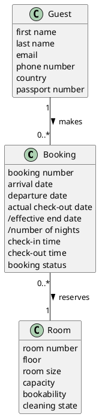

# Domain Model DM-004

## Metadata
| Key | Value |
| --- | --- |
| ID | DM-004 |
| CrossReference | [UC-001], [UC-002], [UC-003], [UCD-001], [DICT-001], [DM-001], [DM-002], [DM-003] |
| Language | en |
| Domain | it |

## Version History
| Date | Status | Author | Reviewer | Change | Commit |
| --- | --- | --- | --- | --- | --- |
| 2026-10-16 | Accepted | Claude (AI) | AI as stand-in for S01 (terminology confirmed by the user) | Initial version | [ec58105] |

---

## Purpose and Scope

The project Domain Model of the hotel back office: bookings, rooms and guests. It consolidates [DM-001], [DM-002] and [DM-003] with the same names. It is conceptual and independent of the code; the differences from `src/NFHotel.Domain` are listed in [RC-036].

## Diagram

Concepts, attributes and associations only — no operations. A slash marks a derived attribute.

## Concept Table

| Concept | Definition | Attributes | Source (use case / glossary) |
| --- | --- | --- | --- |
| Booking | A guest's claim on one room for the nights from an arrival date to a departure date | booking number, arrival date, departure date, actual check-out date, /effective end date, /number of nights, check-in time, check-out time, booking status (pending, confirmed, checked in, checked out, cancelled) | UC-001 steps 1 to 6; glossary: Booking, Booking number, Booking status |
| Room | A lettable room of the hotel that a booking can claim | room number, floor, room size (single, double, suite), capacity, bookability (available, out of service, maintenance), cleaning state (clean, daily cleaning due, departure cleaning due, cleaning in progress, service required, service in progress) | UC-002 steps 1 to 7; glossary: Room, Room number, Bookability, Cleaning state |
| Guest | A person who stays, or will stay, in the hotel and for whom a booking is made | first name, last name, email, phone number, country, passport number (optional) | UC-003 steps 1 to 6; glossary: Guest, Passport number |

## Association Table

| From | Association (reading direction) | To | Multiplicity |
| --- | --- | --- | --- |
| Guest | makes | Booking | Guest 1, Booking 0..* |
| Booking | reserves | Room | Booking 0..*, Room 1 |

## Generalizations

None. No concept is a kind of another concept.

---

[UC-001]: ./use-cases/uc-001/uc.md
[UC-002]: ./use-cases/uc-002/uc.md
[UC-003]: ./use-cases/uc-003/uc.md
[UCD-001]: ./use-case-diagram.md
[DICT-001]: ./dictionary.md
[DM-001]: ./use-cases/uc-001/dm.md
[DM-002]: ./use-cases/uc-002/dm.md
[DM-003]: ./use-cases/uc-003/dm.md
[RC-036]: ./sqa/reviews/rc-036-domain-model.md
[ec58105]: https://github.com/NF-Hotel/NFHotel/commit/ec581054576af2286ced648fbf6c605d6eddb26e
