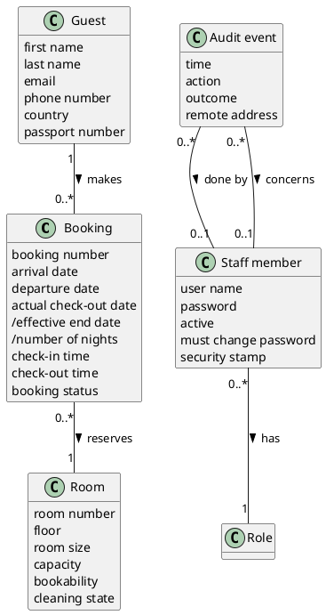

# Domain Model DM-004

## Metadata
| Key | Value |
| --- | --- |
| ID | DM-004 |
| CrossReference | [UC-001], [UC-002], [UC-003], [UCD-001], [DICT-001], [UC-004], [DM-001], [DM-002], [DM-003], [DM-005] |
| Language | en |
| Domain | it |

## Version History
| Date | Status | Author | Reviewer | Change | Commit |
| --- | --- | --- | --- | --- | --- |
| 2026-10-16 | Deprecated | Claude (AI) | AI as stand-in for S01 (terminology confirmed by the user) | Initial version | [ec58105] |
| 2026-10-17 | Deprecated | Claude (AI) | AI as stand-in for S01 (terminology confirmed by the user) | Added the concepts Staff member and Role from DM-005 (MIL-016) | [1593b34] |
| 2026-10-20 | Accepted | mikemike | AI as stand-in for S01 | Added Audit event and two attributes of Staff member (MIL-030) (accepted after RC-135 Go) | [0891cf1] |

---

## Purpose and Scope

The project Domain Model of the hotel back office: bookings, rooms and guests. It consolidates [DM-001], [DM-002], [DM-003] and [DM-005] with the same names. It is conceptual and independent of the code; the differences from `src/NFHotel.Domain` are listed in [RC-036].

## Diagram

Concepts, attributes and associations only — no operations. A slash marks a derived attribute.

## Concept Table

| Concept | Definition | Attributes | Source (use case / glossary) |
| --- | --- | --- | --- |
| Booking | A guest's claim on one room for the nights from an arrival date to a departure date | booking number, arrival date, departure date, actual check-out date, /effective end date, /number of nights, check-in time, check-out time, booking status (pending, confirmed, checked in, checked out, cancelled) | UC-001 steps 1 to 6; glossary: Booking, Booking number, Booking status |
| Room | A lettable room of the hotel that a booking can claim | room number, floor, room size (single, double, suite), capacity, bookability (available, out of service, maintenance), cleaning state (clean, daily cleaning due, departure cleaning due, cleaning in progress, service required, service in progress) | UC-002 steps 1 to 7; glossary: Room, Room number, Bookability, Cleaning state |
| Guest | A person who stays, or will stay, in the hotel and for whom a booking is made | first name, last name, email, phone number, country, passport number (optional) | UC-003 steps 1 to 6; glossary: Guest, Passport number |
| Staff member | A person of the hotel who signs in to the back office with a user name and a password | user name (the same in any case), password (kept only as a salted hash), active, must change password (set for the first Manager and after a reset), security stamp (rises when the password changes or the account is disabled or enabled, so older sessions end) | UC-004 steps 3 and 4; UC-005; UC-006; glossary: Staff member, User name |
| Role | What a staff member does in the hotel, and so which functions the member may use: Receptionist, Manager or Housekeeping | none | UC-004 steps 4 and 6; glossary: Role |
| Audit event | A record that something happened to a staff account or at the sign-in: who did it, to whom, when, what and with what result; never a password | time, action (sign-in, password change, reset, create, disable, enable, lockout), outcome, remote address | UC-006 step 9; UC-005; glossary: Audit event |

## Association Table

| From | Association (reading direction) | To | Multiplicity |
| --- | --- | --- | --- |
| Guest | makes | Booking | Guest 1, Booking 0..* |
| Booking | reserves | Room | Booking 0..*, Room 1 |
| Staff member | has | Role | Staff member 0..*, Role 1 |
| Audit event | is done by | Staff member | Audit event 0..*, Staff member 0..1 (none for an unknown user name) |
| Audit event | concerns | Staff member | Audit event 0..*, Staff member 0..1 |

## Generalizations

None. No concept is a kind of another concept.

---

[UC-001]: ./use-cases/uc-001/uc.md
[UC-002]: ./use-cases/uc-002/uc.md
[UC-003]: ./use-cases/uc-003/uc.md
[UCD-001]: ./use-case-diagram.md
[DICT-001]: ./dictionary.md
[DM-001]: ./use-cases/uc-001/dm.md
[DM-002]: ./use-cases/uc-002/dm.md
[DM-003]: ./use-cases/uc-003/dm.md
[UC-004]: ./use-cases/uc-004/uc.md
[DM-005]: ./use-cases/uc-004/dm.md
[RC-036]: ./sqa/reviews/rc-036-domain-model.md
[ec58105]: https://github.com/NF-Hotel/NFHotel/commit/ec581054576af2286ced648fbf6c605d6eddb26e
[1593b34]: https://github.com/NF-Hotel/NFHotel/commit/1593b34bb7cc020a8564f1030f49e2c395803ad4
[0891cf1]: https://github.com/NF-Hotel/NFHotel/commit/0891cf138311b2c3a9a6e2b20ad92c501ddf80cf
