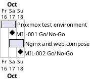

# Project Plan

## Metadata
| Key | Value |
| --- | --- |
| ID | PP-001 |
| CrossReference | [BC-001], [SA-001], [MIL-001], [MIL-002] |
| Language | en |
| Domain | it |

## Version History
| Date | Status | Author | Reviewer | Change | Commit |
| --- | --- | --- | --- | --- | --- |
| 2026-10-16 | Deprecated | Claude (AI) | S04 | Added MIL-002 (accepted by the Product Owner stand-in) (nginx proxy and web service in Docker Compose) to schedule, scope coverage and dependencies | [b690b57] |
| 2026-10-16 | Accepted | Claude (AI) | S04 | Linked the synced GitHub milestones (accepted by the Product Owner stand-in; no content change) | pending |

---

## Purpose

Schedules the single phase that delivers the Proxmox integration test
environment, within the Business Case constraint of one working session by one
person ending 2026-10-17.

## Planning Assumptions

- Week 1 starts 2026-10-16; the plan ends by 2026-10-17, per the Business Case constraint.
- Phase length: two calendar days.
- S04 (Valdamar) stands in for the Product Owner and reviews; in autonomous mode the AI acts as stand-in for S04 and every stand-in review says so.

## Gateway Schedule

| Gateway | Document | Window | Decision date | Owner | Stories | Main deliverable | Milestone |
| --- | --- | --- | --- | --- | --- | --- | --- |
| Proxmox integration test environment | [MIL-001] | 2026-10-16 to 2026-10-17 | 2026-10-17 | S01 | none | Unattended throwaway-container tests against Proxmox VE | [Milestone 1][GH-M1] |
| Nginx proxy and web service in Docker Compose | [MIL-002] | 2026-10-17 to 2026-10-18 | 2026-10-18 | S01 | none | One compose file and one env file per service; web application answering through the proxy | [Milestone 2][GH-M2] |



## Scope Coverage

| Business Case scope item | Gateway |
| --- | --- |
| Credential files `pve.env` and `pve.env.example` | MIL-001 |
| Container image definition and runner script | MIL-001 |
| .NET test project with read-only Proxmox API checks | MIL-001 |
| Documentation of read-only token creation | MIL-001 |
| Compose files and env files per service (reusing the root Dockerfile) | MIL-002 |
| Smoke test through the proxy | MIL-002 |

## Dependencies

```
MIL-001 -> MIL-002
```

A No-Go on MIL-001 moves its decision date; MIL-002 reuses its env-file convention and shifts with it.

## Plan Risks

| Risk | Impact | Mitigation |
| --- | --- | --- |
| Proxmox host and token not yet filled into `pve.env` | The real-server run cannot happen | The run reports the missing settings by name; S01 fills `pve.env` |
| Stand-in reviews are not independent | Weaker assurance | Each record states `Mode: autonomous, not independent`; S04 reviews the summary |

## Open Issues

- The refactor notes in `docs/refactor/` are in Danish and are not framework artifacts; they are referenced, not converted.
- Decision Q-31 (hosting target) and Q-42 (CI platform) stay with the DevOps track.

---

[BC-001]: ./business-case.md
[SA-001]: ./stakeholder-analysis.md
[MIL-001]: ./milestones/mil-001-proxmox-test-env.md
[MIL-002]: ./milestones/mil-002-nginx-proxy-and-web-compose.md
[GH-M1]: https://github.com/NF-Hotel/NFHotel/milestone/1
[GH-M2]: https://github.com/NF-Hotel/NFHotel/milestone/2
[b690b57]: https://github.com/NF-Hotel/NFHotel/commit/b690b576d531e9f26709b6f21275cbc675065d03
