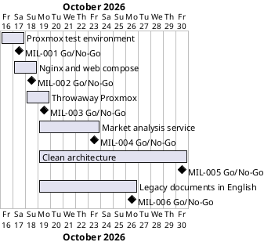

# Project Plan

## Metadata
| Key | Value |
| --- | --- |
| ID | PP-001 |
| CrossReference | [BC-001], [SA-001], [MIL-001], [MIL-002], [MIL-003], [MIL-004], [MIL-005], [MIL-006], [US-001] |
| Language | en |
| Domain | it |

## Version History
| Date | Status | Author | Reviewer | Change | Commit |
| --- | --- | --- | --- | --- | --- |
| 2026-10-16 | Deprecated | Claude (AI) | AI as stand-in for S01 (terminology confirmed by the user) | Added MIL-005 (clean architecture structure) | [78eeb18] |
| 2026-10-16 | Accepted | Claude (AI) | AI as stand-in for S01 (terminology confirmed by the user) | Added MIL-006 (legacy project documents in English); open issue about Danish notes closed | pending |

---

## Purpose

Schedules the single phase that delivers the Proxmox integration test
environment, within the Business Case constraint of one working session by one
person ending 2026-10-17.

## Planning Assumptions

- Week 1 starts 2026-10-16; the plan ends by 2026-10-17, per the Business Case constraint.
- Phase length: two calendar days.
- S04 (Valdamar) stands in for the Product Owner and reviews; in autonomous mode the AI acts as stand-in for S04 and every stand-in review says so.

## Gateway Schedule

| Gateway | Document | Window | Decision date | Owner | Stories | Main deliverable | Milestone |
| --- | --- | --- | --- | --- | --- | --- | --- |
| Proxmox integration test environment | [MIL-001] | 2026-10-16 to 2026-10-17 | 2026-10-17 | S01 | none | Unattended throwaway-container tests against Proxmox VE | [Milestone 1][GH-M1] |
| Nginx proxy and web service in Docker Compose | [MIL-002] | 2026-10-17 to 2026-10-18 | 2026-10-18 | S01 | none | One compose file and one env file per service; web application answering through the proxy | [Milestone 2][GH-M2] |
| Throwaway Proxmox container for tests | [MIL-003] | 2026-10-18 to 2026-10-19 | 2026-10-19 | S01 | none | Proxmox VE container, per-run token in the environment, unattended full cycle | [Milestone 3][GH-M3] |
| Market analysis service on a Proxmox VM behind nginx | [MIL-004] | 2026-10-19 to 2026-10-23 | 2026-10-23 | S02 | US-001.01, US-001.03, US-001.05 | Analysis service on a VM, two services routed through nginx, smoke test | [Milestone 4][GH-M4] |
| Clean architecture structure for NFHotel | [MIL-005] | 2026-10-19 to 2026-10-30 | 2026-10-30 | S01 | none | Entity base type, layer folders, repositories, key columns and DTO folders, tests green | [Milestone 5][GH-M5] |
| Legacy project documents in English | [MIL-006] | 2026-10-19 to 2026-10-26 | 2026-10-26 | S01 | none | The notes, presentation and diagrams of `docs/refactor/` in English with English names | [Milestone 6][GH-M6] |



## Scope Coverage

| Business Case scope item | Gateway |
| --- | --- |
| Credential files `pve.env` and `pve.env.example` | MIL-001 |
| Container image definition and runner script | MIL-001 |
| .NET test project with read-only Proxmox API checks | MIL-001 |
| Documentation of read-only token creation | MIL-001 |
| Compose files and env files per service (reusing the root Dockerfile) | MIL-002 |
| Smoke test through the proxy | MIL-002 |
| Throwaway Proxmox container, per-run token script | MIL-003 |
| Market analysis and benchmark services on Proxmox VMs (objectives 6 and 7) | MIL-004 (analysis, Must); benchmark in a later milestone |
| NFHotel source follows the clean architecture structure (objective 8) | MIL-005 |
| Legacy documents in English (objective 9) | MIL-006 |

## Dependencies

```
MIL-001 -> MIL-002 -> MIL-003 -> MIL-004
MIL-005 (independent of the others)
MIL-006 (independent of the others)
```

A No-Go on MIL-001 moves its decision date; MIL-002 reuses its env-file convention and shifts with it.

## Plan Risks

| Risk | Impact | Mitigation |
| --- | --- | --- |
| KVM not available to Docker | The Proxmox container cannot start | The runner checks `/dev/kvm` first and stops with a message naming the cause |
| The Proxmox host for the services is not decided | MIL-004 tasks 3 to 8 cannot start | Task 2 records the decision in an ADR first |
| The restructuring changes many files at once | Tests fail or behaviour changes | Build and tests after every layer; no behaviour change is allowed in MIL-005 |
| Stand-in reviews are not independent | Weaker assurance | Each record states `Mode: autonomous, not independent`; S04 reviews the summary |

## Open Issues

- The refactor notes in `docs/refactor/` are legacy notes, not framework artifacts; MIL-006 converts them to English but does not turn them into artifact types.
- Decision Q-31 (hosting target) and Q-42 (CI platform) stay with the DevOps track.

---

[BC-001]: ./business-case.md
[SA-001]: ./stakeholder-analysis.md
[MIL-001]: ./milestones/mil-001-proxmox-test-env.md
[MIL-002]: ./milestones/mil-002-nginx-proxy-and-web-compose.md
[MIL-003]: ./milestones/mil-003-throwaway-proxmox.md
[MIL-004]: ./milestones/mil-004-market-analysis-service.md
[MIL-005]: ./milestones/mil-005-clean-architecture.md
[MIL-006]: ./milestones/mil-006-english-legacy-documents.md
[US-001]: ./user-stories.md
[GH-M1]: https://github.com/NF-Hotel/NFHotel/milestone/1
[GH-M2]: https://github.com/NF-Hotel/NFHotel/milestone/2
[GH-M3]: https://github.com/NF-Hotel/NFHotel/milestone/3
[GH-M4]: https://github.com/NF-Hotel/NFHotel/milestone/4
[GH-M5]: https://github.com/NF-Hotel/NFHotel/milestone/5
[GH-M6]: https://github.com/NF-Hotel/NFHotel/milestone/6
[b690b57]: https://github.com/NF-Hotel/NFHotel/commit/b690b576d531e9f26709b6f21275cbc675065d03
[4c5c2d3]: https://github.com/NF-Hotel/NFHotel/commit/4c5c2d3c5a8a8c4de7a2c8ee224719de55b62403
[88a4946]: https://github.com/NF-Hotel/NFHotel/commit/88a49468aa21b75a0a5f9c8fd5a214164e1676ca
[7c6d8f8]: https://github.com/NF-Hotel/NFHotel/commit/7c6d8f85d2177b9fe9f2d11d175df7f0b8f1b5d5
[469ff7a]: https://github.com/NF-Hotel/NFHotel/commit/469ff7a7871bb900155dcaf0639b5db1371681aa
[469c395]: https://github.com/NF-Hotel/NFHotel/commit/469c3959b999487820f8ffa1c24aa4866e61cfe7
[78eeb18]: https://github.com/NF-Hotel/NFHotel/commit/78eeb18cac8d761ebf5267fca5d6b418b04b98c2
