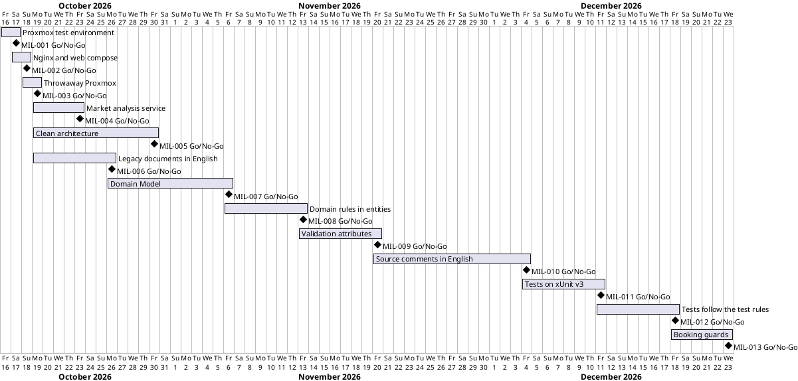

# Project Plan

## Metadata
| Key | Value |
| --- | --- |
| ID | PP-001 |
| CrossReference | [BC-001], [SA-001], [MIL-001], [MIL-002], [MIL-003], [MIL-004], [MIL-005], [MIL-006], [MIL-007], [MIL-008], [MIL-009], [MIL-010], [MIL-011], [MIL-012], [MIL-013], [US-001] |
| Language | en |
| Domain | it |

## Version History
| Date | Status | Author | Reviewer | Change | Commit |
| --- | --- | --- | --- | --- | --- |
| 2026-10-16 | Deprecated | Claude (AI) | AI as stand-in for S01 (terminology confirmed by the user) | Added MIL-009 (validation attributes on the entities) | [4cab5fc] |
| 2026-10-16 | Deprecated | Claude (AI) | AI as stand-in for S01 (terminology confirmed by the user) | Added MIL-010 (source comments in English) | [e67e815] |
| 2026-10-16 | Deprecated | Claude (AI) | AI as stand-in for S01 | Added MIL-011 (tests on xUnit v3) | [ef2bd4b] |
| 2026-10-16 | Deprecated | Claude (AI) | AI as stand-in for S01 | Added MIL-012 (tests follow the test rules) | [8200afa] |
| 2026-10-16 | Accepted | Claude (AI) | AI as stand-in for S01 | Added MIL-013 (booking guards) | [5036584] |

---

## Purpose

Schedules the single phase that delivers the Proxmox integration test
environment, within the Business Case constraint of one working session by one
person ending 2026-10-17.

## Planning Assumptions

- Week 1 starts 2026-10-16; the plan ends by 2026-10-17, per the Business Case constraint.
- Phase length: two calendar days.
- S04 (Valdamar) stands in for the Product Owner and reviews; in autonomous mode the AI acts as stand-in for S04 and every stand-in review says so.

## Gateway Schedule

| Gateway | Document | Window | Decision date | Owner | Stories | Main deliverable | Milestone |
| --- | --- | --- | --- | --- | --- | --- | --- |
| Proxmox integration test environment | [MIL-001] | 2026-10-16 to 2026-10-17 | 2026-10-17 | S01 | none | Unattended throwaway-container tests against Proxmox VE | [Milestone 1][GH-M1] |
| Nginx proxy and web service in Docker Compose | [MIL-002] | 2026-10-17 to 2026-10-18 | 2026-10-18 | S01 | none | One compose file and one env file per service; web application answering through the proxy | [Milestone 2][GH-M2] |
| Throwaway Proxmox container for tests | [MIL-003] | 2026-10-18 to 2026-10-19 | 2026-10-19 | S01 | none | Proxmox VE container, per-run token in the environment, unattended full cycle | [Milestone 3][GH-M3] |
| Market analysis service on a Proxmox VM behind nginx | [MIL-004] | 2026-10-19 to 2026-10-23 | 2026-10-23 | S02 | US-001.01, US-001.03, US-001.05 | Analysis service on a VM, two services routed through nginx, smoke test | [Milestone 4][GH-M4] |
| Clean architecture structure for NFHotel | [MIL-005] | 2026-10-19 to 2026-10-30 | 2026-10-30 | S01 | none | Entity base type, layer folders, repositories, key columns and DTO folders, tests green | [Milestone 5][GH-M5] |
| Legacy project documents in English | [MIL-006] | 2026-10-19 to 2026-10-26 | 2026-10-26 | S01 | none | The notes, presentation and diagrams of `docs/refactor/` in English with English names | [Milestone 6][GH-M6] |
| Domain Model of the hotel back office | [MIL-007] | 2026-10-26 to 2026-11-06 | 2026-11-06 | S01 | none | Domain Dictionary, three brief use cases and a Domain Model that passes QC-DM-001 | [Milestone 7][GH-M7] |
| Domain rules live with the data they guard | [MIL-008] | 2026-11-06 to 2026-11-13 | 2026-11-13 | S01 | none | `NFHotel.Domain/Rules` dissolved into entities, value objects and errors; tests green | [Milestone 8][GH-M8] |
| Validation attributes on the entities | [MIL-009] | 2026-11-13 to 2026-11-20 | 2026-11-20 | S01 | none | Field rules of Room and Guest as attributes; no validation code in the entities | [Milestone 9][GH-M9] |
| Source comments in English | [MIL-010] | 2026-11-20 to 2026-12-04 | 2026-12-04 | S01 | none | Every comment in `src/` and `tests/` in English; only comments changed | [Milestone 10][GH-M10] |
| Tests on xUnit v3 | [MIL-011] | 2026-12-04 to 2026-12-11 | 2026-12-11 | S01 | none | The four test projects reference `xunit.v3`; same test counts; `src/` unchanged | none yet |
| Tests follow the test rules | [MIL-012] | 2026-12-11 to 2026-12-18 | 2026-12-18 | S01 | none | Test plan; unit tests for the services; integration tests for the conflict paths; three-part test names; `src/` unchanged | none yet |
| Booking guards | [MIL-013] | 2026-12-18 to 2026-12-23 | 2026-12-23 | S01 | none | Overview period guard; check-in room guard; check-in flag follows the room; UC-001 updated | none yet |



## Scope Coverage

| Business Case scope item | Gateway |
| --- | --- |
| Credential files `pve.env` and `pve.env.example` | MIL-001 |
| Container image definition and runner script | MIL-001 |
| .NET test project with read-only Proxmox API checks | MIL-001 |
| Documentation of read-only token creation | MIL-001 |
| Compose files and env files per service (reusing the root Dockerfile) | MIL-002 |
| Smoke test through the proxy | MIL-002 |
| Throwaway Proxmox container, per-run token script | MIL-003 |
| Market analysis and benchmark services on Proxmox VMs (objectives 6 and 7) | MIL-004 (analysis, Must); benchmark in a later milestone |
| NFHotel source follows the clean architecture structure (objective 8) | MIL-005 |
| Legacy documents in English (objective 9) | MIL-006 |
| Domain Model of the back office (objective 10) | MIL-007 |
| Domain folders follow the skill (objective 11) | MIL-008 |
| Validation attributes on the entities (objective 12) | MIL-009 |
| Source comments in English (objective 13) | MIL-010 |
| Tests on xUnit v3 (objective 14) | MIL-011 |
| Tests follow the test rules (objective 15) | MIL-012 |
| Booking guards (objective 16) | MIL-013 |

## Dependencies

```
MIL-001 -> MIL-002 -> MIL-003 -> MIL-004
MIL-005 (independent of the others)
MIL-006 (independent of the others)
MIL-006 -> MIL-007
MIL-005 -> MIL-008
MIL-008 -> MIL-009
MIL-009 -> MIL-010
MIL-010 -> MIL-011
MIL-011 -> MIL-012
MIL-012 -> MIL-013
```

A No-Go on MIL-001 moves its decision date; MIL-002 reuses its env-file convention and shifts with it.

## Plan Risks

| Risk | Impact | Mitigation |
| --- | --- | --- |
| KVM not available to Docker | The Proxmox container cannot start | The runner checks `/dev/kvm` first and stops with a message naming the cause |
| The Proxmox host for the services is not decided | MIL-004 tasks 3 to 8 cannot start | Task 2 records the decision in an ADR first |
| The restructuring changes many files at once | Tests fail or behaviour changes | Build and tests after every layer; no behaviour change is allowed in MIL-005 |
| Stand-in reviews are not independent | Weaker assurance | Each record states `Mode: autonomous, not independent`; S04 reviews the summary |

## Open Issues

- The refactor notes in `docs/refactor/` are legacy notes, not framework artifacts; MIL-006 converts them to English but does not turn them into artifact types.
- The legacy diagram `docs/refactor/diagrams/Domain-Model.png` is not a framework Domain Model; MIL-007 replaces it with `docs/domain-model.md`.
- Decision Q-31 (hosting target) and Q-42 (CI platform) stay with the DevOps track.

---

[BC-001]: ./business-case.md
[SA-001]: ./stakeholder-analysis.md
[MIL-001]: ./milestones/mil-001-proxmox-test-env.md
[MIL-002]: ./milestones/mil-002-nginx-proxy-and-web-compose.md
[MIL-003]: ./milestones/mil-003-throwaway-proxmox.md
[MIL-004]: ./milestones/mil-004-market-analysis-service.md
[MIL-005]: ./milestones/mil-005-clean-architecture.md
[MIL-006]: ./milestones/mil-006-english-legacy-documents.md
[MIL-007]: ./milestones/mil-007-domain-model.md
[MIL-008]: ./milestones/mil-008-domain-rules-in-entities.md
[MIL-009]: ./milestones/mil-009-validation-attributes.md
[MIL-010]: ./milestones/mil-010-english-source-comments.md
[MIL-011]: ./milestones/mil-011-xunit-v3.md
[MIL-012]: ./milestones/mil-012-test-kinds.md
[MIL-013]: ./milestones/mil-013-booking-guards.md
[US-001]: ./user-stories.md
[GH-M1]: https://github.com/NF-Hotel/NFHotel/milestone/1
[GH-M2]: https://github.com/NF-Hotel/NFHotel/milestone/2
[GH-M3]: https://github.com/NF-Hotel/NFHotel/milestone/3
[GH-M4]: https://github.com/NF-Hotel/NFHotel/milestone/4
[GH-M5]: https://github.com/NF-Hotel/NFHotel/milestone/5
[GH-M6]: https://github.com/NF-Hotel/NFHotel/milestone/6
[GH-M7]: https://github.com/NF-Hotel/NFHotel/milestone/7
[GH-M8]: https://github.com/NF-Hotel/NFHotel/milestone/8
[GH-M9]: https://github.com/NF-Hotel/NFHotel/milestone/9
[GH-M10]: https://github.com/NF-Hotel/NFHotel/milestone/10
[b690b57]: https://github.com/NF-Hotel/NFHotel/commit/b690b576d531e9f26709b6f21275cbc675065d03
[4c5c2d3]: https://github.com/NF-Hotel/NFHotel/commit/4c5c2d3c5a8a8c4de7a2c8ee224719de55b62403
[88a4946]: https://github.com/NF-Hotel/NFHotel/commit/88a49468aa21b75a0a5f9c8fd5a214164e1676ca
[7c6d8f8]: https://github.com/NF-Hotel/NFHotel/commit/7c6d8f85d2177b9fe9f2d11d175df7f0b8f1b5d5
[469ff7a]: https://github.com/NF-Hotel/NFHotel/commit/469ff7a7871bb900155dcaf0639b5db1371681aa
[469c395]: https://github.com/NF-Hotel/NFHotel/commit/469c3959b999487820f8ffa1c24aa4866e61cfe7
[78eeb18]: https://github.com/NF-Hotel/NFHotel/commit/78eeb18cac8d761ebf5267fca5d6b418b04b98c2
[180a268]: https://github.com/NF-Hotel/NFHotel/commit/180a2683d3138fe0fce82cbbe34d817511e0097a
[e19063e]: https://github.com/NF-Hotel/NFHotel/commit/e19063e96ba5d221fffa80ad028432134ecdb111
[48701b5]: https://github.com/NF-Hotel/NFHotel/commit/48701b550cecaf94616bbae64d74a5c872f72d80
[4cab5fc]: https://github.com/NF-Hotel/NFHotel/commit/4cab5fc64b8358e18f9fec630d27d8bc267e6787
[e67e815]: https://github.com/NF-Hotel/NFHotel/commit/e67e8155fd63d307e6783924f956fa49f915edbd
[ef2bd4b]: https://github.com/NF-Hotel/NFHotel/commit/ef2bd4bda1edbd598228cb0fc043a4f2fc996974
[8200afa]: https://github.com/NF-Hotel/NFHotel/commit/8200afa457e37ca87a68ab7e34126db1dd85e3d1
[5036584]: https://github.com/NF-Hotel/NFHotel/commit/5036584e9809a90d8459f07554733917c7129a0e
