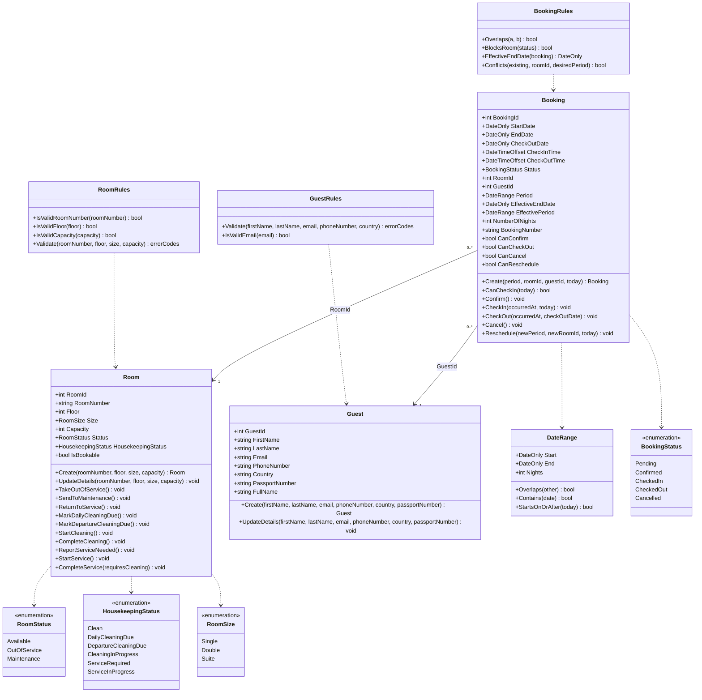
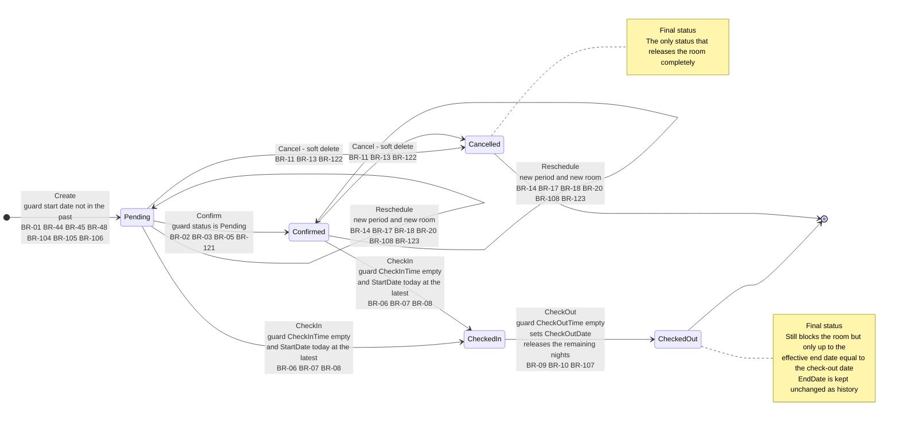
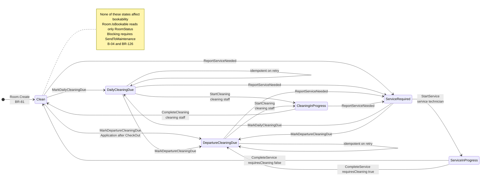
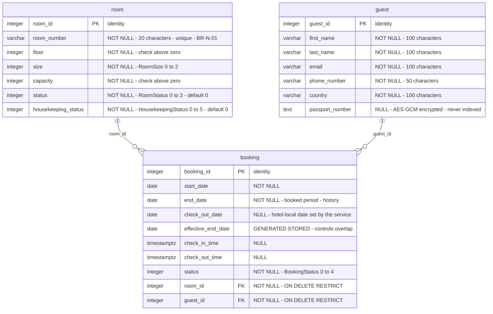
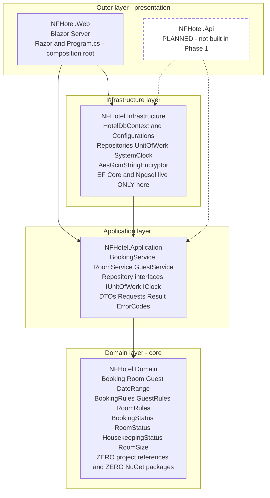

# Architecture-Diagrams.md — Phase 1

> **Legacy note.** This is not the framework Domain Model. The project Domain Model is [docs/domain-model.md](../domain-model.md), checked against QC-DM-001 (RC-036). This document is kept as the history of the analysis.

> Appendix to `Architecture.md`. Drawn by `design:diagrams` from the domain and layer designs.
> The diagrams follow the **revised** overlap rule (A-01) and the rulings A-06 and A-07.
>
> **Applicable overlap rule:** a booking blocks the room from `StartDate` to its effective end date, unless it is `Cancelled`.
> `EffectiveEndDate = GREATEST(StartDate + 1 day, COALESCE(CheckOutDate, EndDate))`. `EndDate` is never changed.

---

## 1. Domain model

Three aggregate roots with no navigable connection beyond the foreign keys. `DateRange` is not persisted — it is a place for rules and a parameter type. `CheckInTime`, `CheckOutTime`, `CheckOutDate` and `PassportNumber` are nullable; mermaid does not render `?`. The validation methods return error codes, not text (A-09).

---

## 2. State diagram — BookingStatus

`Confirmed` is not a precondition for check-in (B-01) — hence two `CheckIn` edges. `Reschedule` is a self-transition. The revised rule affects only `CheckOut`: the transition does not change *whether* the booking blocks, but moves the effective end date down to the check-out date.

---

## 3. State diagram — HousekeepingStatus

Three tracks: daily cleaning, final cleaning after departure, and service — the first two share `CleaningInProgress`. `MarkDepartureCleaningDue` is triggered by Application after `Booking.CheckOut`, not by `Booking` itself (two aggregates).

**The roles are documentation, not enforcement in Phase 1 (A-12).** Authorisation is postponed; anyone can in practice call any transition until Identity is built. No inspection step — added as `Inspected` when the mobile guild asks for it.

---

## 4. ER diagram

All three tables also carry the system column `xmin` as the optimistic concurrency token. The exclusion constraint, check constraints and indexes are in `Architecture.md` section 5.

---

## 5. Layer and package diagram

The proof is in the edge list: four built edges, each from an outer layer toward the core. `Domain` has **out-degree zero**. `Application` has exactly one outgoing edge. `Infrastructure` points to `Application`, never the reverse — that is why the repository *interfaces* live in Application and the *implementations* in Infrastructure.

The rule that cannot be drawn — that `Application` must not reference EF Core or Npgsql — is enforced by the architecture test.

---

## 6. Use case diagram

```mermaid
flowchart LR
    Staff(["Staff<br/>the only actor in Phase 1"])
    Customer(["Customer - POSTPONED"])
    Mobile(["Cleaning and service via mobile - POSTPONED"])

    subgraph UCB [IBookingService - 9]
        B1["GetByIdAsync"]
        B2["GetOverviewAsync<br/>BR-23 BR-24 BR-25 BR-32"]
        B3["GetAvailableRoomsAsync<br/>BR-34 BR-36 BR-39 BR-40 BR-110"]
        B4["CreateAsync<br/>BR-01 BR-41 to BR-49"]
        B5["ConfirmAsync<br/>BR-02 BR-03 BR-05"]
        B6["CheckInAsync<br/>BR-06 BR-07 BR-08"]
        B7["CheckOutAsync<br/>BR-09 BR-10 - sets CheckOutDate"]
        B8["CancelAsync<br/>BR-11 BR-13"]
        B9["RescheduleAsync<br/>BR-14 BR-17 to BR-20"]
    end

    subgraph UCR [IRoomService - 15]
        R1["GetByIdAsync"]
        R2["GetAllAsync"]
        R3["SearchAsync<br/>BR-74 BR-76"]
        R4["GetFilterOptionsAsync<br/>BR-75"]
        R5["CreateAsync<br/>BR-97 to BR-100 BR-113"]
        R6["UpdateAsync<br/>BR-82 - without status"]
        R7["DeleteAsync<br/>BR-78 BR-112"]
        R8["TakeOutOfServiceAsync"]
        R9["SendToMaintenanceAsync"]
        R10["ReturnToServiceAsync"]
        R11["MarkDailyCleaningDueAsync"]
        R12["MarkDepartureCleaningDueAsync"]
        R13["StartCleaningAsync"]
        R14["CompleteCleaningAsync"]
        R15["ReportServiceNeededAsync<br/>StartServiceAsync CompleteServiceAsync"]
    end

    subgraph UCG [IGuestService - 6]
        G1["GetByIdAsync<br/>BR-35"]
        G2["SearchAsync<br/>BR-68 BR-69 BR-70"]
        G3["CreateAsync<br/>BR-52 to BR-57 BR-91 to BR-96"]
        G4["UpdateAsync<br/>BR-62 BR-66 BR-72"]
        G5["DeleteAsync<br/>BR-N-02 requires approval"]
        G6["ValidateFields<br/>BR-58 BR-59 - synchronous"]
    end

    subgraph UCX [Postponed - drawn but not built]
        X1["Self-service booking and payment<br/>no price in the domain"]
        X2["ISalesService<br/>OMITTED - BR-31 always gives zero"]
        X3["Mobile API for cleaning and service<br/>the surface is R11 to R15"]
    end

    Staff --> UCB
    Staff --> UCR
    Staff --> UCG
    Customer -.-> X1
    Staff -.-> X2
    Mobile -.-> X3
    X3 -.-> UCR

    classDef deferred stroke-dasharray: 6 4,fill:#ffffff;
    class Customer,Mobile,X1,X2,X3,UCX deferred;
```

One use case = one service method: **30 built use cases**. `IRoomService` grew from 9 to 15, because the cleaning transitions each got their own method instead of one generic target status (A-07).

The seven cleaning methods are now built as back-office functions. They are at the same time exactly the surface the mobile app will later call — hence the dashed arrow from `X3`.
