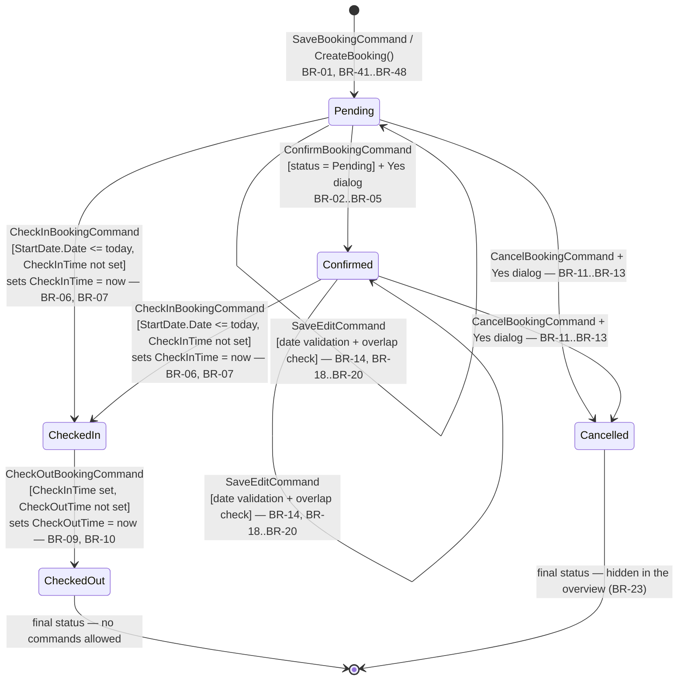

# Business Rules Ledger — NFHotel

> Phase 0, generated 2026-09-02. Source: `4. Semester\NFHotel-Hotel-main\`.
> **126 rules.** The column "Status in new code" is filled in during Phase 3 by `verify:ledger-audit`.
> The column "Evidence" points to the test in the old project that proves the rule (T-ids, see `Analysis.md` section 5).
>
> Groups: BR-01–BR-90 from ViewModels · BR-91–BR-109 model validation · BR-110–BR-116 repo layer · BR-117–BR-126 views/converters.

| Id | Rule | Source (file:line) | Type | Evidence | Status in new code |
|---|---|---|---|---|---|
| BR-01 | A booking is always created with status `Pending` — there is no other initial status. | `ViewModels/NewBookingViewModel.cs:319` | state transition | | |
| BR-02 | The booking can only be confirmed (`Pending → Confirmed`) when a booking is selected and its status is exactly `Pending`; otherwise `ConfirmBookingCommand` is disabled. | `ViewModels/BookingOverviewViewModel.cs:473-479` | state transition | T-20, T-27 | |
| BR-03 | On confirmation BR-02 is rechecked in the action itself and rejected with "Cannot confirm this booking - only Pending bookings can be confirmed". | `ViewModels/BookingOverviewViewModel.cs:488-497` | state transition | | |
| BR-04 | Confirmation requires explicit user confirmation (Yes/No dialog); anything other than "Yes" aborts without change. | `ViewModels/BookingOverviewViewModel.cs:499-511` | access | | |
| BR-05 | Confirmation sets `Status = Confirmed`, persists via the repository and reloads all data. | `ViewModels/BookingOverviewViewModel.cs:522-525` | state transition | | |
| BR-06 | Check-in is only allowed when the status is `Pending` OR `Confirmed`, AND `StartDate.Date <= today`, AND `CheckInTime` is not already set. | `ViewModels/BookingOverviewViewModel.cs:552-562` | state transition | T-21, T-22, T-23 | |
| BR-07 | Check-in sets `CheckInTime = DateTime.Now` (current time of day) and `Status = CheckedIn`, and persists. | `ViewModels/BookingOverviewViewModel.cs:584-588` | state transition | | |
| BR-08 | The check-in rule is rechecked in the action and rejected with "Cannot check in this booking"; check-in requires no confirmation dialog. | `ViewModels/BookingOverviewViewModel.cs:570-579` | state transition | | |
| BR-09 | Check-out is only allowed when the status is exactly `CheckedIn`, AND `CheckInTime` has a value, AND `CheckOutTime` does not yet have a value. | `ViewModels/BookingOverviewViewModel.cs:601-609` | state transition | T-24 | |
| BR-10 | Check-out sets `CheckOutTime = DateTime.Now` and `Status = CheckedOut`, and persists; no confirmation dialog. | `ViewModels/BookingOverviewViewModel.cs:617-635` | state transition | | |
| BR-11 | Cancellation is only allowed when the status is `Pending` OR `Confirmed` — a `CheckedIn`/`CheckedOut` booking cannot be cancelled. | `ViewModels/BookingOverviewViewModel.cs:648-655` | state transition | T-25 | |
| BR-12 | Cancellation requires an explicit "Yes" in the dialog "Cancel Booking Permanently From System?"; otherwise nothing happens. | `ViewModels/BookingOverviewViewModel.cs:674-682` | access | | |
| BR-13 | Cancellation is a soft delete: `Status = Cancelled` is saved, the row is never physically deleted. | `ViewModels/BookingOverviewViewModel.cs:687-690` | state transition | | |
| BR-14 | Editing a booking is only allowed when the status is `Pending` OR `Confirmed`. | `ViewModels/BookingOverviewViewModel.cs:715-722` | access | T-26 | |
| BR-15 | On entering edit mode the edit fields are prefilled with the booking's current room (`AllRooms` matched on `RoomId == SelectedBooking.RoomID`), `StartDate` and `EndDate`, and `IsEditMode` is set to true. | `ViewModels/BookingOverviewViewModel.cs:725-735` | calculation | | |
| BR-16 | `SaveEdit` and `CancelEdit` can only be executed when `IsEditMode` is true. | `ViewModels/BookingOverviewViewModel.cs:261-269` | access | | |
| BR-17 | On saving an edit the status requirement (BR-14) is rechecked and rejected with "Cannot edit this booking - only Pending or Confirmed bookings can be edited". | `ViewModels/BookingOverviewViewModel.cs:743-752` | state transition | | |
| BR-18 | On saving an edit `Booking.ValidateEdit(newStart, newEnd)` is run; any error is shown together (line-separated) and blocks saving. | `ViewModels/BookingOverviewViewModel.cs:755-765` | validation | T-08 | |
| BR-19 | On saving an edit the change is rejected if another booking (`BookingID != current`) exists on the same room whose status is neither `Cancelled` nor `CheckedOut`, and where `otherStart < newCheckOut` AND `otherEnd > newCheckIn` (half-open overlap test) — "Room is not available for selected dates". | `ViewModels/BookingOverviewViewModel.cs:768-786` | validation | | |
| BR-20 | If all checks pass, `StartDate`, `EndDate` and `RoomID` are updated, the booking is persisted, `IsEditMode` is set to false and data is reloaded. | `ViewModels/BookingOverviewViewModel.cs:791-798` | calculation | | |
| BR-21 | `CancelEdit` leaves edit mode without saving — the entered edit values are discarded. | `ViewModels/BookingOverviewViewModel.cs:819-822` | state transition | | |
| BR-22 | When a booking is selected, the permissibility of Confirm, CheckIn, CheckOut, Cancel and Edit is recalculated. | `ViewModels/BookingOverviewViewModel.cs:56-65` | access | | |
| BR-23 | Cancelled bookings are never shown in the overview, regardless of display period. | `ViewModels/BookingOverviewViewModel.cs:394-402` | calculation | T-28 | |
| BR-24 | In year view only bookings that overlap 1 January–31 December of the displayed year are shown (`StartDate <= 31/12` AND `EndDate >= 1/1`). | `ViewModels/BookingOverviewViewModel.cs:389-398` | calculation | | |
| BR-25 | A booking matches a search text if it is contained (case-insensitively) in "First name Last name", country, e-mail or room number; bookings without a guest or room never match. | `ViewModels/BookingOverviewViewModel.cs:370-378` | calculation | T-29 | |
| BR-26 | As soon as the search field contains anything other than whitespace, the display period automatically switches to "Year". | `ViewModels/BookingOverviewViewModel.cs:75-78` | calculation | | |
| BR-27 | The view's start date is the start of the week (`CurrentMonth` minus days since the first day of the week) in week view, otherwise the 1st of the displayed month. | `ViewModels/BookingOverviewViewModel.cs:38-51` | calculation | | |
| BR-28 | Forward/back navigation moves ±7 days in week view, ±1 year in year view and ±1 month otherwise. | `ViewModels/BookingOverviewViewModel.cs:322-337` | calculation | | |
| BR-29 | The number of columns in the calendar is 7 (week), the actual number of days in the month (month) or 12 (year). | `ViewModels/BookingOverviewViewModel.cs:339-368` | calculation | | |
| BR-30 | The period heading is shown as "Week {week number}, {year}" (week number by the current culture's week rule), "{year}" or "MMMM yyyy". | `ViewModels/BookingOverviewViewModel.cs:112-134` | calculation | | |
| BR-31 | The month's revenue is always set to 0 — there is no actual revenue calculation. | `ViewModels/BookingOverviewViewModel.cs:415-418` | calculation | | |
| BR-32 | Sorting: clicking the same column again reverses the direction, clicking a new column sorts ascending; an empty column name does nothing. | `ViewModels/BookingOverviewViewModel.cs:430-454` | calculation | | |
| BR-33 | After the "New booking" dialog is closed, the whole booking overview is reloaded. | `ViewModels/BookingOverviewViewModel.cs:423-428` | calculation | | |
| BR-34 | The room list in new booking contains only rooms that the repository considers available (`GetAllByAvailability`). | `ViewModels/NewBookingViewModel.cs:158-167` | calculation | T-37 | |
| BR-35 | If a guest is preselected, the form is prefilled with the guest's GuestID, name, e-mail, phone, country and passport number. | `ViewModels/NewBookingViewModel.cs:169-173, 240-249` | calculation | T-30 | |
| BR-36 | If either the check-in or the check-out date changes, the available room list is recalculated immediately. | `ViewModels/NewBookingViewModel.cs:42-62` | calculation | | |
| BR-37 | If one of the two dates is missing, the whole list of available rooms is shown and the error message is cleared. | `ViewModels/NewBookingViewModel.cs:183-188` | validation | | |
| BR-38 | If the check-out date is ≤ the check-in date, the room list is emptied and "Check-out date must be after check-in date" is shown (0 nights is not allowed). | `ViewModels/NewBookingViewModel.cs:191-196` | validation | T-31 | |
| BR-39 | A room is occupied in the period if a non-cancelled booking exists with `StartDate < desiredCheckOut` AND `EndDate > desiredCheckIn`; such rooms are removed from the list (departure and arrival on the same day is allowed). | `ViewModels/NewBookingViewModel.cs:204-217` | validation | | |
| BR-40 | If there are zero free rooms in the period, "No rooms available for the selected period. Please try different dates." is shown; otherwise the error message is cleared. | `ViewModels/NewBookingViewModel.cs:227-234` | validation | | |
| BR-41 | Creating a booking requires the check-in date to be filled in ("Check-in date is required"). | `ViewModels/NewBookingViewModel.cs:261-264` | validation | T-01 | |
| BR-42 | Creating a booking requires the check-out date to be filled in ("Check-out date is required"). | `ViewModels/NewBookingViewModel.cs:266-269` | validation | T-02 | |
| BR-43 | Creating a booking requires check-out > check-in (at least 1 night). | `ViewModels/NewBookingViewModel.cs:271-274` | validation | T-03 | |
| BR-44 | The check-in date must not be before today's date (date part compared, same day allowed) — "Check-in date cannot be in the past". | `ViewModels/NewBookingViewModel.cs:276-279` | validation | T-04 | |
| BR-45 | A room must be selected — "Please select a room". | `ViewModels/NewBookingViewModel.cs:282-285` | validation | T-05 | |
| BR-46 | The guest details are validated via `Guest.Validate()`; only the FIRST error is shown to the user and the creation is aborted. | `ViewModels/NewBookingViewModel.cs:288-304` | validation | | |
| BR-47 | A guest with `GuestID == 0` is considered new and is created in the database before the booking, after which the assigned id is used; an existing guest is reused unchanged. | `ViewModels/NewBookingViewModel.cs:306-312` | calculation | | |
| BR-48 | The booking is saved with the selected dates, the selected room's `RoomId`, the guest's id and status `Pending`. | `ViewModels/NewBookingViewModel.cs:314-328` | state transition | | |
| BR-49 | On success the booking number, the guest's name and the number of nights (`Booking.NumberOfNights`) are shown in the receipt text. | `ViewModels/NewBookingViewModel.cs:331` | calculation | T-09, T-10 | Changed by MIL-085: the receipt shows the booking reference in place of the number, and no page shows a booking number (ADR-0049) |
| BR-50 | The booking window closes automatically 2000 ms after a successful creation. | `ViewModels/NewBookingViewModel.cs:334-340` | calculation | | |
| BR-51 | Any `ArgumentException` from the validation is shown as error text; other errors as "An unexpected error occurred: …" — no booking is created in either case. | `ViewModels/NewBookingViewModel.cs:342-349` | validation | | |
| BR-52 | The guest's first name is required ("First name is required."). | `ViewModels/NewGuestViewModel.cs:177-180` | validation | T-11, T-12 | Extended by MIL-086 (ADR-0050): see "Validation rules of the booking flow"; a name has 1 to 100 characters: letters with their marks, spaces, apostrophes, hyphens and full stops, and at least one letter |
| BR-53 | The guest's last name is required ("Last name is required."). | `ViewModels/NewGuestViewModel.cs:181-184` | validation | T-11 | Extended by MIL-086 (ADR-0050): see "Validation rules of the booking flow"; a name has 1 to 100 characters: letters with their marks, spaces, apostrophes, hyphens and full stops, and at least one letter |
| BR-54 | The guest's phone number is required ("Phone number is required.") — no format requirement. | `ViewModels/NewGuestViewModel.cs:185-188` | validation | T-11 | Changed by MIL-086 (ADR-0050): see "Validation rules of the booking flow"; a phone number has 7 to 15 digits |
| BR-55 | The guest's e-mail is required and must contain both "@" and "." ("A valid email is required.") — no regex. | `ViewModels/NewGuestViewModel.cs:189-193` | validation | T-13 | Changed by MIL-086 (ADR-0050): see "Validation rules of the booking flow"; the email is read by `MailAddress` and must be one plain address |
| BR-56 | The guest's country is required ("Country is required."). | `ViewModels/NewGuestViewModel.cs:194-197` | validation | T-11 | Extended by MIL-086 (ADR-0050): see "Validation rules of the booking flow"; the country is one of the names of the list `Countries` |
| BR-57 | The passport number is not validated and is thus optional. | `ViewModels/NewGuestViewModel.cs:69-77` | validation | T-14 | Changed by MIL-086 (ADR-0050): see "Validation rules of the booking flow"; optional, 1 to 20 ASCII letters and digits |
| BR-58 | The Save button is only active when all five error messages (first name, last name, phone, e-mail, country) are empty. | `ViewModels/NewGuestViewModel.cs:155, 199-207` | access | | |
| BR-59 | All fields are revalidated on every change and when the form is opened (null is normalised to an empty string). | `ViewModels/NewGuestViewModel.cs:20-67, 157-158, 168-175` | validation | | |
| BR-60 | On save the guest is validated again with `Guest.Validate()`; ALL errors are shown together and saving is aborted. | `ViewModels/NewGuestViewModel.cs:209-220` | validation | T-15 | |
| BR-61 | Saving requires an explicit "Yes" on "Are you sure you want to save the changes?"; a missing dialog handler is interpreted as "No". | `ViewModels/NewGuestViewModel.cs:222-224` | access | | |
| BR-62 | In edit mode the guest's original `GuestID` is kept and `UpdateGuest` is called; otherwise a new guest is created and the assigned id is set on the object. | `ViewModels/NewGuestViewModel.cs:211-213, 226-229` | calculation | | |
| BR-63 | The form's title/button text is "Edit Guest"/"Save" in edit mode and "New Guest"/"Create" on creation. | `ViewModels/NewGuestViewModel.cs:141-142` | calculation | | |
| BR-64 | Cancel closes the form without saving. | `ViewModels/NewGuestViewModel.cs:236-239` | state transition | | |
| BR-65 | Edit guest and "create booking for guest" are only possible when a guest is selected. | `ViewModels/GuestOverviewViewModel.cs:106-108` | access | | |
| BR-66 | Editing always happens on a COPY of the guest (first name, last name, e-mail, phone, country, passport number) — the original is not changed directly. | `ViewModels/GuestOverviewViewModel.cs:166-183` | access | | |
| BR-67 | An attempt to edit without a selected guest shows "You must select a guest to edit." and aborts. | `ViewModels/GuestOverviewViewModel.cs:168-172` | access | | |
| BR-68 | Guest search: the search text is split into words on spaces, and ALL words must be found (case-insensitively) in either full name, country or e-mail (AND logic). | `ViewModels/GuestOverviewViewModel.cs:146-157` | calculation | T-40 | |
| BR-69 | The guest list is always sorted alphabetically by "first name last name" in lower case. | `ViewModels/GuestOverviewViewModel.cs:129-143, 220-227` | calculation | | |
| BR-70 | An empty or whitespace search shows all guests. | `ViewModels/GuestOverviewViewModel.cs:131-135` | calculation | | |
| BR-71 | "Clear guest" replaces the selected guest with an empty `Guest` object and turns off both edit mode and new-guest mode. | `ViewModels/GuestOverviewViewModel.cs:186-191` | state transition | | |
| BR-72 | Updating the selected guest overwrites exactly six fields — `GuestID` is never changed. | `ViewModels/GuestOverviewViewModel.cs:208-218` | calculation | | |
| BR-73 | The booking-for-guest event is only raised when a guest is actually selected (double check beyond BR-65). | `ViewModels/GuestOverviewViewModel.cs:193-199` | access | | |
| BR-74 | The room filter combines floor, room size and status; an empty/whitespace room size is interpreted as "no filter" (null). | `ViewModels/RoomOverviewViewModel.cs:146-159` | calculation | T-38, T-39 | |
| BR-75 | The filter options are derived from the existing rooms as distinct, sorted values for floor, room size and status. | `ViewModels/RoomOverviewViewModel.cs:128-144` | calculation | | |
| BR-76 | "Clear filter" resets floor, room size and status to null and reloads all rooms. | `ViewModels/RoomOverviewViewModel.cs:161-168` | calculation | | |
| BR-77 | Deleting a room requires an explicit "Yes" on the warning "…This can disrupt logged bookings". | `ViewModels/RoomOverviewViewModel.cs:196-203` | access | | |
| BR-78 | If the repository throws `InvalidOperationException` on deletion (e.g. a room with bookings), the room remains in the list and the error text is shown as "Unable to delete room". | `ViewModels/RoomOverviewViewModel.cs:205-214` | validation | | |
| BR-79 | Edit room does nothing if no room was passed (null parameter). | `ViewModels/RoomOverviewViewModel.cs:181-183, 196-198` | access | | |
| BR-80 | After a room is saved, both the room list and the filter options are reloaded, and the side panel is closed. | `ViewModels/RoomOverviewViewModel.cs:217-228` | calculation | | |
| BR-81 | A newly created room gets the status `Available` as a starting point. | `ViewModels/FormsViewModel/RoomFormViewModel.cs:35-43` | state transition | T-19 | |
| BR-82 | A room with `RoomId == 0` is created; all others are updated. | `ViewModels/FormsViewModel/RoomFormViewModel.cs:59-66` | calculation | | |
| BR-83 | The room form's title/button text is "Create Room"/"Create" on creation and "Edit Room"/"Save" on editing. | `ViewModels/FormsViewModel/RoomFormViewModel.cs:35-49` | calculation | | |
| BR-84 | `Room.Validate()` is called on save, but the result is ignored — invalid rooms are saved anyway (only caught by BR-113 in the repo layer). | `ViewModels/FormsViewModel/RoomFormViewModel.cs:58` | validation | | |
| BR-85 | The application always starts on the booking overview. | `ViewModels/MainViewModel.cs:47` | access | | |
| BR-86 | Navigation between the booking, guest, room, sales and guest policy views is always allowed, and each view holds one lifetime instance. | `ViewModels/MainViewModel.cs:42-72` | access | | |
| BR-87 | A command without an explicit `canExecute` is always allowed. | `Commands/RelayCommand.cs:28-31` | access | | |
| BR-88 | `DateGreaterThan` validation fails when the validated date is ≤ the comparison date, with "{field} must be after {comparison field}". | `Validation/DateGreaterThanAttribute.cs:34-43` | validation | | |
| BR-89 | If `DateGreaterThan` points at a non-existent field, the validation fails with "Unknown property: {name}". | `Validation/DateGreaterThanAttribute.cs:23-28` | validation | | |
| BR-90 | If either the value or the comparison value is not a `DateTime` (e.g. null), the validation is considered passed. | `Validation/DateGreaterThanAttribute.cs:34-46` | validation | | |
| BR-91 | `Guest.FirstName` must not be null, empty or only whitespace. | `Models/Guest.cs:49-50` | validation | T-11, T-12 | Extended by MIL-086 (ADR-0050): see "Validation rules of the booking flow"; a name has 1 to 100 characters: letters with their marks, spaces, apostrophes, hyphens and full stops, and at least one letter |
| BR-92 | `Guest.LastName` must not be null, empty or only whitespace. | `Models/Guest.cs:51-52` | validation | T-11 | Extended by MIL-086 (ADR-0050): see "Validation rules of the booking flow"; a name has 1 to 100 characters: letters with their marks, spaces, apostrophes, hyphens and full stops, and at least one letter |
| BR-93 | `Guest.Email` must be filled in and contain both `@` and `.` (the position is not checked). | `Models/Guest.cs:53-54` | validation | T-13 | Changed by MIL-086 (ADR-0050): see "Validation rules of the booking flow"; the email is read by `MailAddress` and must be one plain address |
| BR-94 | `Guest.PhoneNumber` must not be empty (no format requirement). | `Models/Guest.cs:55-56` | validation | T-11 | Changed by MIL-086 (ADR-0050): see "Validation rules of the booking flow"; a phone number has 7 to 15 digits |
| BR-95 | `Guest.Country` must not be empty. | `Models/Guest.cs:57-58` | validation | T-11 | Extended by MIL-086 (ADR-0050): see "Validation rules of the booking flow"; the country is one of the names of the list `Countries` |
| BR-96 | `Guest.Validate()` collects all errors in one list instead of failing on the first. | `Models/Guest.cs:39-58` | validation | T-15 | |
| BR-97 | `Room.RoomNumber` must not be empty or whitespace. | `Models/Room.cs:40-41` | validation | T-16 | |
| BR-98 | `Room.Floor` must be > 0 (ground floor and basement are thus not allowed). | `Models/Room.cs:43-44` | validation | T-17 | |
| BR-99 | `Room.RoomSize` must not be empty — but it is not checked against a set of allowed values. | `Models/Room.cs:46-47` | validation | T-16 | |
| BR-100 | `Room.Capacity` must be > 0. | `Models/Room.cs:49-50` | validation | T-18 | |
| BR-101 | `Booking.StartDate` must not be `default(DateTime)`. | `Models/Booking.cs:47-48` | validation | T-01 | |
| BR-102 | `Booking.EndDate` must not be `default(DateTime)`. | `Models/Booking.cs:50-51` | validation | T-02 | |
| BR-103 | When both dates are set, `EndDate` must be strictly greater than `StartDate`. | `Models/Booking.cs:53-54` | validation | T-03 | |
| BR-104 | `Booking.StartDate.Date` must not be before `DateTime.Now.Date`. | `Models/Booking.cs:56-57` | validation | T-04 | |
| BR-105 | A booking must have a room: error only if both `Room` is null AND `RoomID` is 0. | `Models/Booking.cs:59-60` | validation | T-05 | |
| BR-106 | A booking must have a guest: error only if both `Guest` is null AND `GuestID` is 0. | `Models/Booking.cs:62-63` | validation | T-06 | |
| BR-107 | When both `CheckInTime` and `CheckOutTime` have a value, `CheckOutTime` must be strictly greater than `CheckInTime`. | `Models/Booking.cs:65-66` | validation | T-07 | |
| BR-108 | `Booking.ValidateEdit(newStart, newEnd)` requires `newEnd > newStart` and `newStart.Date >= today` on the submitted dates. | `Models/Booking.cs:75-79` | validation | T-08 | |
| BR-109 | `NumberOfNights` = `(EndDate - StartDate).Days`, and 0 if one of the dates is `default`. The booking number is formatted as `FLZ-{BookingID:D6}`. | `Models/Booking.cs:13, 30-39` | calculation | T-09, T-10 | `NumberOfNights` holds. The format `FLZ-` is retired by MIL-085: a booking is named by its booking reference, a random version 4 UUID (ADR-0049; see On BR-109) |
| BR-110 | Only rooms with status `Available` count as available — the filter lives in the data access layer. | `Repositories/RoomRepo.cs:220` | calculation | T-37 | |
| BR-111 | Selection of bookings by status happens as an in-memory filter after a full table pull. | `Repositories/BookingRepo.cs:173` | calculation | | |
| BR-112 | A room with existing bookings must not be deleted; the user is directed to set it "Out of service". The rule is coded as a `catch` of SQL error 547. | `Repositories/RoomRepo.cs:208-210` | validation | | |
| BR-113 | A room must pass `Room.Validate()` before it is persisted — enforced in the repo on both create and update. | `Repositories/RoomRepo.cs:21-23, 164-166` | validation | T-36 | |
| BR-114 | A booking must exist before it may be updated or deleted; otherwise `ArgumentException`. `Create`/`Update` with null gives `ArgumentNullException`. | `Repositories/BookingRepo.cs:190-196, 235-239` | access | T-32, T-33 | |
| BR-115 | `GetById` on an unknown id returns `null` — not an exception, not an empty object. | `Repositories/BookingRepo.cs:167`, `GuestRepo.cs:79`, `RoomRepo.cs:101` | calculation | T-34 | |
| BR-116 | Name search on guests is "contains" on first OR last name (wildcards on both sides, OR between columns). | `Repositories/GuestRepo.cs:127, 130` | calculation | T-40 | |
| BR-117 | A booking's duration in the calendar is the number of overnight stays, not the number of days: the width is `(EndDate − StartDate).Days`. | `Converters/CalendarConverters.cs:149` | calculation | T-09 | |
| BR-118 | Half-day rule: a booking is drawn from the middle of the check-in day (`daysOffset + 0.5`) — the room is counted as occupied from noon. | `Converters/CalendarConverters.cs:31, 48` | calculation | | |
| BR-119 | Bookings that started before the displayed period are clipped to the start of the period and get `+0.5` day on the width. | `Converters/CalendarConverters.cs:81, 139` | calculation | | |
| BR-120 | A room's timeline shows only bookings where `Booking.Room.RoomId` matches the room; bookings with no linked room are omitted entirely. | `Converters/CalendarConverters.cs:197` | calculation | | |
| BR-121 | The Confirm button is shown only at status `Pending` (duplicate of BR-02, enforced in an XAML trigger). | `Views/BookingOverviewView.xaml:988` | state transition | T-20 | |
| BR-122 | The Cancel button is shown only at status `Pending` or `Confirmed` (duplicate of BR-11, enforced in an XAML trigger). | `Views/BookingOverviewView.xaml:1037, 1040` | state transition | T-25 | |
| BR-123 | The Edit button is hidden at status `CheckedIn` and `CheckedOut` (duplicate of BR-14, enforced in an XAML trigger). | `Views/BookingOverviewView.xaml:958, 961` | access | T-26 | |
| BR-124 | Guest fields are read-only outside edit mode (`IsReadOnly = !IsEditing` on all six fields). | `Views/GuestOverviewView.xaml:132, 142, 152, 162, 172, 179` | access | | |
| BR-125 | "Edit Guest" requires a selected guest (`NotNullToBoolConverter`); the "New Booking" button, however, has no corresponding guard. | `Views/GuestOverviewView.xaml:186` (missing `:187-190`) | access | | |
| BR-126 | The allowed room statuses in the room form are hard-coded in XAML as Available / Maintanance / Cleaning / Disabled — and do not match the `RoomStatus` enum (Available / OutOfService / Maintenance). | `Views/Forms/RoomFormView.xaml:43-46` vs. `Models/Enums/RoomStatus.cs:9-14` | validation | | |

---

## Distribution

| Type | Count |
|---|---|
| validation | 55 |
| calculation | 40 |
| state transition | 18 |
| access | 23 |

(The sum exceeds 126 because some rules are counted in the type they primarily belong to; see the table's Type column for the authoritative classification.)

**Duplicates to be consolidated in new code:** BR-02/BR-121, BR-11/BR-122, BR-14/BR-123 (the same rule in both ViewModel and XAML trigger) · BR-52..BR-56 / BR-91..BR-95 (the same guest validation in both ViewModel and Model) · BR-41..BR-44 / BR-101..BR-104 (the same date validation in both ViewModel and Model) · BR-88 / BR-38 / BR-43 (the same "end after start" rule in three places).

**Rules that are not implemented in the old project:** BR-31 (revenue always gives 0) · BR-84 (room validation is ignored in the form).

**Direct contradiction between rules:** BR-19 vs. BR-39 (the overlap check excludes `CheckedOut` on editing, but not on creation) · BR-126 vs. the `RoomStatus` enum.

---

## State diagram — BookingStatus

Derived solely from the rules above.

**Note for Phase 1:** the transition `Pending → CheckedIn` (bypassing `Confirmed`) is confirmed by both code and test (T-21), but contradicts the confirmation dialog's own text that `Confirmed` means "payment received". See `OpenQuestions.md` Q-01.

---

## New rules — invented in Phase 1, awaiting approval

> Added 2026-09-07. These do **not** exist in the old system. They are kept apart from BR-01 to BR-126, so Phase 3's `verify:ledger-audit` can tell "kept from the old system" from "invented now".
> If they are not approved, they must be removed from the design — not tacitly accepted.

| Id | Rule | Source of the need | Status in new code |
|---|---|---|---|
| BR-N-01 | Room number must be unique across the hotel | Two rooms with the same number is meaningless; the old schema had no constraint | |
| BR-N-02 | A guest can be deleted | Follows from D-05 (personal data is deleted at the guest's request). Did not exist before | |
| BR-N-03 | Length limits on names and fields are enforced in Domain, not only in the database | A-10 — otherwise too-long values fail as `DbUpdateException` instead of as a domain error | |
| BR-N-04 | `floor > 0` and `capacity > 0` are also enforced as database constraints | The rules existed in C# (BR-98, BR-100), but not in the schema | |
| BR-N-05 | Guest search uses BR-68's semantics everywhere (all words must be found in name, country or e-mail) | The repo searched only on first/last name (BR-116); the ViewModel used BR-68. Two different searches consolidated into one — a search on a last name now also hits a country with the same name | |
| BR-N-06 | The cleaning process's seven transitions: `MarkDailyCleaningDue`, `MarkDepartureCleaningDue`, `StartCleaning`, `CompleteCleaning`, `ReportServiceNeeded`, `StartService`, `CompleteService` | Room status did not really exist as a rule set (only BR-81 and BR-126). Required by the purpose of the mobile app (D-10) | |
| BR-N-07 | A booking's effective occupancy ends at the check-out date, not at `EndDate` | A-01 — resolves the contradiction BR-19 ↔ BR-39 and makes re-letting after an early check-out possible | |
| BR-N-08 | A stay ends at most five years after today, counted in calendar years: the departure is at most `today.AddYears(5)` on the clock of the hotel, for a guest and for staff, when a booking is made and when it is moved. On 29 February the latest departure is 28 February five years later | S01 asked for it in chat on 2026-11-19; MIL-086 decision 3, ADR-0050 | `Booking.CheckPeriod`, called by `Booking.Create`, `Booking.Reschedule` and `BookingService` before a new guest is saved; code `booking.end_date_too_far_ahead` (MIL-086) |

**Note on BR-19 and BR-39:** the two contradicted each other in the old system. BR-39 (only `Cancelled` releases) has been chosen as the one that applies, but applied to the *effective* period via BR-N-07. BR-19's exception for `CheckedOut` is thus replaced, not kept — it is recorded as **changed** in the Phase 3 audit.

**Note on A-12 (roles):** the roles in the cleaning process (cleaning staff, service technician, owner) are **documentation**, not enforced rules in Phase 1. Authorisation is postponed. They must not be counted as implemented at the audit.

---

## The customer side's rules — invented 2026-09-07, awaiting approval

> The customer side does not exist in the old system. These rules are **defined now**, not ported,
> and are therefore kept as a separate `BR-C` series. Phase 3's `verify:ledger-audit` must be able to
> tell them from the 126 ported ones and from the `BR-N` series.

| Id | Rule | Where it is implemented | Status in new code |
|---|---|---|---|
| BR-C-01 | A customer can book without an account. Guest details are entered at booking (guest checkout) | `BookingService.CreateAsync` via `CreateBookingRequest.NewGuest` — already existed as BR-47 | |
| BR-C-02 | The customer sees only rooms that are free in the chosen period — never a room that cannot be booked | `GetAvailableRoomsAsync`, which calls the same overlap function as the creation | |
| BR-C-03 | A customer booking is created with status `Pending`. Confirmation is the staff's action | Follows from BR-01; the customer side has no confirm action | |
| BR-C-04 | The customer cannot choose a room without first having chosen valid dates | `BookingFlowViewModel` — checked on room search, room selection and submission, not only on step change | |
| BR-C-05 | The receipt shows the booking reference, period, number of nights and room — no price, since the price model does not exist | `BookingReceiptCard` shows "Betaling ved ankomst" (payment on arrival) | |
| BR-C-06 | The customer cannot see other guests' bookings or personal data. A booking opens only with its booking reference together with the email it was made with, and the receipt shows only booking and room details | The guest sign-in `GuestAccessService.SignInAsync` is the one lookup: an unknown, unreadable or old reference, a wrong email and a cancelled booking get the same refusal; the guest routes answer only `BookingReceiptDto`, which has no guest fields; the read by id needs `Bookings.View` (MIL-079, MIL-085) | |
| BR-C-07 | On the public site a stay has at most 30 nights, when it is booked and when the guest moves it. Staff can book and move longer stays within the five years of BR-N-08 | `Booking.CheckPublicNights`, called by `BookingService.CreatePublicAsync` and `GuestBookingService`; code `booking.stay_too_long`. MIL-086 decision 3, ADR-0050 | |

**On BR-C-06.** Until MIL-079 the booking number was the only key to the receipt page, and `FLZ-000123` is one
digit from the next booking: anyone could count through every booking and read its dates, room type and status.
Since MIL-079 the page asks for the email the booking was made with as well. A wrong email, an unknown number and
an unreadable number get the same answer, five failed lookups of one number within 15 minutes block that number
for the rest of the window, and the read of a whole booking by its id is for staff with `Bookings.View` only.
Even with the right email the page shows neither name, e-mail, phone nor passport number: the API answers the
lookup with the receipt fields only. A guest sign-in with changes to the booking stays with MIL-018.

**On BR-109.** Since MIL-085 the booking number is gone. A booking is named by its booking reference, a random
version 4 UUID that the domain gives it when the booking is made (ADR-0049), so no page, address or answer to a guest
shows a number from which another booking follows; the back office shows and searches the reference too. The
reference names a booking and opens nothing: the email of the booking is still needed, an old number such as
`FLZ-000123` gets the same refusal as a wrong email, and failed attempts are limited per reference (5) and per caller
address (20) in 15 minutes. The key of the table still counts up, inside the system only.

**On access control.** `/admin/**` needs a signed-in member of staff since MIL-016 (ADR-0005, UC-004):
the roles Receptionist, Manager and Housekeeping hold the permissions of the Access Control Matrix,
and the API checks them. Before MIL-016 the pages were open to anyone who knew the address. The
Guest role and TLS at the public port are still open.

---

## Validation rules of the booking flow

> Added 2026-11-19 by MIL-086 (ADR-0050). One row per field of the request types of the booking flow, per query
> value of the free rooms and of the guest search, and per value of the address of the booking page. A test of the
> API (`ValidationRulesTableTests`) reads this table and fails when a field of a request type of the flow has no row,
> when a row names a field that does not exist, when the type of a row is not the type of its field, when a text has
> no length, when a method of the last column does not exist, and when a request type of the flow takes a field that
> it does not have. A test of the web application holds the rows of `/book` against the address values of the page.

Every value of every request meets these rules before the rules of its row:

- `InputRules` (MIL-077): a text holds no control character other than tab, line feed and carriage return, no
  bidirectional control character and no lone surrogate; an enum value is one that its enum defines; a date lies
  from 1900-01-01 to 2199-12-31. A text whose property or parameter has no `StringLength` or `MaxLength` has at most
  1,000 characters (MIL-086). A value that breaks one of them is refused with 400 and `api.invalid_request` before
  any action runs; a date that is missing is read as 0001-01-01 and is refused so.
- A request body has at most 64 KB, at the API and at the public listener of nginx; a larger body is refused with
  413 and `api.request_too_large`. The intake of a benchmark run is the one exception (30,000,000 bytes, ADR-0050).
- A request type of the flow refuses a field that it does not have, and every request refuses a value that cannot
  be read as its type (a word for a date, a number for a text), with 400 and `api.invalid_request`.
- Each text is trimmed and brought to Unicode normal form C before its rule runs, and the stored text is the
  normalised one. No rule strips or rewrites anything else: a value meets its rule or is refused. Markup and query
  text are data: a name such as `x' OR 'x` meets the rule of names, is stored as it is and is shown as text.
- A refusal answers the codes of the broken rules and nothing else, and writes the security event `input_refused`
  without the value (ADR-0050 decision 6).

The pages check the same rules with the same methods before they send a request, so a guest sees the text of a rule
at the field; the API checks them again and is the authority.

| Field | Type | Required | Length | Characters or values | Normalised | Joined rules | Code | Source | Rule in the code |
|---|---|---|---|---|---|---|---|---|---|
| `CreatePublicBookingRequest.CheckInDate` | date | Yes | n/a | A day that is not before today on the clock of the hotel | No | Before the departure; the stay ends at most five years after today (BR-N-08) and has at most 30 nights (BR-C-07) | `api.invalid_request` when missing, `booking.start_date_in_past` | BR-41, BR-44, MIL-086 decision 3 | `Booking.CheckPeriod` |
| `CreatePublicBookingRequest.CheckOutDate` | date | Yes | n/a | A day after the arrival and at most five years after today | No | At least one night and at most 30 nights after the arrival | `api.invalid_request` when missing, `date_range.end_not_after_start`, `booking.end_date_too_far_ahead`, `booking.stay_too_long` | BR-42, BR-43, BR-N-08, BR-C-07 | `DateRange`, `Booking.CheckPeriod`, `Booking.CheckPublicNights` |
| `CreatePublicBookingRequest.RoomSize` | enum `RoomSize` | Yes | n/a | `Single` (0), `Double` (1) or `Suite` (2) | No | A free room of the size that sleeps the party | `api.invalid_request` when missing or not a size, `booking.room_type_not_available` | MIL-018, MIL-077, MIL-086 decision 2 | `InputRules.IsAccepted`, `BookingService.ChooseRoom` |
| `CreatePublicBookingRequest.Guests` | whole number | Yes | n/a | 1 to 4 | No | The room sleeps the party | `api.invalid_request` when not a whole number, `booking.guests_out_of_range` also when missing | MIL-018, MIL-086 decision 2 | `Booking.CheckPublicParty` |
| `CreatePublicBookingRequest.NewGuest` | object `GuestFields` | Yes | n/a | The details of the guest; each field has its own row | No | A public booking always stores a new guest, and only when the booking can be made | `booking.guest_selection_invalid` when missing | BR-C-01, BR-47 | `BookingService.CreatePublicAsync` |
| `GuestFields.FirstName` | text | Yes | 1 to 100 characters | Letters and marks of any script, the space, the apostrophes `'` and `’`, the hyphen-minus and the full stop; at least one letter | Trimmed, normal form C | None | `guest.first_name_required`, `guest.first_name_too_long`, `guest.first_name_invalid` | BR-52, BR-91, BR-N-03, MIL-086 decision 2 | `PersonNameAttribute.Accepts`, `TextNormalForm.Normalize` |
| `GuestFields.LastName` | text | Yes | 1 to 100 characters | As the first name | Trimmed, normal form C | None | `guest.last_name_required`, `guest.last_name_too_long`, `guest.last_name_invalid` | BR-53, BR-92, BR-N-03, MIL-086 decision 2 | `PersonNameAttribute.Accepts`, `TextNormalForm.Normalize` |
| `GuestFields.Email` | text | Yes | 1 to 100 characters, at most 64 before the `@` | One address that `MailAddress` reads and whose address is the whole text, so no display name; before the `@` no white space, control character, quotation mark, backquote, angle bracket or backslash; after it two or more labels of letters, digits and hyphens, separated by dots, none empty, none longer than 63 characters and none starting or ending with a hyphen | Trimmed, normal form C | Compared without letter case at the guest sign-in | `guest.email_required`, `guest.email_too_long`, `guest.email_invalid` | BR-55, BR-93, MIL-086 decision 2, RFC 5321 | `EmailFormatAttribute.Accepts`, `TextNormalForm.Normalize` |
| `GuestFields.PhoneNumber` | text | Yes | 1 to 50 characters, 7 to 15 digits | An optional `+` first, then the digits 0 to 9 with spaces, hyphens and round brackets between them; after the plus it starts with a digit or `(`, and it ends with a digit or `)` | Trimmed, normal form C | None | `guest.phone_number_required`, `guest.phone_number_too_long`, `guest.phone_number_invalid` | BR-54, BR-94, MIL-086 decision 2, ITU-T E.164 (at most 15 digits) | `PhoneNumberAttribute.Accepts`, `TextNormalForm.Normalize` |
| `GuestFields.Country` | text | Yes | 1 to 100 characters | One of the 249 English short names of ISO 3166-1 in `Countries`, written exactly as there; the pages offer them as a list | Trimmed, normal form C | None | `guest.country_required`, `guest.country_too_long`, `guest.country_invalid` | BR-56, BR-95, MIL-086 decision 2, ISO 3166-1 | `CountryNameAttribute.Accepts`, `Countries.All` |
| `GuestFields.PassportNumber` | text | No | 0 to 20 characters | ASCII letters and digits | Trimmed, normal form C; empty means none | None | `guest.passport_number_too_long`, `guest.passport_number_invalid` | BR-57, MIL-086 decision 2 | `PassportNumberAttribute.Accepts`, `TextNormalForm.NormalizeOptional` |
| `GuestSignInRequest.Reference` | text | Yes | 36 characters | A booking reference: a version 4 UUID in the usual form of five groups of hexadecimal digits, in any letter case | Trimmed | Opens a booking only together with the email of that booking; failed tries are limited per reference and per caller address | `api.guest_unauthorized` when missing, not a reference, unknown or cancelled, or when the email does not match; `booking.too_many_lookups` | ADR-0049, BR-C-06 | `BookingReference.TryParse` |
| `GuestSignInRequest.Email` | text | Yes | 1 to 100 characters | The email of the booking | Trimmed, normal form C | Compared without letter case with the email of the booking of the reference | `booking.receipt_email_required` when missing or blank, `api.guest_unauthorized` | ADR-0047, ADR-0049, BR-C-06 | `GuestAccessService.IsSameEmail`, `TextNormalForm.Normalize` |
| `GuestRescheduleRequest.CheckInDate` | date | Yes | n/a | A day that is not before today | No | Before the departure; the stay ends at most five years after today and has at most 30 nights; the room of the booking is free in the new period | `api.invalid_request` when missing, `booking.start_date_in_past`, `booking.room_not_available` | BR-44, BR-N-08, BR-C-07, MIL-018 | `Booking.CheckPeriod` |
| `GuestRescheduleRequest.CheckOutDate` | date | Yes | n/a | A day after the arrival and at most five years after today | No | At least one night and at most 30 nights after the arrival | `api.invalid_request` when missing, `date_range.end_not_after_start`, `booking.end_date_too_far_ahead`, `booking.stay_too_long` | BR-43, BR-N-08, BR-C-07 | `DateRange`, `Booking.CheckPeriod`, `Booking.CheckPublicNights` |
| `CreateBookingRequest.CheckInDate` | date | Yes | n/a | A day that is not before today | No | Before the departure; the stay ends at most five years after today; staff have no limit on the nights | `api.invalid_request` when missing, `booking.start_date_in_past` | BR-41, BR-44, BR-N-08 | `Booking.CheckPeriod` |
| `CreateBookingRequest.CheckOutDate` | date | Yes | n/a | A day after the arrival and at most five years after today | No | At least one night | `api.invalid_request` when missing, `date_range.end_not_after_start`, `booking.end_date_too_far_ahead` | BR-42, BR-43, BR-N-08 | `DateRange`, `Booking.CheckPeriod` |
| `CreateBookingRequest.RoomId` | whole number | Yes | n/a | The key of a stored room that can be let | No | The room is free in the period | `booking.room_required` when missing or below 1, `room.not_found`, `booking.room_not_bookable`, `booking.room_not_available` | BR-45, BR-105, BR-110, BR-39 | `BookingService.CheckRoomIsBookableAsync`, `BookingService.FindOverlapAsync` |
| `CreateBookingRequest.GuestId` | whole number | One of `GuestId` and `NewGuest` | n/a | 1 or more: the key of a stored guest | No | Exactly one of `GuestId` and `NewGuest` | `api.invalid_request` when below 1, `booking.guest_selection_invalid`, `guest.not_found` | BR-47 | `BookingService.CreateBookingInternalAsync`, `BookingService.ResolveGuestIdAsync` |
| `CreateBookingRequest.NewGuest` | object `GuestFields` | One of `GuestId` and `NewGuest` | n/a | The details of a new guest; each field has its own row | No | Exactly one of `GuestId` and `NewGuest`; the guest is stored only when the booking can be made | `booking.guest_selection_invalid` | BR-47, BR-C-01 | `BookingService.CreateBookingInternalAsync` |
| `RescheduleBookingRequest.BookingId` | whole number | Yes | n/a | 1 or more: the key of a stored booking that is pending or confirmed | No | None | `api.invalid_request` when missing or below 1, `booking.not_found` when unknown, `booking.reschedule.invalid_state` | BR-14, BR-17, BR-114 | `BookingService.RescheduleAsync` |
| `RescheduleBookingRequest.NewStartDate` | date | Yes | n/a | A day that is not before today | No | Before the new departure; the stay ends at most five years after today | `api.invalid_request` when missing, `booking.start_date_in_past` | BR-18, BR-108, BR-N-08 | `Booking.CheckPeriod` |
| `RescheduleBookingRequest.NewEndDate` | date | Yes | n/a | A day after the new arrival and at most five years after today | No | At least one night | `api.invalid_request` when missing, `date_range.end_not_after_start`, `booking.end_date_too_far_ahead` | BR-18, BR-108, BR-N-08 | `DateRange`, `Booking.CheckPeriod` |
| `RescheduleBookingRequest.RoomId` | whole number | Yes | n/a | The key of a stored room that can be let | No | The room is free in the new period, the booking itself left out | `booking.room_required` when missing or below 1, `room.not_found`, `booking.room_not_bookable`, `booking.room_not_available` | BR-19, BR-20, BR-110 | `BookingService.CheckRoomIsBookableAsync`, `BookingService.FindOverlapAsync` |
| `CreateGuestRequest.Fields` | object `GuestFields` | Yes | n/a | The details of the guest; each field has its own row | No | None | `api.invalid_request` when missing | BR-60 | `GuestService.CreateAsync` |
| `UpdateGuestRequest.GuestId` | whole number | Yes | n/a | 1 or more: the key of a stored guest | No | None | `api.invalid_request` when missing or below 1, `guest.not_found` | BR-62, BR-72 | `GuestService.UpdateAsync` |
| `UpdateGuestRequest.Fields` | object `GuestFields` | Yes | n/a | The details of the guest; each field has its own row | No | A guest stored before MIL-086 keeps its values until staff edit it; the edit must meet the rules | `api.invalid_request` when missing | BR-62, MIL-086 decision 8 | `GuestService.UpdateAsync` |
| `BookingOverviewQuery.PeriodStart` | date | Yes | n/a | Any day | No | Not after the end of the period | `api.invalid_request` when missing, `booking.overview_period_invalid` | BR-24, MIL-013 | `BookingService.GetOverviewAsync` |
| `BookingOverviewQuery.PeriodEnd` | date | Yes | n/a | Any day | No | Not before the start of the period | `api.invalid_request` when missing, `booking.overview_period_invalid` | BR-24, MIL-013 | `BookingService.GetOverviewAsync` |
| `BookingOverviewQuery.SearchText` | text | No | 0 to 200 characters | Any text; `%` and `_` are searched as themselves | Trimmed, normal form C; white space only is no search | Matches the name of the guest, the country, the email, the room number or the booking reference | `api.invalid_request` when longer | BR-25, MIL-077, MIL-085 | `SearchLimits.MaxTextLength`, `TextNormalForm.NormalizeOptional` |
| `BookingOverviewQuery.SortBy` | enum `BookingSortField` | No: the start date | n/a | A member of `BookingSortField` | No | None | `api.invalid_request` when not a member | BR-32 | `InputRules.IsAccepted` |
| `BookingOverviewQuery.Direction` | enum `SortDirection` | No: ascending | n/a | `Ascending` (0) or `Descending` (1) | No | None | `api.invalid_request` when not a member | BR-32 | `InputRules.IsAccepted` |
| `BookingOverviewQuery.IncludeCancelled` | boolean | No: false | n/a | `true` or `false` | No | None | `api.invalid_request` when not a boolean | BR-13, BR-23 | `BookingService.GetOverviewAsync` |
| `BookingsController.GetAvailableRoomsAsync(checkInDate)` | date | Yes | n/a | A day that is not before today | No | Before the departure; the period ends at most five years after today | `api.invalid_request` when missing, `booking.start_date_in_past` | BR-37, BR-38, BR-N-08 | `Booking.CheckPeriod` |
| `BookingsController.GetAvailableRoomsAsync(checkOutDate)` | date | Yes | n/a | A day after the arrival and at most five years after today | No | At least one night; no limit on the nights, because staff search the same way | `api.invalid_request` when missing, `date_range.end_not_after_start`, `booking.end_date_too_far_ahead` | BR-38, BR-N-08 | `DateRange`, `Booking.CheckPeriod` |
| `BookingsController.GetAvailableRoomsAsync(excludeBookingId)` | whole number | No | n/a | 1 or more | No | The booking that is being moved does not block its own room | `api.invalid_request` when below 1 | BR-19, MIL-077 | `BookingService.GetAvailableRoomsAsync` |
| `GuestsController.SearchAsync(searchText)` | text | No | 0 to 200 characters | Any text, split into words at the spaces; `%` and `_` are searched as themselves | Trimmed, normal form C | Every word is found in the name, the country or the email | `api.invalid_request` when longer | BR-68, BR-N-05, MIL-077 | `SearchLimits.MaxTextLength`, `GuestService.Tokenize` |
| `/book?checkIn` | text | No | 10 characters (`yyyy-MM-dd`) | A day written `yyyy-MM-dd`; any other text is ignored, and the page keeps its suggested dates | No | As `CreatePublicBookingRequest.CheckInDate`: a day that breaks a rule is shown with the text of the rule at the field, and the page shows no rooms until the dates meet the rules | The texts of `booking.start_date_in_past`, `booking.end_date_too_far_ahead` and `booking.stay_too_long` | MIL-067, MIL-086 decision 3 | `BookingFlowViewModel.Prefill`, `Booking.CheckPeriod` |
| `/book?checkOut` | text | No | 10 characters (`yyyy-MM-dd`) | As `/book?checkIn` | No | As `CreatePublicBookingRequest.CheckOutDate` | The texts of `date_range.end_not_after_start`, `booking.end_date_too_far_ahead` and `booking.stay_too_long` | MIL-067, MIL-086 decision 3 | `BookingFlowViewModel.Prefill`, `Booking.CheckPublicNights` |
| `/book?guests` | text | No | A whole number; the address as a whole is at most 8 KB (nginx and Kestrel) | A whole number from 1 to 4; any other text, and a number outside 1 to 4, is ignored, and the field keeps 1 | White space around the number is allowed | None | None: the value is ignored | MIL-067, MIL-086 decision 2 | `BookingFlowViewModel.Prefill`, `Booking.CheckPublicParty` |

**On the address of the booking page.** Until MIL-086 a party of the address outside 1 to 4 was brought to the
nearest of the two (MIL-067). It is now ignored, as a party that is not a number is: a value meets its rule or is
refused, and the address only suggests what the guest then chooses in the form.

**On the room size.** Until MIL-086 a public booking without a room size was read as a single room, the first member
of `RoomSize`. The field is now required, so the API never chooses a size that the guest did not ask for.
