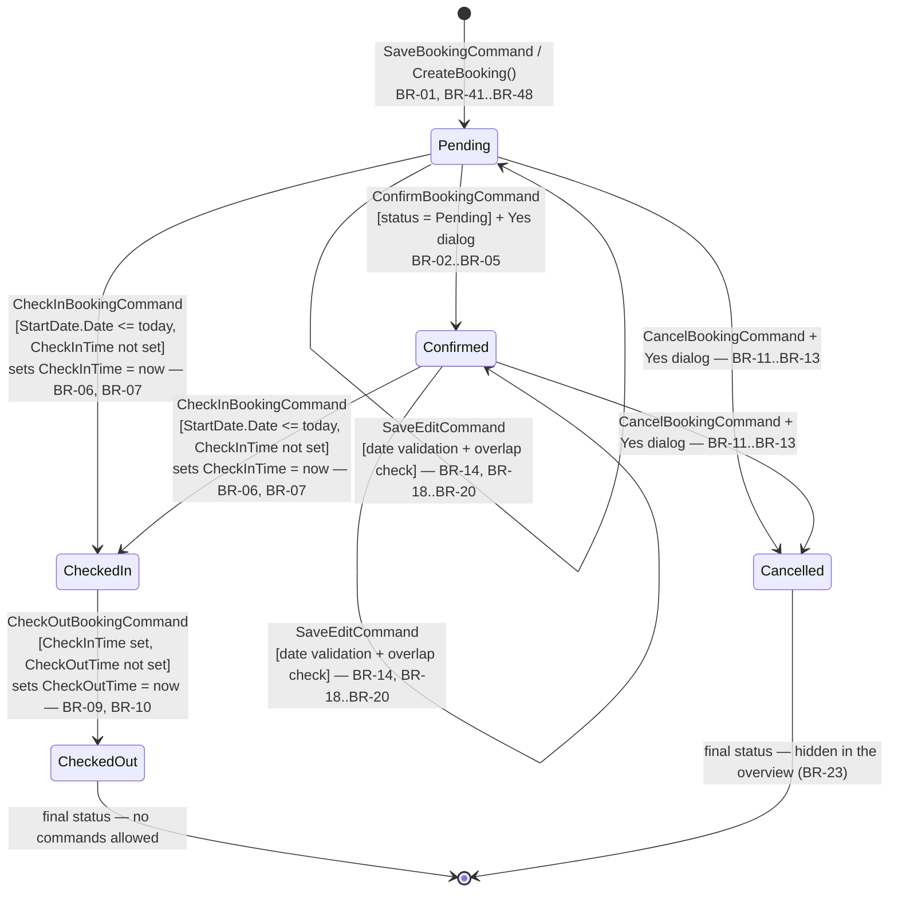

# Business Rules Ledger — NFHotel

> Phase 0, generated 2026-09-02. Source: `4. Semester\NFHotel-Hotel-main\`.
> **126 rules.** The column "Status in new code" is filled in during Phase 3 by `verify:ledger-audit`.
> The column "Evidence" points to the test in the old project that proves the rule (T-ids, see `Analysis.md` section 5).
>
> Groups: BR-01–BR-90 from ViewModels · BR-91–BR-109 model validation · BR-110–BR-116 repo layer · BR-117–BR-126 views/converters.

| Id | Rule | Source (file:line) | Type | Evidence | Status in new code |
|---|---|---|---|---|---|
| BR-01 | A booking is always created with status `Pending` — there is no other initial status. | `ViewModels/NewBookingViewModel.cs:319` | state transition | | |
| BR-02 | The booking can only be confirmed (`Pending → Confirmed`) when a booking is selected and its status is exactly `Pending`; otherwise `ConfirmBookingCommand` is disabled. | `ViewModels/BookingOverviewViewModel.cs:473-479` | state transition | T-20, T-27 | |
| BR-03 | On confirmation BR-02 is rechecked in the action itself and rejected with "Cannot confirm this booking - only Pending bookings can be confirmed". | `ViewModels/BookingOverviewViewModel.cs:488-497` | state transition | | |
| BR-04 | Confirmation requires explicit user confirmation (Yes/No dialog); anything other than "Yes" aborts without change. | `ViewModels/BookingOverviewViewModel.cs:499-511` | access | | |
| BR-05 | Confirmation sets `Status = Confirmed`, persists via the repository and reloads all data. | `ViewModels/BookingOverviewViewModel.cs:522-525` | state transition | | |
| BR-06 | Check-in is only allowed when the status is `Pending` OR `Confirmed`, AND `StartDate.Date <= today`, AND `CheckInTime` is not already set. | `ViewModels/BookingOverviewViewModel.cs:552-562` | state transition | T-21, T-22, T-23 | |
| BR-07 | Check-in sets `CheckInTime = DateTime.Now` (current time of day) and `Status = CheckedIn`, and persists. | `ViewModels/BookingOverviewViewModel.cs:584-588` | state transition | | |
| BR-08 | The check-in rule is rechecked in the action and rejected with "Cannot check in this booking"; check-in requires no confirmation dialog. | `ViewModels/BookingOverviewViewModel.cs:570-579` | state transition | | |
| BR-09 | Check-out is only allowed when the status is exactly `CheckedIn`, AND `CheckInTime` has a value, AND `CheckOutTime` does not yet have a value. | `ViewModels/BookingOverviewViewModel.cs:601-609` | state transition | T-24 | |
| BR-10 | Check-out sets `CheckOutTime = DateTime.Now` and `Status = CheckedOut`, and persists; no confirmation dialog. | `ViewModels/BookingOverviewViewModel.cs:617-635` | state transition | | |
| BR-11 | Cancellation is only allowed when the status is `Pending` OR `Confirmed` — a `CheckedIn`/`CheckedOut` booking cannot be cancelled. | `ViewModels/BookingOverviewViewModel.cs:648-655` | state transition | T-25 | |
| BR-12 | Cancellation requires an explicit "Yes" in the dialog "Cancel Booking Permanently From System?"; otherwise nothing happens. | `ViewModels/BookingOverviewViewModel.cs:674-682` | access | | |
| BR-13 | Cancellation is a soft delete: `Status = Cancelled` is saved, the row is never physically deleted. | `ViewModels/BookingOverviewViewModel.cs:687-690` | state transition | | |
| BR-14 | Editing a booking is only allowed when the status is `Pending` OR `Confirmed`. | `ViewModels/BookingOverviewViewModel.cs:715-722` | access | T-26 | |
| BR-15 | On entering edit mode the edit fields are prefilled with the booking's current room (`AllRooms` matched on `RoomId == SelectedBooking.RoomID`), `StartDate` and `EndDate`, and `IsEditMode` is set to true. | `ViewModels/BookingOverviewViewModel.cs:725-735` | calculation | | |
| BR-16 | `SaveEdit` and `CancelEdit` can only be executed when `IsEditMode` is true. | `ViewModels/BookingOverviewViewModel.cs:261-269` | access | | |
| BR-17 | On saving an edit the status requirement (BR-14) is rechecked and rejected with "Cannot edit this booking - only Pending or Confirmed bookings can be edited". | `ViewModels/BookingOverviewViewModel.cs:743-752` | state transition | | |
| BR-18 | On saving an edit `Booking.ValidateEdit(newStart, newEnd)` is run; any error is shown together (line-separated) and blocks saving. | `ViewModels/BookingOverviewViewModel.cs:755-765` | validation | T-08 | |
| BR-19 | On saving an edit the change is rejected if another booking (`BookingID != current`) exists on the same room whose status is neither `Cancelled` nor `CheckedOut`, and where `otherStart < newCheckOut` AND `otherEnd > newCheckIn` (half-open overlap test) — "Room is not available for selected dates". | `ViewModels/BookingOverviewViewModel.cs:768-786` | validation | | |
| BR-20 | If all checks pass, `StartDate`, `EndDate` and `RoomID` are updated, the booking is persisted, `IsEditMode` is set to false and data is reloaded. | `ViewModels/BookingOverviewViewModel.cs:791-798` | calculation | | |
| BR-21 | `CancelEdit` leaves edit mode without saving — the entered edit values are discarded. | `ViewModels/BookingOverviewViewModel.cs:819-822` | state transition | | |
| BR-22 | When a booking is selected, the permissibility of Confirm, CheckIn, CheckOut, Cancel and Edit is recalculated. | `ViewModels/BookingOverviewViewModel.cs:56-65` | access | | |
| BR-23 | Cancelled bookings are never shown in the overview, regardless of display period. | `ViewModels/BookingOverviewViewModel.cs:394-402` | calculation | T-28 | |
| BR-24 | In year view only bookings that overlap 1 January–31 December of the displayed year are shown (`StartDate <= 31/12` AND `EndDate >= 1/1`). | `ViewModels/BookingOverviewViewModel.cs:389-398` | calculation | | |
| BR-25 | A booking matches a search text if it is contained (case-insensitively) in "First name Last name", country, e-mail or room number; bookings without a guest or room never match. | `ViewModels/BookingOverviewViewModel.cs:370-378` | calculation | T-29 | |
| BR-26 | As soon as the search field contains anything other than whitespace, the display period automatically switches to "Year". | `ViewModels/BookingOverviewViewModel.cs:75-78` | calculation | | |
| BR-27 | The view's start date is the start of the week (`CurrentMonth` minus days since the first day of the week) in week view, otherwise the 1st of the displayed month. | `ViewModels/BookingOverviewViewModel.cs:38-51` | calculation | | |
| BR-28 | Forward/back navigation moves ±7 days in week view, ±1 year in year view and ±1 month otherwise. | `ViewModels/BookingOverviewViewModel.cs:322-337` | calculation | | |
| BR-29 | The number of columns in the calendar is 7 (week), the actual number of days in the month (month) or 12 (year). | `ViewModels/BookingOverviewViewModel.cs:339-368` | calculation | | |
| BR-30 | The period heading is shown as "Week {week number}, {year}" (week number by the current culture's week rule), "{year}" or "MMMM yyyy". | `ViewModels/BookingOverviewViewModel.cs:112-134` | calculation | | |
| BR-31 | The month's revenue is always set to 0 — there is no actual revenue calculation. | `ViewModels/BookingOverviewViewModel.cs:415-418` | calculation | | |
| BR-32 | Sorting: clicking the same column again reverses the direction, clicking a new column sorts ascending; an empty column name does nothing. | `ViewModels/BookingOverviewViewModel.cs:430-454` | calculation | | |
| BR-33 | After the "New booking" dialog is closed, the whole booking overview is reloaded. | `ViewModels/BookingOverviewViewModel.cs:423-428` | calculation | | |
| BR-34 | The room list in new booking contains only rooms that the repository considers available (`GetAllByAvailability`). | `ViewModels/NewBookingViewModel.cs:158-167` | calculation | T-37 | |
| BR-35 | If a guest is preselected, the form is prefilled with the guest's GuestID, name, e-mail, phone, country and passport number. | `ViewModels/NewBookingViewModel.cs:169-173, 240-249` | calculation | T-30 | |
| BR-36 | If either the check-in or the check-out date changes, the available room list is recalculated immediately. | `ViewModels/NewBookingViewModel.cs:42-62` | calculation | | |
| BR-37 | If one of the two dates is missing, the whole list of available rooms is shown and the error message is cleared. | `ViewModels/NewBookingViewModel.cs:183-188` | validation | | |
| BR-38 | If the check-out date is ≤ the check-in date, the room list is emptied and "Check-out date must be after check-in date" is shown (0 nights is not allowed). | `ViewModels/NewBookingViewModel.cs:191-196` | validation | T-31 | |
| BR-39 | A room is occupied in the period if a non-cancelled booking exists with `StartDate < desiredCheckOut` AND `EndDate > desiredCheckIn`; such rooms are removed from the list (departure and arrival on the same day is allowed). | `ViewModels/NewBookingViewModel.cs:204-217` | validation | | |
| BR-40 | If there are zero free rooms in the period, "No rooms available for the selected period. Please try different dates." is shown; otherwise the error message is cleared. | `ViewModels/NewBookingViewModel.cs:227-234` | validation | | |
| BR-41 | Creating a booking requires the check-in date to be filled in ("Check-in date is required"). | `ViewModels/NewBookingViewModel.cs:261-264` | validation | T-01 | |
| BR-42 | Creating a booking requires the check-out date to be filled in ("Check-out date is required"). | `ViewModels/NewBookingViewModel.cs:266-269` | validation | T-02 | |
| BR-43 | Creating a booking requires check-out > check-in (at least 1 night). | `ViewModels/NewBookingViewModel.cs:271-274` | validation | T-03 | |
| BR-44 | The check-in date must not be before today's date (date part compared, same day allowed) — "Check-in date cannot be in the past". | `ViewModels/NewBookingViewModel.cs:276-279` | validation | T-04 | |
| BR-45 | A room must be selected — "Please select a room". | `ViewModels/NewBookingViewModel.cs:282-285` | validation | T-05 | |
| BR-46 | The guest details are validated via `Guest.Validate()`; only the FIRST error is shown to the user and the creation is aborted. | `ViewModels/NewBookingViewModel.cs:288-304` | validation | | |
| BR-47 | A guest with `GuestID == 0` is considered new and is created in the database before the booking, after which the assigned id is used; an existing guest is reused unchanged. | `ViewModels/NewBookingViewModel.cs:306-312` | calculation | | |
| BR-48 | The booking is saved with the selected dates, the selected room's `RoomId`, the guest's id and status `Pending`. | `ViewModels/NewBookingViewModel.cs:314-328` | state transition | | |
| BR-49 | On success the booking number, the guest's name and the number of nights (`Booking.NumberOfNights`) are shown in the receipt text. | `ViewModels/NewBookingViewModel.cs:331` | calculation | T-09, T-10 | |
| BR-50 | The booking window closes automatically 2000 ms after a successful creation. | `ViewModels/NewBookingViewModel.cs:334-340` | calculation | | |
| BR-51 | Any `ArgumentException` from the validation is shown as error text; other errors as "An unexpected error occurred: …" — no booking is created in either case. | `ViewModels/NewBookingViewModel.cs:342-349` | validation | | |
| BR-52 | The guest's first name is required ("First name is required."). | `ViewModels/NewGuestViewModel.cs:177-180` | validation | T-11, T-12 | |
| BR-53 | The guest's last name is required ("Last name is required."). | `ViewModels/NewGuestViewModel.cs:181-184` | validation | T-11 | |
| BR-54 | The guest's phone number is required ("Phone number is required.") — no format requirement. | `ViewModels/NewGuestViewModel.cs:185-188` | validation | T-11 | |
| BR-55 | The guest's e-mail is required and must contain both "@" and "." ("A valid email is required.") — no regex. | `ViewModels/NewGuestViewModel.cs:189-193` | validation | T-13 | |
| BR-56 | The guest's country is required ("Country is required."). | `ViewModels/NewGuestViewModel.cs:194-197` | validation | T-11 | |
| BR-57 | The passport number is not validated and is thus optional. | `ViewModels/NewGuestViewModel.cs:69-77` | validation | T-14 | |
| BR-58 | The Save button is only active when all five error messages (first name, last name, phone, e-mail, country) are empty. | `ViewModels/NewGuestViewModel.cs:155, 199-207` | access | | |
| BR-59 | All fields are revalidated on every change and when the form is opened (null is normalised to an empty string). | `ViewModels/NewGuestViewModel.cs:20-67, 157-158, 168-175` | validation | | |
| BR-60 | On save the guest is validated again with `Guest.Validate()`; ALL errors are shown together and saving is aborted. | `ViewModels/NewGuestViewModel.cs:209-220` | validation | T-15 | |
| BR-61 | Saving requires an explicit "Yes" on "Are you sure you want to save the changes?"; a missing dialog handler is interpreted as "No". | `ViewModels/NewGuestViewModel.cs:222-224` | access | | |
| BR-62 | In edit mode the guest's original `GuestID` is kept and `UpdateGuest` is called; otherwise a new guest is created and the assigned id is set on the object. | `ViewModels/NewGuestViewModel.cs:211-213, 226-229` | calculation | | |
| BR-63 | The form's title/button text is "Edit Guest"/"Save" in edit mode and "New Guest"/"Create" on creation. | `ViewModels/NewGuestViewModel.cs:141-142` | calculation | | |
| BR-64 | Cancel closes the form without saving. | `ViewModels/NewGuestViewModel.cs:236-239` | state transition | | |
| BR-65 | Edit guest and "create booking for guest" are only possible when a guest is selected. | `ViewModels/GuestOverviewViewModel.cs:106-108` | access | | |
| BR-66 | Editing always happens on a COPY of the guest (first name, last name, e-mail, phone, country, passport number) — the original is not changed directly. | `ViewModels/GuestOverviewViewModel.cs:166-183` | access | | |
| BR-67 | An attempt to edit without a selected guest shows "You must select a guest to edit." and aborts. | `ViewModels/GuestOverviewViewModel.cs:168-172` | access | | |
| BR-68 | Guest search: the search text is split into words on spaces, and ALL words must be found (case-insensitively) in either full name, country or e-mail (AND logic). | `ViewModels/GuestOverviewViewModel.cs:146-157` | calculation | T-40 | |
| BR-69 | The guest list is always sorted alphabetically by "first name last name" in lower case. | `ViewModels/GuestOverviewViewModel.cs:129-143, 220-227` | calculation | | |
| BR-70 | An empty or whitespace search shows all guests. | `ViewModels/GuestOverviewViewModel.cs:131-135` | calculation | | |
| BR-71 | "Clear guest" replaces the selected guest with an empty `Guest` object and turns off both edit mode and new-guest mode. | `ViewModels/GuestOverviewViewModel.cs:186-191` | state transition | | |
| BR-72 | Updating the selected guest overwrites exactly six fields — `GuestID` is never changed. | `ViewModels/GuestOverviewViewModel.cs:208-218` | calculation | | |
| BR-73 | The booking-for-guest event is only raised when a guest is actually selected (double check beyond BR-65). | `ViewModels/GuestOverviewViewModel.cs:193-199` | access | | |
| BR-74 | The room filter combines floor, room size and status; an empty/whitespace room size is interpreted as "no filter" (null). | `ViewModels/RoomOverviewViewModel.cs:146-159` | calculation | T-38, T-39 | |
| BR-75 | The filter options are derived from the existing rooms as distinct, sorted values for floor, room size and status. | `ViewModels/RoomOverviewViewModel.cs:128-144` | calculation | | |
| BR-76 | "Clear filter" resets floor, room size and status to null and reloads all rooms. | `ViewModels/RoomOverviewViewModel.cs:161-168` | calculation | | |
| BR-77 | Deleting a room requires an explicit "Yes" on the warning "…This can disrupt logged bookings". | `ViewModels/RoomOverviewViewModel.cs:196-203` | access | | |
| BR-78 | If the repository throws `InvalidOperationException` on deletion (e.g. a room with bookings), the room remains in the list and the error text is shown as "Unable to delete room". | `ViewModels/RoomOverviewViewModel.cs:205-214` | validation | | |
| BR-79 | Edit room does nothing if no room was passed (null parameter). | `ViewModels/RoomOverviewViewModel.cs:181-183, 196-198` | access | | |
| BR-80 | After a room is saved, both the room list and the filter options are reloaded, and the side panel is closed. | `ViewModels/RoomOverviewViewModel.cs:217-228` | calculation | | |
| BR-81 | A newly created room gets the status `Available` as a starting point. | `ViewModels/FormsViewModel/RoomFormViewModel.cs:35-43` | state transition | T-19 | |
| BR-82 | A room with `RoomId == 0` is created; all others are updated. | `ViewModels/FormsViewModel/RoomFormViewModel.cs:59-66` | calculation | | |
| BR-83 | The room form's title/button text is "Create Room"/"Create" on creation and "Edit Room"/"Save" on editing. | `ViewModels/FormsViewModel/RoomFormViewModel.cs:35-49` | calculation | | |
| BR-84 | `Room.Validate()` is called on save, but the result is ignored — invalid rooms are saved anyway (only caught by BR-113 in the repo layer). | `ViewModels/FormsViewModel/RoomFormViewModel.cs:58` | validation | | |
| BR-85 | The application always starts on the booking overview. | `ViewModels/MainViewModel.cs:47` | access | | |
| BR-86 | Navigation between the booking, guest, room, sales and guest policy views is always allowed, and each view holds one lifetime instance. | `ViewModels/MainViewModel.cs:42-72` | access | | |
| BR-87 | A command without an explicit `canExecute` is always allowed. | `Commands/RelayCommand.cs:28-31` | access | | |
| BR-88 | `DateGreaterThan` validation fails when the validated date is ≤ the comparison date, with "{field} must be after {comparison field}". | `Validation/DateGreaterThanAttribute.cs:34-43` | validation | | |
| BR-89 | If `DateGreaterThan` points at a non-existent field, the validation fails with "Unknown property: {name}". | `Validation/DateGreaterThanAttribute.cs:23-28` | validation | | |
| BR-90 | If either the value or the comparison value is not a `DateTime` (e.g. null), the validation is considered passed. | `Validation/DateGreaterThanAttribute.cs:34-46` | validation | | |
| BR-91 | `Guest.FirstName` must not be null, empty or only whitespace. | `Models/Guest.cs:49-50` | validation | T-11, T-12 | |
| BR-92 | `Guest.LastName` must not be null, empty or only whitespace. | `Models/Guest.cs:51-52` | validation | T-11 | |
| BR-93 | `Guest.Email` must be filled in and contain both `@` and `.` (the position is not checked). | `Models/Guest.cs:53-54` | validation | T-13 | |
| BR-94 | `Guest.PhoneNumber` must not be empty (no format requirement). | `Models/Guest.cs:55-56` | validation | T-11 | |
| BR-95 | `Guest.Country` must not be empty. | `Models/Guest.cs:57-58` | validation | T-11 | |
| BR-96 | `Guest.Validate()` collects all errors in one list instead of failing on the first. | `Models/Guest.cs:39-58` | validation | T-15 | |
| BR-97 | `Room.RoomNumber` must not be empty or whitespace. | `Models/Room.cs:40-41` | validation | T-16 | |
| BR-98 | `Room.Floor` must be > 0 (ground floor and basement are thus not allowed). | `Models/Room.cs:43-44` | validation | T-17 | |
| BR-99 | `Room.RoomSize` must not be empty — but it is not checked against a set of allowed values. | `Models/Room.cs:46-47` | validation | T-16 | |
| BR-100 | `Room.Capacity` must be > 0. | `Models/Room.cs:49-50` | validation | T-18 | |
| BR-101 | `Booking.StartDate` must not be `default(DateTime)`. | `Models/Booking.cs:47-48` | validation | T-01 | |
| BR-102 | `Booking.EndDate` must not be `default(DateTime)`. | `Models/Booking.cs:50-51` | validation | T-02 | |
| BR-103 | When both dates are set, `EndDate` must be strictly greater than `StartDate`. | `Models/Booking.cs:53-54` | validation | T-03 | |
| BR-104 | `Booking.StartDate.Date` must not be before `DateTime.Now.Date`. | `Models/Booking.cs:56-57` | validation | T-04 | |
| BR-105 | A booking must have a room: error only if both `Room` is null AND `RoomID` is 0. | `Models/Booking.cs:59-60` | validation | T-05 | |
| BR-106 | A booking must have a guest: error only if both `Guest` is null AND `GuestID` is 0. | `Models/Booking.cs:62-63` | validation | T-06 | |
| BR-107 | When both `CheckInTime` and `CheckOutTime` have a value, `CheckOutTime` must be strictly greater than `CheckInTime`. | `Models/Booking.cs:65-66` | validation | T-07 | |
| BR-108 | `Booking.ValidateEdit(newStart, newEnd)` requires `newEnd > newStart` and `newStart.Date >= today` on the submitted dates. | `Models/Booking.cs:75-79` | validation | T-08 | |
| BR-109 | `NumberOfNights` = `(EndDate - StartDate).Days`, and 0 if one of the dates is `default`. The booking number is formatted as `FLZ-{BookingID:D6}`. | `Models/Booking.cs:13, 30-39` | calculation | T-09, T-10 | |
| BR-110 | Only rooms with status `Available` count as available — the filter lives in the data access layer. | `Repositories/RoomRepo.cs:220` | calculation | T-37 | |
| BR-111 | Selection of bookings by status happens as an in-memory filter after a full table pull. | `Repositories/BookingRepo.cs:173` | calculation | | |
| BR-112 | A room with existing bookings must not be deleted; the user is directed to set it "Out of service". The rule is coded as a `catch` of SQL error 547. | `Repositories/RoomRepo.cs:208-210` | validation | | |
| BR-113 | A room must pass `Room.Validate()` before it is persisted — enforced in the repo on both create and update. | `Repositories/RoomRepo.cs:21-23, 164-166` | validation | T-36 | |
| BR-114 | A booking must exist before it may be updated or deleted; otherwise `ArgumentException`. `Create`/`Update` with null gives `ArgumentNullException`. | `Repositories/BookingRepo.cs:190-196, 235-239` | access | T-32, T-33 | |
| BR-115 | `GetById` on an unknown id returns `null` — not an exception, not an empty object. | `Repositories/BookingRepo.cs:167`, `GuestRepo.cs:79`, `RoomRepo.cs:101` | calculation | T-34 | |
| BR-116 | Name search on guests is "contains" on first OR last name (wildcards on both sides, OR between columns). | `Repositories/GuestRepo.cs:127, 130` | calculation | T-40 | |
| BR-117 | A booking's duration in the calendar is the number of overnight stays, not the number of days: the width is `(EndDate − StartDate).Days`. | `Converters/CalendarConverters.cs:149` | calculation | T-09 | |
| BR-118 | Half-day rule: a booking is drawn from the middle of the check-in day (`daysOffset + 0.5`) — the room is counted as occupied from noon. | `Converters/CalendarConverters.cs:31, 48` | calculation | | |
| BR-119 | Bookings that started before the displayed period are clipped to the start of the period and get `+0.5` day on the width. | `Converters/CalendarConverters.cs:81, 139` | calculation | | |
| BR-120 | A room's timeline shows only bookings where `Booking.Room.RoomId` matches the room; bookings with no linked room are omitted entirely. | `Converters/CalendarConverters.cs:197` | calculation | | |
| BR-121 | The Confirm button is shown only at status `Pending` (duplicate of BR-02, enforced in an XAML trigger). | `Views/BookingOverviewView.xaml:988` | state transition | T-20 | |
| BR-122 | The Cancel button is shown only at status `Pending` or `Confirmed` (duplicate of BR-11, enforced in an XAML trigger). | `Views/BookingOverviewView.xaml:1037, 1040` | state transition | T-25 | |
| BR-123 | The Edit button is hidden at status `CheckedIn` and `CheckedOut` (duplicate of BR-14, enforced in an XAML trigger). | `Views/BookingOverviewView.xaml:958, 961` | access | T-26 | |
| BR-124 | Guest fields are read-only outside edit mode (`IsReadOnly = !IsEditing` on all six fields). | `Views/GuestOverviewView.xaml:132, 142, 152, 162, 172, 179` | access | | |
| BR-125 | "Edit Guest" requires a selected guest (`NotNullToBoolConverter`); the "New Booking" button, however, has no corresponding guard. | `Views/GuestOverviewView.xaml:186` (missing `:187-190`) | access | | |
| BR-126 | The allowed room statuses in the room form are hard-coded in XAML as Available / Maintanance / Cleaning / Disabled — and do not match the `RoomStatus` enum (Available / OutOfService / Maintenance). | `Views/Forms/RoomFormView.xaml:43-46` vs. `Models/Enums/RoomStatus.cs:9-14` | validation | | |

---

## Distribution

| Type | Count |
|---|---|
| validation | 55 |
| calculation | 40 |
| state transition | 18 |
| access | 23 |

(The sum exceeds 126 because some rules are counted in the type they primarily belong to; see the table's Type column for the authoritative classification.)

**Duplicates to be consolidated in new code:** BR-02/BR-121, BR-11/BR-122, BR-14/BR-123 (the same rule in both ViewModel and XAML trigger) · BR-52..BR-56 / BR-91..BR-95 (the same guest validation in both ViewModel and Model) · BR-41..BR-44 / BR-101..BR-104 (the same date validation in both ViewModel and Model) · BR-88 / BR-38 / BR-43 (the same "end after start" rule in three places).

**Rules that are not implemented in the old project:** BR-31 (revenue always gives 0) · BR-84 (room validation is ignored in the form).

**Direct contradiction between rules:** BR-19 vs. BR-39 (the overlap check excludes `CheckedOut` on editing, but not on creation) · BR-126 vs. the `RoomStatus` enum.

---

## State diagram — BookingStatus

Derived solely from the rules above.

**Note for Phase 1:** the transition `Pending → CheckedIn` (bypassing `Confirmed`) is confirmed by both code and test (T-21), but contradicts the confirmation dialog's own text that `Confirmed` means "payment received". See `OpenQuestions.md` Q-01.

---

## New rules — invented in Phase 1, awaiting approval

> Added 2026-09-07. These do **not** exist in the old system. They are kept apart from BR-01 to BR-126, so Phase 3's `verify:ledger-audit` can tell "kept from the old system" from "invented now".
> If they are not approved, they must be removed from the design — not tacitly accepted.

| Id | Rule | Source of the need | Status in new code |
|---|---|---|---|
| BR-N-01 | Room number must be unique across the hotel | Two rooms with the same number is meaningless; the old schema had no constraint | |
| BR-N-02 | A guest can be deleted | Follows from D-05 (personal data is deleted at the guest's request). Did not exist before | |
| BR-N-03 | Length limits on names and fields are enforced in Domain, not only in the database | A-10 — otherwise too-long values fail as `DbUpdateException` instead of as a domain error | |
| BR-N-04 | `floor > 0` and `capacity > 0` are also enforced as database constraints | The rules existed in C# (BR-98, BR-100), but not in the schema | |
| BR-N-05 | Guest search uses BR-68's semantics everywhere (all words must be found in name, country or e-mail) | The repo searched only on first/last name (BR-116); the ViewModel used BR-68. Two different searches consolidated into one — a search on a last name now also hits a country with the same name | |
| BR-N-06 | The cleaning process's seven transitions: `MarkDailyCleaningDue`, `MarkDepartureCleaningDue`, `StartCleaning`, `CompleteCleaning`, `ReportServiceNeeded`, `StartService`, `CompleteService` | Room status did not really exist as a rule set (only BR-81 and BR-126). Required by the purpose of the mobile app (D-10) | |
| BR-N-07 | A booking's effective occupancy ends at the check-out date, not at `EndDate` | A-01 — resolves the contradiction BR-19 ↔ BR-39 and makes re-letting after an early check-out possible | |

**Note on BR-19 and BR-39:** the two contradicted each other in the old system. BR-39 (only `Cancelled` releases) has been chosen as the one that applies, but applied to the *effective* period via BR-N-07. BR-19's exception for `CheckedOut` is thus replaced, not kept — it is recorded as **changed** in the Phase 3 audit.

**Note on A-12 (roles):** the roles in the cleaning process (cleaning staff, service technician, owner) are **documentation**, not enforced rules in Phase 1. Authorisation is postponed. They must not be counted as implemented at the audit.

---

## The customer side's rules — invented 2026-09-07, awaiting approval

> The customer side does not exist in the old system. These rules are **defined now**, not ported,
> and are therefore kept as a separate `BR-C` series. Phase 3's `verify:ledger-audit` must be able to
> tell them from the 126 ported ones and from the `BR-N` series.

| Id | Rule | Where it is implemented | Status in new code |
|---|---|---|---|
| BR-C-01 | A customer can book without an account. Guest details are entered at booking (guest checkout) | `BookingService.CreateAsync` via `CreateBookingRequest.NewGuest` — already existed as BR-47 | |
| BR-C-02 | The customer sees only rooms that are free in the chosen period — never a room that cannot be booked | `GetAvailableRoomsAsync`, which calls the same overlap function as the creation | |
| BR-C-03 | A customer booking is created with status `Pending`. Confirmation is the staff's action | Follows from BR-01; the customer side has no confirm action | |
| BR-C-04 | The customer cannot choose a room without first having chosen valid dates | `BookingFlowViewModel` — checked on room search, room selection and submission, not only on step change | |
| BR-C-05 | The receipt shows booking number, period, number of nights and room — no price, since the price model does not exist | `BookingReceiptCard` shows "Betaling ved ankomst" (payment on arrival) | |
| BR-C-06 | The customer cannot see other guests' personal data. The receipt page shows only booking and room details | `BookingReceiptCard` has no markup for guest fields | |

**On BR-C-06.** Without auth the booking number is the only key, and `FLZ-000123` is trivially guessable.
The receipt page therefore deliberately shows neither name, e-mail, phone nor passport number — only what the
customer has just entered themselves, plus room and dates. The restriction can be lifted when Identity arrives,
and should be reassessed there rather than forgotten.

**On access control.** `/admin/**` needs a signed-in member of staff since MIL-016 (ADR-0005, UC-004):
the roles Receptionist, Manager and Housekeeping hold the permissions of the Access Control Matrix,
and the API checks them. Before MIL-016 the pages were open to anyone who knew the address. The
Guest role and TLS at the public port are still open.
