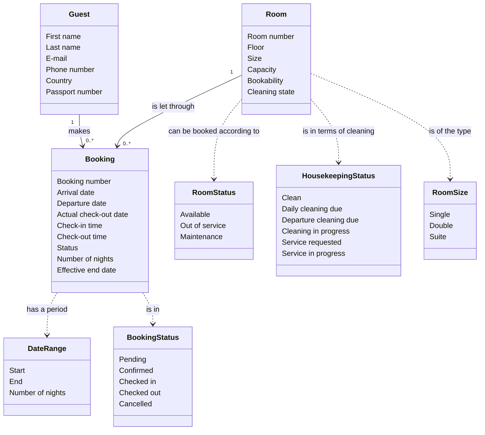

# Domain model and object model

> Generated 2026-09-08 **from the actual code**, not from the design documents.
> Sources: `src/NFHotel.Domain/`, `src/NFHotel.Application/`, `src/NFHotel.Infrastructure/`, `src/NFHotel.Web/`.
>
> Two models, each with its own purpose:
> - **The domain model** describes the business's concepts. It could be discussed with a hotel manager.
> - **The object model** describes the code. It shows classes, interfaces and the direction of dependencies across the layers.

---

# 1. Domain model

Concepts, properties and relations — without technology. No repositories, no DTOs, no methods that exist only for the sake of the implementation.

### 1.1 Concepts

| Concept | Meaning in the business |
|---|---|
| **Booking** | An agreement that a particular guest has a particular room in a particular period |
| **Room** | A physical room in the hotel. Can be let, and must be cleaned between guests |
| **Guest** | A person who stays or has stayed at the hotel. Not a user account |
| **DateRange** | A period from arrival to departure. Half-open: the departure day is not counted as a night |
| **Booking number** | Customer-facing identification, `FLZ-000123`. Derived from the booking's id, not an independent field |
| **Effective end date** | The day the room actually becomes free again. Normally the departure date — but on early check-out the actual check-out date |
| **Bookability** (`RoomStatus`) | Whether the room may be let at all. Independent of whether it is clean |
| **Cleaning state** (`HousekeepingStatus`) | Where the room is in the cleaning process. Independent of whether it may be let |

**Why bookability and cleaning state are separate:** the old system had one status field for both, and it disagreed with its own user interface. A room can very well be available for letting tomorrow *and* need cleaning today — those are two questions, not one.

### 1.2 Business rules in the model

| Rule | Description |
|---|---|
| The period is half-open | A guest who leaves on the 5th and one who arrives on the 5th do not share the room. The number of nights is the difference in days |
| A booking occupies its room | From the arrival date to the **effective** end date — unless it is cancelled |
| Cancellation is the only release | A checked-out booking still occupies the room, but only up to the actual check-out date |
| Confirmation is not a precondition for arrival | A guest can check in without the booking first being confirmed — walk-in is a real situation |
| Cancellation does not delete | The booking gets the status *cancelled* and stays. The history is kept |
| The cleaning process does not block booking | Only *bookability* decides whether a room can be let |

### 1.3 Deliberately left out

| Not modelled | Why |
|---|---|
| **Price** | There is no price model. `RoomSize` is a category, not a rate. Without it revenue cannot be calculated |
| **User and role** | Authentication is postponed. The system today has no notion of who performs an action |
| **Payment and invoice** | Follows from the price. Not decided yet |
| **Extra services** | Breakfast, parking and similar are proposed, but not decided |

---

# 2. Object model

The actual class structure. The arrows point the way the dependencies go — always inward toward the domain.

```mermaid
classDiagram
    direction LR

    class Booking {
        <<entity>>
        +int BookingId
        +DateOnly StartDate
        +DateOnly EndDate
        +DateOnly? CheckOutDate
        +DateTimeOffset? CheckInTime
        +DateTimeOffset? CheckOutTime
        +BookingStatus Status
        +int RoomId
        +int GuestId
        +DateRange Period
        +DateOnly EffectiveEndDate
        +DateRange EffectivePeriod
        +int NumberOfNights
        +string BookingNumber
        +bool CanConfirm
        +bool CanCheckOut
        +bool CanCancel
        +bool CanReschedule
        +Create(period, roomId, guestId, today)$ Booking
        +CanCheckIn(today) bool
        +Confirm() void
        +CheckIn(occurredAt, today) void
        +CheckOut(occurredAt, checkOutDate, today) void
        +Cancel() void
        +Reschedule(newPeriod, newRoomId, today) void
    }

    class Room {
        <<entity>>
        +int RoomId
        +string RoomNumber
        +int Floor
        +RoomSize Size
        +int Capacity
        +RoomStatus Status
        +HousekeepingStatus HousekeepingStatus
        +bool IsBookable
        +bool CanStartCleaning
        +bool CanCompleteCleaning
        +bool CanStartService
        +Create(roomNumber, floor, size, capacity)$ Room
        +UpdateDetails(roomNumber, floor, size, capacity) void
        +TakeOutOfService() void
        +SendToMaintenance() void
        +ReturnToService() void
        +MarkDailyCleaningDue() void
        +MarkDepartureCleaningDue() void
        +StartCleaning() void
        +CompleteCleaning() void
        +ReportServiceNeeded() void
        +StartService() void
        +CompleteService(requiresCleaning) void
    }

    class Guest {
        <<entity>>
        +int GuestId
        +string FirstName
        +string LastName
        +string Email
        +string PhoneNumber
        +string Country
        +string? PassportNumber
        +string FullName
        +Create(...)$ Guest
        +UpdateDetails(...) void
    }

    class DateRange {
        <<value object>>
        +DateOnly Start
        +DateOnly End
        +int Nights
        +Overlaps(other) bool
        +Contains(date) bool
        +StartsOnOrAfter(today) bool
    }

    class BookingRules {
        <<static>>
        +Overlaps(a, b) bool
        +BlocksRoom(status) bool
        +Conflicts(existing, roomId, period) bool
    }

    class IBookingService {
        <<interface>>
        +GetByIdAsync(id) Result~BookingDetailsDto~
        +GetOverviewAsync(query) Result~List~
        +GetAvailableRoomsAsync(from, to) Result~List~
        +CreateAsync(request) Result~BookingDetailsDto~
        +ConfirmAsync(id) Result~BookingDetailsDto~
        +CheckInAsync(id) Result~BookingDetailsDto~
        +CheckOutAsync(id) Result~BookingDetailsDto~
        +CancelAsync(id) Result~BookingDetailsDto~
        +RescheduleAsync(request) Result~BookingDetailsDto~
    }

    class IRoomService {
        <<interface>>
        +GetAllAsync() Result~List~
        +SearchAsync(filter) Result~List~
        +CreateAsync(request) Result~RoomDetailsDto~
        +UpdateAsync(request) Result~RoomDetailsDto~
        +DeleteAsync(id) Result
        +StartCleaningAsync(id) Result~RoomDetailsDto~
        +CompleteCleaningAsync(id) Result~RoomDetailsDto~
        +ReportServiceNeededAsync(id) Result~RoomDetailsDto~
    }

    class IGuestService {
        <<interface>>
        +GetByIdAsync(id) Result~GuestDetailsDto~
        +SearchAsync(text) Result~List~
        +CreateAsync(request) Result~GuestDetailsDto~
        +UpdateAsync(request) Result~GuestDetailsDto~
        +DeleteAsync(id) Result
        +ValidateFields(fields) Result
    }

    class BookingService {
        <<service>>
    }
    class RoomService {
        <<service>>
    }
    class GuestService {
        <<service>>
    }

    class IBookingRepository {
        <<interface>>
    }
    class IRoomRepository {
        <<interface>>
    }
    class IGuestRepository {
        <<interface>>
    }
    class IUnitOfWork {
        <<interface>>
        +SaveChangesAsync() Task
    }
    class IClock {
        <<interface>>
        +DateTimeOffset UtcNow
        +DateOnly Today
    }

    class BookingRepository {
        <<repository>>
    }
    class RoomRepository {
        <<repository>>
    }
    class GuestRepository {
        <<repository>>
    }
    class HotelDbContext {
        <<DbContext>>
    }
    class SystemClock
    class AesGcmStringEncryptor

    class BookingFlowViewModel {
        <<viewmodel>>
    }
    class BookingListViewModel {
        <<viewmodel>>
    }
    class RoomListViewModel {
        <<viewmodel>>
    }

    BookingService ..|> IBookingService
    RoomService ..|> IRoomService
    GuestService ..|> IGuestService

    BookingService --> IBookingRepository
    BookingService --> IRoomRepository
    BookingService --> IGuestRepository
    BookingService --> IUnitOfWork
    BookingService --> IClock
    RoomService --> IRoomRepository
    GuestService --> IGuestRepository

    BookingService ..> Booking : controls the lifecycle
    BookingService ..> BookingRules : asks about overlap
    RoomService ..> Room
    GuestService ..> Guest

    Booking ..> DateRange
    BookingRules ..> DateRange

    BookingRepository ..|> IBookingRepository
    RoomRepository ..|> IRoomRepository
    GuestRepository ..|> IGuestRepository
    SystemClock ..|> IClock
    BookingRepository --> HotelDbContext
    RoomRepository --> HotelDbContext
    GuestRepository --> HotelDbContext
    HotelDbContext ..> AesGcmStringEncryptor : encrypts passport number

    BookingFlowViewModel --> IBookingService
    BookingFlowViewModel --> IGuestService
    BookingListViewModel --> IBookingService
    RoomListViewModel --> IRoomService
```

### 2.1 What each layer owns

| Layer | Content | Dependencies |
|---|---|---|
| **Domain** | `Booking`, `Room`, `Guest`, `DateRange`, `BookingRules`, `GuestRules`, `RoomRules`, four enums | **None.** Neither project references nor NuGet packages |
| **Application** | The three service interfaces and their implementations, repository interfaces, `IUnitOfWork`, `IClock`, DTOs, `Result`, `ErrorCodes` | Domain only |
| **Infrastructure** | `HotelDbContext`, entity configurations, migrations, three repositories, `UnitOfWork`, `SystemClock`, `AesGcmStringEncryptor` | Application → Domain |
| **Web** | Razor components and one ViewModel per screen, `UseCaseRunner`, `ErrorMessages` | Application and Infrastructure |

The direction of dependencies is enforced by an architecture test, not by discipline: it fails if anyone references EF Core from Application, gives Domain a dependency, or lets a service return an entity instead of a DTO.

> Updated 2026-10-16 (ADR-0001): the repository interfaces moved to `Domain/Repositories`; the DTO-returning reads are narrow query ports in `Application/Ports`; the entities derive from `Entity<TKey>`. The diagrams above show the earlier state.

### 2.2 The Web layer — one View and one ViewModel per feature

| Feature | View | ViewModel | Uses |
|---|---|---|---|
| Front page | `Home.razor` | — | no data |
| Customer booking | `Book.razor` | `BookingFlowViewModel` | `IBookingService`, `IGuestService` |
| Receipt | `BookingReceipt.razor` | `BookingReceiptViewModel` | `IBookingService` |
| Admin dashboard | `AdminDashboard.razor` | `AdminDashboardViewModel` | `IBookingService`, `IRoomService` |
| Booking overview | `BookingList.razor` | `BookingListViewModel` + `BookingFormViewModel` | `IBookingService`, `IGuestService`, `IRoomService` |
| Room overview | `RoomList.razor` | `RoomListViewModel` + `RoomFormViewModel` | `IRoomService` |
| Guest overview | `GuestList.razor` | `GuestListViewModel` | `IGuestService` |
| Revenue | `SalesOverview.razor` | — | placeholder |

The Razor files contain markup and simple binding. All state and all service calls live in the ViewModel class, which is injected via the constructor and knows only Application interfaces — never a repository, never a `DbContext`.

### 2.3 Two details worth noting

**`Can*` properties on the entities.** `Booking.CanCancel` and `Room.CanStartCleaning` are not a convenience for the UI — they are the guard the transition method itself uses. That is why the user interface can draw buttons by the same rule the domain enforces, without the rule existing in two places.

**`IClock` instead of `DateTime.Now`.** The domain must not know about "now". All rules that need today's date get it as a parameter, and `SystemClock` is the only place where the conversion to the hotel's time zone happens. It is also the precondition for the state machine being testable deterministically.

---

## The relationship between the two models

The domain model has nine concepts. The object model has the same nine — plus everything needed to get them in and out of a database and up on a screen.

That is how it should look: if a concept appears in the object model that does not exist in the domain model, either business logic has arisen in a technical layer, or the business lacks a word for something it actually does.
