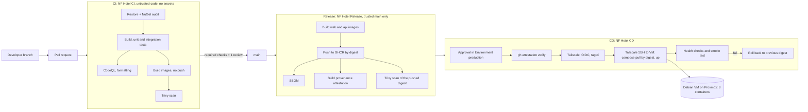

# CI/CD and DevSecOps Assessment

## Metadata
| Key | Value |
| --- | --- |
| ID | DSA-001 |
| CrossReference | [BC-001], [ADR-0003], [ADR-0004], [ADR-0006], [ADR-0007], [ADR-0008], [ADR-0009], [ADR-0010], [MIL-021], [MIL-022], [MIL-023] |
| Language | en |
| Domain | it |

## Version History
| Date | Status | Author | Reviewer | Change | Commit |
| --- | --- | --- | --- | --- | --- |
| 2026-10-18 | Deprecated | mikemike | S01 (decisions D1 to D10 approved in chat) | Accepted without a catalog checklist; D4, D7 and D10 still need input from S03 | [f4649ad] |
| 2026-10-18 | Accepted | mikemike | S01 (server inventory given in chat) | Section 2.4.2: `nf-hotel` confirmed as the production VM; the conclusion of 2.4.1 withdrawn; risks R15 and R16; D4 corrected | [1b94761] |

This document is a working assessment. Its type is not in `framework/registry/artifact-catalog.md`; a catalog type for it is proposed upstream (rule 5) before it is accepted.

---

## 1. Purpose and scope

The purpose of this assessment is to decide how NF Hotel builds, verifies and deploys its software, measured against recognised DevOps and DevSecOps standards. It covers the repository `NF-Hotel/NFHotel`, its GitHub settings, the container images, the Docker Compose services and the Proxmox VM (ADR-0003).

Rules for this document:

- Every finding in section 2 rests on evidence: a file, a command and its output, or an API answer, gathered on 2026-10-18. When something could not be inspected, it is marked **Not verified**. A missing control is never assumed to exist.
- No compliance is claimed. The status column says what the evidence supports. SLSA Build Level 2 is a **target**, not an achieved level.
- Controls are applied in proportion to the risk of a small team running one VM with one public service (see section 6).
- Nothing in this document has been implemented. Every change waits for the approvals in section 13.

## 2. Current-state assessment (evidence-based)

### 2.1 Source control and GitHub settings

| Item | Evidence | Finding |
| --- | --- | --- |
| Repository | `gh api repos/NF-Hotel/NFHotel` | Public, default branch `main` |
| Classic branch protection on `main` | `GET /branches/main/protection` answers 404 "Branch not protected" | None |
| Ruleset `Approve merges` (active, default branch) | `GET /rulesets/{id}` | A pull request is required with 1 approving review; non-fast-forward is blocked. **No required status checks.** No deletion rule. Stale reviews are not dismissed, and approval of the last push is not required. No bypass actors. |
| Code owners | No `CODEOWNERS` file | None |
| Security policy | No `SECURITY.md` | None |
| Secret scanning and push protection | `security_and_analysis` | Disabled |
| Dependabot | Alerts disabled (403); security updates disabled; no `.github/dependabot.yml` | Disabled |
| CodeQL | `code-scanning/default-setup`: `not-configured`; no analysis found | Not configured |
| SonarQube Cloud | PR comments from `sonarqubecloud[bot]`; no configuration file in the repository | Automatic analysis through the GitHub app; the quality gate passes. "0.0% coverage on new code": no coverage report is sent to SonarQube Cloud |
| Actions policy | `actions/permissions` | All actions allowed; SHA pinning not required; default `GITHUB_TOKEN` is read-only; Actions cannot approve pull requests |
| Environments | `GET /environments` returns none | None |
| Repository secrets and variables | Listing is empty | None |
| Container packages (GHCR) | Not verified: the local token lacks `read:packages` | Not verified |

### 2.2 CI workflow

The CI workflow `.github/workflows/ci.yaml` (`NF Hotel CI`) exists on `main` as a build only. The full workflow is in PR #22 (branch `ci-v0.2-pull-request-build`, green on 77d1396):

| Job | What it does | Finding |
| --- | --- | --- |
| `build` | Restore with NuGet audit (`NuGetAuditMode=all`, level `low`, warnings as errors); Release build (warnings as errors through `Directory.Build.props`); 895 tests on Microsoft.Testing.Platform, including PostgreSQL integration tests with Testcontainers; TRX reports; Cobertura coverage with `dotnet-coverage` (67.5 % line coverage of the NFHotel assemblies) | Good base |
| `formatting` | `dotnet format whitespace --verify-no-changes` | Good |
| `container` | `docker build` of the web `Dockerfile` only | `Dockerfile.api` is not built; no image is pushed, scanned, signed or attested |
| Workflow level | `permissions: contents: read`; `concurrency`; time limits | Least privilege for the token |
| Third-party actions | `actions/checkout@v7`, `actions/setup-dotnet@v6`, `actions/upload-artifact@v4` | Pinned by tag, not by commit SHA |

### 2.3 Container images and services

There are 7 deploy units (`deploy/*/docker-compose.yml`) running **8 containers** on the VM. `deploy/proxmox` is a privileged development-only Proxmox container (MIL-003) and does not run on the VM.

| Container | Image source | Runs as | Network exposure | Finding |
| --- | --- | --- | --- | --- |
| `nfhotel-web` (Blazor Server, .NET 10) | `Dockerfile`, built in the VM | `app` (non-root) | `nfhotel-proxy`, `nfhotel-api` | Base images pinned by tag (`sdk:10.0.400`, `aspnet:10.0`), not digest |
| `nfhotel-api` (.NET 10) | `Dockerfile.api`, built in the VM | `app` | `nfhotel-api`, `nfhotel-db` (both internal) | Holds the database login and the passport key; applies migrations at start when `Database__MigrateOnStart=true` |
| `postgres` | `postgres:16-alpine` | image default | `nfhotel-db` (internal) | Named volume `pgdata`; no published port |
| `nginx` | `nginx:1.27-alpine` | image default (root master) | publishes 80 and 443 on `0.0.0.0` and 8081 on loopback | The only published service; TLS 1.2/1.3 (ADR-0006) |
| `market-analysis-api` (Python) | `deploy/market-analysis/Dockerfile`, external repository pinned by commit | `app` | `nfhotel-proxy`, `nfhotel-llm` | Wheels installed without hash checking |
| `market-analysis-notebook` (Python, marimo) | same image | `app` | `nfhotel-proxy`, `nfhotel-llm` | Reached on loopback 8081 only |
| `benchmark` (Python, marimo) | `deploy/benchmark/Dockerfile`, external repository pinned by commit | `app` | `nfhotel-proxy`, `nfhotel-llm` | `pip --require-hashes` with a lock file |
| `ollama` | `ollama/ollama:latest` | root | `nfhotel-llm` | **Mutable `latest` tag** |

None of the compose files sets `cap_drop`, `read_only`, `security_opt: no-new-privileges`, memory or CPU limits, or log rotation (`git grep` over `deploy/`).

### 2.4 VM, network and access

| Item | Evidence | Finding |
| --- | --- | --- |
| VM operating system | cloud-init in `scripts/create-docker-vm.sh` | Debian 12 (bookworm) with Docker CE from download.docker.com |
| Deploy user | cloud-init | `nfhotel`, ssh key only, `sudo` without password **and** member of `docker` (both are root-equivalent) |
| SSH hardening | cloud-init | No `sshd_config` changes in the repository |
| Firewall (nftables) | `git grep` for nftables/iptables/ufw | **No firewall configuration in the repository.** Opening 80/443 is left to the router (ADR-0006, RC-082). The state on the VM is **Not verified** |
| Docker daemon | No `daemon.json` in the repository | Defaults (no user namespaces, no `live-restore`, no log limits). State on the VM **Not verified** |
| Patch management | No `unattended-upgrades` in cloud-init | Not configured by the repository; state on the VM **Not verified** |
| Tailscale | `tailscale status` on the developer workstation | Nodes `nf-hotel` and `proxmox` are online in the tailnet with **no tags**; the connection to `nf-hotel` is relayed (DERP Amsterdam), not direct. Tailscale is not mentioned anywhere in the repository |
| SSH to the VM over the tailnet | `ssh -o StrictHostKeyChecking=yes nfhotel@nf-hotel` | Refused: the host key is not known on this workstation. Offered fingerprint `SHA256:Ea/3dv5VefOgI6rlseLuRBtDBmB28zebBp2hZsXSi1w` (ED25519), **not yet confirmed by S03**. Whether `nf-hotel` is the `nfhotel-services` VM is **Not verified** |
| Deploy today | `scripts/deploy.sh` | Run by hand from a developer machine: it ships that machine's working tree or a clone of `main`, and the git-ignored settings files, over ssh. The VM builds the images |

### 2.4.1 Verification over the tailnet (2026-10-18, second pass)

The connection to a tailnet address is authenticated by the WireGuard node key of the peer, so a host key fetched from a `100.x` address comes from that node. Commands run from the developer workstation, read-only:

| Check | Command | Result |
| --- | --- | --- |
| Identity of `nf-hotel` | `tailscale whois 100.72.194.127` | Node `nf-hotel.taildb84b5.ts.net`, owned by the tailnet user of S01 |
| Host key of `nf-hotel` (D4) | `ssh-keyscan -t ed25519 100.72.194.127` | `SHA256:Ea/3dv5VefOgI6rlseLuRBtDBmB28zebBp2hZsXSi1w`, the same key as in the first pass, now fetched over the authenticated tailnet path: **verified** |
| Operating system | ssh banner | `OpenSSH_10.0p2 Debian-7+deb13u4`: **Debian 13**, not the Debian 12 of `create-docker-vm.sh` |
| Open ports (tailnet) | TCP connect | 22, 80, 443 open; 8080, 8443, 8006 closed |
| Web service | `curl` | Port 80 answers 301 to `https://nf-hotel.taildb84b5.ts.net/`; port 443 answers 200 with the **nginx default page** ("Welcome to nginx!"), not NF Hotel |
| TLS certificate | `openssl s_client` | Let's Encrypt (`YE1`) for `nf-hotel.taildb84b5.ts.net`, valid to 2027-01-04: a Tailscale-issued certificate (`tailscale cert`) |
| SSH authentication | `ssh -v` | `publickey,password`: **password login is enabled** |
| Access for this assessment | `ssh nfhotel@`, `ssh root@` with the workstation key | Refused; no credential for the VM or the Proxmox node is held by the assessor, by design |
| Proxmox node `proxmox` | TCP connect, `ssh-keyscan` | 22 and 8006 open; host key `SHA256:jMKkCdkKIuQLFYel6OZcY1uOTj3LA49yTVeRR2JiPDI` (fetched over the tailnet) |

**Conclusion for D4 (withdrawn on 2026-10-18, see section 2.4.2).** ~~The host key of `nf-hotel` is verified. `nf-hotel` does **not** run the NF Hotel services today: it is a Debian 13 host with a stock nginx. Either the stack of ADR-0003 has not been deployed yet, or it runs on another VM. The first deploy is a bootstrap of this host (section 15, decision D4), `nf-hotel` was not created by `create-docker-vm.sh`, which consistently makes Debian 12 VMs; the deploy scripts depend only on Docker and the compose plugin, so they run on either release.~~ The nginx default page at `/`, the Debian version and the SSH settings do not show which services a host runs; the conclusion was not supported by the evidence.

**New risk R14.** Password login over SSH on `nf-hotel` (CIS Debian, SSH items). Treatment: disable `PasswordAuthentication` and `KbdInteractiveAuthentication` when S03 installs the deploy user (MIL-021 task 5); verified by `ssh -v` showing `publickey` only.

### 2.4.2 Identity of the production VM (2026-10-18, third pass)

S01 stated the production inventory in chat: hostname `nf-hotel`, Debian 13, tailnet IP `100.72.194.127`, Proxmox VMID 100, compose file `/opt/nfhotel/deployment/compose.yaml`, PostgreSQL, Nginx and a Python API deployed, TLS name `nf-hotel.taildb84b5.ts.net`. Sports Club Management is a separate Debian 13 VM, `sports-club`. Read-only checks, and the project's own records:

| Check | Command or source | Result | Supports the inventory |
| --- | --- | --- | --- |
| Tailnet identity | `tailscale status --json` | `nf-hotel.taildb84b5.ts.net`, `100.72.194.127`, joined 2026-09-04, the same day as `proxmox`; `sports-club` is another node (`100.106.197.115`, joined 2026-10-13, host key `SHA256:SARau8tyfYG6VzTjZKkM0+jpb2A0emmlOA93JXFBnro`) | Yes |
| TLS name | `curl --resolve` with the hostname, `openssl s_client` | Same certificate and redirect as by IP; `nginx/1.30.5` | Yes |
| PostgreSQL | TCP connect and a PostgreSQL SSLRequest on 5432 (no login) | Answers `N`: a PostgreSQL server, **without TLS**, reachable from every tailnet device | Yes |
| Other ports | TCP connect | 8000, 8001, 8080, 8081, 2718, 2719, 3000, 5000, 9000, 11434 closed | Python API not found on these; not verified |
| Web paths | `curl` with the hostname | `/` is the nginx default page; `/health`, `/api`, `/docs`, `/admin`, `/login` answer 404 | NF Hotel web not served through this nginx; not a sign that the stack is absent |
| Compose file | `gh search code` over the NF-Hotel organization, all branches and history of this repository | `/opt/nfhotel/deployment/compose.yaml` is not in any repository; the `DevOps` repository is empty | Not verified (no access to the VM) |
| VMID 100 | — | Needs the Proxmox API or console | Not verified |
| Earlier deploy proofs | RC-066, RC-077, RC-082 | All ran in the throwaway Proxmox VE container of MIL-003, not on `nf-hotel` | The repository has never been deployed to production |

**Conclusion.** `nf-hotel` is the production VM of NF Hotel: the inventory of S01 agrees with every item that could be checked, and nothing contradicts it. ADR-0003 is out of date in three points, which ADR-0010 replaces:

- how the VM was made (Debian 13; not by `create-docker-vm.sh`);
- the deploy layout (one compose file outside git, not the per-service files of `deploy/`);
- the network exposure (PostgreSQL on 5432 to the tailnet).

**Consequences for MIL-021.** CD must not deploy to `nf-hotel` until the running deployment is reconciled with the repository (MIL-021 task 10). The deploy command now refuses to run when `/opt/nfhotel` is not a git checkout of this repository. The earlier setup step that stopped the nginx on `nf-hotel` is removed from the wiki: it would have stopped the production proxy.

### 2.5 TLS, data and recovery

| Item | Evidence | Finding |
| --- | --- | --- |
| TLS | ADR-0006, `scripts/make-dev-certificate.sh`, `deploy/nginx/snippets/tls.conf` | nginx terminates TLS; a self-signed development certificate; a certificate from a public authority is not yet decided (ADR-0006 decision 4); HSTS only when `NGINX_HSTS=on` |
| PostgreSQL storage | `deploy/postgres/docker-compose.yml` | Named volume `pgdata`; `--down` keeps the volume |
| Backups | `git grep` for `pg_dump`, backup, restore | **No backup and no restore procedure exist** |
| Migrations | `ApiStartup.MigrateIfRequestedAsync` | EF Core migrations are applied by the API at start; no reviewed SQL script, no rollback procedure |
| Monitoring and logging | compose files | Container health checks only; no central logs, metrics or alerts |

### 2.6 Summary of the gaps

1. A pull request can be merged while CI is red (no required status checks).
2. Secret scanning, Dependabot and CodeQL are off; there is no security policy.
3. Images are built on the production VM, by hand, from whatever was shipped; no image has a digest, an SBOM, a scan or provenance.
4. The deploy identity is root-equivalent, its host key is not pinned, and Tailscale has no tags or access rules for CI.
5. There is no database backup, so a failed migration or a lost disk loses all data.
6. No firewall, daemon or patch configuration is managed in the repository.

## 3. Standards and their role

The standards are of different kinds, and are used differently:

| Standard | Version used | Kind | How this project uses it |
| --- | --- | --- | --- |
| NIST SP 800-218, SSDF | v1.1 (final, February 2022). v1.2 (SP 800-218r1) is an initial public draft and is not used as normative | Framework of practices (PO, PS, PW, RV) | The practice catalogue that the compliance matrix maps to |
| SLSA | v1.2, Build track | Specification with levels; normative for the level that is claimed | Build L2 is the **target**: signed provenance from a hosted build platform. GitHub artifact attestations are documented by GitHub as meeting Build L2; this is verified, not assumed |
| OWASP SAMM | 2.x (5 business functions, 15 practices) | Maturity model | A baseline self-assessment in phase 3; no target score is promised |
| CIS Benchmarks | Docker Benchmark v1.9.0; Debian Linux 12 Benchmark v2.0.0 | Configuration baselines (recommended controls) | Level 1 items that fit one VM, selected and recorded in section 7 |
| OpenSSF Scorecard | current checks (18) | Automated measurement of repository posture | A scheduled workflow with the score as an indicator, not a pass mark |
| ISO/IEC 27001 | 2022 | Normative management-system standard (certifiable) | **Not in scope for certification.** Its risk method (assess, treat, record, review) is used for section 6. No ISO 27001 conformity is claimed |
| DORA metrics | current five: change lead time, deployment frequency, failed deployment recovery time, change failure rate, deployment rework rate | Metrics | Measured from GitHub data after CD exists (phase 3) |

## 4. Proposed CI/CD architecture

Three workflows with separate responsibilities:

1. **CI** (`ci.yaml`, PR #22, extended): runs on every pull request with a read-only token and no secrets, so untrusted code never meets credentials. It builds and scans images but never pushes them.
2. **Release** (`release.yaml`, new): runs only on `main` after CI is green. It builds the `nfhotel-web` and `nfhotel-api` images once, pushes them to `ghcr.io/nf-hotel/...`, and records their SHA256 digests, an SBOM, a Trivy result and a build provenance attestation. Only this workflow has `packages: write`, `id-token: write` and `attestations: write`.
3. **CD** (`cd.yaml`, new): starts when Release succeeds, or by hand for an earlier released digest. The job uses the Environment `production`, so the approval happens **before** the job starts and before any production credential is issued. It verifies the attestation, joins the tailnet, and deploys by digest.

The details are in ADR-0007 (CI/CD and supply chain) and ADR-0008 (database migration and backup).

## 5. DevSecOps compliance matrix

Status values: **Met** (evidence exists), **Partial**, **Gap** (applicable, not done), **N/A** (not applicable, with the reason).

| Standard and control | Applicability | Current implementation | Proposed implementation | Verification method | Required evidence | Responsible | Status | Remaining risk |
| --- | --- | --- | --- | --- | --- | --- | --- | --- |
| SSDF PO.1 Define security requirements | Applicable | Security objectives in BC-001 and ADRs, none for the pipeline | Quality gate matrix (section 8) and release policy as requirements | Review of this document | Accepted RC for DSA-001 | S01 | Partial | Requirements drift without a review cycle |
| SSDF PO.3 Secure toolchains | Applicable | Hosted runners; actions pinned by tag | Pin actions by SHA, Dependabot for actions, `sha_pinning_required` | Scorecard Pinned-Dependencies; Actions policy API | Scorecard result; policy JSON | S01 | Partial | Compromised action before a pin update |
| SSDF PO.5 Secure environments | Applicable | Read-only default token; no environments | Least-privilege per job; Environment `production`; Tailscale tags | Workflow review; API listing | Workflow files, environment settings | S03 | Partial | Misconfigured grant |
| SSDF PS.1 Protect code from tampering | Applicable | 1 review required; force push blocked | Required status checks, dismiss stale reviews, require last-push approval, block deletion, CODEOWNERS | Ruleset API | Ruleset JSON | S01 | Partial | Admin can change rules |
| SSDF PS.2 Integrity of releases | Applicable | None | Image digests, attestations, `gh attestation verify` before deploy | CD log; `gh attestation verify` | Attestation per release | S01 | Gap | Verification skipped by a manual deploy |
| SSDF PS.3 Archive and protect releases | Applicable | None | GHCR keeps images by digest; release record per deploy | GHCR listing; deployment history | Release notes with digests | S01 | Gap | Retention policy deletes old digests |
| SSDF PW.4 Reuse secure components | Applicable | NuGet audit (all levels); pinned external repos | Dependabot (NuGet, Docker, Actions, pip); digest-pinned base images | Dependabot PRs; Trivy | Alerts and PRs | S01 | Partial | Zero-day without an advisory |
| SSDF PW.7 Review code | Applicable | 1 review; SonarQube Cloud | CodeQL default setup for C#, Python, Actions | Code scanning API | Analyses per PR | S01 | Partial | False negatives |
| SSDF PW.8 Test code | Applicable | 895 tests incl. Testcontainers; coverage | Required check; coverage sent to SonarQube Cloud | Required check status | CI run per PR | S01 | Partial | Coverage of the web UI is low (27 %) |
| SSDF PW.9 Secure defaults | Applicable | Non-root .NET images; internal networks | Compose hardening (section 7) | `docker inspect`; Trivy config scan | Inspect output | S03 | Partial | Third-party images run as root |
| SSDF RV.1 Identify vulnerabilities | Applicable | NuGet audit only | Dependabot alerts, Trivy, secret scanning, CodeQL, `SECURITY.md` | Security tab | Alerts list | S01 | Gap | Unreviewed alerts |
| SSDF RV.2 Assess and remediate | Applicable | None | Severity thresholds and time to fix (section 8) | Alert ages | Monthly review record | S01 | Gap | Backlog of open alerts |
| SLSA Build L1 Provenance exists | Applicable | None | Provenance attestation per image | `gh attestation verify` | Attestation | S01 | Gap | — |
| SLSA Build L2 Hosted build, signed provenance | Applicable (target) | Images are built on the VM | Build only in GitHub-hosted Release workflow; signed attestation | `gh attestation verify --owner NF-Hotel` | Verified attestation per deploy | S01 | Gap | Target, not claimed until verified |
| SLSA Build L3 Hardened builds | Not targeted | — | Possible later with a reusable workflow | — | — | — | N/A (proportionality) | Tampering during the build |
| SLSA Source track | Not targeted now | Ruleset and reviews | Revisit after phase 1 | — | — | — | N/A for now | — |
| CIS Docker 1.9.0 (selected Level 1 items) | Applicable | Defaults | Section 7 items | Manual checklist; `docker-bench-security` | Checklist record | S03 | Not verified | Items that conflict with service needs |
| CIS Debian 12 2.0.0 (selected Level 1 items) | Applicable | cloud-init defaults | SSH, firewall, patching, audit logging items | Checklist; Lynis or CIS-CAT Lite | Checklist record | S03 | Not verified | Manual drift |
| OpenSSF Scorecard | Applicable as an indicator | Not run | Scheduled `scorecard-action` with results in code scanning | Score per check | Workflow run | S01 | Gap | Score is an indicator, not proof |
| OWASP SAMM 2.x | Applicable as a maturity baseline | Not assessed | Self-assessment of the 15 practices | SAMM toolbox | Assessment sheet | S01 | Gap | Self-assessment bias |
| ISO/IEC 27001:2022 risk method | Method only | Risk tables in BC-001 | Section 6 register, reviewed each phase | RC records | Risk register | S01 | Partial | No certification, no ISMS |
| DORA metrics | Applicable after CD | None | Derived from deployments and incidents | Monthly report | Metrics table | S01 | Gap | Small numbers are noisy |

## 6. Threat and risk assessment

The scale is 1 (low) to 3 (high) for likelihood (L) and impact (I). Treatment follows the ISO/IEC 27001 options: reduce, accept, avoid, transfer.

| ID | Threat | Asset | L | I | Current control | Treatment (proposed) | Residual |
| --- | --- | --- | --- | --- | --- | --- | --- |
| R1 | A change with failing tests is merged and deployed | Production service | 3 | 2 | One review | Required status checks; CD only after green CI and Release | Low |
| R2 | A pull request from a fork steals deploy credentials | Tailnet and VM | 2 | 3 | No secrets exist yet | Secrets only in the `production` environment, used by `workflow_run`/`main` jobs; never `pull_request_target`; OIDC instead of stored secrets | Low |
| R3 | A compromised third-party action | Build and secrets | 2 | 3 | Tag pins | SHA pins; Dependabot for actions; minimal permissions per job | Medium |
| R4 | A vulnerable dependency or base image | Web, API, database | 3 | 2 | NuGet audit | Trivy, Dependabot, digest pins, monthly rebuild | Medium |
| R5 | A tampered image is deployed | Production | 1 | 3 | None (built on the VM) | Build in CI, deploy by digest, verify the attestation | Low |
| R6 | A leaked secret in git | Passport key, tokens | 2 | 3 | Settings files git-ignored | Secret scanning with push protection | Low |
| R7 | Loss of the database (disk, failed migration, ransomware) | Guest and booking data, passport numbers | 2 | 3 | None | Daily encrypted backup off the VM, tested restore, backup before every migration (ADR-0008) | Medium |
| R8 | The deploy identity is abused | VM (root) | 2 | 3 | Key login | Tailscale SSH with ACL, tag-scoped, no key stored in GitHub; restricted deploy command; no general sudo for the deploy path | Medium |
| R9 | Lateral movement from the CI node in the tailnet | Other tailnet devices | 2 | 3 | No tags or ACL | `tag:ci` may reach only `tag:nfhotel-vm:22` | Low |
| R10 | A public service is exposed by mistake | API, database, notebooks | 1 | 3 | Internal networks, only nginx publishes | nftables default-drop on the VM input; a smoke test that only 80/443 answer from outside | Low |
| R11 | Unpatched host or containers | VM | 3 | 2 | None | `unattended-upgrades` for security updates; monthly image rebuild | Medium |
| R12 | No one notices an outage | Availability | 2 | 2 | Health checks | Post-deploy smoke test; an external uptime check; log rotation | Medium |
| R13 | A failed deploy cannot be undone | Availability | 2 | 2 | Manual redeploy | Rollback to the previous digest, recorded per release | Low |
| R14 | Password guessing against SSH on the VM | VM (root) | 2 | 3 | Reachable only over the tailnet (not verified from the internet) | Disable password and keyboard-interactive login; key or Tailscale SSH only | Low |
| R15 | Any tailnet device reaches PostgreSQL on 5432, without TLS | Guest and booking data | 2 | 3 | Password of the database role (not verified) | Restrict 5432 to the administrators in the tailnet policy now; remove the published port in the reconciliation (ADR-0010) | Low |
| R16 | The production configuration is outside version control | Reproducibility, recovery | 3 | 2 | None | Reconcile `/opt/nfhotel/deployment/compose.yaml` into the repository before CD deploys (ADR-0010) | Low |

## 7. Infrastructure and container security (CIS-aligned)

The private-network design of ADR-0003 and ADR-0004 is kept: only nginx publishes ports, and the API and database live on internal networks. Proposed controls, in the order of the roadmap:

| Area | Proposed control | CIS reference area | Note |
| --- | --- | --- | --- |
| Docker daemon | `daemon.json`: `live-restore`, `no-new-privileges`, `log-driver: local` with size limits, `userland-proxy: false` | Docker 2.x | User namespaces are evaluated, not assumed: they affect volume ownership |
| Container privileges | `cap_drop: [ALL]` with only the capabilities a service needs; `security_opt: [no-new-privileges:true]`; no `privileged` on the VM | Docker 5.x | nginx needs `NET_BIND_SERVICE` or an unprivileged image |
| Non-root | Keep `app` for .NET and Python; evaluate `nginxinc/nginx-unprivileged`; the official Postgres image drops to `postgres` | Docker 4.1 | Ollama stays root unless upstream supports otherwise; it is on an internal network |
| Filesystem | `read_only: true` with `tmpfs` where the service allows it; volumes only where data must persist | Docker 5.12 | Tested per service before it is enforced |
| Resources | Memory and CPU limits per service | Docker 5.10, 5.11 | Sized from observed use |
| Network | Keep internal networks; nftables on the VM: default drop on input, allow 80/443 from the internet, 22 only on `tailscale0` | Debian network items | Docker writes its own rules into the nat and filter tables; the policy is written for the `DOCKER-USER` chain and tested after a Docker restart |
| SSH | Key or Tailscale SSH only, no root login, no passwords; the public port 22 closed | Debian 5.x | Tailscale SSH removes the stored deploy key |
| Secrets | Settings files stay on the VM with mode 600; GitHub holds no service secrets; OIDC for Tailscale | Docker 5.x secrets | Docker secrets are evaluated for the passport key |
| PostgreSQL | Internal network only; the API login is not a superuser; backups encrypted | — | The current login role is checked in the VM |
| TLS | ADR-0006: decide the public certificate (certbot or DNS challenge) before production; HSTS on with a real certificate | — | Open decision of S01 and S03 |
| Logging and monitoring | Log rotation; deployment log; an external uptime check of `https://` | Debian logging items | Central logging is phase 3 |
| Patching | `unattended-upgrades` for Debian security updates; base images by digest updated by Dependabot; a monthly rebuild | — | Reboots are planned by S03 |
| Backup and recovery | ADR-0008: daily `pg_dump`, copy off the VM, restore test every month and before a major migration | — | — |

## 8. Quality gate matrix

| Gate | Tool and stage | Pass | Fail (blocks) | Justified exception | Approver | Evidence |
| --- | --- | --- | --- | --- | --- | --- |
| Code review | Ruleset, PR | 1 approval from someone other than the author; last push approved; conversations resolved | Missing approval | None | Reviewer named in the PR | PR review record |
| Build | CI `build` | Release build with 0 warnings and 0 errors | Any error or warning | None | — | CI run |
| Unit tests | CI `build` | All tests pass; 0 failed | Any failed test | A test marked skipped needs a linked issue | Reviewer | TRX report |
| Integration tests | CI `build` (Testcontainers) | All pass | Any failed test | None | — | TRX report |
| Formatting | CI `formatting` | `--verify-no-changes` clean | Any change | None | — | CI run |
| Static analysis | CodeQL; SonarQube Cloud | No new CodeQL alert of severity high or critical; Sonar quality gate passed | A new high or critical alert; a failed gate | Dismissed as false positive with a written reason | S01 | Code scanning record |
| Dependency scan | NuGet audit; Dependabot | No known vulnerability at any level in restore | Any NuGet audit warning | A risk acceptance with an expiry date (max 30 days) | S01 | CI log; acceptance record |
| Container scan | Trivy on the image digest | No critical; no high with a fix available | A critical, or a fixable high | `.trivyignore` entry with reason and expiry (max 30 days) | S01 | Trivy SARIF |
| Secret detection | Secret scanning with push protection | No open secret alert | Push blocked or alert open | None; a leaked secret is rotated | S03 | Security tab |
| SBOM | Release | An SPDX or CycloneDX SBOM exists per image digest | Missing SBOM | None | — | SBOM attestation |
| Provenance | Release and CD | `gh attestation verify` succeeds for the digest, signer `NF-Hotel/NFHotel` release workflow | Verification fails | None | — | CD log |
| Deployment approval | Environment `production` | Approved by a required reviewer who did not author the change | Rejected or timed out | Emergency fix: approval by S01 recorded afterwards in an RC | S01 or S03 | Deployment record |
| Health check | CD | All containers `healthy` within 3 minutes | Any container unhealthy | None | — | `docker compose ps` output |
| Smoke test | CD | Port 80 answers 301; `https://` answers 200; the API and database answer nothing from outside | Any check fails; rollback runs | None | — | CD log |

Critical failures stop the pipeline at the stage where they happen. An image that has not passed every gate before CD never gets a digest that CD accepts.

## 9. Deployment and rollback design

- **Unit of release.** One release is the pair of `nfhotel-web` and `nfhotel-api` digests plus the commit SHA. The third-party images (postgres, nginx, ollama) and the Python services are pinned by digest in the compose files and change only through a reviewed pull request.
- **Deploy.** CD connects with Tailscale SSH and runs one restricted command on the VM, `scripts/deploy-release.sh <web-digest> <api-digest> <sha>`. It writes the digests into a git-ignored `deploy/release.env`, runs `docker compose pull` and `docker compose up -d` per service. Compose recreates only containers whose image or configuration changed, so unchanged services are not restarted.
- **No build on the VM.** The VM pulls by digest; `build:` remains only for local development.
- **Data.** Named volumes (`pgdata`, `models`, `history`, `results`) are never removed by CD.
- **Concurrency.** `concurrency: production` with `cancel-in-progress: false`.
- **Rollback.** The VM keeps the last three releases in `/opt/nfhotel/releases.log`. CD by hand with a previous release, or automatically when the smoke test fails, deploys the previous digests. A rollback across a database migration follows ADR-0008.
- **Audit trail.** GitHub keeps the deployment record of the environment (who approved, when, which run). The CD run writes the commit SHA, the digests, the attestation result and the smoke test result to the job summary, and appends them to the release log on the VM.

## 10. PostgreSQL migration and backup strategy

Summary of ADR-0008:

- **Backups.** A daily `pg_dump --format=custom` by a systemd timer on the VM, encrypted with `age` to a public key whose private key is held by S03 offline, and copied off the VM (Proxmox Backup Server or another host decided by S03). 14 daily and 8 weekly copies are kept. A Proxmox VM snapshot is taken before a release that contains a migration.
- **Restore test.** Monthly, and before a major migration: restore the latest dump into a throwaway PostgreSQL container, run the API's health check and a row count check. The result is recorded.
- **Migrations.** Migrations are made idempotent SQL scripts (`dotnet ef migrations script --idempotent`) in the Release workflow, reviewed in the pull request, and applied by CD after the backup and before the new API starts. `Database__MigrateOnStart` is turned off in production.
- **Compatibility rule.** Migrations are expand-then-contract: a release adds columns or tables in a backwards-compatible way; removing them happens in a later release. The previous API therefore still runs on the new schema, and a rollback of the images needs no rollback of the schema.
- **Failed migration.** Stop, keep the old API running if the schema is still compatible, otherwise restore the pre-deploy dump or the VM snapshot. The decision belongs to S03.

## 11. Secrets and access control design

| Identity | Credential | Scope | Lifetime | Where stored |
| --- | --- | --- | --- | --- |
| CI job (pull requests) | `GITHUB_TOKEN`, `contents: read` | The repository | One job | GitHub |
| Release job | `GITHUB_TOKEN` with `packages: write`, `id-token: write`, `attestations: write` | GHCR packages of the repository; Sigstore signing | One job | GitHub |
| CD job → tailnet | Tailscale workload identity federation (GitHub OIDC); ephemeral node tagged `tag:ci` | `tag:ci` may reach `tag:nfhotel-vm` port 22 only | One run; the node is removed afterwards | No stored secret (client ID and audience are variables) |
| CD job → VM | Tailscale SSH, allowed by an ACL `ssh` rule from `tag:ci` to the user `deploy` on `tag:nfhotel-vm` | One user whose only permitted command is `deploy-release.sh` (forced command and a narrow sudoers rule, or `docker` group if accepted as a risk) | Session | No ssh private key in GitHub |
| VM → GHCR | None if the packages are public; otherwise a read-only token on the VM | Pull only | Rotated every 90 days if used | VM, mode 600 |
| Services | Settings files `deploy/*/*.env` | Per service | Rotated on staff change or suspected leak | VM only, mode 600 |
| People (S01, S03) | GitHub accounts with 2FA; Tailscale accounts | Admin | — | — |

Untrusted pull requests run CI only. The `production` environment allows deployments from `main` only, and its jobs start only after a required reviewer approves, so no production credential exists before the approval.

## 12. Release traceability

```mermaid
flowchart LR
  req[Requirement: BC objective, MIL task, issue] --> pr[Pull request: Closes #N]
  pr --> rev[Review approval]
  rev --> tests[CI run: tests, scans]
  tests --> sha[Merge commit SHA]
  sha --> dig[Image digests in GHCR]
  dig --> prov[Provenance and SBOM attestations]
  prov --> appr[Approval in Environment production]
  appr --> dep[CD run: deployment record]
  dep --> verify[Smoke test result in job summary]
```

Each link is stored where it is produced: the issue and the PR in GitHub; the CI and Release runs keyed by commit SHA; the digests and attestations in GHCR and the attestation API; the approval and the deployment in the environment's history; the result in the CD job summary and the release log on the VM. The release notes of each deploy list all of them, so a release can be traced from the requirement to the verified deployment and back.

### Standard to control to evidence

| Standard requirement | Control (this project) | Evidence | Gate |
| --- | --- | --- | --- |
| SSDF PS.1, Scorecard Branch-Protection | Ruleset: PR, review, required checks, no force push | Ruleset JSON | Code review |
| SSDF PW.8 | CI tests on every PR | TRX, CI run | Unit and integration tests |
| SSDF PW.7, Scorecard SAST | CodeQL, SonarQube Cloud | Code scanning analyses | Static analysis |
| SSDF PW.4, RV.1, Scorecard Vulnerabilities | NuGet audit, Dependabot, Trivy | Alerts, SARIF | Dependency and container scan |
| SSDF PO.3, Scorecard Pinned-Dependencies | Actions and images pinned by SHA and digest | Workflow and compose files | Release review |
| SSDF PO.5, Scorecard Token-Permissions | Least privilege per job | Workflow files | Release review |
| SLSA Build L1/L2, SSDF PS.2 | Hosted Release build, signed provenance | Attestation, `gh attestation verify` | Provenance |
| SSDF PS.3 | Digests in GHCR, release log | GHCR, release notes | Deployment approval |
| CIS Docker, Debian | Section 7 controls | Checklist record | Phase 3 review |
| ISO/IEC 27001 risk treatment | Section 6 register | Reviewed RC | Each phase gate |
| DORA | Deployment records | Monthly metrics | Continuous improvement |

## 13. QA and QC responsibilities

| Area | QA (prevent: process) | QC (detect: checks) |
| --- | --- | --- |
| Standards | Coding conventions of the framework; this release policy | Formatting, build warnings as errors, CodeQL, Sonar |
| Requirements | Traceability from BC to MIL to issue to PR | Traceability matrix review |
| Architecture | ADR with an `RC-*` review | `qc-adr` checklist |
| Change | PR review, Definition of Done | Required status checks |
| Release | Approval in `production` by S01 or S03 | Attestation verification, health and smoke tests |
| Security | Threat register reviewed each phase | Secret scanning, Dependabot, Trivy, Scorecard |
| Operations | Backup and patch policy | Monthly restore test, patch status |
| Regression | Tests added with every fix | Full test suite on every PR |

**Definition of Done for a change:** all CI gates green; one approving review; the linked issue closed by the PR; documentation and ADRs updated; the release deployed and the smoke test green.

**Continuous improvement:** DORA metrics monthly from phase 3; a blameless incident review for every failed deployment or outage; an OWASP SAMM self-assessment and a Scorecard review twice a year.

## 14. Implementation roadmap

| Phase | Milestone | Priority tasks | Depends on |
| --- | --- | --- | --- |
| 1 Secure CI/CD foundation | [MIL-021] | Merge PR #22; ruleset with required checks; secret scanning and Dependabot; Tailscale tags, ACL and OIDC; `production` environment; Release workflow pushing web and api to GHCR; CD by digest with smoke test and rollback; PostgreSQL backup and a tested restore | — |
| 2 Software supply chain | [MIL-022] | Trivy gate; SBOM; provenance attestation and verification in CD; SHA-pinned actions; digest-pinned base and third-party images; CodeQL; migrations as reviewed scripts | MIL-021 |
| 3 Operational quality | [MIL-023] | CIS-aligned hardening of Docker and Debian; nftables; unattended upgrades; log rotation and uptime check; OpenSSF Scorecard; OWASP SAMM baseline; DORA metrics; monthly restore drill | MIL-022 |

## 15. Decisions that need approval

| # | Decision | Recommendation | Who |
| --- | --- | --- | --- |
| D1 | Build images in CI and pull them on the VM from GHCR. This replaces the earlier choice "build in the VM", and moves GHCR into phase 1 so that CD never builds on the VM | Approve | S01 |
| D2 | GHCR packages public (the repository is public) or private with a read-only pull token on the VM | Public | S01 |
| D3 | Tailscale: tags `tag:ci` and `tag:nfhotel-vm`, workload identity federation instead of an OAuth secret, Tailscale SSH instead of a stored deploy key | Approve | S03 |
| D4 | Confirm that `nf-hotel` is the services VM and confirm its host key fingerprint | **Decided 2026-10-18, corrected the same day (section 2.4.2, ADR-0010):** `nf-hotel` (VMID 100) is the production VM and already runs NF Hotel; its host key is verified over the tailnet. CD deploys to it only after the running deployment is reconciled with the repository (MIL-021 task 10) | S03 (reconciliation) |
| D5 | Ruleset changes: required status checks, dismiss stale reviews, approve last push, block deletion | Approve | S01 |
| D6 | Turn on secret scanning with push protection, Dependabot alerts and updates, CodeQL default setup | Approve | S01 |
| D7 | Backup target off the VM and who holds the decryption key | **Decided 2026-10-18:** an `age` key pair is created on the workstation of S01/S03; the private key stays off the VM in the password manager. Off-VM copies go by rsync over the tailnet to a dedicated user `nfhotel-backup` on the Proxmox node (a different disk and failure domain than the VM), and the Proxmox node keeps a weekly `vzdump` of the VM. A copy outside the Proxmox host is the residual gap (R7) | S03 |
| D8 | Migrations applied by CD as reviewed scripts; `MigrateOnStart` off in production | Approve | S01 |
| D9 | Trivy and CodeQL thresholds in section 8 | Approve | S01 |
| D10 | Public TLS certificate method (ADR-0006 decision 4) before the VM serves the internet | **Decided 2026-10-18 in ADR-0009:** inside the tailnet, `tailscale cert` (Let's Encrypt, already in use on `nf-hotel`); for a public host name, certbot with the HTTP-01 webroot challenge through nginx, renewed by a systemd timer. Until a public name exists, the VM is not exposed to the internet | S01, S03 |

## 16. Sources

- NIST SP 800-218, SSDF v1.1: https://csrc.nist.gov/projects/ssdf (v1.2 draft: https://www.nist.gov/news-events/news/2025/12/secure-software-development-framework-ssdf-version-12-available-public)
- SLSA v1.2 Build track: https://slsa.dev/spec/v1.2/build-track-basics and https://slsa.dev/spec/v1.2/build-requirements
- GitHub artifact attestations: https://docs.github.com/en/actions/concepts/security/artifact-attestations
- OWASP SAMM: https://owaspsamm.org/about/
- CIS Docker Benchmark: https://www.cisecurity.org/benchmark/docker ; CIS Debian Linux: https://www.cisecurity.org/benchmark/debian_linux
- OpenSSF Scorecard: https://scorecard.dev/ and https://github.com/ossf/scorecard
- DORA metrics: https://dora.dev/guides/dora-metrics/
- Tailscale GitHub Action: https://tailscale.com/docs/integrations/github/github-action

---

[BC-001]: ../business-case.md
[ADR-0003]: ../adr/adr-0003-proxmox-vm-for-services.md
[ADR-0004]: ../adr/adr-0004-database-api.md
[ADR-0006]: ../adr/adr-0006-tls.md
[ADR-0007]: ../adr/adr-0007-cicd-and-supply-chain.md
[ADR-0008]: ../adr/adr-0008-database-migration-and-backup.md
[ADR-0009]: ../adr/adr-0009-tls-certificates.md
[ADR-0010]: ../adr/adr-0010-production-vm-as-deployed.md
[MIL-021]: ../milestones/mil-021-secure-cicd-foundation.md
[MIL-022]: ../milestones/mil-022-supply-chain-security.md
[MIL-023]: ../milestones/mil-023-operational-quality.md
[f4649ad]: https://github.com/NF-Hotel/NFHotel/commit/f4649adfd68aa312e04533632f0f66ee32df245f
[1b94761]: https://github.com/NF-Hotel/NFHotel/commit/1b94761ddb5113cd0d34915c01fe7f0f278bba60
