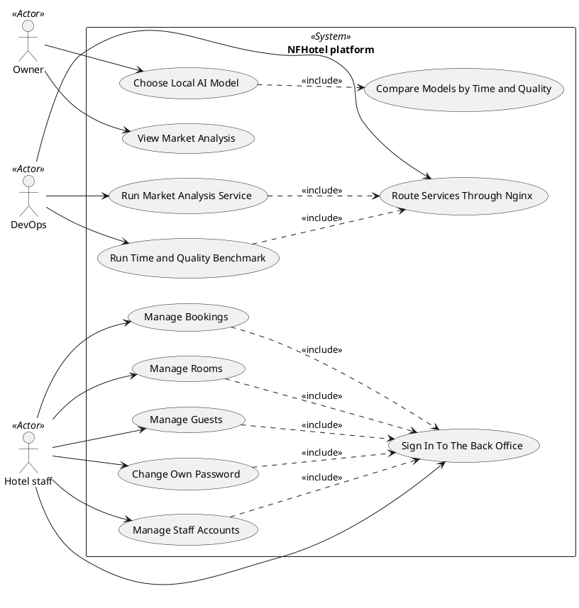

# Use Case Diagram

## Metadata
| Key | Value |
| --- | --- |
| ID | UCD-001 |
| CrossReference | [SA-001], [BC-001], [US-001] |
| Language | en |
| Domain | it |

## Version History
| Date | Status | Author | Reviewer | Change | Commit |
| --- | --- | --- | --- | --- | --- |
| 2026-10-16 | Deprecated | Claude (AI) | AI as stand-in for S01 (terminology confirmed by the user) | Accepted after RC-013 Go | [469ff7a] |
| 2026-10-16 | Deprecated | Claude (AI) | AI as stand-in for S01 (terminology confirmed by the user) | Added the actor Hotel staff and the use cases Manage Bookings, Manage Rooms and Manage Guests (MIL-007) | [a29c54a] |
| 2026-10-17 | Deprecated | Claude (AI) | AI as stand-in for S01 (terminology confirmed by the user) | Added the use case Sign In To The Back Office (MIL-016) | [1593b34] |
| 2026-10-20 | Accepted | mikemike | AI as stand-in for S01 | Added Change Own Password and Manage Staff Accounts (MIL-030) (accepted after RC-135 Go) | [0891cf1] |

---

## Purpose and Scope

The system boundary is the NFHotel platform as the owner and DevOps use it: a
market analysis that shows diagrams and an AI analysis, a benchmark that
compares local AI models on time and answer quality, and the hosting of both on
Proxmox VE virtual machines as Docker containers behind one nginx reverse proxy.
The back office of the hotel (staff managing bookings, rooms and guests, added for MIL-007) is inside it; the guest flows and the screens are outside this
diagram. The two source services are the repositories
`NF-Hotel/Notebook_Market_Analysis` and `NF-Hotel/notebook-benchmark`.

## Diagram

## Actor Table

| Actor | Stereotype | Stakeholder ID (SA) | Goals (use cases) |
| --- | --- | --- | --- |
| Owner | `<<Actor>>` | S01 | View Market Analysis; Choose Local AI Model |
| DevOps | `<<Actor>>` | S02 | Route Services Through Nginx; Run Time and Quality Benchmark; Run Market Analysis Service |
| Hotel staff | `<<Actor>>` | S05 | Manage Bookings; Manage Rooms; Manage Guests; Sign In To The Back Office; Change Own Password; Manage Staff Accounts |

## Use Case Table

| Use Case | Actor(s) | Goal | Source story | Priority (MoSCoW) | Reason |
| --- | --- | --- | --- | --- | --- |
| View Market Analysis | Owner | See the market analysis as diagrams with an AI analysis | [US-001].01 | Must | Direct value to the owner; the analysis application already exists |
| Choose Local AI Model | Owner | Pick the local AI model with the best balance of response time and answer quality | [US-001].02 | Should | Depends on benchmark results (UC Run Time and Quality Benchmark) |
| Route Services Through Nginx | DevOps | Reach every web and API service only through the nginx proxy | [US-001].03 | Must | Already started in MIL-002; the other services depend on it |
| Run Time and Quality Benchmark | DevOps | Run the time and answer-quality test as a service on a Proxmox VM behind the proxy | [US-001].04 | Should | Hardware dependent (GPU access from a VM is the main risk) |
| Run Market Analysis Service | DevOps | Run the market analysis service on a Proxmox VM through Docker Compose behind the proxy | [US-001].05 | Must | Needed before the owner can view the analysis |
| Compare Models by Time and Quality | Owner | See models side by side by response time and answer quality | [US-001].02 | Should | Part of choosing a model; shown by the benchmark results |
| Manage Bookings | Hotel staff | Create, confirm, check in, check out, cancel and move bookings without double booking | [US-001].06 | Must | The core of the back office |
| Manage Rooms | Hotel staff | Keep the rooms, their status and their cleaning state correct | [US-001].07 | Must | Bookings need rooms |
| Manage Guests | Hotel staff | Find, register, change and delete guests | [US-001].08 | Must | Bookings need guests |
| Sign In To The Back Office | Hotel staff | Sign in with an own account and see only what the role needs | [US-001].09 | Must | The back office must not run on the public port without it |
| Change Own Password | Hotel staff | Change the own password with the current one, so that older sessions end | [US-001].10 | Must | A password that others have seen must be replaceable |
| Manage Staff Accounts | Hotel staff (Manager) | Create, disable, enable and reset accounts and read the audit trail | [US-001].11 | Must | Accounts are made by a command on the server today |

## Role Matrix

Suggestion for the Product Owner to approve. There are three primary actors, so
roles follow the actors: the Owner role decides on analysis and model choice;
the DevOps role operates the services; the Hotel staff role runs the back office. Data visibility is not covered.

| Use Case | Owner | DevOps | Hotel staff |
| --- | --- | --- | --- |
| View Market Analysis | performs | - | - |
| Choose Local AI Model | performs | - | - |
| Compare Models by Time and Quality | performs | - | - |
| Route Services Through Nginx | - | performs | - |
| Run Time and Quality Benchmark | - | performs | - |
| Run Market Analysis Service | - | performs | - |
| Manage Bookings | - | - | performs |
| Manage Rooms | - | - | performs |
| Manage Guests | - | - | performs |
| Sign In To The Back Office | - | - | performs |
| Change Own Password | - | - | performs |
| Manage Staff Accounts | - | - | performs (Manager only) |

No use case is shared by two roles. Whether DevOps may also view the analysis
is a question for the Product Owner.

## Relationships

| From | Relationship (`<<include>>` / `<<extend>>`) | To | Justification |
| --- | --- | --- | --- |
| Choose Local AI Model | `<<include>>` | Compare Models by Time and Quality | A model choice always needs the comparison; it is a mandatory part of the goal |
| Run Time and Quality Benchmark | `<<include>>` | Route Services Through Nginx | The benchmark service is only reachable behind the proxy |
| Run Market Analysis Service | `<<include>>` | Route Services Through Nginx | The analysis service is only reachable behind the proxy |
| Manage Bookings, Manage Rooms, Manage Guests | `<<include>>` | Sign In To The Back Office | Every back office function needs a signed-in member of staff |
| Change Own Password, Manage Staff Accounts | `<<include>>` | Sign In To The Back Office | Both need a signed-in member of staff |

---

[SA-001]: ./stakeholder-analysis.md
[BC-001]: ./business-case.md
[US-001]: ./user-stories.md
[fc8ec78]: https://github.com/NF-Hotel/NFHotel/commit/fc8ec78b24b805b10d5c056b19ed2785697ee8ff
[469ff7a]: https://github.com/NF-Hotel/NFHotel/commit/469ff7a7871bb900155dcaf0639b5db1371681aa
[a29c54a]: https://github.com/NF-Hotel/NFHotel/commit/a29c54a0e6cc95b2b627748aa841ee24a399c15d
[1593b34]: https://github.com/NF-Hotel/NFHotel/commit/1593b34bb7cc020a8564f1030f49e2c395803ad4
[0891cf1]: https://github.com/NF-Hotel/NFHotel/commit/0891cf138311b2c3a9a6e2b20ad92c501ddf80cf
