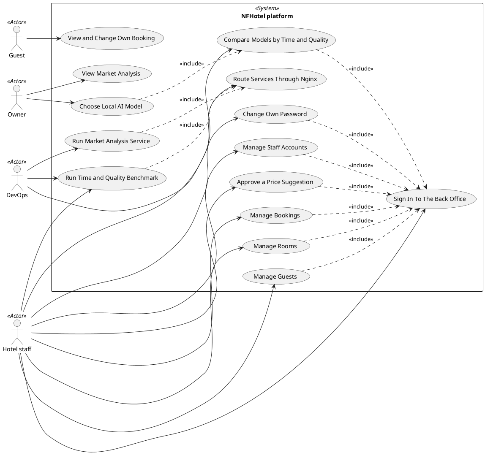

# Use Case Diagram

## Metadata
| Key | Value |
| --- | --- |
| ID | UCD-001 |
| CrossReference | [SA-001], [BC-001], [US-001] |
| Language | en |
| Domain | it |

## Version History
| Date | Status | Author | Reviewer | Change | Commit |
| --- | --- | --- | --- | --- | --- |
| 2026-11-14 | Deprecated | mikemike | AI as stand-in for S01 | The benchmark use cases aligned with MIL-019 and MIL-020 (UC-008, UC-009): Hotel staff (Manager) on Compare Models by Time and Quality, which includes Sign In To The Back Office, and, beside DevOps, on Run Time and Quality Benchmark; the Owner works through the role Manager; the service repository is notebook-market-analysis; the older rows of the Version History left to git; accepted after RC-368 Go, at S01's word in chat ("Du godkender for mig"); mode autonomous, not independent | [50f850d] |
| 2026-11-15 | Accepted | mikemike | AI as stand-in for S01 | The actor Guest (S06) and the use case View and Change Own Booking (UC-010, US-001.13) added for MIL-018; a guest's own booking is inside the boundary, making a booking on the website stays outside Go in RC-390; accepted by the AI as stand-in for S01 | pending |

---

## Purpose and Scope

The system boundary is the NFHotel platform as the owner and DevOps use it: a
market analysis that shows diagrams and an AI analysis, a benchmark that
compares local AI models on time and answer quality, and the hosting of both on
Proxmox VE virtual machines as Docker containers behind one nginx reverse proxy.
The back office of the hotel (staff managing bookings, rooms and guests, added for MIL-007) is inside it, and so is a guest's view and change of the own booking (MIL-018); making a booking on the
website and the screens are outside this diagram. The two source services are the repositories
`NF-Hotel/notebook-market-analysis` and `NF-Hotel/notebook-benchmark`.

## Diagram

## Actor Table

| Actor | Stereotype | Stakeholder ID (SA) | Goals (use cases) |
| --- | --- | --- | --- |
| Owner | `<<Actor>>` | S01 | View Market Analysis; Choose Local AI Model |
| DevOps | `<<Actor>>` | S02 | Route Services Through Nginx; Run Time and Quality Benchmark; Run Market Analysis Service |
| Hotel staff | `<<Actor>>` | S05 | Manage Bookings; Manage Rooms; Manage Guests; Sign In To The Back Office; Change Own Password; Manage Staff Accounts; Approve a Price Suggestion; Run Time and Quality Benchmark (a Manager starts a run); Compare Models by Time and Quality |
| Guest | `<<Actor>>` | S06 | View and Change Own Booking |

## Use Case Table

| Use Case | Actor(s) | Goal | Source story | Priority (MoSCoW) | Reason |
| --- | --- | --- | --- | --- | --- |
| View Market Analysis | Owner | See the market analysis as diagrams with an AI analysis | [US-001].01 | Must | Direct value to the owner; the analysis application already exists |
| Choose Local AI Model | Owner | Pick the local AI model with the best balance of response time and answer quality | [US-001].02 | Should | Depends on benchmark results (UC Run Time and Quality Benchmark) |
| Route Services Through Nginx | DevOps | Reach every web and API service only through the nginx proxy | [US-001].03 | Must | Already started in MIL-002; the other services depend on it |
| Run Time and Quality Benchmark | DevOps; Hotel staff (Manager) | DevOps runs the time and answer-quality test as a service on a Proxmox VM behind the proxy; a Manager starts a run of the chosen models from the back office and follows it until its result is stored ([UC-009]) | [US-001].04 | Should | Hardware dependent (GPU access from a VM is the main risk); MIL-020 lets a Manager start a run |
| Run Market Analysis Service | DevOps | Run the market analysis service on a Proxmox VM through Docker Compose behind the proxy | [US-001].05 | Must | Needed before the owner can view the analysis |
| Compare Models by Time and Quality | Hotel staff (Manager) | See models side by side by response time and answer quality ([UC-008]) | [US-001].02 | Should | Part of choosing a model; MIL-019 shows the stored runs only to the permission `Benchmark.View`, which only the Manager holds |
| Manage Bookings | Hotel staff | Create, confirm, check in, check out, cancel and move bookings without double booking | [US-001].06 | Must | The core of the back office |
| Manage Rooms | Hotel staff | Keep the rooms, their status and their cleaning state correct | [US-001].07 | Must | Bookings need rooms |
| Manage Guests | Hotel staff | Find, register, change and delete guests | [US-001].08 | Must | Bookings need guests |
| Sign In To The Back Office | Hotel staff | Sign in with an own account and see only what the role needs | [US-001].09 | Must | The back office must not run on the public port without it |
| Change Own Password | Hotel staff | Change the own password with the current one, so that older sessions end | [US-001].10 | Must | A password that others have seen must be replaceable |
| Manage Staff Accounts | Hotel staff (Manager) | Create, disable, enable and reset accounts and read the audit trail | [US-001].11 | Must | Accounts are made by a command on the server today |
| Approve a Price Suggestion | Hotel staff (Manager) | Approve or revert a suggested price change for the high or the low season | [US-001].12 | Should | The owner wants the market analysis to lead to a price |
| View and Change Own Booking | Guest | Sign in with the booking number and the email of the booking, see the own booking, move its dates or cancel it ([UC-010]) | [US-001].13 | Should | Objective 21 of the Business Case; no guest reaches another guest's booking |

## Role Matrix

Suggestion for the Product Owner to approve. There are four primary actors, so
roles follow the actors: the Owner role decides on analysis and model choice;
the DevOps role operates the services; the Hotel staff role runs the back office;
the Guest role sees and changes only the own booking. Data visibility is not covered.

| Use Case | Owner | DevOps | Hotel staff | Guest |
| --- | --- | --- | --- | --- |
| View Market Analysis | performs | - | - | - |
| Choose Local AI Model | performs | - | - | - |
| Compare Models by Time and Quality | - | - | performs (Manager only) | - |
| Route Services Through Nginx | - | performs | - | - |
| Run Time and Quality Benchmark | - | performs (runs the service) | performs (Manager only: starts a run) | - |
| Run Market Analysis Service | - | performs | - | - |
| Manage Bookings | - | - | performs | - |
| Manage Rooms | - | - | performs | - |
| Manage Guests | - | - | performs | - |
| Sign In To The Back Office | - | - | performs | - |
| Change Own Password | - | - | performs | - |
| Manage Staff Accounts | - | - | performs (Manager only) | - |
| Approve a Price Suggestion | - | - | performs (Manager only) | - |
| View and Change Own Booking | - | - | - | performs (the own booking only) |

One use case is shared by two roles: in Run Time and Quality Benchmark, DevOps
runs the service and a Manager starts a run (MIL-020). The Owner compares the
models and starts runs through an account with the role Manager, which alone
holds `Benchmark.View` and `Benchmark.Run` (MIL-019, decision 4). Whether DevOps
may also view the analysis is a question for the Product Owner.

## Relationships

| From | Relationship (`<<include>>` / `<<extend>>`) | To | Justification |
| --- | --- | --- | --- |
| Choose Local AI Model | `<<include>>` | Compare Models by Time and Quality | A model choice always needs the comparison; it is a mandatory part of the goal |
| Run Time and Quality Benchmark | `<<include>>` | Route Services Through Nginx | The benchmark service is only reachable behind the proxy |
| Run Market Analysis Service | `<<include>>` | Route Services Through Nginx | The analysis service is only reachable behind the proxy |
| Manage Bookings, Manage Rooms, Manage Guests | `<<include>>` | Sign In To The Back Office | Every back office function needs a signed-in member of staff |
| Change Own Password, Manage Staff Accounts, Approve a Price Suggestion | `<<include>>` | Sign In To The Back Office | Both need a signed-in member of staff |
| Compare Models by Time and Quality | `<<include>>` | Sign In To The Back Office | The stored runs are in the back office, for a signed-in Manager. Run Time and Quality Benchmark does not include it: DevOps runs the service outside the back office, and a Manager who starts a run has signed in first (a precondition of [UC-009]) |

---

[SA-001]: ./stakeholder-analysis.md
[BC-001]: ./business-case.md
[US-001]: ./user-stories.md
[UC-008]: ./use-cases/uc-008/uc.md
[UC-009]: ./use-cases/uc-009/uc.md
[UC-010]: ./use-cases/uc-010/uc.md
[50f850d]: https://github.com/NF-Hotel/NFHotel/commit/50f850d890371ba0759cbba802c27c9b31cf5b69
