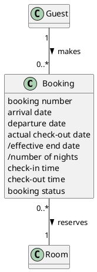

# Domain Model DM-001

## Metadata
| Key | Value |
| --- | --- |
| ID | DM-001 |
| CrossReference | [UC-001], [UCD-001], [DICT-001] |
| Language | en |
| Domain | it |

## Version History
| Date | Status | Author | Reviewer | Change | Commit |
| --- | --- | --- | --- | --- | --- |
| 2026-10-16 | Accepted | Claude (AI) | AI as stand-in for S01 (terminology confirmed by the user) | Initial version | [2242b02] |

---

## Purpose and Scope

Covers [UC-001] Manage Bookings: the concept Booking, and the Guest and the Room it refers to. The attributes of Guest and Room are in [DM-002] and [DM-003].

## Diagram

Concepts, attributes and associations only — no operations. A slash marks a derived attribute.

## Concept Table

| Concept | Definition | Attributes | Source (use case / glossary) |
| --- | --- | --- | --- |
| Booking | A guest's claim on one room for the nights from an arrival date to a departure date | booking number, arrival date, departure date, actual check-out date, /effective end date, /number of nights, check-in time, check-out time, booking status (pending, confirmed, checked in, checked out, cancelled) | UC-001 steps 1 to 6; glossary: Booking, Booking number, Booking status |
| Guest | A person for whom a booking is made (attributes in DM-003) | none here | UC-001 step 1 |
| Room | A room that a booking claims (attributes in DM-002) | none here | UC-001 step 1 |

## Association Table

| From | Association (reading direction) | To | Multiplicity |
| --- | --- | --- | --- |
| Guest | makes | Booking | Guest 1, Booking 0..* |
| Booking | reserves | Room | Booking 0..*, Room 1 |

## Generalizations

None. No concept is a kind of another concept.

---

[UC-001]: ./uc.md
[UCD-001]: ../../use-case-diagram.md
[DICT-001]: ../../dictionary.md
[DM-002]: ../uc-002/dm.md
[DM-003]: ../uc-003/dm.md
[2242b02]: https://github.com/NF-Hotel/NFHotel/commit/2242b023565ea8213a6dc071ae8432cbff038222
