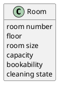

# Domain Model DM-002

## Metadata
| Key | Value |
| --- | --- |
| ID | DM-002 |
| CrossReference | [UC-002], [UCD-001], [DICT-001] |
| Language | en |
| Domain | it |

## Version History
| Date | Status | Author | Reviewer | Change | Commit |
| --- | --- | --- | --- | --- | --- |
| 2026-10-16 | Accepted | Claude (AI) | AI as stand-in for S01 (terminology confirmed by the user) | Initial version | [2242b02] |

---

## Purpose and Scope

Covers [UC-002] Manage Rooms: the concept Room with its bookability and cleaning state.

## Diagram

Concepts, attributes and associations only — no operations. A slash marks a derived attribute.

## Concept Table

| Concept | Definition | Attributes | Source (use case / glossary) |
| --- | --- | --- | --- |
| Room | A lettable room of the hotel that a booking can claim | room number, floor, room size (single, double, suite), capacity, bookability (available, out of service, maintenance), cleaning state (clean, daily cleaning due, departure cleaning due, cleaning in progress, service required, service in progress) | UC-002 steps 1 to 7; glossary: Room, Room number, Bookability, Cleaning state |

## Association Table

| From | Association (reading direction) | To | Multiplicity |
| --- | --- | --- | --- |
| none | none | none | A room has no association of its own here; its relation to Booking is in DM-001 |

## Generalizations

None. No concept is a kind of another concept.

---

[UC-002]: ./uc.md
[UCD-001]: ../../use-case-diagram.md
[DICT-001]: ../../dictionary.md
[2242b02]: https://github.com/NF-Hotel/NFHotel/commit/2242b023565ea8213a6dc071ae8432cbff038222
