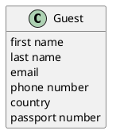

# Domain Model DM-003

## Metadata
| Key | Value |
| --- | --- |
| ID | DM-003 |
| CrossReference | [UC-003], [UCD-001], [DICT-001] |
| Language | en |
| Domain | it |

## Version History
| Date | Status | Author | Reviewer | Change | Commit |
| --- | --- | --- | --- | --- | --- |
| 2026-10-16 | Accepted | Claude (AI) | AI as stand-in for S01 (terminology confirmed by the user) | Initial version | [2242b02] |

---

## Purpose and Scope

Covers [UC-003] Manage Guests: the concept Guest and its personal data.

## Diagram

Concepts, attributes and associations only — no operations. A slash marks a derived attribute.

## Concept Table

| Concept | Definition | Attributes | Source (use case / glossary) |
| --- | --- | --- | --- |
| Guest | A person who stays, or will stay, in the hotel and for whom a booking is made | first name, last name, email, phone number, country, passport number (optional) | UC-003 steps 1 to 6; glossary: Guest, Passport number |

## Association Table

| From | Association (reading direction) | To | Multiplicity |
| --- | --- | --- | --- |
| none | none | none | A guest has no association of its own here; its relation to Booking is in DM-001 |

## Generalizations

None. No concept is a kind of another concept.

---

[UC-003]: ./uc.md
[UCD-001]: ../../use-case-diagram.md
[DICT-001]: ../../dictionary.md
[2242b02]: https://github.com/NF-Hotel/NFHotel/commit/2242b023565ea8213a6dc071ae8432cbff038222
