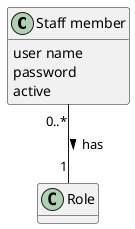

# Domain Model DM-005

## Metadata
| Key | Value |
| --- | --- |
| ID | DM-005 |
| CrossReference | [UC-004], [UCD-001], [DICT-001] |
| Language | en |
| Domain | it |

## Version History
| Date | Status | Author | Reviewer | Change | Commit |
| --- | --- | --- | --- | --- | --- |
| 2026-10-17 | Proposed | Claude (AI) | AI as stand-in for S01 | Initial version (MIL-016) | pending |
| 2026-10-17 | Accepted | Claude (AI) | AI as stand-in for S01 | Accepted after RC-071 Go | pending |

---

## Purpose and Scope

Covers [UC-004] Sign In To The Back Office: the concepts Staff member and Role.

## Diagram

Concepts, attributes and associations only — no operations. A slash marks a derived attribute.

## Concept Table

| Concept | Definition | Attributes | Source (use case / glossary) |
| --- | --- | --- | --- |
| Staff member | A person of the hotel who signs in to the back office with a user name and a password | user name (the same in any case), password (kept only as a salted hash), active (an inactive member cannot sign in) | UC-004 steps 3 and 4; glossary: Staff member, User name |
| Role | What a staff member does in the hotel, and so which functions the member may use: Receptionist, Manager or Housekeeping | none | UC-004 steps 4 and 6; glossary: Role |

## Association Table

| From | Association (reading direction) | To | Multiplicity |
| --- | --- | --- | --- |
| Staff member | has | Role | Staff member 0..*, Role 1 |

## Generalizations

None. No concept is a kind of another concept.

---

[UC-004]: ./uc.md
[UCD-001]: ../../use-case-diagram.md
[DICT-001]: ../../dictionary.md
