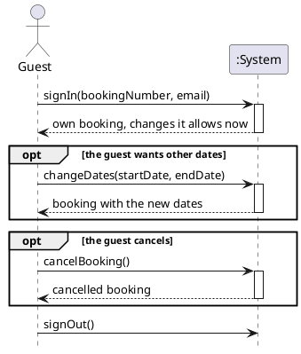
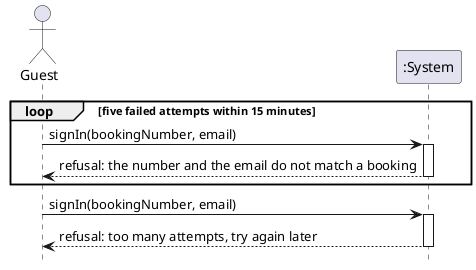

# SSD-001 View and Change Own Booking

## Metadata
| Key | Value |
| --- | --- |
| ID | SSD-001 |
| CrossReference | [UC-010], [DM-004], [OC-001] |
| Language | en |
| Domain | it |

## Version History
| Date | Status | Author | Reviewer | Change | Commit |
| --- | --- | --- | --- | --- | --- |
| 2026-11-15 | Accepted | mikemike | AI as stand-in for S01 | Initial version; task 3 of MIL-018, written by the AI Go in RC-389; accepted by the AI as stand-in for S01 | pending |

---

## Source Use Case

[UC-010] View and Change Own Booking: the main success scenario (steps 1 to 8), and the refused sign-in of
extensions 2a and 2b in a second diagram. The other extensions are out of scope of the diagrams: 1a belongs to the
booking on the website, which has no use case of its own; 3a to 3c and *a to *c are refusals of a message below,
listed as exceptions in [OC-001]; 7a changes nothing that the guest sees.

## Diagram

Main success scenario:

Refused sign-in (extensions 2a and 2b):

## System Operations Table

| Step | Message (verb phrase) | Parameters | Return | Use case step |
| --- | --- | --- | --- | --- |
| 1 | signIn | booking number, email | the own booking with the changes it allows now | 1, 2 |
| 2 | changeDates | startDate (the arrival date), endDate (the departure date) | the booking with the new dates | 3, 4 |
| 3 | cancelBooking | none | the cancelled booking | 5, 6 |
| 4 | signOut | none | none | 7, 8 |

Steps 1 and 2 of the use case are one message: the system shows the booking as the answer to the sign-in.
changeDates and cancelBooking name no booking: they act on the booking of the guest's sign-in.

## Lifecycle Notes

- The `:System` is the NFHotel platform as the guest reaches it: the website and the hotel API behind it.
- signIn starts the guest's sign-in for one booking; it ends with signOut or two hours after signIn, whichever comes
  first. changeDates and cancelBooking work only within it. A refused signIn starts nothing.
- A staff sign-in in the same browser is a separate sign-in: signIn and signOut neither start nor end it.

---

[UC-010]: ./uc.md
[DM-004]: ../../domain-model.md
[OC-001]: ./oc.md
