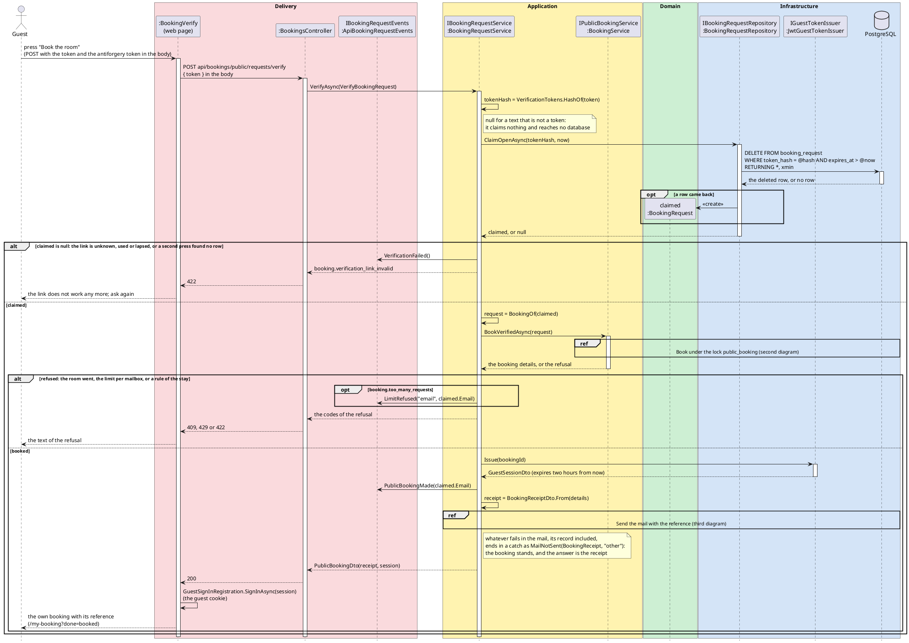
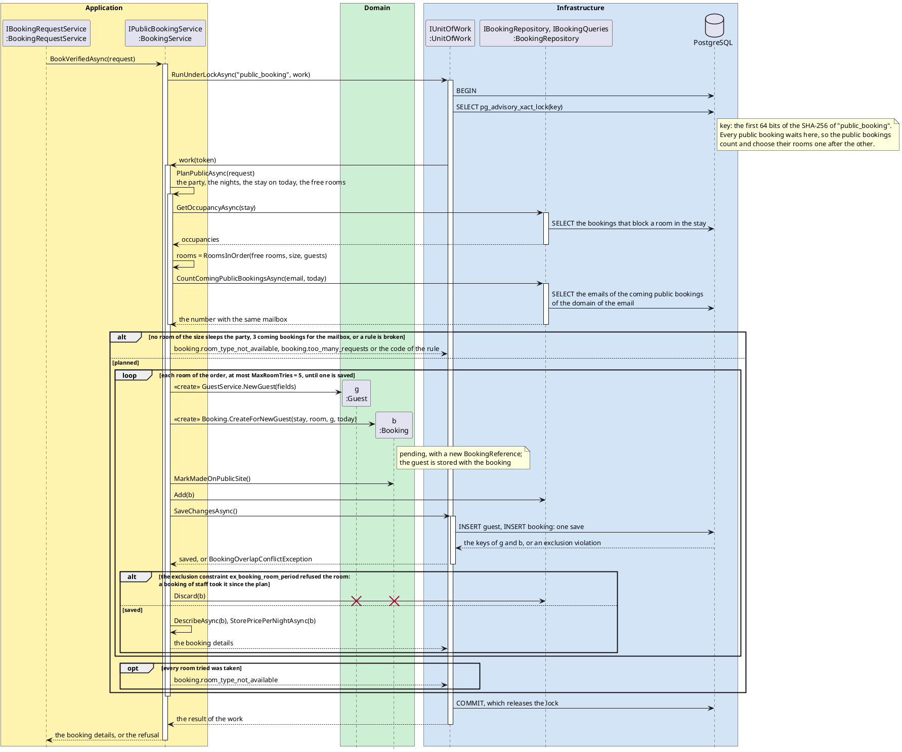
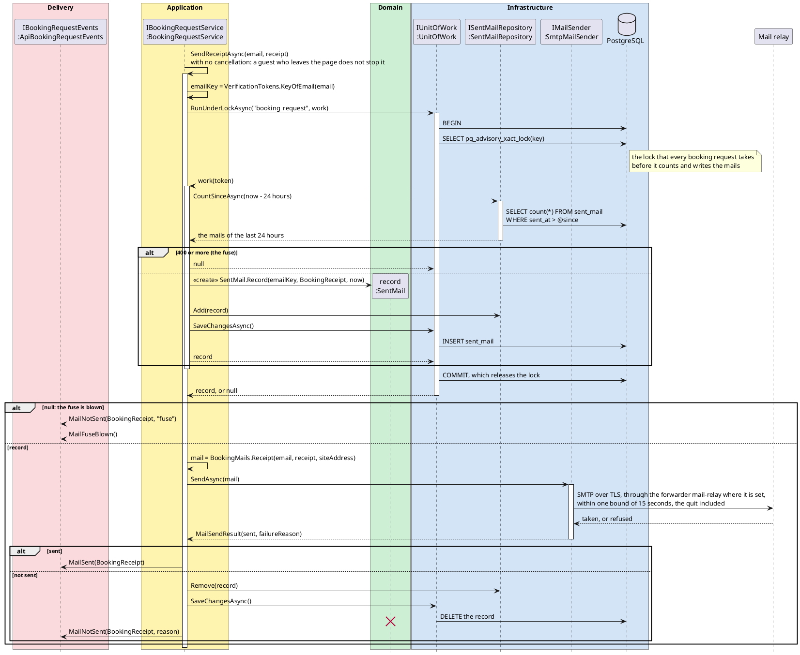

# SD-001 Book a Room and Verify It by Email

## Metadata
| Key | Value |
| --- | --- |
| ID | SD-001 |
| CrossReference | [OC-002], [SSD-002], [UC-011], [DICT-001], [SA-001], [ADR-0047], [ADR-0049], [ADR-0051], [ADR-0052], [ADR-0053] |

## Version History
| Date | Status | Author | Reviewer | Change | Commit |
| --- | --- | --- | --- | --- | --- |
| 2026-11-20 | Accepted | mikemike | AI as stand-in for S01 | Initial version, the first Sequence Diagram of the project; task 3 of MIL-088, written by the AI from the code of the branch: verifyBooking through the claim of the request, the booking under the lock `public_booking`, the guest session and the mail with the reference (ADR-0052, ADR-0053) Go in RC-435; accepted by the AI as stand-in for S01 in autonomous mode | [739a25b] |

---

## Purpose

How the objects of the website and the API carry out verifyBooking, contract CO4 of [OC-002]: the step that turns a
booking request into a booking. It answers the concern CN-006 of S05, no double booking, because two locks of the
database and its exclusion constraint decide every race for a room and for a link; and CN-007 of S06, only the own
booking without an account and personal data kept private, because the request is taken once and is gone after it,
and the guest is signed in only after the verification ([SA-001]). It serves the developers, and S04 (CN-005), who
can trace each message to the code and to its decision in [ADR-0052] and [ADR-0053].

The other contracts of [OC-002] have no sequence diagram yet. bookAtOnce (CO6) books through the same frame as the
second diagram below, without a request and without a mail.

The lifelines are grouped by the layers of the design class diagram (`docs/dcd.md`): Delivery, Application, Domain
and Infrastructure. A lifeline of an outer layer that implements a port of an inner layer is named after both, the
port first (`IMailSender` and `:SmtpMailSender`), so a call across a layer boundary goes through the port. The
website is drawn as one lifeline: its page `BookingVerify` and its view model `BookingVerifyViewModel` call the API
through the port `IBookingRequestService`, which the API client `ApiBookingRequestService` implements with an HTTP
request. PostgreSQL and the mail relay are outside the application.

## Sequence: verifyBooking

**Realizes:** `verifyBooking` in [OC-002] (CO4), message 4 of [SSD-002]

### Diagram

From the button to the receipt:

Book under the lock `public_booking`, `BookingService.BookVerifiedAsync`, the same frame as a booking at once:

Send the mail with the reference, `BookingRequestService.SendReceiptAsync`:

Not drawn: with the verification by email switched off, `VerifyAsync` answers `booking.not_found` before it claims
anything, and the page shows the text of an invalid link; a token that is missing or longer than 64 characters is
refused with `api.invalid_request` before the action runs. Both change nothing (the first two exceptions of CO4).

### Pattern Annotations

| Pattern (GRASP / GoF) | Applied to | Rationale |
| --- | --- | --- |
| Controller (GRASP) | `BookingsController` | Receives the system operation verifyBooking and hands it to the use case; it holds no rule |
| Pure Fabrication (GRASP), use case controller | `BookingRequestService` | Coordinates the request's way to a booking: the claim, the booking, the session, the events and the mail. It is no concept of the Domain Model |
| Information Expert (GRASP) | `BookingService` (`PlanPublicAsync`, `RoomsInOrder`), `Booking.CreateForNewGuest`, `VerificationTokens`, `Mailbox` | Each knows its rules: the rules and the room order of a public booking, the invariants of a new booking, the form of a token, the normal form of a mailbox |
| Creator (GRASP), Factory Method (GoF) | `Booking.CreateForNewGuest`, `GuestService.NewGuest`, `SentMail.Record`; `BookingRequestRepository` for the claimed request | The static creation methods make valid objects only; the repository makes the request from the row that it deleted |
| Repository and Unit of Work (Fowler) | `IBookingRequestRepository`, `IBookingRepository`, `ISentMailRepository`, `IUnitOfWork` | The repositories mark and read; only the unit of work saves, and `RunUnderLockAsync` gives a piece of work one transaction under a lock of the database |
| Command (GoF) | the work passed to `RunUnderLockAsync` | The unit of work runs the work inside its transaction and runs it again when the execution strategy of the database retries |
| Adapter (GoF), Protected Variations (GRASP) | `SmtpMailSender` for `IMailSender`, `JwtGuestTokenIssuer` for `IGuestTokenIssuer`, `ApiBookingRequestEvents` for `IBookingRequestEvents`, the repositories and `UnitOfWork` for their ports | The use case does not change when the relay, the token format, the log or the database changes; the tests replace each port |

### Postcondition Coverage

| Postcondition (from contract) | Satisfied by message |
| --- | --- |
| r was deleted | `ClaimOpenAsync` with `DELETE ... RETURNING` (first diagram); the claim commits on its own, so r stays deleted whatever follows |
| A `Guest` g was created with the fields of r | `BookingOf(claimed)` (first diagram) and `<<create>> GuestService.NewGuest(fields)` (second diagram) |
| A `Booking` b was created: a new `BookingReference`, the dates of r, pending, `MadeOnPublicSite` set | `<<create>> Booking.CreateForNewGuest(stay, room, g, today)` and `MarkMadeOnPublicSite()` (second diagram) |
| b was associated with g and with a free `Room` of r.RoomSize that sleeps r.Guests; g and b were stored together | `RoomsInOrder` and the loop over the rooms; `SaveChangesAsync()` with one INSERT of the guest and the booking, under the lock `public_booking`, retried on the next room when the exclusion constraint refuses (second diagram) |
| A `GuestSession` gs was created and associated with b, ending two hours from now | `Issue(bookingId)` (first diagram); the page keeps it in the guest cookie (`SignInAsync`) |
| A `SentMail` s was created, unless the fuse is blown, the relay did not take the mail, or the sending failed in another way before s was stored | `SentMail.Record`, `Add` and `SaveChangesAsync` under the lock `booking_request`; `Remove` when the relay refuses (third diagram); any other failure ends in the catch of `VerifyAsync` with `MailNotSent(BookingReceipt, "other")` (first diagram) |

### Responsibility Check

No lifeline receives all the messages. `BookingsController` turns the HTTP request into one call and the result into a
status. `BookingRequestService` coordinates and decides nothing that another object knows: it does not choose the
room, check the rules of the stay or write SQL. `BookingService` keeps the checks and the save of every public booking,
so the booking at once and the verified booking cannot drift apart. The repositories hold the queries, `UnitOfWork`
the transaction and the lock, `SmtpMailSender` the mail protocol, `JwtGuestTokenIssuer` the token, and the domain
objects their own invariants. The two locks have one job each: `booking_request` orders the counts and writes of the
mails, and `public_booking` orders the counts and the choice of the room of the public bookings.

---

[OC-002]: ./oc.md
[SSD-002]: ./ssd.md
[UC-011]: ./uc.md
[DICT-001]: ../../dictionary.md
[SA-001]: ../../stakeholder-analysis.md
[ADR-0047]: ../../adr/adr-0047-guest-login.md
[ADR-0049]: ../../adr/adr-0049-booking-reference.md
[ADR-0051]: ../../adr/adr-0051-limits-of-the-booking-flow-and-the-caller-address.md
[ADR-0052]: ../../adr/adr-0052-a-booking-takes-a-room-once-its-email-is-verified.md
[ADR-0053]: ../../adr/adr-0053-mail-from-the-application-through-a-relay.md
[739a25b]: https://github.com/NF-Hotel/NFHotel/commit/739a25b00890c77fe75ba0bb02fcd64a00548089
