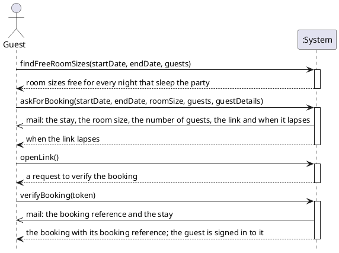
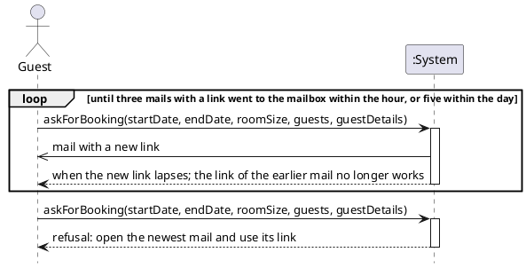
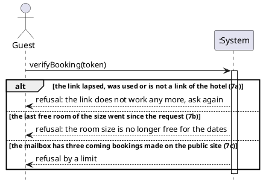
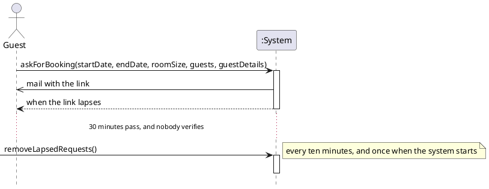
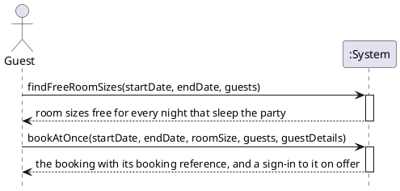

# SSD-002 Book a Room and Verify It by Email

## Metadata
| Key | Value |
| --- | --- |
| ID | SSD-002 |
| CrossReference | [UC-011], [DM-004], [OC-002], [UC-010] |
| Language | en |
| Domain | it |

## Version History
| Date | Status | Author | Reviewer | Change | Commit |
| --- | --- | --- | --- | --- | --- |
| 2026-11-20 | Accepted | mikemike | AI as stand-in for S01 | Initial version; task 3 of MIL-088, written by the AI: the system operations of the booking on the website that is asked for, verified by email and then booked (ADR-0052, ADR-0053) Go in RC-435; accepted by the AI as stand-in for S01 in autonomous mode | [739a25b] |

---

## Source Use Case

[UC-011] Book a Room and Verify It by Email: the main success scenario (steps 1 to 9) in the first diagram; the mail
asked for again (extension 5a) up to the limit of the mails per mailbox (extension 4e) in the second; the refused
verification (extensions 7a to 7c) in the third; the request that nobody verifies (extension 5b) in the fourth; and
the booking at once while the verification by email is switched off (extension *a) in the fifth. The other extensions
are refusals of a message below and are listed as exceptions in [OC-002]: 2a and 2b of findFreeRoomSizes; 4a to 4d,
4f, 4g and *b of askForBooking; 7d of verifyBooking. Extension 9a changes nothing that the guest sees but the mail
that does not come.

## Diagram

Main success scenario:

The mail asked for again (extensions 5a and 4e):

The refused verification (extensions 7a to 7c):

The request that nobody verifies (extension 5b):

The booking at once while the verification by email is switched off (extension *a):

## System Operations Table

| Step | Message (verb phrase) | Parameters | Return | Use case step |
| --- | --- | --- | --- | --- |
| 1 | findFreeRoomSizes | startDate (the arrival date), endDate (the departure date), guests (the number of guests) | the room sizes free for every night of the stay that sleep the party | 1, 2 |
| 2 | askForBooking | startDate, endDate, roomSize (the room size), guests, guestDetails (first name, last name, email, phone number, country, and the passport number if the guest gives one) | the time the link lapses; the mail with the link goes to the email | 3, 4, 5a |
| 3 | openLink | none: the secret part of the link stays in the guest's browser | a request to verify the booking | 5, 6 |
| 4 | verifyBooking | token (the secret part of the link) | the booking receipt, and the guest's sign-in to the booking; the mail with the booking reference goes to the email | 7, 8, 9 |
| 5 | removeLapsedRequests | none: started by the time, not by an actor | none | 5b |
| 6 | bookAtOnce | as askForBooking | the booking receipt, and a sign-in to the booking on offer | *a |

Steps 1 and 2, 3 and 4, 5 and 6, and 7 to 9 of the use case are one message each: the system's response is the answer
to the guest's message. The two mails are outputs of askForBooking and verifyBooking, drawn as asynchronous messages,
and go to the email, which in extension 5b is not the guest's. removeLapsedRequests has no actor of the use case:
time starts it. The sign-in on offer after bookAtOnce is extension 1a of UC-010, not a message of this diagram.

## Lifecycle Notes

- The `:System` is the NFHotel platform as the guest reaches it: the website and the hotel API behind it, and the
  mails that it sends through the mail relay.
- askForBooking creates a booking request, or replaces the open one of the same mailbox. The request holds no room and
  lives until verifyBooking takes it, the next askForBooking of the mailbox replaces it, or removeLapsedRequests
  deletes it after its link lapsed. A refused askForBooking creates nothing and leaves the open request as it was,
  except when the mail relay does not take the mail: then no request of the mailbox is left.
- verifyBooking ends the booking request whatever follows. When it books, it starts the guest's sign-in to the
  booking, which ends at the sign-out or two hours after the verification ([UC-010]).
- findFreeRoomSizes and openLink start and end nothing. bookAtOnce makes the booking without a request and starts no
  sign-in; the guest's sign-in starts when the guest takes the sign-in on offer.

---

[UC-011]: ./uc.md
[DM-004]: ../../domain-model.md
[OC-002]: ./oc.md
[UC-010]: ../uc-010/uc.md
[739a25b]: https://github.com/NF-Hotel/NFHotel/commit/739a25b00890c77fe75ba0bb02fcd64a00548089
