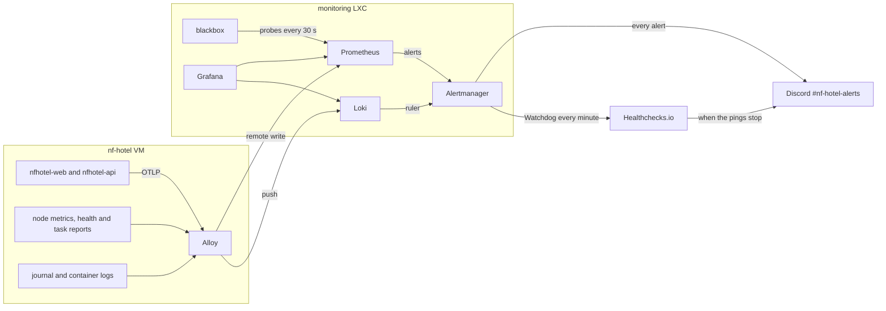

# Alerts

**Decisions:** [ADR-0020](https://github.com/NF-Hotel/NFHotel/blob/main/docs/adr/adr-0020-monitoring-stack.md) (the monitoring stack), [ADR-0023](https://github.com/NF-Hotel/NFHotel/blob/main/docs/adr/adr-0023-application-telemetry.md) (application metrics and objectives). **Work:** MIL-023, MIL-034, MIL-036, MIL-040, MIL-049. **Why each product:** [Technology Choices](Technology-Choices).

Every alert of NF Hotel: what it measures, when it fires, how serious it is, where it goes and what to do. How to set up and operate the monitoring is on [Monitoring](Monitoring); its runbook table has the first commands for each alert. The rules are in `ops/deploy/monitoring/` and are checked in Ops CI with `promtool check rules`, `promtool test rules` (`prometheus/rules-test.yml`) and `amtool check-config`; the Loki rule is proven by `ops/tests/test-monitoring-stack.sh`.

## How an alert travels

- **Where the facts come from.** Prometheus scrapes and evaluates every 30 seconds. Blackbox probes the site from the LXC (jobs `site`, `public_site` and `redirect`). Alloy on the VM pushes the host metrics, the container health (`nfhotel_container_healthy`, from `report-health.sh` every minute), the time of the last success of the backup, the copy off the VM and the certificate renewal (`nfhotel_task_last_success_timestamp_seconds`), the request metrics of the applications over OTLP, and the logs.
- **Why the monitoring is not on the VM.** A monitor on the machine it watches goes down with it. The LXC on the same Proxmox node sees a VM that stops; Healthchecks.io sees a node that stops.
- **Retention.** Metrics 30 days, logs 14 days.

## Routing

| Setting | Value | Why |
| --- | --- | --- |
| Receiver | Discord channel `#nf-hotel-alerts`, with resolved messages | The team reads Discord already; no pager service for a student project |
| Grouping | By `alertname`, `instance`, `container`, `task` | One message per broken thing, not one per probe |
| `group_wait` / `group_interval` / `repeat_interval` | 30 s / 5 min / 4 h | Quick first message; a reminder every 4 hours while it lasts, so it is not forgotten and not noise |
| Watchdog route | To Healthchecks.io, every minute (`group_interval` 30 s, `repeat_interval` 50 s) | A tick of 1 minute sent it every 2 minutes (seen 2026-10-24); the check expects one per minute |
| Inhibit: `SiteDown` silences `RedirectBroken` | | When the site is down the redirect is down too; one message is enough |
| Inhibit: `NoMetricsFromNfHotel` silences every `warning` | | A VM that sends nothing would otherwise raise every stale and missing warning |
| Secrets | The webhook and ping URLs are files in `secrets/`, git-ignored, read with `webhook_url_file` and `url_file` | A URL that is a secret never sits in git |

**Severity.** `critical`: guests or data are affected now; act at once. `warning`: something will break or a safety net is gone; act the same day. `none`: the Watchdog only.

## Alert rules

### Availability: `prometheus/rules/nfhotel.yml`

| Alert | Measures | Fires when | Severity | Why this threshold | What to do |
| --- | --- | --- | --- | --- | --- |
| `SiteDown` | `probe_success{job="site"}`: `/`, `/book` and `/admin/login` over HTTPS on the tailnet name, certificate checked | A probe fails for 2 minutes | critical | Two failed rounds of four probes rule out one lost packet; a deploy restarts in less | `sudo docker ps` on `nf-hotel`, then the latest CD run ([CI-CD](CI-CD)) |
| `PublicSiteDown` | `probe_success{job="public_site"}`: `/` and `/book` of `nfhotel.devmatiker.com`, through Cloudflare | A probe fails for 3 minutes, and the address answered at least once in the last 7 days | critical | Quiet until the tunnel was set up, and 7 days after it is taken down on purpose | [Public Access](Public-Access#when-the-public-site-is-down): the tailnet name first, then the tunnel |
| `RedirectBroken` | `probe_success{job="redirect"}`: port 80 answers 301 (MIL-017) | No 301 for 5 minutes | warning | Nobody is hurt at once: browsers keep HSTS | `curl -sI http://nf-hotel.taildb84b5.ts.net/` must answer 301; check nginx |
| `CertificateExpiresSoon` | Days left of the certificate on the `site` probes, one per job | Fewer than 21 days, for 10 minutes | warning | The renewal runs daily and renews well before; 21 days leaves three weeks to fix it by hand | `systemctl status nfhotel-cert-renew.service` (ADR-0009) |
| `NoMetricsFromNfHotel` | `node_uname_info{host="nf-hotel"}` is absent | 10 minutes without it | critical | The VM, Alloy or the tailnet path is down, and every other rule on VM data is blind | `qm status 100` on the node; `sudo docker ps \| grep alloy` |
| `DiskAlmostFull` | Used share of `/` on the VM | Above 80 % for 10 minutes | warning | Room for a deploy, which pulls new images before old ones go | `df -h /`, then `sudo docker image prune` |
| `ContainerUnhealthy` | `nfhotel_container_healthy == 0` | For 30 seconds | critical | A stopped container alerts within 3 minutes (MIL-023 criterion 7); a starting one counts as healthy, so a deploy raises none | `sudo docker logs --tail 50 <container>` |
| `BackupStale` | Age of the last good database backup | Older than 26 hours | critical | The backup runs nightly; 2 hours of slack before the recovery point of 24 hours is broken (ADR-0025) | `systemctl status nfhotel-backup.timer`, `journalctl -u nfhotel-backup` |
| `OffVmCopyStale` | Age of the last copy to the backup host | Older than 72 hours | warning | The laptop of S03 is often off; a weekend is normal, longer is not | Bring the laptop back on the tailnet; the backups wait on the VM |
| `CertificateRenewalStale` | Age of the last successful renewal run | Older than 26 hours | warning | It runs daily; one missed day is a warning long before `CertificateExpiresSoon` | `journalctl -u nfhotel-cert-renew` |
| `TaskReportMissing` | One of the reports `backup`, `offvm_copy`, `cert_renew` does not exist, while the VM sends metrics | For 30 minutes | warning | A report that does not exist cannot grow old, so the three rules above would never fire (ADR-0020 decision 4) | Start the job's service once and read its journal |
| `HealthReportMissing` | `nfhotel_container_healthy` is absent while the VM sends metrics | For 10 minutes | warning | Without it `ContainerUnhealthy` is blind | `systemctl status nfhotel-report-health.timer` |
| `Watchdog` | `vector(1)`: always firing | Always | none | Proves that Prometheus, the rules and Alertmanager work end to end | Nothing; Healthchecks.io alerts when it stops |

### Service level objectives: `prometheus/rules/applications.yml`

The applications push their request metrics over OTLP (ADR-0023), so these rules see what a guest and a member of staff experience. The Blazor circuit (`/_blazor`) is one request as long as the tab is open, so it is left out of the latency. Two recording rules keep the dashboard and the alerts on the same series: `job:http_server_request_duration_seconds:p95_5m` and `job:http_server_requests:error_ratio_10m`.

| Objective | Alert | Fires when | Severity | What to do |
| --- | --- | --- | --- | --- |
| **Availability:** the site answers 99.5 % of the time over 30 days (`avg_over_time(probe_success{job="site"}[30d])`) | `SiteDown` (above) | | | |
| **Speed:** 95 % of the requests within 1 second | `ApplicationSlow` | p95 above 1 second for 10 minutes | warning | The panel "95 % of the requests within", then the slowest routes ([Monitoring](Monitoring)) |
| **Errors:** fewer than 5 % server errors | `ApplicationErrors` | Above 5 % for 5 minutes, with at least one request a minute | critical | The log of the application in Grafana: `{container=~".*nfhotel-api.*"} \|= "fail"` |
| **Exceptions:** an unhandled exception is rare | `ApplicationExceptions` | More than 5 in 10 minutes | warning | `sum by (error_type) (increase(aspnetcore_diagnostics_exceptions_total[1h]))`, then the stack trace in the log |
| The telemetry itself | `ApplicationMetricsMissing` | No request metrics of `nfhotel-web` for 15 minutes while the VM reports | warning | `Telemetry__OtlpEndpoint` of the container; `sudo docker logs nfhotel-alloy-alloy-1` |

**Why these numbers.** 99.5 % allows about 3.6 hours down a month, which a monthly maintenance window and a few failed deploys fit in. 1 second is where a page feels slow. The floor of one request a minute stops one error at night from being a 100 % error rate. The probes make requests every 30 seconds, so missing request metrics mean a broken export, not a quiet site.

### Security: `prometheus/rules/security.yml` and `loki/rules/fake/security.yml`

| Alert | Source | Fires when | Severity | Why | What to do |
| --- | --- | --- | --- | --- | --- |
| `StaffSignInFailures` | Prometheus: answers 401 and 429 of `api/auth/login` in the API's request metrics | More than 20 in 10 minutes | warning | Someone may be guessing staff passwords; the throttle answers 429, so refused attempts count too | The audit log of the back office names the user names (ADR-0017); follow [Incidents](Incidents) |
| `SshLoginFailures` | Loki ruler: `Failed password`, `Invalid user` or `authentication failure` in the journal of `ssh.service` | More than 10 in 10 minutes | warning | sshd answers on the tailnet only, so a failed login comes from a device of the tailnet | `tailscale status` to find the device; follow [Incidents](Incidents) |

### Security scans: `prometheus/rules/scans.yml`

The scan exporter (MIL-053) reads GitHub code scanning (CodeQL, Trivy, OWASP ZAP, OpenSSF Scorecard), the latest run on `main` of each scan workflow and SonarQube Cloud every 15 minutes. Every rule waits longer than one read, so a finding fixed in the meantime does not alert.

| Alert | Source | Fires when | Severity | Why | What to do |
| --- | --- | --- | --- | --- | --- |
| `ScanFindingsHigh` | `nfhotel_code_scanning_open_alerts` with severity `critical`, `high` or `error` | One or more, for 30 minutes, per tool | warning | A high finding in a released image or in the code is a known weakness; it is fixed or dismissed with a reason, never left open | Security, Code scanning of `NF-Hotel/NFHotel`: fix it, or dismiss it with the reason |
| `ScanStale` | Age of the latest analysis of CodeQL, OWASP ZAP and Scorecard | Older than 8 days, for 1 hour | warning | They run at least weekly; a scan that stopped finds nothing, which looks like no findings | The latest run of its workflow in GitHub Actions; check that the schedule is not disabled |
| `ScanWorkflowFailed` | `nfhotel_scan_workflow_last_run_info` of `ci.yaml`, `release.yaml`, `e2e-dast.yaml`, `running-image-scan.yaml`, `scorecard.yaml` | The latest completed run on `main` failed or timed out, for 30 minutes | warning | A failed scan gives no result | Open the run, fix the cause or run it again |
| `SonarQualityGateFailed` | `nfhotel_sonar_quality_gate_passed` | 0 for 1 hour | warning | The new code of `main` does not meet the quality gate | The project on sonarcloud.io shows the failing condition |
| `ScanSourceDown` | `nfhotel_scan_source_up`, or the exporter is not scraped | A source not read for 1 hour | warning | The dashboard *Security scans* is stale | `docker compose logs scan-exporter` in the LXC; a missing or expired token stops `github_code_scanning` ([Monitoring](Monitoring#security-scans)) |

## The watchdog

An alerting system that is down sends no alerts, and silence looks like health. So `Watchdog` always fires, and Alertmanager sends it to Healthchecks.io every minute. When the pings stop (the LXC, Prometheus, Alertmanager, the node or the network is down), Healthchecks.io alerts on its own, outside our infrastructure. The drill of MIL-023 stops Prometheus and waits for that alert: about 8 minutes. Healthchecks.io receives only a ping, no data.

## Choices and alternatives

| Choice | Chosen | Alternatives and why not |
| --- | --- | --- |
| The stack | Prometheus, Alertmanager, Grafana, blackbox, Loki and Alloy, configured as files in git (ADR-0020) | Gatus (no host, container or log data); Uptime Kuma (configuration in its own database, not in git); a hosted service such as UptimeRobot, Better Stack or Grafana Cloud (cannot reach a tailnet-only site, and the data leaves the team); nothing (how the faults before MIL-023 went unseen) |
| Logs | Loki with Alloy: indexes labels only, read in Grafana | Elastic or OpenSearch with Kibana (several GB of memory); Graylog (needs OpenSearch and MongoDB); VictoriaLogs (lighter, less used) |
| Watchdog | Healthchecks.io: free, receives a ping only | Dead Man's Snitch or Cronitor (the same idea); a check from the legion laptop (often off) |
| Application metrics | OTLP push from the applications through Alloy (ADR-0023) | A `/metrics` endpoint scraped by Alloy (a route the public site must not serve, and a pre-release exporter); traces (not needed yet) |
| Errors in the application | Counted as a metric, stack traces in Loki | Sentry or GlitchTip (group exceptions into issues): deferred until the objectives show a need |
| Where alerts go | Discord, one channel | E-mail (read late); a pager service such as PagerDuty or Opsgenie (on-call rotations the team does not have) |
| Silencing during work | A silence in Alertmanager with `alertname!=Watchdog` ([Monitoring](Monitoring)) | Stopping Alertmanager (then the Watchdog stops and Healthchecks.io alerts) |

## Known gaps

- One Proxmox node holds both the VM and the monitoring LXC; when the node stops, only Healthchecks.io reports it.
- No alert on memory or CPU of the VM: the containers have limits, and `ContainerUnhealthy` and the objectives show the effect.
- No alert on the monitoring LXC's own disk.
- The Discord channel is the only receiver; if Discord is down, alerts wait in Alertmanager.
