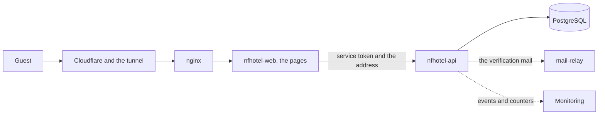

# Booking Flow Protection

**English**

How the public booking flow is protected against misuse, which limits it keeps, what its log holds, and what to do when one of its alerts fires. The flow is the search and the booking page (`/book`), the page of the verification link (`/booking/verify`), the guest sign-in and the page of the own booking, and the routes of the API behind them. The security audit SAR-002 of [MIL-089](https://github.com/NF-Hotel/NFHotel/blob/main/docs/milestones/mil-089-the-booking-flow-attacked-and-measured.md) read it against OWASP ASVS 5.0 at level 2: [docs/sqa/security-audit-2026-12-booking-flow.md](https://github.com/NF-Hotel/NFHotel/blob/main/docs/sqa/security-audit-2026-12-booking-flow.md).

**For:** whoever answers `BookingFlowRefusals`, `PublicBookingSurge`, `MailNotSent`, `MailFuseBlown` or `MailVolumeHigh`, and whoever changes the booking flow.
**Decisions:** [ADR-0047](https://github.com/NF-Hotel/NFHotel/blob/main/docs/adr/adr-0047-guest-login.md), [ADR-0049](https://github.com/NF-Hotel/NFHotel/blob/main/docs/adr/adr-0049-booking-reference.md), [ADR-0050](https://github.com/NF-Hotel/NFHotel/blob/main/docs/adr/adr-0050-where-the-rules-of-the-booking-input-live.md), [ADR-0051](https://github.com/NF-Hotel/NFHotel/blob/main/docs/adr/adr-0051-limits-of-the-booking-flow-and-the-caller-address.md), [ADR-0052](https://github.com/NF-Hotel/NFHotel/blob/main/docs/adr/adr-0052-a-booking-takes-a-room-once-its-email-is-verified.md), [ADR-0053](https://github.com/NF-Hotel/NFHotel/blob/main/docs/adr/adr-0053-mail-from-the-application-through-a-relay.md). **Work:** MIL-085 to MIL-089.

**Contents**
1. [The layers](#the-layers)
2. [The limits](#the-limits)
3. [What the log holds](#what-the-log-holds)
4. [When an alert fires](#when-an-alert-fires)
5. [How it is tested](#how-it-is-tested)
6. [Known gaps](#known-gaps)

---

## The layers

| Layer | What it does for the booking flow | Where |
| --- | --- | --- |
| Cloudflare and the tunnel | End the caller's connection and pass on the address they saw | [Public Access](Public-Access) |
| nginx | Takes the address only from the tunnel and writes it into `X-NFHotel-Client-Address`, over whatever the caller sent; refuses a body over 64 KB, and times out a client that takes over 60 seconds for its headers or between two reads or writes | `ops/deploy/nginx/` |
| The web application | Sends the security headers: a content security policy without inline code, `Referrer-Policy: same-origin`, and `no-referrer` on `/booking/verify`, where the token of the link is; keeps at most 50 circuits of the pages open per caller ([ADR-0051](https://github.com/NF-Hotel/NFHotel/blob/main/docs/adr/adr-0051-limits-of-the-booking-flow-and-the-caller-address.md) decision 8); hands the address to the API only with the service token | `src/NFHotel.Web/Security/` |
| The API | Refuses an unknown field, control characters and text over its bound ([ADR-0050](https://github.com/NF-Hotel/NFHotel/blob/main/docs/adr/adr-0050-where-the-rules-of-the-booking-input-live.md)); counts the limits per address; writes the security events | `src/NFHotel.Api/Security/` |
| The application and the database | The rules of a booking; the limit per mailbox under the lock `public_booking`; the exclusion constraint that refuses two bookings of one room at once; the link of a request claimed once | `src/NFHotel.Application/UseCases/Bookings/` |
| The mail | While the verification is on, a booking takes its room only once the link in its mail is used ([ADR-0052](https://github.com/NF-Hotel/NFHotel/blob/main/docs/adr/adr-0052-a-booking-takes-a-room-once-its-email-is-verified.md)); the fuse stops all mail after 400 in 24 hours | [Mail Relay](Mail-Relay) |
| Monitoring | Counts the events and fires the five alerts below | [Alerts](Alerts) |

The booking reference is a random number that cannot be guessed ([ADR-0049](https://github.com/NF-Hotel/NFHotel/blob/main/docs/adr/adr-0049-booking-reference.md)), and a guest opens a booking only with its reference and its email ([ADR-0047](https://github.com/NF-Hotel/NFHotel/blob/main/docs/adr/adr-0047-guest-login.md)).

## The limits

The table "Limits of the booking flow" in [`docs/refactor/BusinessRules.md`](https://github.com/NF-Hotel/NFHotel/blob/main/docs/refactor/BusinessRules.md#limits-of-the-booking-flow) is the one source of the numbers; a test fails when it and the code differ. In short:

| Name in the log | What it limits | How much |
| --- | --- | --- |
| `search` | Searches for free rooms, per address | 60 a minute |
| `booking_hour`, `booking_day` | Public bookings and booking requests, per address | 5 an hour, 20 a day |
| `mailbox` | Coming bookings made on the public site, per mailbox | 3 |
| `guest_sign_in` | Failed tries of the guest sign-in | 5 per reference, 20 per address, in 15 minutes |
| `verification_mail` | Verification mails, per mailbox | 3 an hour, 5 a day |
| `circuits` | Open circuits of the pages, the live connection of each open tab, per address, in the web application | 50 at a time |

An IPv6 address counts by its first 64 bits. The counts per address live in the memory of the API, and those of the circuits in the memory of the web application, so a restart clears them. Every limit of the API answers `429` with one of three codes (`booking.too_many_requests`, `booking.too_many_lookups` or `booking.too_many_mails`), never an answer of the 500 kind. The limit of the circuits is a constant of the code, `CircuitLimit.OpenPerCaller`, and not a row of the table: over it, the web application answers `429` with no body. The 51st open tab of one caller gets its page but no circuit, so the page does not work; once another tab is closed, it gets its circuit when it is loaded again.

## What the log holds

The security events of the flow go to the log of `nfhotel-api` under the category `NFHotel.Security`; the refusal of the circuits goes to the log of `nfhotel-web` under the same category. They hold fixed words of the code and the values in the table below, and no other value that a guest typed. Since MIL-089 they hold no email, whole, masked or hashed ([ADR-0051](https://github.com/NF-Hotel/NFHotel/blob/main/docs/adr/adr-0051-limits-of-the-booking-flow-and-the-caller-address.md) decision 6). Each event but `input_refused` is counted in `nfhotel_security_events_total`, with its kind and, for a refusal, its limit.

| Event | When | What the line holds |
| --- | --- | --- |
| `public_booking_made` | A booking made on the public site: at once while the verification is off, or when its link is used while it is on | The address |
| `booking_request_made` | A booking request with its mail, while the verification is on | The address |
| `verification_failed` | A link of a booking request that does not work: unknown, used or lapsed | The address |
| `guest_lookup_failed` | A failed try of the guest sign-in | The address |
| `limit_refused` | A limit refused a request | The limit and the address |
| `mail_not_sent` | A mail of the flow, the link or the receipt, that did not go | The mail and the reason in a word |
| `mail_fuse_blown` | The fuse of the mails a day refused a request | Nothing more |
| `input_refused` | The API refused a field; not counted | The method, the route, the status and the code, not the value |

Which mailbox a refusal was for is not in the log, and a refused request is not stored: staff can list in the database the mailboxes that are at their limit at the time, from the bookings and the requests, as ADR-0051 says, but cannot tie a refusal to one. The back office shows no booking request. In Grafana, *Explore*, data source *Loki*, `{host="nf-hotel"} |= "limit_refused"` lists the refusals of the API and of the web application with their limit and address.

## When an alert fires

**`BookingFlowRefusals`** (more than 20 refusals of the limits in 10 minutes, those of the API and of the web application together):
1. Run `{host="nf-hotel"} |= "limit_refused"` in Loki and look at the limits and the addresses.
2. One address with many refusals is a script, which the limits already stop: nothing more to do.
3. Many addresses, or many refusals of `mailbox`, is an attack on the bookings: do what `PublicBookingSurge` says.
4. Many refusals of `guest_sign_in` from many addresses is someone guessing at the guest sign-in: follow [Incidents](Incidents).
5. Many refusals of `circuits` from many addresses is someone holding the pages open: S01 decides a rule of Cloudflare for the pages, and the team follows [Incidents](Incidents).

**`PublicBookingSurge`** (more than 10 public bookings in an hour):
1. Run `{host="nf-hotel"} |= "public_booking_made"` in Loki to see the addresses.
2. Find the bookings made on the public site: the back office does not mark them, so they are found in the database by `MadeOnPublicSite` ([Database Access](Database-Access)). In the back office, cancel those that are not real; when in doubt, ask the guest by phone or mail first.
3. If it goes on, S01 decides a rule of Cloudflare for the booking page, the next step that [ADR-0051](https://github.com/NF-Hotel/NFHotel/blob/main/docs/adr/adr-0051-limits-of-the-booking-flow-and-the-caller-address.md) decision 7 names, and the team follows [Incidents](Incidents).

**`MailNotSent`** (a mail of the booking flow, the link or the receipt, that did not go): while the verification is on and the relay takes no mail, no guest can book on the public site; a receipt that does not go leaves its booking standing. [Mail Relay](Mail-Relay#when-the-mail-fails) says what to do for each reason; while it cannot be fixed, turn the verification off ([Mail Relay](Mail-Relay#turn-it-off)).

**`MailFuseBlown`** (400 mails in 24 hours): the public booking refuses every new request until the oldest mails leave the 24 hours. Find the sender as for `MailVolumeHigh`; the fuse lifts itself.

**`MailVolumeHigh`** (200 mails in 24 hours, half the fuse):
1. Run `{host="nf-hotel"} |= "booking_request_made"` in Loki to see the addresses of the requests.
2. Many requests from a few addresses, or from many addresses at once, is an attack on the mail: S01 blocks it with a rule of Cloudflare, and the team follows [Incidents](Incidents).

## How it is tested

- **Each abuse case** has tests that fail when its control is taken out; section 4 of SAR-002 names them, case by case: guessing a reference, trying emails against one, taking the rooms, filling a mailbox, a link used twice, the race for the last room, a forged caller address, an unknown field, markup in a field, a body that is too large and many slow requests. The last is held for one address only: many addresses can still hold circuits of the pages (BF-02).
- **The stack check** `ops/tests/check-e2e-stack.sh` runs in CI against the throwaway stack: the limits refuse, the events have their address, and no event holds an email.
- **The load test** `.github/workflows/load-test.yaml` runs every week with the verification off and on: searches and bookings within the limits keep 95 percent of the answers within 1,000 ms, and a burst from one address gets only the refusals of the limits ([Workflows](Workflows)).
- **The scans** of the site and the API, and CodeQL on every pull request; a rule of the scan that ignores an alert lapses on its date and must be renewed with its reason (`ops/security/zap-rules.tsv`).
- **On the live site**, `ops/scripts/check-guest-login.sh` checks the guest sign-in after a deploy, with a booking that S01 makes for the test.

## Known gaps

The audit left twelve findings for S01, each with its issue and its proposed fix. The severity is the OWASP Risk Rating of each finding, its likelihood and its impact (section 1 of SAR-002). None is High or Critical as production runs since 2026-11-22, with the verification by email on; with it off, BF-01 is High (likelihood High, impact Medium).

| Finding | Severity | Issue |
| --- | --- | --- |
| BF-01 A few addresses can hold the rooms, or use up the mails of a day | Medium since the verification went on on 2026-11-22; High with it off | [#867](https://github.com/NF-Hotel/NFHotel/issues/867) |
| BF-02 Many addresses can still hold the circuits of the pages; one address is held at 50 since MIL-089 | Medium | [#868](https://github.com/NF-Hotel/NFHotel/issues/868) |
| BF-03 The routes of the mobile app reach every rooms action with a staff password alone (outside the flow) | Medium | [#869](https://github.com/NF-Hotel/NFHotel/issues/869) |
| BF-04 Guests and bookings have no retention period | Medium | [#870](https://github.com/NF-Hotel/NFHotel/issues/870) |
| BF-05 The log store takes reads and writes without a credential (outside the flow) | Medium | [#871](https://github.com/NF-Hotel/NFHotel/issues/871) |
| BF-06 A guest session cannot be ended early, and an idle one stays open | Low | [#872](https://github.com/NF-Hotel/NFHotel/issues/872) |
| BF-07 The security log misses some events and has no request id | Low | [#873](https://github.com/NF-Hotel/NFHotel/issues/873) |
| BF-08 The keys have no written life cycle | Low | [#874](https://github.com/NF-Hotel/NFHotel/issues/874) |
| BF-09 The booking pages share an origin with the back office | Low | [#875](https://github.com/NF-Hotel/NFHotel/issues/875) |
| BF-10 HSTS lasts 30 days | Low | [#876](https://github.com/NF-Hotel/NFHotel/issues/876) |
| BF-11 Callers inside the stack can name an address | Low | [#877](https://github.com/NF-Hotel/NFHotel/issues/877) |
| BF-12 Hardening notes | Informational | [#878](https://github.com/NF-Hotel/NFHotel/issues/878) |

BF-01 is the largest risk in production, with the verification on too (section 2 of SAR-002): watch `PublicBookingSurge`, and `MailVolumeHigh` for the mails of a day.
