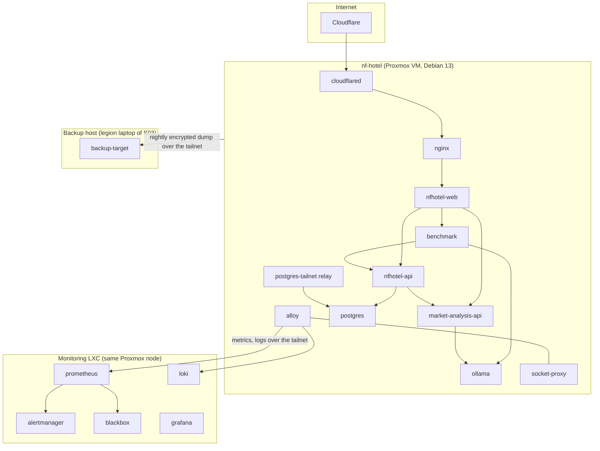

# Containers and Images

**Decisions:** [ADR-0003](https://github.com/NF-Hotel/NFHotel/blob/main/docs/adr/adr-0003-proxmox-vm-for-services.md), [ADR-0007](https://github.com/NF-Hotel/NFHotel/blob/main/docs/adr/adr-0007-cicd-and-supply-chain.md), [ADR-0024](https://github.com/NF-Hotel/NFHotel/blob/main/docs/adr/adr-0024-secrets-as-files.md), [ADR-0039](https://github.com/NF-Hotel/NFHotel/blob/main/docs/adr/adr-0039-python-services-network.md). **Work:** MIL-002, MIL-022, MIL-023, MIL-049, MIL-061. **Why each product:** [Technology Choices](Technology-Choices).

Every container of NF Hotel: where it runs, what it does, which image it runs and where that image comes from, and how it is locked down. For how to deploy them, see [Proxmox Deployment](Proxmox-Deployment); for their settings files, see [Environment Files](Environment-Files).

## Where the containers run

**Why one VM and one Compose project per service** ([ADR-0003](https://github.com/NF-Hotel/NFHotel/blob/main/docs/adr/adr-0003-proxmox-vm-for-services.md)): a KVM virtual machine gives the containers their own kernel, so a faulty container cannot touch the Proxmox host, and the same compose files run on a developer machine. Rejected: Docker in an LXC container (needs nesting and weakens the isolation) and Docker on the Proxmox host (no isolation from the hypervisor). Kubernetes or Docker Swarm were not chosen: one node and a small team gain nothing from a scheduler, and Swarm would change every compose file (ADR-0024, option 4).

**Why the monitoring is not on the VM** ([ADR-0020](https://github.com/NF-Hotel/NFHotel/blob/main/docs/adr/adr-0020-monitoring-stack.md)): it must still report when `nf-hotel` is down.

## The containers on nf-hotel

Every service publishes no host port unless the table says so; the others are reached only by name on an internal Docker network.

| Service (compose folder) | What it does | Image | Registry | Networks | Published port |
| --- | --- | --- | --- | --- | --- |
| `cloudflared` (`cloudflared`) | Outbound tunnel to Cloudflare; forwards the public host name to nginx (ADR-0028) | `cloudflare/cloudflared:2026.10.7` | Docker Hub | proxy | none |
| `nginx` (`nginx`) | Reverse proxy and TLS end: HTTPS on the tailnet and the public listener for the tunnel; no route to the Python services (ADR-0039) | `ghcr.io/nf-hotel/nfhotel-nginx`: `nginx:1.29-alpine` with the fixes of its Alpine packages (ADR-0040) | GHCR, built by Release | proxy, api | 80 and 443 (tailnet and LAN, firewalled to 80 and 443 only) |
| `nfhotel-web` (`nfhotel-web`) | The Blazor web application: guest pages and back office | `ghcr.io/nf-hotel/nfhotel-web` | GHCR (our build) | proxy, api, python | none |
| `nfhotel-api` (`nfhotel-api`) | NFHotel.Api: the only container that reaches the database (ADR-0004) | `ghcr.io/nf-hotel/nfhotel-api` | GHCR (our build) | api, db, python | none |
| `postgres` (`postgres`) | PostgreSQL 16, the production database | `postgres:16-alpine` | Docker Hub | db | none |
| `relay` (`postgres-tailnet`) | HAProxy in TCP mode: the team's DBeaver access to PostgreSQL (ADR-0034) | `haproxy:3.2-alpine` | Docker Hub | db, published | Port 5432 on the tailnet address of `nf-hotel` only |
| `market-analysis-api` (`market-analysis`) | The market analysis service of `NF-Hotel/notebook-market-analysis` | `ghcr.io/nf-hotel/market-analysis` | GHCR (our build) | python, llm | none |
| `benchmark` (`benchmark`) | The benchmark service of `NF-Hotel/notebook-benchmark`: compares the local AI models | `ghcr.io/nf-hotel/benchmark` | GHCR (our build) | python, llm | none |
| `results-owner` (`benchmark`) | One-shot job before `benchmark`: gives the results volume to the service's user (MIL-045), with no network | `ghcr.io/nf-hotel/benchmark` | GHCR (our build) | none | none |
| `ollama` (`ollama`) | Local model server for the benchmark and the market analysis | `ollama/ollama:0.40.11` | Docker Hub | llm | none |
| `alloy` (`alloy`) | Agent that sends the logs and metrics of the VM to the monitoring LXC | `grafana/alloy:v1.21.3` | Docker Hub | internal, egress, apps | none |
| `socket-proxy` (`alloy`) | Gives Alloy read-only access to the Docker API (GET of containers and networks only) | `ghcr.io/nf-hotel/nfhotel-socket-proxy`: `tecnativa/docker-socket-proxy:v0.5.0` with the fixes of its Alpine packages (ADR-0040) | GHCR, built by Release | internal | none |

**The Docker networks:**

| Network | Who is on it | Why |
| --- | --- | --- |
| `nfhotel-proxy` | cloudflared, nginx, web | What nginx may route to |
| `nfhotel-api` | nginx, web, API, Alloy | Calls between the .NET applications (nginx only for the two mobile routes), and their telemetry to Alloy |
| `nfhotel-python` | web, API, market-analysis, benchmark | Calls to and from the Python services; nginx is not on it (ADR-0039) |
| `nfhotel-db` | API, PostgreSQL, the relay | Only the API and the relay reach the database |
| `nfhotel-llm` | Ollama, benchmark, market-analysis | Only the AI services reach the model server |

A container on `nfhotel-proxy` cannot open the database, because it is not on `nfhotel-db`. This is the network part of ADR-0004 and [ADR-0011](https://github.com/NF-Hotel/NFHotel/blob/main/docs/adr/adr-0011-postgresql-access-for-the-api.md). It cannot open a connection to the Python services either, because it is not on `nfhotel-python` (ADR-0039); why the networks are kept apart is on [Network Isolation](Network-Isolation), and `ops/tests/test-service-networks.sh` keeps this table true on every pull request.

## The containers elsewhere

| Service (compose folder) | Runs on | What it does | Image | Registry | Published port |
| --- | --- | --- | --- | --- | --- |
| `prometheus` (`monitoring`) | Monitoring LXC | Metrics store and alert rules | `prom/prometheus:v3.15.1` | Docker Hub | 9090 on the LXC's tailnet address |
| `alertmanager` (`monitoring`) | Monitoring LXC | Sends alerts to Discord and the watchdog ping to Healthchecks.io | `prom/alertmanager:v0.34.2` | Docker Hub | none |
| `blackbox` (`monitoring`) | Monitoring LXC | Probes the site over HTTPS, the redirect and the public name | `prom/blackbox-exporter:v0.29.1` | Docker Hub | none |
| `loki` (`monitoring`) | Monitoring LXC | Log store, kept 14 days; its ruler evaluates the log alert | `grafana/loki:3.7.9` | Docker Hub | 3100 on the LXC's tailnet address |
| `grafana` (`monitoring`) | Monitoring LXC | Dashboards and log search | `grafana/grafana:13.3.0` | Docker Hub | 3000 on the LXC's tailnet address |
| `scan-exporter` (`monitoring`) | Monitoring LXC | Reads the results of the security scans (GitHub code scanning, the scan workflows, SonarQube Cloud) every 15 minutes for Prometheus (MIL-053); the code is mounted read-only, nothing is built | `python:3.13-slim` | Docker Hub | none |
| `backup-target` (`backup-target`) | Backup host (legion laptop of S03) | Write-only SSH target of the nightly off-VM copy of the encrypted backup (ADR-0008) | `nfhotel-backup-target:local`, built there from `debian:12-slim` | built locally | SSH on the host's tailnet address |
| `proxmox` (`proxmox`) | CI and a developer machine only | Throwaway Proxmox VE for the Proxmox integration tests (MIL-003) | `dockurr/proxmox:9.2.20` | Docker Hub | `127.0.0.1:18006` |

## Where the images come from

| Registry | Images | Why there |
| --- | --- | --- |
| **GHCR** (`ghcr.io/nf-hotel/`) | `nfhotel-web`, `nfhotel-api`, `market-analysis`, `benchmark`, `nfhotel-nginx`, `nfhotel-socket-proxy` | Our own builds, and the two proxies with their patch layers. The Release workflow pushes with the job token, so no registry password is stored; the packages belong to the organisation and stay private, so the VM pulls them with a read credential of its own ([CI-CD](CI-CD)); the provenance and the SBOM are stored beside each digest |
| **Microsoft Container Registry** (`mcr.microsoft.com`) | `mcr.microsoft.com/dotnet/sdk:10.0.403` (build stage) and `mcr.microsoft.com/dotnet/aspnet:10.0.14` (runtime) | Microsoft publishes the .NET images only there |
| **Docker Hub** | the base images `python:3.14-slim`, `python:3.13-slim`, `debian:12-slim`, and every third-party service above | Where the projects publish their official images |

**Why not build everything ourselves:** an image always starts `FROM` another. Building PostgreSQL, nginx or Grafana from source would make us responsible for every security fix in them. The official images are patched by their maintainers; we pin them, scan them and take the next version when Dependabot proposes it. The daily scan checks every third-party image pinned in a compose file again (MIL-064). When a maintainer has not rebuilt an image whose findings are all in its operating-system packages, as with nginx and the socket proxy of Alloy in November 2026, the release adds a patch layer on top of the pinned image (ADR-0040). A finding that the newest build still has is accepted for a time, as the [accepted findings](#the-accepted-findings-of-the-third-party-images) below say.

**Why not mirror everything into GHCR:** it would remove the dependency on Docker Hub and its pull limits, at the cost of one more job to keep the mirror current. Not needed at today's pull rate; it would be the answer if a pull limit or an outage of Docker Hub stopped a deploy.

## Our own images

| Image | Dockerfile | Built from | Runs as |
| --- | --- | --- | --- |
| `nfhotel-web` | `Dockerfile` | `src/` of this repository, multi-stage on `dotnet/sdk`, final stage `dotnet/aspnet` | `app` (non-root) |
| `nfhotel-api` | `Dockerfile.api` | the same, for `NFHotel.Api` | `app` (non-root) |
| `market-analysis` | `ops/deploy/market-analysis/Dockerfile` | the source of `NF-Hotel/notebook-market-analysis` at the pinned commit `MARKET_ANALYSIS_REF`, on `python:3.13-slim`, with every dependency locked by hash (`requirements.lock`) | `app`, uid 10001 |
| `benchmark` | `ops/deploy/benchmark/Dockerfile` | the source of `NF-Hotel/notebook-benchmark` at the pinned commit `BENCHMARK_REF`, on `python:3.14-slim`, locked by hash | `app`, uid 10001 |
| `nfhotel-nginx` | `ops/deploy/nginx/Dockerfile` | the pinned `nginx:1.29-alpine` and one `apk upgrade --no-cache` layer with the fixes of its Alpine packages; nginx itself stays the build of nginx.org, and the build fails if the upgrade replaces it (ADR-0040) | the master process `root`, the workers `nginx`, as upstream |
| `nfhotel-socket-proxy` | `ops/deploy/alloy/socket-proxy/Dockerfile` | the pinned `tecnativa/docker-socket-proxy:v0.5.0` and one `apk upgrade --no-cache` layer with the fixes of its Alpine packages; HAProxy stays the build of the upstream image, and the build fails if the upgrade replaces it (ADR-0040, MIL-065) | `root`, as upstream: HAProxy reads the Docker socket, which root owns |

Each final stage runs `apt-get upgrade` for the Debian security updates published since its base image was built, and the two proxies run `apk upgrade` for the Alpine ones. The two .NET images throw the SDK stage away, so the compilers never reach production.

**From commit to running container:**

1. Release builds the six images from the commit CI tested.
2. Trivy scans each image; the gate (`ops/scripts/scan-gate.sh`) stops the release on a critical vulnerability, a high one with a fix, or a secret in a layer, before anything is pushed. An accepted finding is in `ops/security/trivyignore.yaml` with a reason and an expiry of at most 30 days.
3. The image is pushed by digest, with a build provenance attestation and an SBOM attestation.
4. CD verifies both attestations of each digest before the deploy.
5. The VM pulls the images by digest; it never builds an image of its own.
6. Every day the running image scan scans the images in production again with that day's database, and the third-party images pinned in the compose files of that release (MIL-064).

**The market-analysis history:** the original repository disappeared, so the image was frozen at its last good digest (ADR-0500) and then patched in a layer on top of it (ADR-0030). It is now built again from source, from the new repository `NF-Hotel/notebook-market-analysis` at a pinned commit, like the benchmark (commit 5f8e3a3). ADR-0500 and ADR-0030 are the record of the two steps before.

## The accepted findings of the third-party images

A pinned third-party image can keep a finding that its newest build has not fixed. Such a finding is accepted in `ops/security/trivyignore.yaml`, one entry per finding, narrowed to the files (`paths`) or the packages (`purls`) of the images that have it, so an entry never hides the same finding in an image of NF Hotel. Its statement begins with what the check found: "Not in the binary" (the affected package is not compiled into it), "Not used" (the file or the library never runs in the container) or "Accepted" (it runs, and the statement says why the risk is taken). S01 approves each entry in the review of its pull request (DSA-001 section 8). Every entry below runs out on **2026-12-08**; from that day the daily scan reports the finding again, unless a new build has cleared it or a reviewed pull request has renewed the entry (MIL-065). The vulnerability IDs and the full statements are in the file.

| Image | What is accepted | What the check found |
| --- | --- | --- |
| `postgres:16-alpine` | 26 findings of the Go standard library in `gosu` 1.19, built with Go 1.24.6 | Not in the binary: `gosu` has functions of `os`, `syscall` and `github.com/moby/sys/user` only; the entry point runs it once, to start the server as `postgres`, and no build of the tag has a newer `gosu` |
| `ollama/ollama:0.40.11`, `grafana/alloy:v1.21.3` | The HTML parser of `golang.org/x/net` in `ollama` and `alloy`; `apt` 2.8.3 of Ubuntu 24.04 | Not in the binary for the parser; accepted for `apt`, which runs only when an image is built and never in these containers |
| `cloudflare/cloudflared:2026.10.7` | The HTML parser of `golang.org/x/net` in `cloudflared`; two findings in Debian's `zlib1g` | Not in the binary; not used, because `cloudflared` is a static Go binary that never loads `libz` |
| `prom/prometheus:v3.15.1`, `prom/alertmanager:v0.34.2`, `prom/blackbox-exporter:v0.29.1`, `grafana/loki:3.7.9` | The HTML parser of `golang.org/x/net` in their binaries | Not in the binary |
| `grafana/grafana:13.3.0` | Eight findings (seven vulnerabilities) in the `grafana` server and its bundled data source plugins | Accepted or not in the binary: Grafana provisions only the Prometheus and Loki data sources, over plain HTTP inside the monitoring network, and is reached only on the tailnet address of the monitoring LXC after a login; 13.3.0 is the newest release |
| `python:3.13-slim` (the scan exporter) | `setuptools`, `msgpack` and `urllib3`, vendored inside pip; two findings in Debian's `zlib1g` | Not used: the exporter runs its own module with the standard library and never pip, and its Python calls none of the `gz*` functions of the two zlib findings |

## How every container is locked down

| Measure | Where | Why | CIS Docker |
| --- | --- | --- | --- |
| Image pinned by `@sha256` digest | every compose file and Dockerfile | The tested image is the one that runs; a moved tag changes nothing | 4.x |
| `cap_drop: [ALL]`, and only the capabilities it needs added back | every service | A compromised process cannot use kernel privileges it never needed | 5.3 |
| `security_opt: [no-new-privileges:true]` | every service, and the daemon default | No privilege gain through setuid binaries | 5.25 |
| `read_only: true`, with `tmpfs` for what it writes | every service except `backup-target` | An attacker cannot change the program files or leave a tool behind | 5.12 |
| Memory, CPU and PID limits | every long-running service | A leak or a fork bomb in one container cannot starve the others | 5.10, 5.11, 5.28 |
| Non-root user | the web, API, market-analysis and benchmark images and Alloy (473); PostgreSQL drops to its own user, and the nginx workers run as `nginx` | A process escape starts without root | 4.1 |
| No host port, except the table above | every compose file | Nothing answers that does not need to | 5.7 |
| Secrets as files under `/run/secrets`, never environment variables | web, API, PostgreSQL, cloudflared, Alertmanager | `docker inspect` and an environment dump show no secret (ADR-0024) | 4.10 |
| A health check | every long-running service | The deploy waits for healthy containers and rolls back otherwise; an unhealthy container raises `ContainerUnhealthy` | 4.6 |
| Docker daemon: `live-restore`, `icc: false`, `userland-proxy: false`, bounded logs | `/etc/docker/daemon.json` on the VM | Containers survive a daemon restart; no traffic between containers outside their networks | 2.x |

Two containers are deliberate exceptions:

- `proxmox` runs `privileged`, because it is a hypervisor. It runs only in CI and on a developer machine, never on the VM.
- `backup-target` is not read-only, because it writes the backups. It runs on the backup host, accepts only SSH keys and is reached only from the tailnet.

The capabilities each service needs, and its limits, are measured on the throwaway stack and listed on [Host Hardening](Host-Hardening).

## When something changes

- **A new service:** add its compose folder, a row to the right table above and its settings to [Environment Files](Environment-Files). `ops/tests/test-wiki-coverage.sh` fails in Ops CI until this page names the service.
- **A new third-party image:** pin it by digest, add it to `.github/dependabot.yml`, name it with its tag in the right table above, and check that the Trivy gate passes.
- **A new version of an image:** change the tag on this page in the same pull request as the pin. `ops/tests/test-wiki-coverage.sh` fails until this page names the tag that each compose file and Dockerfile pins.
- **A finding with no fix yet:** an entry in `ops/security/trivyignore.yaml`, narrowed to the files or the packages of the image, with a statement and an expiry at most 30 days ahead, approved by S01; change the table of the accepted findings above with it.
