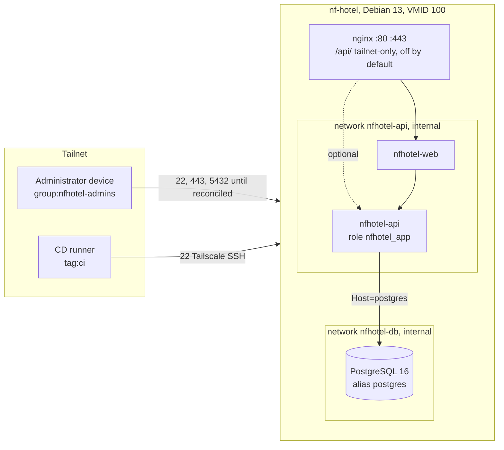

# Database Preparation

How S03 prepares the production PostgreSQL 16 on `nf-hotel` for the NF Hotel API (ADR-0011, MIL-024). Every step keeps the existing data, volumes, users, schemas and migration history. Nothing is restarted, and no second database is created. Every step is checked before and after.

## Target architecture



| Role | Login | May | Used by |
| --- | --- | --- | --- |
| `nfhotel_owner` | no | own the schema objects | nobody directly (reached with `SET ROLE`) |
| `nfhotel_migrator` | yes | `SET ROLE nfhotel_owner`, then change the schema | the migration step of CD |
| `nfhotel_app` | yes | read and write rows | the API at run time |
| `nfhotel_backup` | yes | read everything (`pg_read_all_data`) | `nfhotel-backup` |
| superuser of the image | yes | everything | S03 only, break-glass |

## Steps on the VM

Run them as root in a checkout of this repository. Before the reconciliation of ADR-0010, use a copy of the repository in a folder of its own, for example `/root/nfhotel-tools`; never overwrite `/opt/nfhotel`.

1. **Find the container:**

   ```bash
   docker ps --filter ancestor=postgres:16 --format '{{.Names}}'
   ```

   Below it is called `<pg>`.
2. **Baseline.** These change nothing.

   ```bash
   bash scripts/verify-database.sh --container <pg>
   ```

   Before the preparation, the role checks fail; keep the output for the RC. From an administrator device and from another device, also run:

   ```bash
   bash scripts/check-tailnet-exposure.sh --host nf-hotel
   ```

   Today 5432 answers to every device (risk R15).
3. **Backup first.** Install the backup (wiki page CI-CD, one-time setup), with `BACKUP_CONTAINER=<pg>` in `/etc/nfhotel/backup.env`. Then run it, and restore the dump in a drill on your own machine:

   ```bash
   systemctl start nfhotel-backup.service
   ```

4. **Dry run**, which shows the version, the database, the current owners and the roles:

   ```bash
   bash scripts/prepare-database-roles.sh --container <pg>
   ```

5. **Roles and secrets:**

   ```bash
   bash scripts/prepare-database-roles.sh --container <pg> --apply
   ```

   The passwords are in `/etc/nfhotel/secrets/` (0600), along with `nfhotel-api-database.env` and `nfhotel-migrator-database.env`. Check:

   ```bash
   bash scripts/verify-database.sh --container <pg>
   ```

6. **Internal network.** This is additive: the container joins `nfhotel-db` as `postgres` and keeps its other networks.

   ```bash
   bash scripts/prepare-database-roles.sh --container <pg> --apply --connect-network
   ```

7. **Ownership transfer**, in a maintenance window. It runs a fresh backup, then one transaction, and changes no row.

   ```bash
   bash scripts/prepare-database-roles.sh --container <pg> --apply --transfer-ownership
   ```

   Then:

   ```bash
   bash scripts/verify-database.sh --container <pg> --expect-transfer --expect-network
   ```

   All checks must pass. Compare the rows and migrations with the baseline.
8. **Backup as the read-only role.** Set `BACKUP_ROLE=nfhotel_backup` in `/etc/nfhotel/backup.env`, then run the backup and the restore drill again.
9. **Close 5432 on the tailnet.** In the tailnet policy, allow `tcp:5432` on `tag:nfhotel-vm` only to `group:nfhotel-admins`:

   ```json
   "groups": { "group:nfhotel-admins": ["<S03 login>"] },
   "grants": [ { "src": ["group:nfhotel-admins"], "dst": ["tag:nfhotel-vm"], "ip": ["tcp:5432"] } ]
   ```

   If the policy still has the default allow-all rule, replace it with explicit grants for what is used today (22, 80 and 443 for the members) before adding this one. Then run `check-tailnet-exposure.sh` again from both devices: 5432 must answer only on the administrator device.

## What happens when the API is deployed

- **API settings.** The compose file of the API reads `/etc/nfhotel/secrets/nfhotel-api-database.env` (`ConnectionStrings__HotelDatabase` as `nfhotel_app`, `Host=postgres`). Set `Database__MigrateOnStart=false`.
- **Migrations.** The migration step applies the reviewed idempotent script as the owner, with the migrator URL from `nfhotel-migrator-database.env` (it includes `options=-c role=nfhotel_owner`):

  ```bash
  psql "$NFHOTEL_MIGRATOR_URL" -f migrations.sql
  ```

- **Route.** The nginx route `/api/` is turned on by copying `deploy/nginx/optional/api.conf` into `deploy/nginx/snippets/locations.d/` in a reviewed change. It answers only tailnet addresses.
- **The published port.** 5432 is removed in the reconciliation (ADR-0010): PostgreSQL then publishes `127.0.0.1:5432` at most, for administrators over Tailscale SSH.

## Roll back

- **Roles.** They are only added. To remove them, `DROP ROLE` them after `REASSIGN OWNED BY nfhotel_owner TO <superuser>`. The data is untouched.
- **Network.** `docker network disconnect nfhotel-db <pg>` undoes the join without a restart.
- **Ownership.** `REASSIGN OWNED BY nfhotel_owner TO <superuser>` gives the objects back.
- **Anything else.** Restore the backup of step 3 (ADR-0008).
