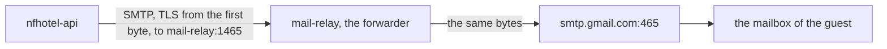

# Mail Relay

The API sends two mails of the booking flow: the link that verifies a booking request, and the receipt with the reference once the guest has pressed the button of that link ([ADR-0052](https://github.com/NF-Hotel/NFHotel/blob/main/docs/adr/adr-0052-a-booking-takes-a-room-once-its-email-is-verified.md)). It sends them with SMTP over TLS to a relay, Gmail, through the forwarder `mail-relay` on the VM, because the API itself has no route out of the VM ([ADR-0053](https://github.com/NF-Hotel/NFHotel/blob/main/docs/adr/adr-0053-mail-from-the-application-through-a-relay.md)). This page holds the steps of S01 that set the relay up and switch the verification on (task 9 of MIL-088), and what to do when the mail fails.

**For:** S01, who owns the account of the relay and approves the deploys, and anyone who answers `MailNotSent`, `MailFuseBlown` or `MailVolumeHigh`.
**Decisions:** [ADR-0052](https://github.com/NF-Hotel/NFHotel/blob/main/docs/adr/adr-0052-a-booking-takes-a-room-once-its-email-is-verified.md), [ADR-0053](https://github.com/NF-Hotel/NFHotel/blob/main/docs/adr/adr-0053-mail-from-the-application-through-a-relay.md). **Work:** MIL-088.

**Contents**
1. [How a mail travels](#how-a-mail-travels)
2. [Which account](#which-account)
3. [Set it up, step by step](#set-it-up-step-by-step)
4. [Check it on the live site](#check-it-on-the-live-site)
5. [The copies in Sent and the bounces](#the-copies-in-sent-and-the-bounces)
6. [Revoke the app password](#revoke-the-app-password)
7. [Turn it off](#turn-it-off)
8. [When the mail fails](#when-the-mail-fails)
9. [A sender address of the hotel's own domain, later](#a-sender-address-of-the-hotels-own-domain-later)

---

## How a mail travels



- The API is on internal networks only. The forwarder is the one other service on `nfhotel-mail`, and the only service on `nfhotel-mail-out`, the network with a route out ([Network Isolation](Network-Isolation#the-way-of-the-mail)).
- The TLS runs from the API to Gmail: the forwarder passes encrypted bytes, holds no secret, and gets only `Smtp__Host` and `Smtp__Port` of `nfhotel-api.env`. The API checks the certificate of `smtp.gmail.com` as if it connected itself. The log of the forwarder has one line per connection with its times and bytes, never its content.
- `ops/scripts/deploy-services.sh` creates both networks at every deploy and starts the forwarder before the API, only when `Smtp__Forwarder` is set. It refuses the deploy, and names the setting, when `Smtp__Forwarder` is set without `Smtp__Host` or `Smtp__Port`, or when `BookingVerification__Enabled` is true without `Smtp__Forwarder`.
- The API sends at most 400 mails in 24 hours (`Smtp__MaxMailsPerDay`, the fuse); Gmail allows an account 500 a day.
- In the throwaway stack of the end-to-end tests and in the light development mode the mails go through the same forwarder to the mail catcher Mailpit, never to the internet ([Local Development Deploy](Local-Development-Deploy)).

Every setting is described on [Environment Files](Environment-Files); the alerts are on [Alerts](Alerts#mail-prometheusrulessecurityyml).

## Which account

S01 chose a private Google account for the relay (ADR-0053 decision 8). This page recommends an account made for the hotel instead, because with the private account:

- Gmail keeps a copy of each mail that it sends in the folder **Sent** of the account. A copy holds the email of a guest, the dates, a link that works for 30 minutes and the reference of the booking, which with the email opens the booking. The clean-up of the application never reaches it ([The copies in Sent and the bounces](#the-copies-in-sent-and-the-bounces));
- a mail to an address that does not exist bounces back into the inbox of the account, with the mail inside;
- when many mails bounce, Google may stop the account from sending for 24 hours, and gives no number for "many"; with the private account that stops S01's own mail too;
- the app password opens that mailbox: whoever reads `Smtp__Password` on the VM can read S01's private mail and send in S01's name.

An account made for the hotel (a new Google account with 2-Step Verification on) keeps all four inside the mail of the hotel. Guests see the address of the account as the sender, and a reply lands in that mailbox; the mails say that a reply is not read. The steps below are the same for either account. S01 decides before step 1.

## Set it up, step by step

**Before you start:** the release of MIL-088 runs on `nf-hotel`, so the API knows the settings and the deploy knows the forwarder. The relay is set up and deployed first with the verification off, so a wrong setting shows while the public site still books as before (Parts A and B); the verification is switched on with a second deploy (Part C).

### Part A: the account (S01, in the browser)

1. Sign in to the Google account that will send the mails and open **Security** (`https://myaccount.google.com/security`). Turn on **2-Step Verification** if it is off. *Why:* Google makes app passwords only for an account with 2-Step Verification.
2. Open **App passwords** (`https://myaccount.google.com/apppasswords`), name the app `NF Hotel`, and create it. Google shows 16 letters once, in four groups. Keep the page open for step 5 and copy the letters nowhere else: not into a chat, a note, a screenshot or a file. *Why an app password:* Gmail takes no normal password over SMTP, and an app password can be revoked alone ([Revoke the app password](#revoke-the-app-password)).

### Part B: the relay on `nf-hotel` (S01, over the tailnet)

3. Open a shell on the VM: `tailscale ssh root@nf-hotel`.
4. Add the settings to the file of the API: `sudo -u nfhotel nano /opt/nfhotel/ops/deploy/nfhotel-api/nfhotel-api.env`, with the address of the account in place of `<address of the account>`, twice:
   ```text
   Smtp__Host=smtp.gmail.com
   Smtp__Port=465
   Smtp__Security=SslOnConnect
   Smtp__UserName=<address of the account>
   Smtp__FromAddress=<address of the account>
   Smtp__FromName=NF Hotel
   Smtp__Forwarder=mail-relay:1465
   BookingVerification__SiteAddress=https://nfhotel.devmatiker.com
   BookingVerification__Enabled=false
   ```
   *Why the same address twice:* Gmail sends only from the address of the account. `Smtp__MaxMailsPerDay` stays at its default of 400, under the 500 of Gmail. Leave `Smtp__CertificateThumbprint` out: it is for the mail catcher of the test stacks, and in production the certificate of Gmail is checked against the store of the system.
5. Write the app password without it reaching the screen, the shell history or the process list. The command asks for it; type or paste the 16 letters and press Enter:
   ```bash
   sudo -u nfhotel bash -c 'f=/opt/nfhotel/ops/deploy/nfhotel-api/nfhotel-api.env; read -rs -p "App password: " t; echo; umask 077; { grep -v "^Smtp__Password=" "$f"; printf "Smtp__Password=%s\n" "${t// /}"; } >"$f.new" && mv "$f.new" "$f"'
   ```
   *Why like this:* as with the token of the tunnel ([Public Access](Public-Access)), `read -s` does not echo, and `printf` is part of the shell, so the password is never a command argument. `${t// /}` drops the spaces between the four groups. Then close the page of Google: it does not show the letters again.
6. **Deploy:** re-run the latest successful `NF Hotel CD` run in GitHub Actions and approve it. The deploy writes the app password into a secret file of the API (ADR-0024), creates the networks of the mail, starts `mail-relay` before the API, and checks that no secret is in the environment of a container.
7. **Check the first deploy:** on `nf-hotel`, `sudo docker ps --filter name=mail-relay` shows the forwarder `healthy`, and `https://nfhotel.devmatiker.com/book` opens as before: the verification is still off, so the public site books at once and sends no mail yet.

### Part C: the verification on (S01, over the tailnet)

8. In the same file, change `BookingVerification__Enabled=false` to `BookingVerification__Enabled=true`.
9. **Deploy** again as in step 6. With the setting on, the API refuses to start, and names the setting, when a setting of the relay is missing or `BookingVerification__SiteAddress` is not an absolute `https` address; the deploy then fails its health check and rolls back ([CI-CD](CI-CD)), and the log of the API names the setting.
10. Check it on the live site, as the next section says.

## Check it on the live site

This is the check of criterion 10 of MIL-088. S01 makes the test booking with an email of S01's own, from outside the tailnet:

1. On `https://nfhotel.devmatiker.com/book`, ask for a room. The page says that a mail with a link was sent, and the back office shows no new booking: the request takes no room.
2. Ask again with the same email, or let the page send the mail again. A second mail arrives.
3. Open the link of the first mail and press the button: the link no longer works.
4. Open the link of the second mail and press the button: the page shows the reference of the booking, the back office shows the booking as `Pending`, and the receipt arrives.
5. Cancel the test booking in the back office, and delete the copies of the test mails as the next section says.

A screenshot for the evidence shows no email address, no name, no link and no reference: crop or blur it first.

## The copies in Sent and the bounces

After the first test mail, and from time to time while the private account sends the mails, in Gmail of the account:

1. Search `in:sent subject:"NF Hotel"`: the copies of the mails to the guests (the subjects of the two mails are in `src/NFHotel.Application/UseCases/Bookings/BookingMails.cs`). Select them all and **Delete**, then open **Trash**, select them and **Delete forever**. *Why forever:* Trash keeps a mail for 30 days.
2. Search `from:mailer-daemon`: the bounces, each with the mail that could not be delivered inside it. Delete them the same way.

## Revoke the app password

When the app password may have been anywhere but in step 5 (a chat, a screenshot, a file), or when the relay is no longer wanted:

1. On `https://myaccount.google.com/apppasswords`, delete the app password `NF Hotel`. From that moment Gmail refuses the API: each mail fails, `MailNotSent` fires, and while the verification is on the public site takes no booking request.
2. Either make a new app password and repeat steps 5 and 6 with it, or turn the mail off as the next section says.

A change of the password of the Google account revokes its app passwords too, with the same effect.

## Turn it off

1. Set `BookingVerification__Enabled=false` in `nfhotel-api.env` and deploy: the public site books at once again, without a mail. This comes first, because the deploy refuses the verification without the forwarder.
2. To stop the mail altogether, delete the lines `Smtp__Forwarder` and `Smtp__Password` and deploy. The deploy leaves out a forwarder that is not named, but does not stop one that runs; stop it on `nf-hotel`:
   ```bash
   sudo docker compose -p nfhotel-mail-relay down
   ```
3. Revoke the app password as the section above says.

## When the mail fails

`MailNotSent` in Discord means that the relay did not take a mail in the last 10 minutes. While the verification is on, the guest of that request was told to try again later, so no guest can book on the public site until the mail works again.

1. In Grafana, *Explore*, data source *Loki*, `{host="nf-hotel"} |= "mail_not_sent"` shows the kind of each mail and the reason in a word, never the address.
2. `auth`: Gmail refused the account; the app password was revoked or the password of the account changed. Make a new app password and repeat steps 5 and 6.
3. `connect` or `timeout`: the forwarder or Gmail could not be reached. On `nf-hotel`, `sudo docker ps --filter name=mail-relay` must show the forwarder `healthy`, and `sudo docker logs --tail 20 nfhotel-mail-relay-mail-relay-1` shows its last connections. No forwarder: check that `Smtp__Forwarder` is set and that the last deploy started it. A network that blocks port 465 out: `Smtp__Port=587` with `Smtp__Security=StartTls` reaches the same relay.
4. `tls`: the certificate of the relay did not match `Smtp__Host`, or the relay did not speak TLS on that port; compare the three settings with step 4.
5. `refused`: Gmail refused the sender or the mail, for example while it stops the account after many bounces or over its daily limit. Look in the inbox of the account for a notice from Google.
6. `fuse`: the receipt of a booking that the guest verified was held back, because the fuse of 400 mails in 24 hours was blown; the booking stands, and `MailFuseBlown` fires too.
7. While it cannot be fixed, turn the verification off (step 1 of [Turn it off](#turn-it-off)), so the public site books at once again.

`MailFuseBlown` and `MailVolumeHigh` are on [Alerts](Alerts#mail-prometheusrulessecurityyml).

## A sender address of the hotel's own domain, later

A Gmail address needs no records in the name system: Google signs the mail of `gmail.com` and publishes its policies. A sender address of a domain of the hotel, with a relay that sends for that domain, needs three records of the domain before the first mail; the relay names their values:

| Record | Where | What it says |
| --- | --- | --- |
| SPF (Sender Policy Framework) | a TXT record of the domain, such as `v=spf1 include:_spf.google.com ~all` for Google Workspace | Which servers may send mail for the domain |
| DKIM (DomainKeys Identified Mail) | a TXT record at `<selector>._domainkey` of the domain | The public key that checks the signature that the relay puts on each mail |
| DMARC (Domain-based Message Authentication, Reporting and Conformance) | a TXT record at `_dmarc` of the domain, such as `v=DMARC1; p=quarantine; rua=mailto:<address for the reports>` | What a receiver does with a mail that fails SPF and DKIM, and where it sends its reports |

Then `Smtp__Host`, `Smtp__Port`, `Smtp__UserName`, `Smtp__Password` and `Smtp__FromAddress` change to those of the new relay, and the AI checks the records from outside (MIL-088 task 9).

Related: [Network Isolation](Network-Isolation), [Environment Files](Environment-Files), [Alerts](Alerts), [Containers and Images](Containers-and-Images), [Public Access](Public-Access).
