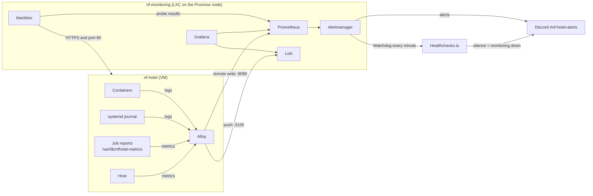

# Monitoring

The monitoring of NF Hotel tells the team in Discord when the site, a container or a nightly job fails, and keeps 14 days of logs and 30 days of metrics to find out why.

**For:** the people who install, run and change the monitoring (S03), and anyone who answers an alert.
**Decision:** [ADR-0020](https://github.com/NF-Hotel/NFHotel/blob/main/docs/adr/adr-0020-monitoring-stack.md), which explains why, with the options that were weighed. **Work:** MIL-023 tasks 7 to 10.

**Contents**
1. [Overview](#overview)
2. [Quick reference](#quick-reference)
3. [Install the monitoring](#install-the-monitoring)
4. [Daily use](#daily-use)
5. [Runbook: when an alert arrives](#runbook-when-an-alert-arrives)
6. [Troubleshooting](#troubleshooting)
7. [Change the monitoring](#change-the-monitoring)
8. [Reference](#reference)
9. [Why it is built this way](#why-it-is-built-this-way)

---

## Overview



- **Alloy** on `nf-hotel` sends logs and metrics to the LXC. Nothing on the VM listens for the monitoring.
- **blackbox** checks the site from outside the VM, the way a user meets it.
- **Prometheus** evaluates the alert rules, and **Alertmanager** sends the alerts to Discord.
- **Healthchecks.io** alerts if the monitoring itself goes silent.
- **Grafana** shows the dashboard and searches the logs.

All traffic runs on the tailnet; no part is on the internet.

## Quick reference

| What | Where |
| --- | --- |
| Grafana (dashboard, logs) | `http://<LXC address>:3000`, user `admin`, with the password of step C4 |
| Alerts | Discord `#nf-hotel-alerts` |
| Watchdog | Healthchecks.io check "NF Hotel monitoring watchdog" |
| The LXC | Proxmox container `102`, host name `nf-monitoring`; shell: `pct enter 102` on the node, or `tailscale ssh root@nf-monitoring` |
| IDs on the Proxmox node | `100` nf-hotel (VM), `101` sports-club (VM), `102` nf-monitoring (LXC) |
| The configuration in the LXC | `/opt/nfhotel-monitoring/ops/deploy/monitoring/` |
| Alloy on the VM | `/opt/nfhotel/ops/deploy/alloy/`, started by CD once `alloy.env` exists |
| Job reports on the VM | `/var/lib/nfhotel-metrics/*.prom` |
| Retention | Metrics 30 days, logs 14 days |

## Install the monitoring

This is done once, by S03, in five parts, about 45 minutes in all. Do the parts in order: each part needs the one before it.

> **Secrets.** The Discord webhook URL, the Healthchecks.io ping URL and the Grafana password are secrets. Keep them in your password manager until step C4, and put them only in the files of that step: never in a chat, an issue, a commit or a screenshot.

### Before you start

- An admin login for Discord, the Tailscale admin console and the Proxmox web interface.
- Your own computer on the tailnet.
- Shell access to `nf-hotel` (`nfadmin`).

### Part A: accounts and access (browser)

**A1. Create the Discord webhook.**
1. In Discord, create the text channel `#nf-hotel-alerts` if it does not exist.
2. Open the channel settings, then *Integrations*, then *Webhooks*, then *New Webhook*.
3. Name it `NF Hotel monitoring`.
4. Click *Copy Webhook URL*, and save the URL in your password manager.

**A2. Create the Healthchecks.io check.**
1. Sign up at [healthchecks.io](https://healthchecks.io/). The free plan is enough.
2. Add a check named `NF Hotel monitoring watchdog`, with *Period* 1 minute and *Grace time* 5 minutes.
3. Under *Integrations*, add Discord (the same channel) or your e-mail.
4. Save the ping URL (`https://hc-ping.com/…`) in your password manager.

**A3. Allow the traffic on the tailnet.** In the [Tailscale admin console](https://login.tailscale.com/admin/acls), open *Access controls* and add these to the policy. Keep the existing entries.

```json
"tagOwners": { "tag:monitoring": ["autogroup:admin"] },
"grants": [
  { "src": ["tag:nfhotel-vm"], "dst": ["tag:monitoring"], "ip": ["tcp:9090", "tcp:3100"] },
  { "src": ["tag:monitoring"], "dst": ["tag:nfhotel-vm"], "ip": ["tcp:80", "tcp:443"] },
  { "src": ["autogroup:admin"], "dst": ["tag:monitoring"], "ip": ["tcp:3000"] }
],
"ssh": [
  { "action": "check", "src": ["autogroup:admin"], "dst": ["tag:monitoring"], "users": ["root"] }
]
```

Merge each list into the one that is already in the policy, and keep the existing grants, `ssh` rules and tests. Then click *Save*.

**Result:** the policy saves without an error. Its tests still pass.

> **Who can open Grafana.** The grant above lets admins reach port 3000. If the policy already has a broad grant, such as `autogroup:member` to every destination on every port, that grant still lets every member reach Grafana too: grants only add access. Grafana's own login (user `admin`, the password of C4) then protects it. Narrowing the broad grant is a separate decision for the whole tailnet, so this guide does not remove it.

### Part B: the container (Proxmox node, as root)

Open the node's *Shell* in the Proxmox web interface.

**B1. Choose a free ID.**

```bash
pct list; qm list
```

Pick an ID that neither command lists. On the NF Hotel node, `100` is nf-hotel and `101` is sports-club, so the monitoring uses **`102`**. The script refuses an ID that a container or a VM already uses.

**B2. Download the template.**

```bash
pveam update
pveam available --section system | grep debian-13
pveam download local <the newest debian-13-standard file of the list>
```

On 2026-10-23 the newest file was `debian-13-standard_13.6-1_amd64.tar.zst`. The script uses the newest Debian 13 template that `pveam list local` shows, so no setting is needed. To use another one, put `MONITORING_TEMPLATE=local:vztmpl/<file>` in front of the commands in B4.

**Result:** `pveam list local` shows the file.

**B3. Get the scripts.**

```bash
apt-get install -y git
git clone --depth 1 https://github.com/NF-Hotel/NFHotel.git /root/nfhotel
```

If `/root/nfhotel` exists from an earlier try, bring it up to date instead: `git -C /root/nfhotel pull --ff-only`. Only then does it find the template by itself.

**B4. Check, then create the container.**

```bash
pvesm status
ip -br link show vmbr0
bash /root/nfhotel/ops/scripts/create-monitoring-lxc.sh 102
```

The last command only prints what it would do, starting with the template it chose. Check the template, the storage and the bridge in that printout:

- The storage must be one that `pvesm status` lists. The default is `local-lvm`; set `MONITORING_STORAGE=<name>` if yours differs.
- The bridge default is `vmbr0`, and `ip -br link show vmbr0` must show it `UP`; set `MONITORING_BRIDGE=<name>` if yours differs.

Then run it again with `--apply`:

```bash
bash /root/nfhotel/ops/scripts/create-monitoring-lxc.sh 102 --apply
```

**Result:** the script ends with `==> done` and lists the next steps. `pct status 102` prints `status: running`.

If it stops with `is not downloaded`, the script did not find the template: check `pveam list local`, or give `MONITORING_TEMPLATE` as in B2. Nothing was created then, so run it again.

### Part C: the monitoring (inside the container)

```bash
pct enter 102
```

**C1. Join the tailnet.**

```bash
tailscale up --ssh --advertise-tags=tag:monitoring --hostname=nf-monitoring
```

Open the link that it prints, and approve the machine. Then run:

```bash
tailscale ip -4
```

**Result:** an address like `100.x.y.z`. This guide calls it the *LXC address*.

**C2. Get the configuration.**

```bash
git clone https://github.com/NF-Hotel/NFHotel.git /opt/nfhotel-monitoring
cd /opt/nfhotel-monitoring/ops/deploy/monitoring
```

**C3. Write the settings.**

```bash
cp monitoring.env.example monitoring.env
sed -i "s/^MONITORING_BIND=.*/MONITORING_BIND=$(tailscale ip -4)/" monitoring.env
cat monitoring.env
```

**Result:** `MONITORING_BIND=` shows the LXC address.

**C4. Write the secrets.** `read -s` shows nothing while you paste, and the values stay out of the shell history.

```bash
install -d -m 700 secrets
umask 077
read -rsp 'Discord webhook URL: ' v && printf '%s' "$v" > secrets/discord-webhook-url; echo
read -rsp 'Healthchecks ping URL: ' v && printf '%s' "$v" > secrets/healthchecks-watchdog-url; echo
unset v
head -c 18 /dev/urandom | base64 | tr -d '\n' > secrets/grafana-admin-password
chmod 600 secrets/*
cat secrets/grafana-admin-password; echo
```

Save the Grafana password that the last command shows in your password manager.

**C5. Check, then start.**

```bash
bash /opt/nfhotel-monitoring/ops/scripts/deploy-monitoring.sh
bash /opt/nfhotel-monitoring/ops/scripts/deploy-monitoring.sh --apply
docker compose --env-file monitoring.env ps
```

- The first command checks the settings, the secrets and the configuration, and starts nothing.
- The second command gives each secret file to the container that reads it, then starts the stack. It returns when every service is up.

**Result:** the first command ends with `configuration valid`, and `ps` lists five services (`alertmanager`, `blackbox`, `grafana`, `loki`, `prometheus`), all running.

**C6. Check that it works.**
1. On your own computer, open `http://<LXC address>:3000` and sign in as `admin`.
2. Open the dashboard *NF Hotel overview*. The panel *Site over HTTPS* shows 1.
3. In Healthchecks.io, the check turns green within 2 minutes.

### Part D: the agent on nf-hotel

**D1. Point Alloy at the LXC.**

```bash
cd /opt/nfhotel/ops/deploy/alloy
sudo -u nfhotel cp alloy.env.example alloy.env
sudo -u nfhotel sed -i "s/100\.64\.0\.2/<LXC address>/" alloy.env
sudo -u nfhotel cat alloy.env
```

**Result:** both URLs show the LXC address.

The next CD run starts Alloy by itself. You do not start it by hand: CD owns what runs on the VM (ADR-0018), and a container started by hand would be replaced at the next deploy.

**D2. Check that data arrives.** After that CD run:
- In Grafana, *Explore*, data source *Loki*, the query `{host="nf-hotel"}` shows log lines.
- Within 10 minutes, the dashboard shows the disk and the containers.

### Part E: the alarm drill

Raise each alert once on purpose, and record when it arrives in Discord (MIL-023 task 10, recorded in an RC):

| Alert | How to raise it | Must arrive within |
| --- | --- | --- |
| `ContainerUnhealthy` | `sudo docker stop nfhotel-web-nfhotel-web-1`, then `sudo docker start nfhotel-web-nfhotel-web-1` | 3 minutes |
| `BackupStale` | `sudo sed -i 's/ [0-9]*$/ '"$(($(date +%s) - 97200))"'/' /var/lib/nfhotel-metrics/backup.prom` (27 hours old) | 2 minutes; the next backup writes a fresh file |
| `CertificateExpiresSoon` | In the LXC, raise the threshold in the local copy only: `cd /opt/nfhotel-monitoring && sed -i 's/ \/ 86400 < 21$/ \/ 86400 < 400/' ops/deploy/monitoring/prometheus/rules/nfhotel.yml && bash ops/scripts/deploy-monitoring.sh --apply`. **After the alert**, set it back: `git checkout -- ops/deploy/monitoring/prometheus/rules/nfhotel.yml && bash ops/scripts/deploy-monitoring.sh --apply` | 11 minutes (the rule waits 10) |
| Watchdog (Healthchecks.io) | `docker compose --env-file monitoring.env stop prometheus` in the LXC. **After the alert**, `start prometheus` | About 8 minutes: Alertmanager keeps the Watchdog until it expires, then Healthchecks.io waits its period and grace |

Run the step that ends a drill only after the alert has arrived. Every alert needs a minute or more to pass the chain: report, scrape, rule evaluation, `for`, and the wait of Alertmanager. A step taken at once ends the drill before the monitoring can see it. Record the times in UTC (`date -u`), as Discord shows local time.

Measured on 2026-10-24 (the alarm drill record, RC-189):

| Drill | From cause to alert |
| --- | --- |
| `ContainerUnhealthy` | 2 min 45 s at most |
| `BackupStale` | 49 s to 1 min 48 s |
| Watchdog | About 8 minutes |

## Daily use

### Read the dashboard

*NF Hotel overview* has these panels:
- the site over HTTPS and the days left on the certificate;
- the disk;
- the hours since each job last succeeded;
- the health of each container over time;
- the error lines in the logs.

### Search the logs

In Grafana, open *Explore* and choose the data source *Loki*. Some useful queries:

| To see | Query |
| --- | --- |
| Everything from the VM | `{host="nf-hotel"}` |
| One container | `{container="nfhotel-web-nfhotel-web-1"}` |
| Errors of the API | `{container="nfhotel-api-nfhotel-api-1"} \|~ "(?i)error\|exception"` |
| The last backup runs | `{source="journal", unit="nfhotel-backup.service"}` |
| The deploys | `{source="journal"} \|= "nfhotel-deploy"` |

Set the time range at the top right. The logs go back 14 days.

### Silence an alert during planned work

Before a planned stop, for example a VM reboot, silence the alerts so the channel is not flooded. Run this in the LXC:

```bash
cd /opt/nfhotel-monitoring/ops/deploy/monitoring
docker compose --env-file monitoring.env exec alertmanager amtool silence add \
  --alertmanager.url=http://localhost:9093 --duration=1h --comment="VM reboot" 'alertname!=Watchdog'
```

- List the silences with `amtool silence query`, using the same `--alertmanager.url`.
- End a silence early with `amtool silence expire <id>`.
- The matcher `alertname!=Watchdog` silences every alert except the Watchdog, so Healthchecks.io still knows that the monitoring is alive.

## Runbook: when an alert arrives

Each alert in Discord names what failed. Start with the first step below. Once the cause is gone, Alertmanager posts *RESOLVED* by itself.

| Alert | Severity | Means | First step |
| --- | --- | --- | --- |
| `SiteDown` | critical | The site has not answered over HTTPS for 2 minutes | Open the site. Then run `sudo docker ps` on `nf-hotel`, and read the latest CD run ([CI-CD](CI-CD)) |
| `RedirectBroken` | warning | Port 80 has not redirected to HTTPS for 5 minutes | `curl -sI http://nf-hotel.taildb84b5.ts.net/` must answer 301; check the nginx container |
| `CertificateExpiresSoon` | warning | The certificate has fewer than 21 days left | `systemctl status nfhotel-cert-renew.service` and its journal (ADR-0009) |
| `NoMetricsFromNfHotel` | critical | No data from the VM for 10 minutes | Is the VM up (`qm status 100` on the node)? Is Alloy running (`sudo docker ps \| grep alloy`)? |
| `DiskAlmostFull` | warning | The root disk is more than 80 % full | `df -h /`, then `sudo docker image prune` |
| `ContainerUnhealthy` | critical | A container has been stopped or unhealthy for 30 s | `sudo docker logs --tail 50 <container>` |
| `BackupStale` | critical | The last good backup is more than 26 hours old | `systemctl status nfhotel-backup.timer` and `journalctl -u nfhotel-backup` (ADR-0008) |
| `OffVmCopyStale` | warning | No backup has been copied off the VM for 72 hours | Turn on the legion laptop or bring it back on the tailnet. The backups wait on the VM |
| `CertificateRenewalStale` | warning | The renewal has not succeeded for 26 hours | `journalctl -u nfhotel-cert-renew` |
| `TaskReportMissing` | warning | A job has never reported success, or its file is gone | Run the job's service once (`sudo systemctl start nfhotel-backup.service`) and read its journal |
| `HealthReportMissing` | warning | The container health report is missing | `systemctl status nfhotel-report-health.timer` |
| Healthchecks.io: down | — | The monitoring itself is silent | `pct status 102` on the node; then `docker compose ps` in the LXC |

## Troubleshooting

| Problem | Cause and fix |
| --- | --- |
| Grafana does not open | Your computer must be on the tailnet, with a grant to port 3000 of `tag:monitoring` (A3). Check `tailscale status` in the LXC, and the `grafana` service in `docker compose ps` |
| `deploy-monitoring.sh` says a secret is readable by others | Run `chmod 600 secrets/*`, then run the script again |
| `deploy-monitoring.sh` says the address is not of this host | `MONITORING_BIND` must be the output of `tailscale ip -4` in the LXC |
| No logs or host data from `nf-hotel` | `alloy.env` is missing or has a wrong address (D1); or the grant `tag:nfhotel-vm` → `tag:monitoring` is missing (A3). On the VM, run `sudo docker logs nfhotel-alloy-alloy-1 --tail 20` |
| Alloy restarts on `nf-hotel`, or the CD run warns "alloy did not turn healthy" | Run `sudo docker logs nfhotel-alloy-alloy-1 --tail 20`. Alloy runs as its own user 473 with the host's `systemd-journal` group, which CD finds with `getent group systemd-journal`. `permission denied` means a mount it cannot read; the CI job *Ops monitoring configuration* starts Alloy the same way, so a pull request shows it first |
| The site probes fail but the site works | The grant `tag:monitoring` → `tag:nfhotel-vm` on 80 and 443 is missing (A3) |
| No alert in Discord, but Grafana shows a red value | Run `docker compose logs alertmanager` in the LXC; a wrong webhook URL shows there as an error with `receiver=discord` |

## Change the monitoring

**Add or change an alert rule.**
1. In a branch, edit [`prometheus/rules/nfhotel.yml`](https://github.com/NF-Hotel/NFHotel/blob/main/ops/deploy/monitoring/prometheus/rules/nfhotel.yml).
2. Add a test case to [`rules-test.yml`](https://github.com/NF-Hotel/NFHotel/blob/main/ops/deploy/monitoring/prometheus/rules-test.yml) that shows the alert firing, and not firing when it should not.
3. Add a row to the runbook above.
4. Open a pull request. The job *Ops monitoring configuration* runs `promtool test rules`.

**Deploy a merged change to the LXC.**

```bash
cd /opt/nfhotel-monitoring && git pull --ff-only
bash ops/scripts/deploy-monitoring.sh --apply
```

The parts on `nf-hotel` (Alloy and the job reports) are updated by CD, with no step of yours.

## Reference

**Files**

| File | What it holds |
| --- | --- |
| [`ops/deploy/monitoring/docker-compose.yml`](https://github.com/NF-Hotel/NFHotel/blob/main/ops/deploy/monitoring/docker-compose.yml) | The five services, pinned by digest and hardened |
| [`prometheus/prometheus.yml`](https://github.com/NF-Hotel/NFHotel/blob/main/ops/deploy/monitoring/prometheus/prometheus.yml) | The probes and the scrape settings (every 30 s) |
| [`prometheus/rules/nfhotel.yml`](https://github.com/NF-Hotel/NFHotel/blob/main/ops/deploy/monitoring/prometheus/rules/nfhotel.yml) | The alert rules |
| [`alertmanager/alertmanager.yml`](https://github.com/NF-Hotel/NFHotel/blob/main/ops/deploy/monitoring/alertmanager/alertmanager.yml) | The routes to Discord and Healthchecks.io |
| [`ops/deploy/alloy/config.alloy`](https://github.com/NF-Hotel/NFHotel/blob/main/ops/deploy/alloy/config.alloy) | What Alloy collects on `nf-hotel` |
| [`ops/scripts/report-health.sh`](https://github.com/NF-Hotel/NFHotel/blob/main/ops/scripts/report-health.sh) | The container health report, every minute |
| [`ops/scripts/deploy-monitoring.sh`](https://github.com/NF-Hotel/NFHotel/blob/main/ops/scripts/deploy-monitoring.sh) | Checks and starts the stack in the LXC |
| [`ops/scripts/create-monitoring-lxc.sh`](https://github.com/NF-Hotel/NFHotel/blob/main/ops/scripts/create-monitoring-lxc.sh) | Creates the LXC on the Proxmox node |

**Job reports on nf-hotel**

| File | Written by | Alert when |
| --- | --- | --- |
| `backup.prom` | The backup (nightly, and before every deploy) | Older than 26 h, or missing |
| `offvm_copy.prom` | The copy to the legion laptop | Older than 72 h, or missing |
| `cert_renew.prom` | The certificate renewal (daily) | Older than 26 h, or missing |
| `containers.prom` | `nfhotel-report-health.timer` (every minute) | A value of 0 for 30 s, or missing |

**Checks in CI** (job *Ops monitoring configuration*, on every pull request):
- `promtool check config` and `promtool test rules`;
- `amtool check-config`;
- `loki -verify-config` and `blackbox_exporter --config.check`;
- `alloy fmt`;
- a check that the dashboard is valid JSON;
- a start of the whole stack as this guide does it.

## Why it is built this way

The full reasoning, with the options that were weighed, is in [ADR-0020](https://github.com/NF-Hotel/NFHotel/blob/main/docs/adr/adr-0020-monitoring-stack.md). In short:

- **Off the VM.** A VM that monitors itself goes silent at the moment it fails.
- **An unprivileged LXC.** It runs the stack with far less memory than a second VM. Root in the container is not root on the node.
- **Tailnet only, with pushes from the VM.** No port opens on the internet or on `nf-hotel`.
- **Jobs report their success.** A timer that runs is not proof that the backup worked.
- **A watchdog outside.** A monitor cannot report its own death.
- **Everything is code.** It is reviewed, tested in CI, and the same after a rebuild.
