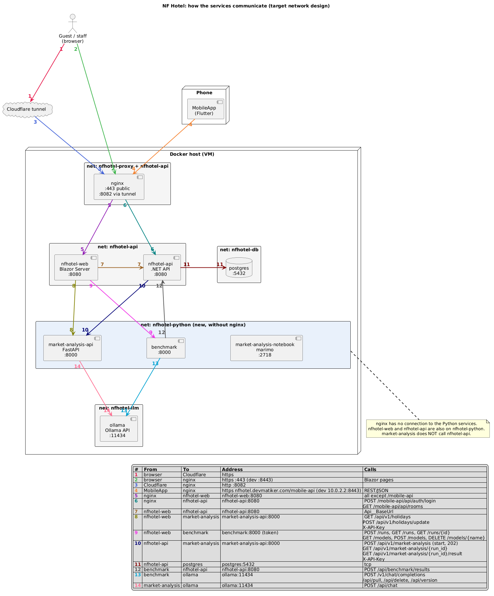

# Network Isolation

**English**

How the NF Hotel services talk to each other, which Docker network each one is on, and why some networks are kept apart from the rest. The diagram and the tables show the **target design**: the Python services (market analysis and benchmark) on a network of their own that nginx cannot see. The VM does not run this yet; [What changes from today](#what-changes-from-today) lists the difference.

**Contents**
1. [The picture](#the-picture)
2. [Who calls whom](#who-calls-whom)
3. [The networks](#the-networks)
4. [Why we isolate networks](#why-we-isolate-networks)
5. [What changes from today](#what-changes-from-today)
6. [Rules for a new service](#rules-for-a-new-service)
7. [Open points](#open-points)

## The picture

Every arrow has a number, and the number has the colour of its arrow; the next section says what each arrow is. The diagram is PlantUML. Its source is `docs/wiki/images/network-communication.puml`; change the source and render the PNG again.

## Who calls whom

A call goes from the service that starts it to the service that answers it. The market analysis does **not** call `nfhotel-api`: `nfhotel-api` starts a run and reads the report.

| # | From | To | Address | Calls |
| --- | --- | --- | --- | --- |
| 1 | Browser | Cloudflare tunnel | https | |
| 2 | Browser | nginx | https `:443` (dev `:8443`) | Blazor pages |
| 3 | Cloudflare tunnel | nginx | http `:8082` | |
| 4 | MobileApp | nginx | `https://nfhotel.devmatiker.com/mobile-api` (dev `10.0.2.2:8443`) | REST/JSON |
| 5 | nginx | `nfhotel-web` | `nfhotel-web:8080` | everything except `/mobile-api` |
| 6 | nginx | `nfhotel-api` | `nfhotel-api:8080` | `POST /mobile-api/api/auth/login`, `GET /mobile-api/api/rooms` |
| 7 | `nfhotel-web` | `nfhotel-api` | `nfhotel-api:8080` | `Api__BaseUrl` |
| 8 | `nfhotel-web` | market analysis | `market-analysis-api:8000` | `GET /api/v1/holidays`, `POST /api/v1/holidays/update`, header `X-API-Key` |
| 9 | `nfhotel-web` | benchmark | `benchmark:8000` (token) | `POST /runs`, `GET /runs`, `GET /runs/{id}`, `GET /models`, `POST /models`, `DELETE /models/{name}` |
| 10 | `nfhotel-api` | market analysis | `market-analysis-api:8000` | `POST /api/v1/market-analysis` (start, 202), `GET /api/v1/market-analysis/{run_id}`, `GET /api/v1/market-analysis/{run_id}/result`, header `X-API-Key` |
| 11 | `nfhotel-api` | PostgreSQL | `postgres:5432` | TCP |
| 12 | benchmark | `nfhotel-api` | `nfhotel-api:8080` | `POST /api/benchmark/results` |
| 13 | benchmark | Ollama | `ollama:11434` | `POST /v1/chat/completions`, `/api/pull`, `/api/delete`, `/api/version` |
| 14 | market analysis | Ollama | `ollama:11434` | `POST /api/chat` |

## The networks

| Network | Who is on it (target) | What it is for |
| --- | --- | --- |
| `nfhotel-proxy` | Cloudflare tunnel, nginx, `nfhotel-web` | What nginx may route to |
| `nfhotel-api` | nginx, `nfhotel-web`, `nfhotel-api` | Calls between the .NET applications |
| `nfhotel-python` (new) | `nfhotel-web`, `nfhotel-api`, market analysis, benchmark | Calls to and from the Python services; **nginx is not on it** |
| `nfhotel-db` | `nfhotel-api`, PostgreSQL, the DBeaver relay | Only the API and the relay reach the database |
| `nfhotel-llm` | Ollama, market analysis, benchmark | Only the AI services reach the model server |

Two networks already follow this rule today (`nfhotel-db` and `nfhotel-llm`, see [Containers and Images](Containers-and-Images)). `nfhotel-python` applies it to the Python services.

## Why we isolate networks

A Docker network is the cheapest wall we have: a container can open a connection only to a container it shares a network with. Each reason below is a decision to put a service on fewer networks.

1. **nginx faces the internet, so it is the most exposed container.** Traffic for the public host name reaches it through the Cloudflare tunnel ([Public Access](Public-Access)). If someone takes nginx over, they stand on every network nginx is on. The fewer services share those networks, the less they can reach. With the Python services on `nfhotel-python`, a taken-over nginx cannot open a connection to them.
2. **The Python services run the most code we do not control.** They load many third-party libraries, run notebooks and pass text to and from AI models. That is a wider attack surface than a Blazor page. Keeping them away from the front door means a flaw in them is not reachable from the internet, and a flaw in the front door does not hand over the analysis service.
3. **Nothing should reach the data by a shortcut.** Only `nfhotel-api` opens the database (ADR-0004, [ADR-0011](https://github.com/NF-Hotel/NFHotel/blob/main/docs/adr/adr-0011-postgresql-access-for-the-api.md)). The Python services get the bookings in the request that the API sends and never connect to PostgreSQL, so they are not on `nfhotel-db`.
4. **A service that is only called needs no route from the front.** The browser never talks to the Python services; `nfhotel-web` and `nfhotel-api` do, for a signed-in user with the right role. Without a route in nginx there is one place, the .NET application, where sign-in, roles and rate limits are checked, and no second path around it.
5. **The model server stays behind the AI services.** Ollama has no sign-in of its own. On `nfhotel-llm`, with only the two AI services, nobody else can ask it for answers or tell it to download and delete models.
6. **A smaller blast radius, easier to reason about.** When a service is on two networks instead of five, the question "what can this container reach?" has a short answer that we can read from the compose file and check with a review or a port scan.
7. **No published ports.** None of these services publishes a host port. Together with the networks, the only ways in from outside are nginx and the tunnel.

Network isolation does not replace the other layers: the tokens between services (`X-API-Key`, the benchmark token), the roles in the back office, read-only containers, dropped capabilities and image scanning still apply. It limits how far a mistake in one of them can travel.

## What changes from today

| Service | Networks today | Networks in the target |
| --- | --- | --- |
| nginx | `proxy`, `api` | `proxy`, `api` (unchanged) |
| `nfhotel-web` | `proxy`, `api` | `proxy`, `api`, `python` |
| `nfhotel-api` | `api`, `db` | `api`, `db`, `python` |
| market analysis | `proxy`, `llm`, `api` | `python`, `llm` |
| benchmark | `llm`, `api` | `python`, `llm` |

To get there:

- Create the network `nfhotel-python` and add `NFHOTEL_PYTHON_NETWORK` to the environment files beside the existing network names ([Environment Files](Environment-Files)).
- Move the compose files of the market analysis and the benchmark from `proxy` and `api` to `python`, and join `nfhotel-web` and `nfhotel-api` to `python`.
- Remove the nginx listener on `127.0.0.1:8081` that proxies to `market-analysis-api` and `market-analysis-notebook`, because nginx can no longer resolve them.
- The benchmark keeps `NFBENCH_WEB_URL=http://nfhotel-api:8080`: the name still resolves, because `nfhotel-api` is on `python` too.

## Rules for a new service

1. Start with no network. Add a network only for a call that you can name in the table above.
2. Do not put a service on `nfhotel-proxy` unless nginx must route to it.
3. A service that only answers calls from the .NET applications belongs on `nfhotel-python` (or a network of its own), not on `nfhotel-api` or `nfhotel-proxy`.
4. Do not publish a host port. If a person needs access, use the tailnet ([Database Access](Database-Access) is the example).
5. Update the diagram, the call table and [Containers and Images](Containers-and-Images) in the same pull request.

## Open points

- **The marimo notebook page** of the market analysis (`market-analysis-notebook:2718`) is reached today only through the nginx listener on `127.0.0.1:8081`. In the target design it has no route. Decide whether to drop it, or to reach it through an SSH tunnel to the VM when someone needs it.
- **Ollama for the market analysis.** The example environment file points at `host.docker.internal:11434`; the diagram assumes the container `ollama:11434` on `nfhotel-llm`. Confirm what the running service uses.
- **Order of the move.** The services and the nginx change have to move in one deploy, or the analysis page breaks in between.

Related: [Home](Home), [Containers and Images](Containers-and-Images), [Public Access](Public-Access), [Security Controls](Security-Controls).
