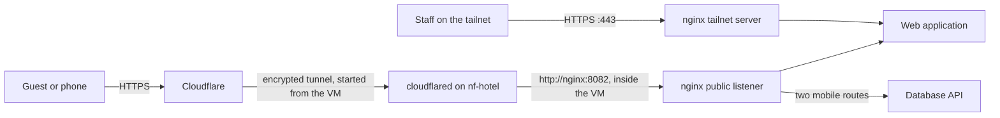

# Public Access

NF Hotel is public at `https://nfhotel.devmatiker.com` through Cloudflare Tunnel: guests book and the mobile app works from anywhere, while no port is open in the home network and the back office stays on the tailnet.

**For:** S01, who owns the Cloudflare account and the domain, and anyone who answers `PublicSiteDown`.
**Decision:** [ADR-0028](https://github.com/NF-Hotel/NFHotel/blob/main/docs/adr/adr-0028-public-access-through-cloudflare-tunnel.md), which explains why, with the options that were weighed. **Work:** MIL-040.

**Contents**
1. [What is public](#what-is-public)
2. [How a request travels](#how-a-request-travels)
3. [Set it up, step by step](#set-it-up-step-by-step)
4. [Check it](#check-it)
5. [Turn it off](#turn-it-off)
6. [When the public site is down](#when-the-public-site-is-down)
7. [Why it is built this way](#why-it-is-built-this-way)

---

## What is public

| Path on `nfhotel.devmatiker.com` | Public | Why |
| --- | --- | --- |
| `/`, `/book`, `/booking/...` | Yes | Guests look, book and sign in to their booking |
| `/mobile-api/api/auth/login`, `/mobile-api/api/rooms...` | Yes | The two routes of the mobile app (ADR-0015) |
| `/admin...` | No, 404 | The back office stays on `https://nf-hotel.taildb84b5.ts.net/admin` |
| Any other path of `/mobile-api/` | No, 404 | The API has no other public path |
| SSH, the monitoring, PostgreSQL | No | Not on the tunnel at all |

## How a request travels



No arrow points into the home network: `cloudflared` opens the connection from the inside, so the router keeps every port closed.

## Set it up, step by step

### Part A: Cloudflare (S01, in the browser)

1. **Create the tunnel.** In the [Cloudflare dashboard](https://dash.cloudflare.com), open **Zero Trust → Networks → Tunnels → Create a tunnel**, choose **Cloudflared**, and name it `nf-hotel`. *Why this kind:* a tunnel managed in the dashboard needs only a token on the VM, no certificate file.
2. **Copy the token.** On the "Install and run a connector" page, choose **Docker**. The command shown ends with `--token eyJ...`: copy only the long value after `--token`. Do not run the command, and do not paste the token anywhere else; it gives control of the tunnel. Keep the page open for step 3.
3. **Add the public host name.** Under **Public Hostname**: subdomain `nfhotel`, domain `devmatiker.com`, service type **HTTP**, URL `nginx:8082`. *Why HTTP:* the hop from `cloudflared` to nginx stays inside the VM on a Docker network; the tunnel itself and the guest's connection to Cloudflare are encrypted.
4. **Force HTTPS.** In the domain's **SSL/TLS → Edge Certificates**, turn on **Always Use HTTPS**. *Why:* a guest who types `http://` is sent to `https://` by Cloudflare before anything reaches the hotel.
5. **Limit sign-in attempts.** In **Security → WAF → Rate limiting rules**, create one rule: when the URI path contains `/mobile-api/api/auth/login`, with the same IP, more than 5 requests in 10 seconds, **Block** for 10 seconds. *Why:* password guessing is stopped at Cloudflare; the API's own per-address limit stays as the second line.

### Part B: the token on `nf-hotel` (S01, over the tailnet)

6. Open a shell on the VM: `tailscale ssh root@nf-hotel`.
7. Create the settings file from its example, readable by its owner only:
   ```bash
   sudo -u nfhotel bash -c 'umask 077 && cp /opt/nfhotel/ops/deploy/cloudflared/cloudflared.env.example /opt/nfhotel/ops/deploy/cloudflared/cloudflared.env'
   ```
8. Write the token without it reaching the screen, the shell history or the process list. The command asks for it; paste it and press Enter:
   ```bash
   sudo -u nfhotel bash -c 'f=/opt/nfhotel/ops/deploy/cloudflared/cloudflared.env; read -rs -p "Tunnel token: " t; echo; umask 077; { grep -v "^TUNNEL_TOKEN=" "$f"; printf "TUNNEL_TOKEN=%s\n" "$t"; } >"$f.new" && mv "$f.new" "$f"'
   ```
   *Why like this:* `read -s` does not echo, and `printf` is part of the shell, so the token is never a command argument that another user could see.
9. **Deploy:** re-run the latest successful `NF Hotel CD` run in GitHub Actions. The deploy writes the token to a secret file (ADR-0024), starts `cloudflared`, and checks that no secret is in its environment.

## Check it

From a phone with Tailscale turned off, or any machine outside the tailnet:

- `https://nfhotel.devmatiker.com/` and `/book` open, with a valid certificate.
- `https://nfhotel.devmatiker.com/admin/login` answers 404.
- In the Cloudflare dashboard the tunnel `nf-hotel` shows **Healthy**.
- In Grafana, the public probe (`job="public_site"`) shows success.

## Turn it off

- **At once, from the browser:** in **Zero Trust → Networks → Tunnels**, open `nf-hotel` and delete its public host name. The site leaves the internet; the tailnet is unchanged.
- **For good, on the VM:** delete `/opt/nfhotel/ops/deploy/cloudflared/cloudflared.env` and re-run CD; the deploy leaves the tunnel out. `PublicSiteDown` alerts, and stops 7 days after the last success.

## When the public site is down

`PublicSiteDown` in Discord means the public probe has failed for 3 minutes, so guests cannot reach the site.

1. Open `https://nf-hotel.taildb84b5.ts.net/` from the tailnet. If that fails too, the VM or the site is down: follow `SiteDown` in [Monitoring](Monitoring#runbook-when-an-alert-arrives).
2. If only the public name fails: look at the tunnel in the Cloudflare dashboard. **Down** or **Inactive** means `cloudflared` is not connected: on `nf-hotel`, `sudo docker logs --tail 50 nfhotel-cloudflared-cloudflared-1`.
3. An "unauthorized" or token error in that log means the token was revoked or mistyped: repeat Part B step 8 with the token from the dashboard, then re-run CD.
4. A 502 from Cloudflare with a healthy tunnel means nginx did not answer on port 8082: check `sudo docker ps` for the nginx container.

## Why it is built this way

- **A tunnel, not open ports.** The VM stands in a private home; with a tunnel the home address stays hidden and the router stays closed, and Cloudflare stops floods before they reach the home connection.
- **A separate listener on 8082.** The public rules (no back office, the client's address from Cloudflare, HTTPS reported to the application) apply only to tunnel traffic; the tailnet server on 443 keeps working as before.
- **The back office on the tailnet only.** Strangers cannot try passwords on a sign-in page they cannot see.
- **The token as a file.** Like every other secret since ADR-0024, it is never an environment variable, so `docker inspect` and the monitoring cannot read it.
- **Production on every release.** An error shows the error page, never a stack trace, to a guest.
