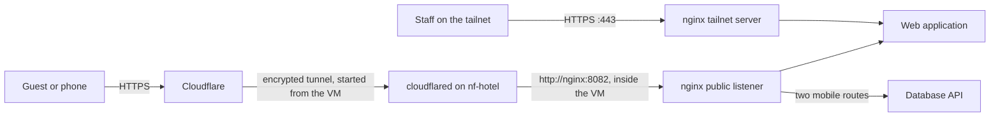

# Public Access

NF Hotel is public at `https://nfhotel.devmatiker.com` through Cloudflare Tunnel: guests book and the mobile app works from anywhere, while no port is open in the home network and the back office sits behind Cloudflare Access.

**For:** S01, who owns the Cloudflare account and the domain, and anyone who answers `PublicSiteDown`.
**Decision:** [ADR-0028](https://github.com/NF-Hotel/NFHotel/blob/main/docs/adr/adr-0028-public-access-through-cloudflare-tunnel.md), which explains why, with the options that were weighed. **Work:** MIL-040.

**Contents**
1. [What is public](#what-is-public)
2. [How a request travels](#how-a-request-travels)
3. [Set it up, step by step](#set-it-up-step-by-step)
4. [The back office from the internet](#the-back-office-from-the-internet)
5. [The edge as code](#the-edge-as-code)
6. [The security.txt](#the-securitytxt)
7. [Check it](#check-it)
8. [Turn it off](#turn-it-off)
9. [When the public site is down](#when-the-public-site-is-down)
10. [Why it is built this way](#why-it-is-built-this-way)

---

## What is public

| Path on `nfhotel.devmatiker.com` | Public | Why |
| --- | --- | --- |
| `/`, `/book`, `/booking/...`, `/my-booking...` | Yes | Guests look, book, sign in to their booking with its reference and email, and change or cancel it; an old address `/booking/<number>` leads to the empty sign-in form (MIL-079, MIL-018, MIL-085) |
| `/mobile-api/api/auth/login`, `/mobile-api/api/rooms...` | Yes | The two routes of the mobile app (ADR-0015) |
| `/admin...`, in any letter case | Behind Cloudflare Access | Only listed staff get past the e-mail code to the hotel's sign-in (MIL-041, MIL-072); without it, 404 |
| `/.well-known/security.txt`, and `/security.txt` as a redirect to it | Yes | Where to report a security problem (RFC 9116, MIL-084); nginx serves it from git, so it answers while the web application is down ([The security.txt](#the-securitytxt)) |
| Any other path of `/mobile-api/` | No, 404 | The API has no other public path |
| SSH, the monitoring, PostgreSQL | No | Not on the tunnel at all |

## How a request travels



No arrow points into the home network: `cloudflared` opens the connection from the inside, so the router keeps every port closed.

## Set it up, step by step

The order matters: Cloudflare adds the public host name only once the tunnel has a connected connector, so the token goes on the VM (Part B) before the name is added (Part C).

These steps built the edge by hand, and they stay the way to build it again from nothing. Since MIL-078 the routes of Part C and the Access application of the back office are also code: once they exist, a change of them goes through the code ([The edge as code](#the-edge-as-code)), not through the dashboard.

### Part A: Cloudflare (S01, in the browser)

1. **Create the tunnel.** In the [Cloudflare dashboard](https://dash.cloudflare.com), open **Networking → Tunnels → Create a tunnel**, choose **Cloudflared**, and name it `nf-hotel`. *Why this kind:* a tunnel managed in the dashboard needs only a token on the VM, no certificate file.
2. **Leave the install page.** It shows install commands with the token in them: do not run them and do not copy them anywhere. The token is fetched again in Part B.
3. **Force HTTPS.** In the domain's **SSL/TLS → Edge Certificates**, turn on **Always Use HTTPS**. *Why:* a guest who types `http://` is sent to `https://` by Cloudflare before anything reaches the hotel.
4. **Limit sign-in attempts.** In the domain's **Security → Security rules → Create rule → Rate limiting rules**, create one rule: when the URI path contains `/mobile-api/api/auth/login`, with the same IP, more than 5 requests in 10 seconds, **Block** for 10 seconds. *Why:* password guessing is stopped at Cloudflare; the API's own per-address limit stays as the second line.

### Part B: the token on `nf-hotel` (S01, over the tailnet)

5. **Fetch the token.** In **Networking → Tunnels → nf-hotel → Edit**, the install command ends with a long value starting with `eyJ`: that value alone is the token. It gives control of the tunnel, so it goes only into the command of step 8.
6. Open a shell on the VM: `tailscale ssh root@nf-hotel`.
7. Create the settings file from its example, readable by its owner only:
   ```bash
   sudo -u nfhotel bash -c 'umask 077 && cp /opt/nfhotel/ops/deploy/cloudflared/cloudflared.env.example /opt/nfhotel/ops/deploy/cloudflared/cloudflared.env'
   ```
8. Write the token without it reaching the screen, the shell history or the process list. The command asks for it; paste it and press Enter:
   ```bash
   sudo -u nfhotel bash -c 'f=/opt/nfhotel/ops/deploy/cloudflared/cloudflared.env; read -rs -p "Tunnel token: " t; echo; umask 077; { grep -v "^TUNNEL_TOKEN=" "$f"; printf "TUNNEL_TOKEN=%s\n" "$t"; } >"$f.new" && mv "$f.new" "$f"'
   ```
   *Why like this:* `read -s` does not echo, and `printf` is part of the shell, so the token is never a command argument that another user could see.
9. **Deploy:** re-run the latest successful `NF Hotel CD` run in GitHub Actions. The deploy writes the token to a secret file (ADR-0024), starts `cloudflared`, and checks that no secret is in its environment. In the dashboard the tunnel turns **Healthy**.

### Part C: the public host name (S01, in the browser)

10. In **Networking → Tunnels → nf-hotel → Edit → Routes → Add route → Published application**: subdomain `nfhotel`, domain `devmatiker.com`, path empty, service URL `http://nginx:8082`, HTTP Host Header empty, the other settings at their defaults. Cloudflare creates the DNS record itself. *Why HTTP:* the hop from `cloudflared` to nginx stays inside the VM on a Docker network; the tunnel itself and the guest's connection to Cloudflare are encrypted. *Why no Host Header:* the web application gets `nfhotel.devmatiker.com`, the name the guest typed.

### Rotate the token

If the token has been anywhere but step 8 (a chat, a screenshot, a file), rotate it: in the tunnel's settings, refresh (rotate) the token, then repeat steps 5 to 9 with the new one; the old token stops working. Where the dashboard offers no such action, delete the tunnel, create a new one with the same name, and repeat Parts B and C. A new tunnel has a new ID: change `TF_VAR_tunnel_id` and the secret `CLOUDFLARE_TUNNEL_ID` too ([The settings outside git](#the-settings-outside-git)).

## The back office from the internet

**Decision:** [ADR-0029](https://github.com/NF-Hotel/NFHotel/blob/main/docs/adr/adr-0029-back-office-behind-cloudflare-access.md). **Work:** MIL-041, and MIL-072 for the order of the routes and every spelling of `/admin`.

### Sign in as staff

1. Open `https://nfhotel.devmatiker.com/admin` in any browser, without Tailscale.
2. Cloudflare asks for your e-mail address. Type the one the team listed for you.
3. A 6-digit code arrives by e-mail (look in the spam folder the first time). Type it in.
4. The hotel's own sign-in appears: your user name and password, as before.

Cloudflare remembers the browser for 1 week. An address that is not on the list gets no code and never sees the hotel's sign-in. On the tailnet, `https://nf-hotel.taildb84b5.ts.net/admin` works as before, without a code.

### Set it up (S01, in the browser, before the nginx change is deployed)

1. **The Access application.** In **Zero Trust → Access controls → Applications → Add an application → Self-hosted**: name `NF Hotel back office`, session duration **1 week**, public hostname `nfhotel` · `devmatiker.com`, path `admin`. Login method: **One-time PIN** only.
2. **The policy.** Add a policy `Team`, action **Allow**, include **Emails**: the listed addresses. Save the application.
3. **Note two values.** In **Zero Trust → Settings**, the *team domain* (`<team>.cloudflareaccess.com`); on the application's page, the **Application Audience (AUD) Tag**. Neither is a secret.
4. **The validating route.** In **Networking → Tunnels → nf-hotel → Routes → Add route → Published application**: subdomain `nfhotel`, domain `devmatiker.com`, path `(?i)^/admin`, service URL `http://nginx:8082`. Under **Additional application settings → Access**, turn on **Validate the Access JWT at the tunnel** (or "Protect with Access") with the team name and the AUD tag of step 3. Save, then in the list of routes open the new route's **⋯** menu and choose **Move up** until it shows **Order 1**. *Why:* a request for `/admin` that did not pass Access stops at the tunnel and never reaches the VM. The routes are matched from top to bottom and the first match wins, so below the route without a path this route is never used; `(?i)` makes the path ignore letter case, as the web application does, so `/ADMIN` is checked too.
5. **Check before the deploy:** `https://nfhotel.devmatiker.com/admin/login` and `/ADMIN/login` in a private window show Cloudflare's e-mail page, and the route with the path `(?i)^/admin` has **Order 1**. Only then is the nginx change of MIL-041 deployed, which lets a request with the Access token through to the back office.

### Add or remove a member of staff

Since MIL-078 the addresses of the policy `Team` are a setting outside git, kept in two places: `TF_VAR_team_emails` in the `edge.env` of the person who applies, and the secret `CLOUDFLARE_TEAM_EMAILS` of the environment `cloudflare-read` ([The settings outside git](#the-settings-outside-git)). Change the address in both, then apply it as step 2 of [Change the edge](#change-the-edge) says; it needs no pull request, because the addresses are not in git.

To take someone off the list at once, remove the address in the dashboard: **Zero Trust → Access controls → Applications → NF Hotel back office → Policies → Team**, under **Emails**, and save. Then change both places the same day; until they match the dashboard, the weekly comparison reports the policy as different. Removing an address stops new codes at once; a session already open ends within the week. Their hotel account is managed in the back office as before (Manager → staff accounts).

## The edge as code

**Decision:** [ADR-0046](https://github.com/NF-Hotel/NFHotel/blob/main/docs/adr/adr-0046-the-tunnel-routes-and-access-in-opentofu.md). **Work:** MIL-078.

The routes of the tunnel `nf-hotel` and the Access application of the back office with its policy `Team` are code in `ops/infra/cloudflare/`, written for OpenTofu, the open fork of Terraform. A change is a pull request that S01 or S03 applies from their own machine; nothing applies by itself. Every Monday a workflow compares the live account with the code and opens an issue when they differ. No state file is kept anywhere: every plan imports the three objects from the account, so the plan of an account that matches the code shows **3 to import, 0 to add, 0 to change, 0 to destroy**.

### What is in code

- **In `ops/infra/cloudflare/main.tf`:**
  - the routes of `nf-hotel` in their order: first `nfhotel.devmatiker.com` with the path `(?i)^/admin` and the Access check on (the team name, and the AUD tag, which the code reads from the application), then the same name without a path, both to `http://nginx:8082`, and last a 404 for any other request;
  - the Access application `NF Hotel back office`: self-hosted, for `nfhotel.devmatiker.com/admin`, with a session of 1 week (`168h`) and the policy `Team`;
  - the policy `Team`: **Allow** for the listed e-mail addresses.
- **Still in the dashboard only:** the tunnel itself and its token (Parts A and B); the DNS record of the public name, which Cloudflare made with the route (a route for a new name needs its record made there too); and the settings of the domain: the SSL mode, **Always Use HTTPS** and the rate-limiting rule.

Settings that the dashboard set and this page never recorded, such as the login method of the application, may show as a difference in the first plan. They are then written into the code until the plan is clean; nothing is applied to make it clean (MIL-078, task 5).

### The settings outside git

The identifiers and the addresses never go into git, an issue or a log. On the machine of the person who applies they are in `ops/infra/cloudflare/edge.env`, which git ignores; in GitHub they are secrets of the environment `cloudflare-read`.

| In `edge.env` | Secret of `cloudflare-read` | What it is, and where to find it |
| --- | --- | --- |
| `TF_VAR_account_id` | `CLOUDFLARE_ACCOUNT_ID` | The account: the 32 hexadecimal characters right after `dash.cloudflare.com/` in the address of any page of the dashboard |
| `TF_VAR_tunnel_id` | `CLOUDFLARE_TUNNEL_ID` | The ID (a UUID) of the tunnel `nf-hotel`: in **Networking → Tunnels**, or from the API below |
| `TF_VAR_access_application_id` | `CLOUDFLARE_ACCESS_APP_ID` | The ID (a UUID) of the application `NF Hotel back office`, from the API below |
| `TF_VAR_access_policy_id` | `CLOUDFLARE_ACCESS_POLICY_ID` | The ID (a UUID) of the policy `Team`, from the API below |
| `TF_VAR_access_team_name` | `CLOUDFLARE_TEAM_NAME` | The team name: `<team>` of the team domain `<team>.cloudflareaccess.com` in **Zero Trust → Settings** (step 3 of the back office set-up) |
| `TF_VAR_team_emails` | `CLOUDFLARE_TEAM_EMAILS` | The addresses of the policy `Team`, written as a JSON list: `["first@example.com","second@example.com"]` |
| none: `edge-tofu.sh` asks for it | `CLOUDFLARE_READ_TOKEN` | The token that reads ([Set up the weekly comparison](#set-up-the-weekly-comparison)) |

The API of Cloudflare lists the three IDs by name, with the token that reads. The token is typed without echo and reaches `curl` through a pipe, so it is not on a command line; the account ID is the one of the first row of the table:

```bash
read -rsp "Cloudflare token (not shown): " token; echo
account=<the account ID>
for list in "cfd_tunnel?is_deleted=false" access/apps access/policies; do
  printf 'Authorization: Bearer %s\n' "$token" |
    curl -sS -H @- "https://api.cloudflare.com/client/v4/accounts/$account/$list" |
    jq -r '.result[] | "\(.id)  \(.name)"'
done
unset token
```

To make `edge.env`, copy its example, readable by you only, and fill in the six values:

```bash
(cd ops/infra/cloudflare && umask 077 && cp edge.env.example edge.env)
```

### Change the edge

1. **The pull request.** Change `ops/infra/cloudflare/main.tf` in a pull request, reviewed like any other change. `bash ops/scripts/edge-tofu.sh format` formats the code; Ops CI checks the format and validates the code (`Ops edge code (MIL-078)`), with no token and without reaching Cloudflare.
2. **Apply it after the merge (S01 or S03, on your own machine).** It needs Linux, macOS or WSL, Docker, and bash 4.4 or later (on macOS from Homebrew):
   ```bash
   git switch main && git pull --ff-only
   bash ops/scripts/edge-tofu.sh apply
   ```
   `apply` asks for the token that writes without showing it, shows the plan, and asks for `yes`. Answer `yes` only when the plan shows the three imports and the change of the pull request, nothing else. A change you did not make means that the account was changed elsewhere: answer `no` and [read the weekly issue](#read-the-weekly-issue) first. A `replace` makes the object anew (a new application gets a new AUD tag): never apply one without knowing why.
3. **Check it.** Run the workflow by hand (**Actions → NF Hotel edge comparison → Run workflow**, on `main`): it must say that the live account matches the code. After a change of the routes, check their order in the log of `cloudflared`, as [Check it](#check-it) says.

**The token that writes** is made by the person who applies, for their own use only: a custom token in the Cloudflare dashboard (**My Profile → API Tokens → Create Token → Custom token**) with **Account → Cloudflare Tunnel → Edit** and **Account → Access: Apps and Policies → Edit**, for the NF Hotel account only, with a short expiry. It can open the back office to anyone, so it is typed at the prompt of `edge-tofu.sh` and never written to a file of the repository, to CI, to an issue or to a chat. Keep it in your password manager, or delete it in the dashboard once the change is applied.

### The weekly comparison

The workflow `NF Hotel edge comparison` (`edge-comparison.yaml`) runs every Monday at 04:23 UTC, and by hand. It plans with the token that reads and prints only the counts and the names of the objects that differ, never the plan, because the logs of this public repository are public.

| The run | What it means | What to do |
| --- | --- | --- |
| Green: "The live account matches the code" | No difference; an open issue is closed | Nothing |
| Green with a warning: the issue **The public edge differs from its code** is opened, or has a new comment | The live account differs from the code | [Read the weekly issue](#read-the-weekly-issue) |
| Green with the warning "not compared" | A secret of the environment `cloudflare-read` is missing; the warning names it | Add it ([Set up the weekly comparison](#set-up-the-weekly-comparison)) |
| Red | The plan failed: an expired or wrong token, a value in the wrong form, or Cloudflare out of reach. The log shows the errors with `<id>` and `<address>` in place of the values | Run `bash ops/scripts/edge-tofu.sh plan` on your own machine for the whole message; renew the token if it expired |

A difference leaves the run green on purpose: the run is a check of the newest commit of `main`, and CD deploys a commit only when all of its checks are green ([ADR-0021](https://github.com/NF-Hotel/NFHotel/blob/main/docs/adr/adr-0021-automatic-deploy-when-green.md)), so a red run blocks the deploy of that commit, as a failed daily scan does.

### Read the weekly issue

The issue and the summary of the run list each object that differs with its action, for example `cloudflare_zero_trust_access_policy.team: update`. The plan itself is not in them; never paste it into the issue or a chat, because it holds the identifiers.

| Object | What usually differs |
| --- | --- |
| `cloudflare_zero_trust_tunnel_cloudflared_config.nf_hotel` | The routes: their order, a path, a service or the Access check. Check at once that `/admin/login` and `/ADMIN/login` show Cloudflare's e-mail page ([Check it](#check-it)) |
| `cloudflare_zero_trust_access_application.back_office` | A setting of the application: its session, its path or its policies |
| `cloudflare_zero_trust_access_policy.team` | The policy, most often its addresses: the dashboard and the secret `CLOUDFLARE_TEAM_EMAILS` list different people |

The action is `update` for a change in place, and `replace` for a change that makes the object anew.

1. **See the whole difference** on your own machine: `bash ops/scripts/edge-tofu.sh plan`, with a token of your own that reads (the two permissions of the token that reads) or the token that writes. It shows each attribute that differs, with the addresses hidden, and changes nothing.
2. **Find out who changed it, and when,** in the audit log of the Cloudflare account.
3. **Decide which side is right.** If the code is right, apply it ([Change the edge](#change-the-edge)) or undo the change in the dashboard. If the dashboard is right, for example after a change made in an emergency, write the change into the code in a pull request (an address goes into `edge.env` and the secret `CLOUDFLARE_TEAM_EMAILS` instead), until the plan shows no difference.
4. **Run the workflow by hand.** A clean plan closes the issue.

### Set up the weekly comparison

S01, once:

1. **The token that reads.** In the Cloudflare dashboard, **My Profile → API Tokens → Create Token → Custom token**: **Account → Cloudflare Tunnel → Read** and **Account → Access: Apps and Policies → Read**, for the NF Hotel account only, with an expiry date. Put the date in a calendar: an expired token turns the weekly run red.
2. **The environment.** In GitHub, **Settings → Environments → New environment** `cloudflare-read`. Under **Deployment branches and tags**, choose **Selected branches and tags** and add `main`, so that no other branch can read its secrets. No reviewer: the run is unattended. If the workflow has run before, GitHub has already made the environment without this rule: open it and add the rule.
3. **The secrets.** In the environment, **Add environment secret** for each of the seven names of [the settings outside git](#the-settings-outside-git): `CLOUDFLARE_READ_TOKEN`, `CLOUDFLARE_ACCOUNT_ID`, `CLOUDFLARE_TUNNEL_ID`, `CLOUDFLARE_ACCESS_APP_ID`, `CLOUDFLARE_ACCESS_POLICY_ID`, `CLOUDFLARE_TEAM_NAME` and `CLOUDFLARE_TEAM_EMAILS`. Use secrets, not variables: GitHub masks a secret wherever it would appear in the log, and prints a variable.
4. **The first run.** **Actions → NF Hotel edge comparison → Run workflow** on `main`. It must show 3 to import and 0 to add, change or destroy (MIL-078, criterion 3). A difference here means that the code does not yet describe the account: correct the code, as [What is in code](#what-is-in-code) says.

**Renew the token that reads** before it expires, or at once if it may have leaked: make a new one as in step 1, replace the secret `CLOUDFLARE_READ_TOKEN`, run the workflow by hand, then delete the old token in the dashboard.

### In an emergency

The dashboard stays the fastest way to act: to take the site off the internet ([Turn it off](#turn-it-off)) or a member of staff off the list. The weekly comparison then reports the difference until the code and the dashboard agree again: write the change into the code afterwards, or undo it in the dashboard.

## The security.txt

**Decision:** [ADR-0048](https://github.com/NF-Hotel/NFHotel/blob/main/docs/adr/adr-0048-where-security-txt-is-served.md). **Work:** MIL-084. **The policy:** `SECURITY.md` in the repository, which GitHub also shows as the security policy of the repository.

`https://nfhotel.devmatiker.com/.well-known/security.txt` tells someone who finds a weakness where to report it, in the form of RFC 9116: the private report form of GitHub and a mailbox as the two contacts, the policy, the languages (Danish and English), the address of the file itself (`Canonical`), that there is no bug bounty, and the date after which the file is not to be trusted (`Expires`). `/security.txt` answers with a redirect to it. How a report is handled: [Incidents](Incidents#a-vulnerability-report-from-outside).

### Where it is

- **The file** is `ops/deploy/nginx/well-known/security.txt` in git: ASCII, with LF line ends. The folder is `well-known`, without the dot, so it is not hidden.
- **The route** is an exact location of the public listener in `ops/deploy/nginx/templates/public.conf.template`, before every other location and without the check of Cloudflare Access. It sends `text/plain; charset=utf-8`, `nosniff`, a content security policy that allows nothing, and the Strict-Transport-Security that the web application sends for the public site; keep the two equal. The HTTPS server of the tailnet has no such route: the file speaks for the public name only, and on the tailnet the path goes to the web application as before.
- **The mount:** `docker-compose.yml` of the proxy mounts the folder read-only at `/etc/nginx/well-known`. nginx reads the file at every request, so a new file is live as soon as the checkout on the VM has it; a change of the file alone does not recreate the proxy.

### Change it

1. **The pull request.** Change the file in a pull request; `CODEOWNERS` asks S01 for every change under `ops/`. Ops CI checks the file against RFC 9116 and ADR-0048 (the step `Check security.txt (MIL-084)` of `Ops nginx routes`), and `test-nginx.sh` checks that the public listener serves it unchanged, with its headers.
2. **The deploy.** The file reaches the site with the next release, like any other change: S01 approves the CD run.
3. **Check it** from outside the tailnet: `curl -sS -D - https://nfhotel.devmatiker.com/.well-known/security.txt` answers `200` with the type and the three headers above, and the body is the file of `main`. The whole check, as the weekly look runs it, works on Linux or WSL with curl:
   ```bash
   u=https://nfhotel.devmatiker.com/.well-known/security.txt
   bash ops/scripts/check-security-txt.sh --url "$u" --canonical "$u" --same-as ops/deploy/nginx/well-known/security.txt \
     --links --hsts-like https://nfhotel.devmatiker.com/ --expect-warnings unsigned,no-encryption,no-role-address
   ```

### Keep the contacts and the date

- **The date.** `Expires` is set 180 days ahead, at 00:00 UTC, on the day of the pull request that sets it (S01, MIL-084): `date -u -d '+180 days' +%Y-%m-%dT00:00:00Z`. From 30 days before the date the check fails: the job `Ops nginx routes` then fails on every pull request and every push to `main`, so nothing is merged or deployed (ADR-0021) until a pull request moves the date, and the weekly look opens its issue. Move the date before that; a fix in that window has to carry the new date. The check refuses a date more than 366 days ahead.
- **The contacts.** The first is the private report form of GitHub (private vulnerability reporting, turned on in the settings of the repository); the second is the mailbox that S01 named for the file. When either changes (the form is turned off, the mailbox closes), change the file and the sentence of `SECURITY.md` that names the mailbox in one pull request, the same week.
- **The exceptions of ADR-0048.** The file is not signed (E1), names no role address such as `security@` (E2) and no key for encryption (E3), and `SECURITY.md` promises no safe harbour (E4). The check reports E1 to E3 as the warnings `unsigned`, `no-role-address` and `no-encryption`, and fails when the warnings differ from the expected ones. When an exception is closed, change ADR-0048, the file, `--expect-warnings` in `ops-ci.yaml` and `SECURITY_TXT_WARNINGS` in `ops/scripts/edge-comparison-steps.sh` in one pull request.

### The weekly look

The job `Look at the public security.txt` of the workflow `NF Hotel edge comparison` runs every Monday beside the comparison of the edge, without an environment and without a secret. It fetches the public file and checks it as Ops CI does; it also compares the body with the file of `main`, asks every address that the file names, and compares the Strict-Transport-Security with the one of the front page (RFC 9116, section 5.1: watch the file and what it refers to).

| The run | What it means | What to do |
| --- | --- | --- |
| Green, the look passes | The live file is the file of `main`, and every address answers on its own host; an open issue is closed | Nothing |
| Green with a warning: the issue **The public security.txt fails its weekly check** is opened, or has a new comment | The issue quotes the check: each line names the kind (`RFC 9116` with its section, or `ADR-0048 rule`), the line of the file and the field, never a value | Read the list below |
| Red | The check could not run, for example a wrong option or a missing tool; the log shows what it said | Correct the script or the workflow |

What a line of the issue usually means:

- **The file `answers 404`, or `could not be fetched`:** the file is not deployed (expected until the first deploy of MIL-084), the proxy lacks the mount, or the site is down ([When the public site is down](#when-the-public-site-is-down)).
- **`the body differs from`:** the live file is not the file of `main`: a release with a new file is not deployed yet, or the file on the VM was changed outside git. Treat a change outside git as a possible incident ([Incidents](Incidents)): find out who changed it before you deploy the file again.
- **`Expires is ... days ahead, fewer than 30`:** move the date, as above.
- **An address `answers` an error, or `ends on another host`:** the report form, the policy or the file moved or broke. The report form sends a visitor without a session to the sign-in of GitHub on `github.com`, which passes; if GitHub changes that, this line appears. Open the address in a browser, and correct the file if it moved.
- **`Strict-Transport-Security is ...`:** the web application sends another value now; change the location in `public.conf.template` to the same.
- **`the warnings are ...`:** an exception was closed, or a new gap opened; see the exceptions above.

After the fix, run the workflow by hand (**Actions → NF Hotel edge comparison → Run workflow**, on `main`): a look that passes closes the issue.

## Check it

From a phone with Tailscale turned off, or any machine outside the tailnet:

- `https://nfhotel.devmatiker.com/` and `/book` open, with a valid certificate.
- `https://nfhotel.devmatiker.com/admin/login` shows Cloudflare's e-mail page, not the hotel's sign-in, and so does a spelling with capital letters, such as `/ADMIN/login`.
- In the Cloudflare dashboard the tunnel `nf-hotel` shows **Healthy**, and under **Routes** the route with the path `(?i)^/admin` has **Order 1**. After any change of the routes, the newest line `Updated to new configuration` of `cloudflared` in Grafana (Loki) lists that route first.
- In Grafana, the public probe (`job="public_site"`) shows success.
- The newest run of `NF Hotel edge comparison` says that the live account matches the code, and no issue **The public edge differs from its code** is open.
- `https://nfhotel.devmatiker.com/.well-known/security.txt` shows the file of `main`, and no issue **The public security.txt fails its weekly check** is open ([The security.txt](#the-securitytxt)).

## Turn it off

- **At once, from the browser:** in **Networking → Tunnels**, open `nf-hotel` and delete its route `nfhotel.devmatiker.com`. The site leaves the internet; the tailnet is unchanged. The weekly comparison then reports the routes as different until the route is back, or until the code drops it too.
- **For good, on the VM:** delete `/opt/nfhotel/ops/deploy/cloudflared/cloudflared.env` and re-run CD; the deploy leaves the tunnel out. `PublicSiteDown` alerts, and stops 7 days after the last success.

## When the public site is down

`PublicSiteDown` in Discord means the public probe has failed for 3 minutes, so guests cannot reach the site.

1. Open `https://nf-hotel.taildb84b5.ts.net/` from the tailnet. If that fails too, the VM or the site is down: follow `SiteDown` in [Monitoring](Monitoring#runbook-when-an-alert-arrives).
2. If only the public name fails: look at the tunnel in the Cloudflare dashboard. **Down** or **Inactive** means `cloudflared` is not connected: on `nf-hotel`, `sudo docker logs --tail 50 nfhotel-cloudflared-cloudflared-1`.
3. An "unauthorized" or token error in that log means the token was revoked or mistyped: repeat Part B step 8 with the token from the dashboard, then re-run CD.
4. A 502 from Cloudflare with a healthy tunnel means nginx did not answer on port 8082: check `sudo docker ps` for the nginx container.

## Why it is built this way

- **A tunnel, not open ports.** The VM stands in a private home; with a tunnel the home address stays hidden and the router stays closed, and Cloudflare stops floods before they reach the home connection.
- **A separate listener on 8082.** The public rules (the back office only behind Access, the client's address from Cloudflare, HTTPS reported to the application) apply only to tunnel traffic; the tailnet server on 443 keeps working as before.
- **The back office behind Cloudflare Access.** Strangers cannot try passwords on a sign-in page they cannot see, and staff need no Tailscale (ADR-0029).
- **The routes and Access as code, without a state file.** The order of the routes once changed unseen in the dashboard (MIL-072); in git each change has a review, and a weekly plan finds a change made elsewhere. Every plan imports the live objects, so no state file with the identifiers and the addresses exists, and the only token in CI can read but not write (ADR-0046).
- **The token as a file.** Like every other secret since ADR-0024, it is never an environment variable, so `docker inspect` and the monitoring cannot read it.
- **The security.txt from nginx, in git.** A finder finds the contacts where RFC 9116 says to look, also while the web application is down; each change has a review, and a date in git runs out where every pull request sees it, not unseen in a dashboard (ADR-0048).
- **Production on every release.** An error shows the error page, never a stack trace, to a guest.
