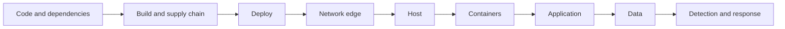

# Security Controls

**Assessment:** [DSA-001](https://github.com/NF-Hotel/NFHotel/blob/main/docs/sqa/devsecops-assessment.md), [CIS-001](https://github.com/NF-Hotel/NFHotel/blob/main/docs/sqa/cis-checklist.md), [SAMM-001](https://github.com/NF-Hotel/NFHotel/blob/main/docs/sqa/samm-baseline.md). **Work:** MIL-016, MIL-017, MIL-021 to MIL-023, MIL-033 to MIL-036, MIL-040, MIL-041, MIL-049. **Why each product:** [Technology Choices](Technology-Choices).

Every security control of NF Hotel, layer by layer: what it is, what it catches, why it was chosen, what else could have been used, and what risk is left. Each control names the file or the decision it comes from. To report a vulnerability, see `SECURITY.md` in the repository; to handle an incident, see [Incidents](Incidents).

## Defence in depth at a glance

A request from the internet passes Cloudflare, the tunnel, nginx, the web application, the API and the database, and each of them checks something of its own. A change of the code passes the same kind of layers before it runs: review, CI, the scan gate, the attestations and the deploy gate.

## 1. Code and dependencies

| Control | What it catches | Where | Why | Alternatives | Remaining risk |
| --- | --- | --- | --- | --- | --- |
| **CodeQL** default setup | Injection, unsafe deserialisation and unsafe workflow patterns in C#, JavaScript, TypeScript and the workflows | GitHub code scanning, on every pull request and push | Managed by GitHub, covers the workflows too, no workflow to maintain | Semgrep (rules to maintain), SonarQube security rules alone (fewer dataflow rules) | A pattern CodeQL has no query for |
| **SonarQube Cloud** with the gate `Sonar way` | Bugs, code smells, security hotspots, and new code under 80 % coverage | The `build` job of CI ([ADR-0033](https://github.com/NF-Hotel/NFHotel/blob/main/docs/adr/adr-0033-sonarqube-cloud-coverage.md)) | Quality and coverage on every pull request; the CD gate waits for it | Automatic Analysis (no coverage); a separate workflow (builds twice) | The token `SONAR_TOKEN` must be renewed |
| **NuGet audit**, locked restore | A known vulnerable direct or transitive package, and a changed package hash | `dotnet restore --locked-mode -p:NuGetAuditMode=all` in CI | Fails the build before review; the lock files pin every hash (MIL-044) | Snyk or OWASP Dependency-Check (another account or a slower scan) | A vulnerability not yet in the advisory database |
| **Dependabot** updates and alerts | An outdated pin; a published vulnerability in a dependency | `.github/dependabot.yml`, repository settings | Everything is pinned, so something must propose the next pin; a 7-day cooldown keeps a compromised release out for a week | Renovate (more options, one more app) | A pull request nobody merges |
| **Secret scanning** with push protection | A known token format in a push | Repository settings | Stops a secret before it is in the history | Gitleaks in CI (runs after the push) | A secret format GitHub does not know |
| **Review and the ruleset** | A change that no check catches | Ruleset "Approve merges": a pull request and 19 green checks | Every change is visible and tested before `main` | Two reviewers (ADR-0019: rejected, it blocked every merge) | No four-eyes principle: one person can merge alone (accepted in ADR-0019) |
| **OpenSSF Scorecard** | Weak repository practices: unpinned actions, broad token permissions, missing protection | `scorecard.yaml`, weekly | An outside, comparable measure | A hand-made checklist | Some checks score decisions, not defects; those are dismissed with a reason (ADR-0032) |

## 2. Build and supply chain

| Control | What it catches | Where | Why | Alternatives | Remaining risk |
| --- | --- | --- | --- | --- | --- |
| **Build once, deploy by digest** | A deployed image that is not the tested one | Release pushes to GHCR; CD deploys digests ([ADR-0007](https://github.com/NF-Hotel/NFHotel/blob/main/docs/adr/adr-0007-cicd-and-supply-chain.md)) | The VM never builds; a rollback is a known digest | Build on the VM (no provenance); a self-hosted runner (untrusted code next to production) | GHCR is a dependency: an outage blocks deploys |
| **Trivy scan gate** | A critical vulnerability, a high one with a fix, or a secret in a layer | `ops/scripts/scan-gate.sh`, before any push | Nothing with a known fixable hole or a secret reaches the registry | Grype (similar), Docker Scout or Snyk (an account and a token) | An accepted finding, for at most 30 days, with a reason (`ops/security/trivyignore.yaml`) |
| **SBOM and build provenance** attested | An image that was not built by our Release workflow | `actions/attest-build-provenance` and the SBOM attestation in `release-images` | Aimed at SLSA Build Level 2: who built what, from which commit | Cosign with own keys (a key to keep safe) | The provenance proves where an image was built, not that its code is good |
| **Attestation check before deploy** | An image swapped in the registry | `deploy-release`, step "Verify the attestations" | A pushed image without our attestation is never deployed | Trust the registry | None known |
| **Pinned actions and base images** | A moved tag that points at other code | Every `uses:` by commit SHA; every `FROM` and `image:` by digest | A compromised upstream tag changes nothing here | Version tags (move silently) | A compromised commit that Dependabot proposes and is merged within the cooldown |
| **Locked Python dependencies** | A changed or added package in the AI services | `requirements.lock` with hashes for `market-analysis` and `benchmark` | Their upstream installs from version ranges; ours from hashes | Install from the upstream Dockerfile | The upstream code at the pinned commit is trusted |
| **Daily scan of the running images** | A vulnerability published after the deploy | `running-image-scan.yaml` | Found within a day, reported as an issue | Scan only at build time | Up to a day between publication and the issue |

## 3. Deploy

| Control | What it catches | Where | Why | Alternatives | Remaining risk |
| --- | --- | --- | --- | --- | --- |
| **Every check green before deploy** | A red E2E, DAST, Ops CI, CodeQL or SonarQube check on the release commit | `cd-steps.sh gate` ([ADR-0021](https://github.com/NF-Hotel/NFHotel/blob/main/docs/adr/adr-0021-automatic-deploy-when-green.md)) | No person needs to click, and nothing red deploys | A human approval (only confirmed the checks); deploy when Release is green (could deploy while E2E was red) | No person stands between `main` and production |
| **OIDC to Tailscale, SSH over the tailnet** | A stolen deploy key, an open SSH port | `deploy-release`; the tailnet policy lets `tag:ci` reach port 22 of the VM only | No stored key or secret; nothing inbound | A stored SSH key and a public port | A wrong tailnet policy could widen access; it is checked by the scope step |
| **The deploy command updates itself only from `main`** | An old command running against a new layout; a command from an unreviewed branch | `nfhotel-deploy update` ([ADR-0018](https://github.com/NF-Hotel/NFHotel/blob/main/docs/adr/adr-0018-deploy-command-updates-itself.md)) | What runs as root is reviewed and in git | Manual install (forgotten on 2026-10-21) | A bad change that passes review and CI reaches root at the next deploy |
| **Backup, smoke test and rollback** | A release that does not start or answer | `nfhotel-deploy` | A bad release is undone in minutes | A staging environment (ADR-0026: rejected) | A migration is not undone by a rollback; migrations are expand-then-contract (ADR-0008) |
| **No secret in a container environment** | A secret passed as an environment variable | `check-secret-env.sh` in the deploy and in CI | Secrets stay in files (ADR-0024) | A vault (unsealing, storage, its own secret) | The secret files are plain text on the VM disk, readable by root |

## 4. Network edge

| Control | What it catches | Where | Why | Alternatives | Remaining risk |
| --- | --- | --- | --- | --- | --- |
| **Cloudflare Tunnel** | Direct scans and floods of the home connection | `cloudflared` ([ADR-0028](https://github.com/NF-Hotel/NFHotel/blob/main/docs/adr/adr-0028-public-access-through-cloudflare-tunnel.md)) | No port opened at home; the home address stays hidden; Cloudflare filters known attacks and floods | Open ports 80 and 443 (home address public); Tailscale Funnel (no flood protection) | Cloudflare sees requests in clear, personal data included (a processor) |
| **Cloudflare Access on `/admin`** | A stranger trying staff passwords | Access application with a one-time PIN, validated at the tunnel ([ADR-0029](https://github.com/NF-Hotel/NFHotel/blob/main/docs/adr/adr-0029-back-office-behind-cloudflare-access.md)) | A stranger never sees the staff sign-in | Open `/admin` (bots see it); a hidden path (leaks) | Cloudflare learns staff e-mail addresses and sign-in times |
| **What is public** | Exposure of internal routes | `public.conf.template`: the web application (`/admin` only with a Cloudflare Access token, else 404) and two routes of the mobile app; every other `/mobile-api/` path answers 404, and the API and the database have no public route | The smallest public surface | Publish everything behind sign-in | A defect in a public route is internet-facing |
| **TLS** | Passwords and cookies read on the wire | nginx with TLS 1.2 and 1.3 only, HSTS; `tailscale cert` on the tailnet, Cloudflare on the public name ([ADR-0006](https://github.com/NF-Hotel/NFHotel/blob/main/docs/adr/adr-0006-tls.md), [ADR-0009](https://github.com/NF-Hotel/NFHotel/blob/main/docs/adr/adr-0009-tls-certificates.md)) | One place holds the key; trusted certificates | TLS in the application (key in the page process) | The hop from nginx to the application is plain HTTP inside the VM |
| **Tailscale for all administration** | Access to SSH, the database relay and the monitoring from the LAN or the internet | The tailnet policy, `ops/tailnet/` ([ADR-0027](https://github.com/NF-Hotel/NFHotel/blob/main/docs/adr/adr-0027-configuration-as-code.md)) | Identity-based access with no open port | A VPN server (one more service), SSH keys on a public port | The policy may still let every member reach every node; changing it is S01's decision |

## 5. Host

| Control | What it catches | Where | Why | Alternatives | Remaining risk |
| --- | --- | --- | --- | --- | --- |
| **nftables firewall** | Any port other than 80 and 443 from outside; SSH and 5432 from anywhere but `tailscale0` | `ops/deploy/host/nftables/nfhotel.nft`, applied by `apply-firewall.sh`, which reverts unless confirmed | Default drop; a mistake cannot lock the team out | ufw (does not see Docker's published ports) | The Proxmox node and the LAN are outside this firewall |
| **CIS Level 1 hardening** | Weak defaults of Debian and Docker | 44 Docker and 24 Debian items applied ([CIS-001](https://github.com/NF-Hotel/NFHotel/blob/main/docs/sqa/cis-checklist.md)) | A recognised baseline with evidence per item | A hardened image (not available for Debian 13) | Debian 13 has no CIS benchmark yet; the Debian 12 one is used; items Deferred are listed |
| **sshd, sudo and kernel settings** | Password guessing, root login, forwarding; unlogged sudo; ICMP redirects | `install-host-settings.sh` | Keys only, no root, no forwarding; sudo logs | Fail2ban (sshd answers on the tailnet only, so there is little to ban) | A stolen key of a tailnet member |
| **Automatic security updates** | Known holes in Debian packages | `unattended-upgrades`, daily, no automatic reboot | Patches arrive without a person | Manual patching (forgotten) | A kernel fix waits for the monthly reboot |
| **Monthly image rebuild and reboot** | Outdated base layers in running containers | [Host Hardening](Host-Hardening) | Base images get their own security fixes | Rebuild only on a release | Between two windows, a fix waits up to a month unless the daily scan reports it |

## 6. Containers

Every container drops all capabilities, cannot gain privileges, has a read-only root, limits on memory, CPU and processes, a health check, an image pinned by digest, and publishes no port it does not need. The details per container are on [Containers and Images](Containers-and-Images). Alloy reaches Docker through a socket proxy that allows only reads, so a compromised agent cannot start a container.

## 7. Application

| Control | What it catches | Where | Why | Alternatives | Remaining risk |
| --- | --- | --- | --- | --- | --- |
| **Only the API reaches the database** | A compromise of the internet-facing web application reading the database | `NFHotel.Api`, `NFHotel.ApiClient`, the `nfhotel-db` network ([ADR-0004](https://github.com/NF-Hotel/NFHotel/blob/main/docs/adr/adr-0004-database-api.md)) | The web application holds no database login and no passport key | A restricted role in the web application (login still exposed); gRPC | The service token between web and API is a shared secret |
| **Staff sign-in and roles** | Access without sign-in; a role reaching more than it needs | PBKDF2-HMAC-SHA256 with 600 000 iterations, a signed token (8 hours), a permission table checked in the API ([ADR-0005](https://github.com/NF-Hotel/NFHotel/blob/main/docs/adr/adr-0005-backoffice-login.md)) | Small, own code on platform primitives, with tests for tampered and expired tokens | ASP.NET Identity (needs the database in the web application); an outside identity provider | We own security-critical code |
| **Security stamp and audit** | An old session after a password change or a disable; untraceable account changes | `StaffMember.SecurityStamp`, `staff_audit_event` ([ADR-0017](https://github.com/NF-Hotel/NFHotel/blob/main/docs/adr/adr-0017-staff-passwords-and-audit.md)) | A disable ends every session at once; every account change has a name | A token revocation list; mail reset (no mail service) | The audit table has no retention rule yet |
| **Rate limits** | Password guessing; write floods by one staff member | The sign-in throttles of the API (per user name, and `AddressLoginThrottle` per address for the mobile app), `StaffWriteRateLimit`, and a Cloudflare rate-limiting rule on the mobile sign-in ([Public Access](Public-Access)) | Slows guessing without locking accounts | Account lockout (lets a stranger lock staff out) | The throttles are in memory and reset on restart |
| **Guest authorization** | A guest reading or changing another guest's booking | The guest login of MIL-018 and the RBAC checks in `BookingService` | A booking number alone gives no access | None simpler | – |
| **Security headers and cookie flags** | Clickjacking, content sniffing, mixed content, cross-origin leaks; a cookie sent in clear | `src/NFHotel.Web/Security/SecurityHeaders.cs` (CSP, COOP, COEP, CORP, Permissions-Policy, nosniff) and HSTS in nginx (MIL-033) | Proven by the DAST scans | Headers in nginx only (the application knows its own CSP best) | A CSP that has to allow what Blazor needs |
| **Mobile app with the staff token only** | A secret extracted from the app | Two open routes for the staff token ([ADR-0015](https://github.com/NF-Hotel/NFHotel/blob/main/docs/adr/adr-0015-mobile-app-staff-token-access.md)) | No secret in an app anyone can unpack | The service token in the app (public on day one); a gateway | The login route is internet-facing |

## 8. Data

| Control | What it catches | Where | Why | Alternatives | Remaining risk |
| --- | --- | --- | --- | --- | --- |
| **Passport numbers encrypted** | A database dump or a backup read by someone | AES-GCM in `AesGcmStringEncryptor`, the key as a secret file of the API | Personal data stays unreadable without the key | Database-level encryption (the key would sit in the database server) | The key cannot be rotated yet (ADR-0024 decision 7) |
| **Least-privilege database roles** | A leaked runtime password changing the schema; a backup that writes | `nfhotel_owner`, `nfhotel_migrator`, `nfhotel_app`, `nfhotel_backup` ([ADR-0011](https://github.com/NF-Hotel/NFHotel/blob/main/docs/adr/adr-0011-postgresql-access-for-the-api.md)) | Each login can do only its job | The superuser for everything | The internal Docker network carries the database traffic without TLS |
| **Personal team logins** | Unattributed changes by the team | `dev_<name>` roles, DML only, every change logged with the role ([ADR-0034](https://github.com/NF-Hotel/NFHotel/blob/main/docs/adr/adr-0034-team-database-access.md)) | Each change has a name | A shared login | Four people can change personal data; the changed values are in the log for 14 days |
| **Encrypted backups, off the VM** | Loss of the VM disk; a backup read by someone | `pg_dump` nightly, encrypted with `age`, copied to the backup host; a restore drill ([ADR-0008](https://github.com/NF-Hotel/NFHotel/blob/main/docs/adr/adr-0008-database-migration-and-backup.md), [ADR-0025](https://github.com/NF-Hotel/NFHotel/blob/main/docs/adr/adr-0025-recovery-objectives.md)) | Recovery within 4 hours, at most 24 hours of bookings lost | Proxmox backups of the whole VM; replication | Losing the private key of S03 loses the backups |
| **No personal data in the logs** | A guest's data written to a log | The log privacy check of the E2E tests | Logs leave the VM for Loki and alerts go to Discord | Masking in Alloy (finds only known patterns) | The `dev_` roles' changed values (see above) |

## 9. Detection and response

| Control | What it catches | Where | Why |
| --- | --- | --- | --- |
| **Security alerts** | More than 20 failed staff sign-ins, or more than 10 failed SSH logins, in 10 minutes | `StaffSignInFailures` and `SshLoginFailures` ([Alerts](Alerts)) | Guessing is seen while it happens |
| **Uptime and health alerts** | The site down, a container unhealthy, a backup or a certificate renewal that stopped | [Alerts](Alerts) | Faults are reported within minutes, not found by guests |
| **Incident procedure** | An incident handled without a plan | [Incidents](Incidents), with the GDPR steps for a leak of personal data | One written way to act and to report |
| **Weekly DAST full scan and load test** | A new hole or a slowdown | `e2e-dast.yaml`, `load-test.yaml` ([Workflows](Workflows)) | Active tests without touching production |

## Mapped to the OWASP Top 10 (2021)

| Risk | Main controls |
| --- | --- |
| A01 Broken access control | Permission table in the API, guest authorization, Cloudflare Access, `nfhotel-db` network, least-privilege roles |
| A02 Cryptographic failures | TLS 1.2 and 1.3 with HSTS, AES-GCM for passports, PBKDF2 for passwords, encrypted backups |
| A03 Injection | EF Core with parameters, CodeQL, the DAST scans |
| A04 Insecure design | ADRs with options and consequences, the threat assessment of DSA-001 |
| A05 Security misconfiguration | CIS hardening, container lock-down, security headers, Scorecard, ZAP |
| A06 Vulnerable and outdated components | NuGet audit, Dependabot, Trivy gate, daily scan of the running images |
| A07 Identification and authentication failures | PBKDF2, security stamp, throttles, `StaffSignInFailures` |
| A08 Software and data integrity failures | Pinned actions and images, locked hashes, provenance and SBOM attestations verified before deploy |
| A09 Security logging and monitoring failures | Loki with 14 days of logs, the audit table, the alerts, the watchdog |
| A10 Server-side request forgery | The applications call fixed internal names only; outbound calls go to named services on internal networks |

## Maturity

The OWASP SAMM baseline of 2026-10-20 ([SAMM-001](https://github.com/NF-Hotel/NFHotel/blob/main/docs/sqa/samm-baseline.md)) scored Implementation highest (Secure Build and Secure Deployment 1.75 of 3), and Education, Incident Management and Security Testing lowest. Since then MIL-033 to MIL-036 added the security headers, the image scans, the security alerts, the load test and the incident procedure; the next assessment will score them.
