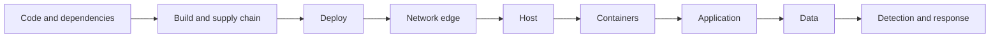

# Security Controls

**English**

**Assessment:** [DSA-001](https://github.com/NF-Hotel/NFHotel/blob/main/docs/sqa/devsecops-assessment.md), [CIS-001](https://github.com/NF-Hotel/NFHotel/blob/main/docs/sqa/cis-checklist.md), [SAMM-001](https://github.com/NF-Hotel/NFHotel/blob/main/docs/sqa/samm-baseline.md), [SAR-002](https://github.com/NF-Hotel/NFHotel/blob/main/docs/sqa/security-audit-2026-12-booking-flow.md). **Work:** MIL-016, MIL-017, MIL-018, MIL-021 to MIL-023, MIL-033 to MIL-036, MIL-040, MIL-041, MIL-049, MIL-058, MIL-077, MIL-079, MIL-084 to MIL-089. **Why each product:** [Technology Choices](Technology-Choices).

Every security control of NF Hotel, layer by layer: what it is, what it catches, why it was chosen, what else could have been used, and what risk is left. Each control names the file or the decision it comes from. To report a vulnerability, see `SECURITY.md` in the repository or the `security.txt` of the public site; to handle an incident, see [Incidents](Incidents).

## Defence in depth at a glance

A request from the internet passes Cloudflare, the tunnel, nginx, the web application, the API and the database, and each of them checks something of its own. A change of the code passes the same kind of layers before it runs: review, CI, the scan gate, the attestations and the deploy gate.

## 1. Code and dependencies

| Control | What it catches | Where | Why | Alternatives | Remaining risk |
| --- | --- | --- | --- | --- | --- |
| **CodeQL** default setup | Injection, unsafe deserialisation and unsafe workflow patterns in C#, JavaScript, TypeScript and the workflows | GitHub code scanning, on every pull request and push | Managed by GitHub, covers the workflows too, no workflow to maintain | Semgrep (rules to maintain), SonarQube security rules alone (fewer dataflow rules) | A pattern CodeQL has no query for |
| **CodeQL code quality** (the `code-quality` suites of C#, JavaScript and Python) | Reliability and maintainability defects, not vulnerabilities: a path combined with an absolute part, a local `IDisposable` never disposed, a value that may be null and is dereferenced, a `catch` of every exception, a loop that could be a LINQ query, a statement without effect | GitHub's Code quality tab, on every push; the findings are not alerts and not a check, and the tab is read by members only | The findings are triaged in a milestone and each gets a decision with its reason in a review record (MIL-058, [RC-278](https://github.com/NF-Hotel/NFHotel/blob/main/docs/sqa/reviews/rc-278-mil-058-code.md)); a finding in vendored third-party code (Bootstrap under `wwwroot/lib`) is dismissed on the tab with that reason, as ADR-0032 does for code scanning | SonarQube Cloud alone (its rules overlap, but it has no dataflow for nullness and disposal) | The tab has no API, so the scan exporter of MIL-053 does not count these findings; a finding is seen only by someone who opens the tab |
| **SonarQube Cloud** with the gate `Sonar way` | Bugs, code smells, security hotspots, and new code under 80 % coverage | The `build` job of CI ([ADR-0033](https://github.com/NF-Hotel/NFHotel/blob/main/docs/adr/adr-0033-sonarqube-cloud-coverage.md)) | Quality and coverage on every pull request; the CD gate waits for it | Automatic Analysis (no coverage); a separate workflow (builds twice) | The token `SONAR_TOKEN` must be renewed |
| **NuGet audit**, locked restore | A known vulnerable direct or transitive package, and a changed package hash | `dotnet restore --locked-mode -p:NuGetAuditMode=all` in CI | Fails the build before review; the lock files pin every hash (MIL-044) | Snyk or OWASP Dependency-Check (another account or a slower scan) | A vulnerability not yet in the advisory database |
| **Dependabot** updates and alerts | An outdated pin; a published vulnerability in a dependency | `.github/dependabot.yml`, repository settings | Everything is pinned, so something must propose the next pin; a 7-day cooldown keeps a compromised release out for a week | Renovate (more options, one more app) | A pull request nobody merges |
| **Secret scanning** with push protection | A known token format in a push | Repository settings | Stops a secret before it is in the history | Gitleaks in CI (runs after the push) | A secret format GitHub does not know |
| **Review and the ruleset** | A change that no check catches | Ruleset "Approve merges": a pull request and 44 green checks, which [Workflows](Workflows) names: the jobs that CI, Ops CI, E2E and DAST and the release check run on a pull request, CodeQL and SonarQube Cloud, except `Ops service networks (MIL-061)`, which the ruleset does not require yet ([SAR-001](https://github.com/NF-Hotel/NFHotel/blob/main/docs/sqa/security-audit-2026-11.md), SEC-03) | Every change is visible and tested before `main` | Two reviewers (ADR-0019: rejected, it blocked every merge) | No four-eyes principle: one person can merge alone (accepted in ADR-0019) |
| **OpenSSF Scorecard** | Weak repository practices: unpinned actions, broad token permissions, missing protection | `scorecard.yaml`, weekly | An outside, comparable measure | A hand-made checklist | Some checks score decisions, not defects; those are dismissed with a reason (ADR-0032) |

## 2. Build and supply chain

| Control | What it catches | Where | Why | Alternatives | Remaining risk |
| --- | --- | --- | --- | --- | --- |
| **Build once, deploy by digest** | A deployed image that is not the tested one | Release pushes to GHCR; CD deploys digests ([ADR-0007](https://github.com/NF-Hotel/NFHotel/blob/main/docs/adr/adr-0007-cicd-and-supply-chain.md)) | The VM never builds; a rollback is a known digest | Build on the VM (no provenance); a self-hosted runner (untrusted code next to production) | GHCR is a dependency: an outage blocks deploys |
| **Trivy scan gate** | A critical vulnerability, a high one with a fix, or a secret in a layer | `ops/scripts/scan-gate.sh`, before any push | Nothing with a known fixable hole or a secret reaches the registry | Grype (similar), Docker Scout or Snyk (an account and a token) | An accepted finding, for at most 30 days, with a statement of what the check found, approved by S01 (`ops/security/trivyignore.yaml`). An entry for a third-party image is narrowed to the files or the packages of that image, so it never hides the same finding in an image of NF Hotel (MIL-065); the entries are listed on [Containers and Images](Containers-and-Images) |
| **SBOM and build provenance** attested | An image that was not built by our Release workflow | `actions/attest-build-provenance` and the SBOM attestation in `release-images` | Aimed at SLSA Build Level 2: who built what, from which commit | Cosign with own keys (a key to keep safe) | The provenance proves where an image was built, not that its code is good |
| **Attestation check before deploy** | An image swapped in the registry | `deploy-release`, step "Verify the attestations" | A pushed image without our attestation is never deployed | Trust the registry | None known |
| **Pinned actions and base images** | A moved tag that points at other code | Every `uses:` by commit SHA; every `FROM` and `image:` by digest; the repository setting requires the SHA, and `ops/tests/test-workflow-policy.sh` refuses an unpinned action ([ADR-0037](https://github.com/NF-Hotel/NFHotel/blob/main/docs/adr/adr-0037-github-actions-hardening-policy.md)) | A compromised upstream tag changes nothing here | Version tags (move silently) | A compromised commit that Dependabot proposes and is merged within the cooldown |
| **Workflow policy test** | A write token at the top of a workflow, a checkout that keeps the job token, `pull_request_target`, a secret above a step, an expression in a script, a download piped to a shell | `ops/tests/test-workflow-policy.sh` in the job Ops linters, a required check, with a self-test of its fixtures ([ADR-0037](https://github.com/NF-Hotel/NFHotel/blob/main/docs/adr/adr-0037-github-actions-hardening-policy.md)) | The GhostAction campaign of 2026 added exactly such steps through taken-over accounts; the audit of MIL-059 found none here and made the rules a check | zizmor in CI (one more dependency to pin and to trust) | The test reads the layout of this repository; the controls of the accounts (two-factor authentication, roles, apps) are the organisation's, listed in the security audit report |
| **Locked Python dependencies** | A changed or added package in the AI services | `requirements.lock` with hashes for `market-analysis` and `benchmark` | Their upstream installs from version ranges; ours from hashes | Install from the upstream Dockerfile | The upstream code at the pinned commit is trusted |
| **Daily scan of the running images** | A vulnerability published after the deploy; a finding in a pinned third-party image, which no build scans (MIL-064) | `running-image-scan.yaml` | Found within a day, reported as an issue | Scan only at build time | Up to a day between publication and the issue; the monitoring stack, deployed by hand, can run older pins than its release |

## 3. Deploy

| Control | What it catches | Where | Why | Alternatives | Remaining risk |
| --- | --- | --- | --- | --- | --- |
| **Approval before a deploy** | A green change that should not go out now: a merge of a taken-over account (SAR-001 SEC-02), a wrong moment for the guests, a change S01 wants to see once more | The environment `production`: required reviewer S01, self-review allowed ([ADR-0038](https://github.com/NF-Hotel/NFHotel/blob/main/docs/adr/adr-0038-approval-before-a-deploy.md)) | No credential for the VM exists before S01's click, and the deployment history names who approved which run | Deploy automatically when green (ADR-0021, 2026-10-23 to 2026-11-04: a merge was a deploy); manual runs only (a release nobody deploys would leave no pending run) | S01 approves alone (ADR-0019): a moment of choice, not a second pair of eyes; a run nobody approves expires after 30 days |
| **Every check green before deploy** | A red E2E, DAST, Ops CI, CodeQL or SonarQube check on the release commit | `cd-steps.sh gate`, after the approval ([ADR-0021](https://github.com/NF-Hotel/NFHotel/blob/main/docs/adr/adr-0021-automatic-deploy-when-green.md)) | Nothing red deploys, even after an approval | Deploy when Release is green (could deploy while E2E was red) | The gate trusts the checks GitHub records on the commit; the ruleset still demands the required ones before the merge |
| **OIDC to Tailscale, SSH over the tailnet** | A stolen deploy key, an open SSH port | `deploy-release`; the tailnet policy lets `tag:ci` reach port 22 of the VM only | No stored key or secret; nothing inbound | A stored SSH key and a public port | A wrong tailnet policy could widen access; it is checked by the scope step |
| **The deploy command updates itself only from `main`** | An old command running against a new layout; a command from an unreviewed branch | `nfhotel-deploy update` ([ADR-0018](https://github.com/NF-Hotel/NFHotel/blob/main/docs/adr/adr-0018-deploy-command-updates-itself.md)) | What runs as root is reviewed and in git | Manual install (forgotten on 2026-10-21) | A bad change that passes review and CI reaches root at the next deploy |
| **Backup, smoke test and rollback** | A release that does not start or answer | `nfhotel-deploy` | A bad release is undone in minutes | A staging environment (ADR-0026: rejected) | A migration is not undone by a rollback; migrations are expand-then-contract (ADR-0008) |
| **No secret in a container environment** | A secret passed as an environment variable | `check-secret-env.sh` in the deploy and in CI | Secrets stay in files (ADR-0024) | A vault (unsealing, storage, its own secret) | The secret files are plain text on the VM disk, readable by root |

## 4. Network edge

| Control | What it catches | Where | Why | Alternatives | Remaining risk |
| --- | --- | --- | --- | --- | --- |
| **Cloudflare Tunnel** | Direct scans and floods of the home connection | `cloudflared` ([ADR-0028](https://github.com/NF-Hotel/NFHotel/blob/main/docs/adr/adr-0028-public-access-through-cloudflare-tunnel.md)) | No port opened at home; the home address stays hidden; Cloudflare filters known attacks and floods | Open ports 80 and 443 (home address public); Tailscale Funnel (no flood protection) | Cloudflare sees requests in clear, personal data included (a processor) |
| **Cloudflare Access on `/admin`** | A stranger trying staff passwords | Access application with a one-time PIN, validated at the tunnel ([ADR-0029](https://github.com/NF-Hotel/NFHotel/blob/main/docs/adr/adr-0029-back-office-behind-cloudflare-access.md)) | A stranger never sees the staff sign-in | Open `/admin` (bots see it); a hidden path (leaks) | Cloudflare learns staff e-mail addresses and sign-in times |
| **What is public** | Exposure of internal routes | `public.conf.template`: the web application (`/admin` only with a Cloudflare Access token, else 404), two routes of the mobile app and the file `/.well-known/security.txt` (MIL-084); every other `/mobile-api/` path answers 404, and the API and the database have no public route | The smallest public surface | Publish everything behind sign-in | A defect in a public route is internet-facing |
| **TLS** | Passwords and cookies read on the wire | nginx with TLS 1.2 and 1.3 only, HSTS; `tailscale cert` on the tailnet, Cloudflare on the public name ([ADR-0006](https://github.com/NF-Hotel/NFHotel/blob/main/docs/adr/adr-0006-tls.md), [ADR-0009](https://github.com/NF-Hotel/NFHotel/blob/main/docs/adr/adr-0009-tls-certificates.md)) | One place holds the key; trusted certificates | TLS in the application (key in the page process) | The hop from nginx to the application is plain HTTP inside the VM |
| **Tailscale for all administration** | Access to SSH, the database relay and the monitoring from the LAN or the internet | The tailnet policy, `ops/tailnet/` ([ADR-0027](https://github.com/NF-Hotel/NFHotel/blob/main/docs/adr/adr-0027-configuration-as-code.md)) | Identity-based access with no open port | A VPN server (one more service), SSH keys on a public port | The policy may still let every member reach every node; changing it is S01's decision |

## 5. Host

| Control | What it catches | Where | Why | Alternatives | Remaining risk |
| --- | --- | --- | --- | --- | --- |
| **nftables firewall** | Any port other than 80 and 443 from outside; SSH and 5432 from anywhere but `tailscale0` | `ops/deploy/host/nftables/nfhotel.nft`, applied by `apply-firewall.sh`, which reverts unless confirmed | Default drop; a mistake cannot lock the team out | ufw (does not see Docker's published ports) | The Proxmox node and the LAN are outside this firewall |
| **CIS Level 1 hardening** | Weak defaults of Debian and Docker | 44 Docker and 24 Debian items applied ([CIS-001](https://github.com/NF-Hotel/NFHotel/blob/main/docs/sqa/cis-checklist.md)) | A recognised baseline with evidence per item | A hardened image (not available for Debian 13) | Debian 13 has no CIS benchmark yet; the Debian 12 one is used; items Deferred are listed |
| **sshd, sudo and kernel settings** | Password guessing, root login, forwarding; unlogged sudo; ICMP redirects | `install-host-settings.sh` | Keys only, no root, no forwarding; sudo logs | Fail2ban (sshd answers on the tailnet only, so there is little to ban) | A stolen key of a tailnet member |
| **Automatic security updates** | Known holes in Debian packages | `unattended-upgrades`, daily, no automatic reboot | Patches arrive without a person | Manual patching (forgotten) | A kernel fix waits for the monthly reboot |
| **Monthly image rebuild and reboot** | Outdated base layers in running containers | [Host Hardening](Host-Hardening) | Base images get their own security fixes | Rebuild only on a release | Between two windows, a fix waits up to a month unless the daily scan reports it |

## 6. Containers

Every container drops all capabilities, cannot gain privileges, has a read-only root, limits on memory, CPU and processes, a health check, an image pinned by digest, and publishes no port it does not need. The details per container are on [Containers and Images](Containers-and-Images). Alloy reaches Docker through a socket proxy that allows only reads, so a compromised agent cannot start a container.

## 7. Application

The controls of the public booking flow, its limits and what to do at its alerts are gathered in [Booking Flow Protection](Booking-Flow-Protection); the security audit SAR-002 (MIL-089) read them against OWASP ASVS 5.0 at level 2.

| Control | What it catches | Where | Why | Alternatives | Remaining risk |
| --- | --- | --- | --- | --- | --- |
| **Only the API reaches the database** | A compromise of the internet-facing web application reading the database | `NFHotel.Api`, `NFHotel.ApiClient`, the `nfhotel-db` network ([ADR-0004](https://github.com/NF-Hotel/NFHotel/blob/main/docs/adr/adr-0004-database-api.md)) | The web application holds no database login and no passport key | A restricted role in the web application (login still exposed); gRPC | The service token between web and API is a shared secret |
| **Staff sign-in and roles** | Access without sign-in; a role reaching more than it needs | PBKDF2-HMAC-SHA256 with 600 000 iterations, a signed token (8 hours), a permission table checked in the API ([ADR-0005](https://github.com/NF-Hotel/NFHotel/blob/main/docs/adr/adr-0005-backoffice-login.md)) | Small, own code on platform primitives, with tests for tampered and expired tokens | ASP.NET Identity (needs the database in the web application); an outside identity provider | We own security-critical code |
| **Security stamp and audit** | An old session after a password change or a disable; untraceable account changes | `StaffMember.SecurityStamp`, `staff_audit_event` ([ADR-0017](https://github.com/NF-Hotel/NFHotel/blob/main/docs/adr/adr-0017-staff-passwords-and-audit.md)) | A disable ends every session at once; every account change has a name | A token revocation list; mail reset (no mail service) | The audit table has no retention rule yet |
| **Rate limits** | Password guessing; guessing the email of a booking, also across many bookings from one address; write floods by one staff member; a script that searches the free rooms without end, or that holds rooms with booking requests from one address or with one email; the form of the booking used to fill a stranger's mailbox with links; a caller who holds the pages open with many circuits | The sign-in throttles of the API (per user name, and `AddressLoginThrottle` per address for the mobile app), the two limits of the guest sign-in in stores of their own (5 failed attempts per booking reference and 20 per caller address in 15 minutes, [ADR-0049](https://github.com/NF-Hotel/NFHotel/blob/main/docs/adr/adr-0049-booking-reference.md)), the limits of the booking flow (60 searches for free rooms a minute and 5 booking requests an hour and 20 a day per caller address, and 3 coming bookings of the public site per mailbox, in the table "Limits of the booking flow" of `docs/refactor/BusinessRules.md`, [ADR-0051](https://github.com/NF-Hotel/NFHotel/blob/main/docs/adr/adr-0051-limits-of-the-booking-flow-and-the-caller-address.md), MIL-087), the limits of the mails of the verification by email (3 an hour and 5 a day per mailbox, counted in the database under one lock, [ADR-0052](https://github.com/NF-Hotel/NFHotel/blob/main/docs/adr/adr-0052-a-booking-takes-a-room-once-its-email-is-verified.md), MIL-088), the limit of the open circuits of the pages in the web application (50 per caller address, `CircuitLimit`, ADR-0051 decision 8, MIL-089), `StaffWriteRateLimit`, and a Cloudflare rate-limiting rule on the mobile sign-in ([Public Access](Public-Access)). Every limit per address counts the address that nginx saw, which nginx writes into `X-NFHotel-Client-Address` over any value of the caller, and which the API takes only from a call with the service token | Slows guessing without locking accounts | Account lockout (lets a stranger lock staff out) | The throttles and limits are in memory and reset on restart, except the limits per mailbox, which the database counts; five wrong emails also block the sign-in of that reference for its own guest for 15 minutes; many addresses (a botnet) pass every limit per address, and the alert `PublicBookingSurge` watches for that; since MIL-088 the public bookings count the limit per mailbox and choose their rooms under one lock of the database, so two at the same moment no longer both pass it; guests behind one address (a hotel network, a mobile operator) share its counts; an IPv6 caller counts by its first 64 bits, except in the sign-in limit of the mobile app (`AddressLoginThrottle`), which counts a whole address, so a sender with a network of 64 bits gets many addresses there while the limit per user name still holds; a flood never frees a reference whose tries are used up, but one that fills the store of references with them (about 50,000 failed sign-ins in 15 minutes from 2,500 or more addresses) makes a reference without a window wait until windows run out; those failed sign-ins show in the counter as `guest_lookup_failed`, which no alert watches; a store of caller addresses full of used-up windows drops the one that runs out first, so many addresses cannot lock every other caller out |
| **Guest authorization** | Anyone reading or changing another guest's booking by counting or guessing what names it; a guest reaching the back office | A booking is named by a random reference, a version 4 UUID, and its counting key never leaves the system. A guest signs in with the reference and the email of the booking and gets a guest token for that booking alone, valid for 2 hours, in its own cookie (`nfhotel.guest`: `HttpOnly`, `Secure`, `SameSite=Lax`, only for `/my-booking`). The guest routes `api/guest/booking` take no key: they act on the booking in the token and answer with its receipt alone. Every staff endpoint refuses a guest token with 403, and no answer to a guest holds a passport number; an unknown, unreadable or old reference, a wrong email, a cancelled booking and an expired or forged token get the same 401 answer. The read by id needs `Bookings.View` ([ADR-0047](https://github.com/NF-Hotel/NFHotel/blob/main/docs/adr/adr-0047-guest-login.md), [ADR-0049](https://github.com/NF-Hotel/NFHotel/blob/main/docs/adr/adr-0049-booking-reference.md), MIL-018, MIL-079, MIL-085) | The guest already holds both, and there is no account or password to store | Guest accounts with a password; a link sent by email (needs a mail service) | Whoever knows both the reference and the email of a booking can see and change it for 2 hours; a copied guest token cannot be revoked before its end |
| **Hostile input refused at the API** | A request that makes the API answer 500 or leak an exception name, a stack trace or a setting: a body that is not JSON, JSON of the wrong type, `null` fields, a string of one megabyte, numbers out of range, dates out of range, a NUL, a right-to-left override or a lone surrogate | `InputGuardFilter` and `InputRules` in `src/NFHotel.Api/Security` check every value bound from a request before the action runs, the validation attributes of the requests set the ranges, and every refusal is a 400 with the code `api.invalid_request` alone (MIL-077). `HostileInputTests` sends every kind of input to every endpoint that the API maps, and the weekly API scan of ZAP attacks every endpoint of the OpenAPI document that the build writes; the running API does not serve that document. Every answer of the API carries `X-Content-Type-Options: nosniff` (`ApiSecurityHeaders`), which the first API scan found missing | One guard for every endpoint, so a new endpoint is covered without a change, and a refusal that names no .NET type or setting | Validation in each controller (easy to forget on a new endpoint); a web application firewall in front of the API (it does not know the types of the API) | The rules are general (text, enums, dates, depth): a value that is valid in form but wrong in meaning is refused by its use case, not by the guard |
| **One set of rules for the booking input** | A stay of a hundred years or of 31 nights on the public site, a party of five, an email with a line break or two addresses, a phone number of words, a country of free text that would reach the AI of the market analysis, a passport number with symbols; a request with a field that its type does not have; a body of megabytes; a slow request that holds a connection for an hour | The table "Validation rules of the booking flow" in `docs/refactor/BusinessRules.md` names every field. Each rule is implemented once in the domain (`Booking.CheckPeriod`, `Booking.CheckPublicNights`, `Booking.CheckPublicParty`, the attributes of `NFHotel.Domain/Attributes`, `TextNormalForm`, `Countries`): the API refuses with the code of the field, and the pages use the same members for early feedback (the date fields offer only the days that the rules allow, the country is a list). Every text is trimmed and in Unicode normal form C before it is checked; a text without a rule of its own has at most 1,000 characters; an unknown field is refused; the API takes at most 64 KB of body (the benchmark intake 30 MB) and the public listener of nginx 64 KB; every nginx location waits at most 60 seconds, only the web socket of the pages (`/_blazor`) an hour. Each refusal of input writes the security event `input_refused` in the category `NFHotel.Security` with the method, the route template, the status and the codes, never the value ([ADR-0050](https://github.com/NF-Hotel/NFHotel/blob/main/docs/adr/adr-0050-where-the-rules-of-the-booking-input-live.md), MIL-086) | One place says what a field accepts, so the page and the API cannot drift apart; markup and SQL text are data, encoded at the output and passed as parameters, so no rule strips or rewrites a value | Rules in the page only (bypassed by calling the API); a validation library (a second place for the rules); cleaning the input (changes what the guest typed and hides an attack) | A guest stored before MIL-086 keeps its values until staff edit it; the limits bound one request, not many: the limits per caller are in the row Rate limits (MIL-087) |
| **A booking verified by email** | A competitor who fills the hotel with bookings that nobody stands behind (OWASP OAT-021, denial of inventory); a booking in somebody else's email; the form of the booking used to send a stranger a message | With the setting `BookingVerification:Enabled` on, a booking on the public site is first a booking request that holds no room. The API mails a link whose token has 256 random bits and is stored only as its SHA-256; it works once and for 30 minutes. The page of the link verifies only when the guest presses its one button, which sends the token in the body; the token is in no address that a log keeps, and the page sends no referrer and is not cached. The verification stores the guest and the booking in one transaction under a lock of the database, and only then is the guest signed in. One open request per mailbox; the mail is plain text with the dates, the room size and the link, and no text that was typed; a lapsed request is deleted with its personal data within an hour ([ADR-0052](https://github.com/NF-Hotel/NFHotel/blob/main/docs/adr/adr-0052-a-booking-takes-a-room-once-its-email-is-verified.md), MIL-088) | A request that holds nothing costs the hotel nothing, and the email is shown to belong to the guest before a room or a session is given | A room held for a limited time (moves the harm to the next guest); a puzzle for humans (services solve it); a payment (the hotel takes none online); an account for every guest | On in production since 2026-11-22, when S01 turned it on with the relay (task 9 of MIL-088); with it off, the public site books at once, behind the limits of MIL-087. A sender with many mailboxes can still ask for many bookings, each one costing a mail and a press of the button within 30 minutes. Staff book without a request, behind their own sign-in |
| **Mail through a relay over TLS** | A mail read or changed on the way; a relay that falls back to plain text; the password of the relay in a log; a header added through a field of the form; a burst of mails that gets the account of the relay blocked | `SmtpMailSender` (MailKit) sends with TLS from the first byte or after STARTTLS and never in plain text, and checks the certificate of the relay against the store of the system and its host name (a pinned certificate only for the mail catcher of the test stacks); the mail leaves the VM through the forwarder `mail-relay`; the password is the secret file `Smtp__Password`; a line break in an address or a subject is refused before any mail is built; a relay that fails is a reason in a word, never its text, and the guest is told while nothing is kept; a fuse stops new requests at 400 mails a day ([ADR-0053](https://github.com/NF-Hotel/NFHotel/blob/main/docs/adr/adr-0053-mail-from-the-application-through-a-relay.md), [Mail Relay](Mail-Relay)) | The flow fails closed when the relay is down (ASVS 16.5.2), and the API keeps no mail server of its own | A mail server on the VM (its own reputation and patching); the web interface of a provider (a second secret and a library per provider) | The revocation of the certificate of the relay is not checked, because the API has no route to a revocation list; the provider of the relay reads the mails it carries |
| **Security headers and cookie flags** | Clickjacking, content sniffing, mixed content, cross-origin leaks; a cookie sent in clear | `src/NFHotel.Web/Security/SecurityHeaders.cs` (CSP, COOP, COEP, CORP, Permissions-Policy, nosniff, and since MIL-089 `Referrer-Policy: same-origin` on every answer and `no-referrer` on `/booking/verify`) and HSTS in nginx (MIL-033) | Proven by the DAST scans | Headers in nginx only (the application knows its own CSP best) | A CSP that has to allow what Blazor needs |
| **Mobile app with the staff token only** | A secret extracted from the app | Two open routes for the staff token ([ADR-0015](https://github.com/NF-Hotel/NFHotel/blob/main/docs/adr/adr-0015-mobile-app-staff-token-access.md)) | No secret in an app anyone can unpack | The service token in the app (public on day one); a gateway | The login route is internet-facing |

## 8. Data

| Control | What it catches | Where | Why | Alternatives | Remaining risk |
| --- | --- | --- | --- | --- | --- |
| **Passport numbers encrypted** | A database dump or a backup read by someone | AES-GCM in `AesGcmStringEncryptor`, the key as a secret file of the API | Personal data stays unreadable without the key | Database-level encryption (the key would sit in the database server) | The key cannot be rotated yet (ADR-0024 decision 7) |
| **Least-privilege database roles** | A leaked runtime password changing the schema or the migration history; a backup that writes | `nfhotel_owner`, `nfhotel_migrator`, `nfhotel_app`, `nfhotel_backup` ([ADR-0011](https://github.com/NF-Hotel/NFHotel/blob/main/docs/adr/adr-0011-postgresql-access-for-the-api.md)) | Each login can do only its job | The superuser for everything | The internal Docker network carries the database traffic without TLS |
| **Personal team logins** | Unattributed changes by the team | `dev_<name>` roles, DML only, every change logged with the role ([ADR-0034](https://github.com/NF-Hotel/NFHotel/blob/main/docs/adr/adr-0034-team-database-access.md)) | Each change has a name | A shared login | Four people can change personal data; the changed values are in the log for 14 days |
| **Encrypted backups, off the VM** | Loss of the VM disk; a backup read by someone | `pg_dump` nightly, encrypted with `age`, copied to the backup host; a restore drill ([ADR-0008](https://github.com/NF-Hotel/NFHotel/blob/main/docs/adr/adr-0008-database-migration-and-backup.md), [ADR-0025](https://github.com/NF-Hotel/NFHotel/blob/main/docs/adr/adr-0025-recovery-objectives.md)) | Recovery within 4 hours, at most 24 hours of bookings lost | Proxmox backups of the whole VM; replication | Losing the private key of S03 loses the backups |
| **No personal data in the logs** | A guest's data written to a log | The log privacy check of the E2E tests; the security events of the booking flow write the caller address and no email, whole, masked or hashed, and no other typed value ([ADR-0051](https://github.com/NF-Hotel/NFHotel/blob/main/docs/adr/adr-0051-limits-of-the-booking-flow-and-the-caller-address.md), decision 6, since MIL-089) | Logs leave the VM for Loki and alerts go to Discord | Masking in Alloy (finds only known patterns) | The `dev_` roles' changed values (see above); the security events keep the caller address for the 14 days of Loki |

## 9. Detection and response

| Control | What it catches | Where | Why |
| --- | --- | --- | --- |
| **Security alerts** | More than 20 failed staff sign-ins, or more than 10 failed SSH logins, in 10 minutes; more than 20 refusals by the limits of the booking flow in 10 minutes; more than 10 bookings on the public site in an hour; a mail of the booking flow that the relay did not take, the fuse of the mails, and 200 mails in a day | `StaffSignInFailures`, `SshLoginFailures`, `BookingFlowRefusals` and `PublicBookingSurge` ([Alerts](Alerts#booking-flow-prometheusrulessecurityyml)); `MailNotSent`, `MailFuseBlown` and `MailVolumeHigh` ([Alerts](Alerts#mail-prometheusrulessecurityyml)) | Guessing and abuse are seen while they happen |
| **Security events of the booking flow** | Who books on the public site, who fails the guest sign-in, who is refused by a limit, and which mail did not go | The events `public_booking_made`, `guest_lookup_failed` and `limit_refused` (with the name of the limit), and since MIL-088 `booking_request_made`, `verification_failed`, `mail_not_sent` (with the mail and the reason in a word) and `mail_fuse_blown`, since MIL-089 `limit_refused` with the limit `circuits` in the log of the web application, and the counter `nfhotel_mails_total` by `kind` in the log of the API, category `NFHotel.Security`, with the caller address and no email; the counter `nfhotel_security_events_total` by `kind` and `limit` ([ADR-0051](https://github.com/NF-Hotel/NFHotel/blob/main/docs/adr/adr-0051-limits-of-the-booking-flow-and-the-caller-address.md), decision 6) | An incident can be traced to an address and a time without a guest's data in the log |
| **Uptime and health alerts** | The site down, a container unhealthy, a backup or a certificate renewal that stopped | [Alerts](Alerts) | Faults are reported within minutes, not found by guests |
| **Incident procedure** | An incident handled without a plan | [Incidents](Incidents), with the GDPR steps for a leak of personal data | One written way to act and to report |
| **Vulnerability disclosure** | A weakness that someone outside finds and cannot report privately; a contact file that was changed, ran out or names a dead address | `SECURITY.md` (scope, terms and the times of DSA-001) and `/.well-known/security.txt` on the public name, served by nginx from git (RFC 9116, [ADR-0048](https://github.com/NF-Hotel/NFHotel/blob/main/docs/adr/adr-0048-where-security-txt-is-served.md)); private vulnerability reporting of GitHub; the check in Ops CI and the weekly look of `edge-comparison.yaml` ([Public Access](Public-Access#the-securitytxt)); the handling on [Incidents](Incidents#a-vulnerability-report-from-outside) | A finder finds the contacts where the standard says to look, also while the web application is down, and a report reaches S01 privately |
| **Weekly DAST full scan, API scan and load test** | A new hole, an answer 500 of the API, a slowdown, or a limit of the booking flow that gives way under load | `e2e-dast.yaml`: the ZAP full scan of the web pages, then the ZAP API scan of the API itself with its OpenAPI document (MIL-077); `load-test.yaml`, whose guests also search and book, and whose burst from one address must get exactly the refusals of the limits (MIL-089) ([Workflows](Workflows)) | Active tests without touching production |

## Mapped to the OWASP Top 10 (2021)

| Risk | Main controls |
| --- | --- |
| A01 Broken access control | Permission table in the API, guest authorization, Cloudflare Access, `nfhotel-db` network, least-privilege roles |
| A02 Cryptographic failures | TLS 1.2 and 1.3 with HSTS, AES-GCM for passports, PBKDF2 for passwords, encrypted backups |
| A03 Injection | EF Core with parameters, the input guard of the API and its hostile-input test, CodeQL, the DAST scans and the API scan |
| A04 Insecure design | ADRs with options and consequences, the threat assessment of DSA-001 |
| A05 Security misconfiguration | CIS hardening, container lock-down, security headers, Scorecard, ZAP |
| A06 Vulnerable and outdated components | NuGet audit, Dependabot, Trivy gate, daily scan of the running images |
| A07 Identification and authentication failures | PBKDF2, security stamp, throttles, `StaffSignInFailures` |
| A08 Software and data integrity failures | Pinned actions and images, locked hashes, provenance and SBOM attestations verified before deploy |
| A09 Security logging and monitoring failures | Loki with 14 days of logs, the audit table, the alerts, the watchdog |
| A10 Server-side request forgery | The applications call fixed internal names only; outbound calls go to named services on internal networks |

## Maturity

The OWASP SAMM baseline of 2026-10-20 ([SAMM-001](https://github.com/NF-Hotel/NFHotel/blob/main/docs/sqa/samm-baseline.md)) scored Implementation highest (Secure Build and Secure Deployment 1.75 of 3), and Education, Incident Management and Security Testing lowest. Since then MIL-033 to MIL-036 added the security headers, the image scans, the security alerts, the load test and the incident procedure; the next assessment will score them.
