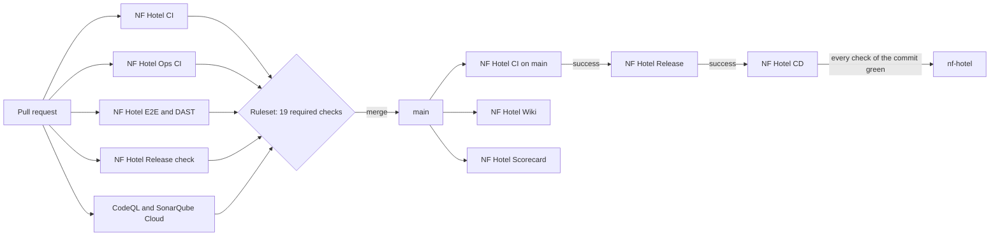

# Workflows

**Decisions:** [ADR-0007](https://github.com/NF-Hotel/NFHotel/blob/main/docs/adr/adr-0007-cicd-and-supply-chain.md), [ADR-0016](https://github.com/NF-Hotel/NFHotel/blob/main/docs/adr/adr-0016-one-repository-for-application-and-operations.md), [ADR-0021](https://github.com/NF-Hotel/NFHotel/blob/main/docs/adr/adr-0021-automatic-deploy-when-green.md). **Work:** MIL-021, MIL-022, MIL-027, MIL-036, MIL-049.

Every GitHub Actions workflow and composite action of NF Hotel: when it runs, what it checks, what it may do, why it exists and what else could have been used. For how to operate the pipeline (a deploy that does not start, a rollback), see [CI-CD](CI-CD). For the security controls behind the checks, see [Security Controls](Security-Controls).

## The path of a change

1. A pull request runs CI, Ops CI, E2E and DAST, the release check, CodeQL and SonarQube Cloud. The ruleset "Approve merges" requires 19 of these checks to be green before the merge.
2. The merge to `main` runs CI again. When it succeeds, `workflow_run` starts Release, which builds the four images once, scans them, pushes them to GHCR and attests them.
3. When Release succeeds, `workflow_run` starts CD. CD verifies the attestations, waits until every check of the commit is green, joins the tailnet and runs the deploy command on the VM.

**Why `workflow_run` and not one long workflow:** a pull request, and a fork in particular, never reaches the jobs that hold the package token or the tailnet identity. Release and CD run only for a push to `main` in this repository, and they check out exactly the commit that CI tested. The alternative, one workflow with `needs:` between the jobs, would give the pull-request jobs and the release jobs the same trigger, so the permissions would have to be guarded in every job.

## Rules every workflow follows

| Rule | Why | Checked by |
| --- | --- | --- |
| Every action is pinned by its full commit SHA, with the version in a comment | A tag can be moved to other code; a SHA cannot (OpenSSF Scorecard "Pinned-Dependencies") | actionlint and Dependabot, which proposes the next SHA |
| `permissions: contents: read` at the top; a job adds only what it needs | A stolen or misused job token can do only what its job needs | Scorecard "Token-Permissions"; review |
| `persist-credentials: false` on checkouts that do not push | The token is not left in `.git/config` for later steps | Review |
| A `timeout-minutes` on every job | A hung job does not hold a runner or a deploy for 6 hours | actionlint |
| `concurrency` per workflow and branch; `production` and `release` never cancel | A newer push cancels an older test run; a deploy is never stopped halfway | Review |
| No secret in a workflow except `SONAR_TOKEN`; Tailscale and GHCR use OIDC and the job token | Nothing long-lived to leak or rotate | Secret scanning; review |
| Logic lives in `ops/scripts/`, tested by Ops CI; workflows only wire it up | A script can be tested locally and in CI; YAML cannot | Ops CI |
| Comments and names in English | The PO language (BC-001) | The CI job "Comments are in English" |

## The workflows

### NF Hotel CI (`ci.yaml`)

| | |
| --- | --- |
| **Runs on** | Every pull request to `main`, every push to `main`, and by hand |
| **Jobs** | `Comments are in English`; `Build, tests and security`; `Formatting`; `Docker build` |
| **Checks** | No Danish comment; `dotnet restore --locked-mode` with NuGet audit of direct and transitive packages (any known vulnerability fails); build with warnings as errors; unit and integration tests (Testcontainers starts PostgreSQL); code coverage with `dotnet-coverage`; SonarQube Cloud analysis; `dotnet format` without changes; the web image builds |
| **Permissions** | `contents: read`. Secret `SONAR_TOKEN` (the analysis is skipped without it, for Dependabot and forks) |
| **Why** | The first gate: nothing reaches review that does not build and pass its tests. A successful run on `main` is what starts Release. |
| **Alternatives** | Azure DevOps or GitLab CI: the code, the issues and the reviews are on GitHub, so a second platform would need its own access and secrets. A self-hosted runner: rejected in ADR-0007, because untrusted code would run next to production. |
| **Decision** | ADR-0007; SonarQube Cloud inside the build job: ADR-0033 |

### NF Hotel Ops CI (`ops-ci.yaml`)

| | |
| --- | --- |
| **Runs on** | Every pull request to `main`, every push to `main`, and by hand |
| **Jobs** | `Ops linters`; `Ops wiki coverage`; `Ops script tests (<test>)`, one job per script test; `Ops host hardening`; `Ops monitoring configuration`; `Ops nginx routes`; `Ops benchmark results volume`; `Ops Proxmox tests`; `Ops PostgreSQL preparation`; `Ops team database roles`; `Ops secret rotation drill` |
| **Checks** | actionlint, shellcheck, shfmt and yamllint over every script, workflow and action; each script test in a clean `debian:12-slim` container; the Docker daemon, patching, host settings and the nftables firewall in Debian 13 and network namespaces; `promtool` checks and unit tests of the alert rules, and a real start of the monitoring stack and of Alloy; the nginx routes with and without the API route; the real EF Core migrations, the database roles, the backup and the restore against PostgreSQL 16; each secret rotated on a throwaway stack |
| **Permissions** | `contents: read`; no secret |
| **Why** | `ops/` changes production directly: the deploy command runs as root on the VM. Every script therefore has a test that runs on a clean system, so a change that would break the VM breaks a check first. |
| **Alternatives** | Test on the VM itself: it would change production to find out. Bats or a Python test runner: the tests are plain bash with the same tools as the scripts, so no extra framework is needed. |
| **Decision** | ADR-0012 and ADR-0016 (operations in this repository, tested here) |

The script tests are: `test-deploy-release.sh`, `test-cd-steps.sh`, `test-vm-setup.sh`, `test-scan-gate.sh`, `test-dast-rules.sh`, `test-deploy-services-env.sh`, `test-resolve-model-name.sh`, `test-switch-vm-checkout.sh`, `test-renew-certificate.sh`, `test-backup-target.sh`, `test-backup-settings.sh`, `test-dora-metrics.sh`, `test-report-health.sh`, `test-scan-running-release.sh`, `test-check-log-privacy.sh`, `test-publish-wiki.sh`, `test-create-monitoring-lxc.sh`, `test-write-secret-files.sh` and `test-check-secret-env.sh`. `Ops wiki coverage` runs `test-wiki-coverage.sh` on the runner, because it reads `.github/` and `docs/wiki/` and the script tests see only `ops/`.

### NF Hotel E2E and DAST (`e2e-dast.yaml`)

| | |
| --- | --- |
| **Runs on** | Pull requests and pushes to `main` (end-to-end tests and the DAST baseline); every Monday at 03:17 UTC and by hand (the DAST full scan) |
| **Jobs** | `End-to-end tests`; `DAST baseline`; `DAST full scan` |
| **Checks** | A throwaway stack (nginx with a self-signed certificate, web, API, PostgreSQL) is built from the commit. Playwright browser tests sign in and use the pages. The log privacy check fails when the test guest's personal data is in a log. OWASP ZAP scans the stack passively, signed out and signed in; weekly, it attacks it actively. A High alert that is not accepted in `ops/security/zap-rules.tsv` fails the job |
| **Permissions** | `contents: read`; `security-events: write` for the ZAP SARIF; `issues: write` for the full scan, which opens one issue when it fails |
| **Why** | Unit tests stop at the process boundary. These are the only tests of the whole stack as it runs in production, with the same images and compose files, and the only test that attacks it. The stack has no host port, so nothing outside the runner is scanned. |
| **Alternatives** | Selenium or Cypress instead of Playwright: Playwright has an official .NET library and a Docker image, so the tests are C# with xUnit like the others. Burp Suite or Nuclei instead of ZAP: ZAP is free, scriptable and has GitHub-ready baseline and full scans. Scanning production: rejected; a scan must never touch the VM, the tailnet or the public host. |
| **Decision** | MIL-027; staging replaced by this throwaway stack: ADR-0026; what reaches code scanning: ADR-0032 |

### NF Hotel Release check (`release-check.yaml`)

| | |
| --- | --- |
| **Runs on** | Every pull request to `main` |
| **Jobs** | `Release build (no push)` |
| **Checks** | The four release images build through the `release-images` action, pass the Trivy gate and carry the labels of the commit; nothing is pushed |
| **Permissions** | `contents: read`; no secret |
| **Why** | A change of a Dockerfile, a base image or `ops/` could break the release after the merge, when it is already on `main`. This shows it before the merge, with the same action as Release. |
| **Alternatives** | Build only in Release: a broken release would be found on `main`, and the deploy would stop until a fix is merged. |
| **Decision** | ADR-0016 |

### NF Hotel Release (`release.yaml`)

| | |
| --- | --- |
| **Runs on** | A successful NF Hotel CI run of a push to `main` in this repository (`workflow_run`) |
| **Jobs** | `Build and push images` |
| **Does** | Checks out the commit CI tested; builds `nfhotel-web`, `nfhotel-api`, `market-analysis` and `benchmark`; scans each with Trivy and stops on a blocking finding before any push; pushes them to `ghcr.io/nf-hotel/*` tagged `sha-<commit>`; attests the build provenance and the SBOM of each digest; uploads the scans to code scanning; keeps `release.json` (the commit and the four digests) and `migrations.sql` as the artifact `release-manifest` for 90 days |
| **Permissions** | `packages: write` (GHCR), `id-token: write` and `attestations: write` (provenance and SBOM), `security-events: write` (Trivy SARIF); no stored secret |
| **Why** | The image that runs in production is the one CI tested, built once, identified by its digest, with provenance aimed at SLSA Build Level 2. The VM never builds. |
| **Alternatives** | Build on the VM: the deployed image would never be the tested one, and provenance would be impossible. Docker Hub instead of GHCR: GHCR uses the job token, so no registry password is stored, and the packages belong to the organisation. |
| **Decision** | ADR-0007; Trivy, SBOM and provenance: MIL-022 |

### NF Hotel CD (`cd.yaml`)

| | |
| --- | --- |
| **Runs on** | A successful NF Hotel Release run of `main` (`workflow_run`); by hand with the run ID of an earlier release, to redeploy or roll back (a dry run unless `apply` is true), or as the rollback drill |
| **Jobs** | `Deploy to production`, in the environment `production` (only `main` may deploy) |
| **Does** | Reads the release manifest; verifies the provenance and SBOM attestations of each digest; waits up to 45 minutes until every check of the commit is green, and stops on any red one; joins the tailnet as an ephemeral node tagged `tag:ci` through GitHub OIDC; checks that only port 22 of the VM answers; runs `nfhotel-deploy` on the VM over Tailscale SSH, which updates its own commands from `main`, takes a backup, applies the migration script as `nfhotel_migrator`, deploys, waits for healthy containers, runs the smoke test and rolls back when it fails |
| **Permissions** | `id-token: write` (Tailscale OIDC), `attestations: read`, `packages: read`, `actions: read`, `checks: read`; no stored secret, no stored SSH key |
| **Why** | A green merge reaches production without a click, but only when everything is green, and only an attested image reaches it. Nothing inbound is opened on the VM. |
| **Alternatives** | A human approval per deploy (ADR-0007, ADR-0019): replaced, because the approval only confirmed what the checks had confirmed. Deploy when Release is green: a deploy could start while E2E or DAST were red. A nightly deploy: a fix would wait a day. SSH to a public address or a stored Tailscale key: a long-lived secret and an open port. A self-hosted runner on the VM: untrusted code next to production. |
| **Decision** | ADR-0007, ADR-0018 (the command updates itself), ADR-0021 (the gate) |

### NF Hotel running image scan (`running-image-scan.yaml`)

| | |
| --- | --- |
| **Runs on** | Every day at 05:17 UTC, and by hand (optionally with a test image) |
| **Jobs** | `Scan the release in production` |
| **Does** | Finds the release of the last successful CD run, pulls its four images by digest and scans them with today's Trivy database. A finding opens an issue, or adds to the open one; a clean scan closes it. The run itself stays green |
| **Permissions** | `actions: read`, `packages: read`, `issues: write` |
| **Why** | An image is scanned when it is built, but a vulnerability published after the deploy would wait for the next release. This finds it within a day. The run stays green because the CD gate refuses a commit with a red check, so a red scan would block the release that fixes the finding (2026-10-24). |
| **Alternatives** | Not decided in an ADR. A scanner on the VM would be one more privileged agent in production; a hosted scanner such as Docker Scout or Snyk would need a second account and a token. The workflow reuses the Trivy gate of the release, so a finding means the same in both places. |
| **Decision** | MIL-036 task 1 |

### NF Hotel load test (`load-test.yaml`)

| | |
| --- | --- |
| **Runs on** | Every Wednesday at 02:40 UTC, and by hand before a large release |
| **Jobs** | `Load test of a throwaway stack` |
| **Checks** | k6 opens the public pages and the staff sign-in with 20 virtual guests and fails when the objectives of MIL-034 break under that load: 95 % of the requests within 1 second, fewer than 5 % failed |
| **Permissions** | `contents: read`; no secret |
| **Why** | The objectives are measured in production, but a slow change should be found before it reaches the guests, and without loading the VM. |
| **Alternatives** | Not decided in an ADR. JMeter, Locust and Gatling are common alternatives; k6 needs no JVM or Python environment, runs from one Docker image and writes thresholds in the script. |
| **Decision** | MIL-036 task 3 |

### NF Hotel Scorecard (`scorecard.yaml`)

| | |
| --- | --- |
| **Runs on** | Pushes to `main`, a change of the branch protection, every Tuesday, and by hand |
| **Jobs** | `Scorecard analysis` |
| **Does** | OpenSSF Scorecard scores the repository (pinned dependencies, token permissions, branch protection, SAST, dangerous workflows and more), uploads the result to code scanning and publishes it to the Scorecard API |
| **Permissions** | `security-events: write`, `id-token: write` (signs the published result), `actions: read` |
| **Why** | An outside, repeatable measure of the repository's security posture; a finding shows in code scanning beside the others. |
| **Alternatives** | A hand-made checklist: not repeatable and not comparable with other projects. |
| **Decision** | MIL-023 task 5; findings that score a decision are dismissed with the reason: ADR-0032 |

### NF Hotel Wiki (`publish-wiki.yaml`)

| | |
| --- | --- |
| **Runs on** | Pushes to `main` that change `docs/wiki/`, the publish script or this workflow; by hand |
| **Jobs** | `Publish docs/wiki to the GitHub wiki` |
| **Does** | Makes the GitHub wiki equal to `docs/wiki/`: adds, changes and removes pages in one commit that names the source commit |
| **Permissions** | `contents: write`, which GitHub requires to push to the wiki |
| **Why** | The pages are reviewed with the code they describe, and the wiki follows within a minute. |
| **Alternatives** | Copying by hand (it drifted within days); writing in the wiki only (no review); dropping the wiki (readers lose the sidebar). |
| **Decision** | ADR-0022 |

## The composite actions

The workflows keep the trigger, the permissions, the environment and the concurrency, which a composite action cannot set. The steps are in four local actions in `.github/actions/`, so the same steps run in a pull request and in the release.

| Action | Used by | Does |
| --- | --- | --- |
| `release-images` | Release, Release check | Builds the four images, scans each with Trivy before any push (`ops/scripts/scan-gate.sh`), and with `push` pushes them, attests provenance and SBOM, and writes `release.json` and `migrations.sql` |
| `deploy-release` | CD | Checks the release run, reads the manifest, verifies the attestations, waits for every check (`ops/scripts/cd-steps.sh gate`), joins the tailnet, checks its scope and runs the deploy over Tailscale SSH; writes the audit summary |
| `e2e-tests` | E2E and DAST | Starts the throwaway stack, runs the Playwright tests, checks the logs for the test guest's personal data, uploads the results and removes the stack |
| `dast-scan` | E2E and DAST | Starts the throwaway stack, runs the ZAP baseline or full scan, uploads HTML, JSON and SARIF reports and removes the stack |

**Why composite actions and not reusable workflows:** a reusable workflow would need a second checkout to reach the scripts, at a ref that cannot be tied to the `uses:` ref (ADR-0012, option 3). Composite actions run in the caller's job and read the scripts from the same checkout.

## GitHub settings that work with the workflows

| Setting | What it does | Why |
| --- | --- | --- |
| Ruleset **Approve merges** on `main` | A pull request is required, no force push, no deletion, and 19 checks must pass: `Build, tests and security`, `Formatting`, `Docker build`, `End-to-end tests`, `DAST baseline`, `Release build (no push)`, `Ops linters`, `Ops nginx routes`, `Ops Proxmox tests (live tests skip)`, `Ops PostgreSQL preparation (real migrations)` and nine `Ops script tests` | No change reaches `main` without the checks; no approving review is required (ADR-0019) |
| Environment **production** | Only `main` may deploy; holds the tailnet settings `TS_OIDC_CLIENT_ID`, `TS_OIDC_AUDIENCE` and `NFHOTEL_VM_HOST` | A branch cannot deploy; the settings are not secrets, because OIDC proves who asks |
| **CodeQL** default setup | Static analysis of C#, JavaScript and TypeScript, and of the workflows themselves (`actions`), on every pull request and push | Finds injection and unsafe workflow patterns; managed by GitHub, so there is no workflow to maintain |
| **SonarQube Cloud** app | Reports the quality gate as the check `SonarCloud Code Analysis`; new code needs 80 % coverage | The analysis runs in CI (ADR-0033); the CD gate waits for this check too |
| **Dependabot** (`.github/dependabot.yml`) | Weekly pull requests for NuGet, Dockerfiles, compose images and actions, with a 7-day cooldown; security updates at once | Everything is pinned, so something must propose the next pin. The cooldown gives a compromised release a week to be found first. A new major of PostgreSQL is ignored, because it needs a dump and restore |
| **Secret scanning** with push protection | Refuses a push that contains a known secret format | A leaked token is stopped before it is in the history |
| **CODEOWNERS** | Names the owners of each path | Shows who should look at a change of `ops/` or the workflows |

## When something changes

- **A new workflow or composite action:** add a section to this page. `ops/tests/test-wiki-coverage.sh` fails in Ops CI until the page names it.
- **A new required check:** add it to the ruleset and to the list above, and say so in the pull request.
- **A new secret:** avoid it. Prefer OIDC or the job token. If one is unavoidable, it needs an ADR, an entry on [Environment Files](Environment-Files) and a rotation procedure.
